# Revisão visual dos acertos perdidos pelo INT8 oficial — T8.1

Inspeção das sete fotos originais e das respectivas entradas T4.1 de 224 × 224 pixels. As observações são preliminares; a validação taxonômica está pendente.

Observações descrevem o conteúdo visível. As hipóteses não demonstram a causa da mudança de predição; não houve nova inferência, alteração de rótulos, pesos, limiares ou conjunto de teste.

Foram inspecionados todos os sete casos selecionados pelas previsões, sem seleção por aparência. Os originais foram conferidos por SHA-256; cada caso foi observado também após T4.1. O rótulo real é o histórico do dataset, sem revalidação de espécie.

| ID | Rótulo real / Keras | INT8 oficial | Observação na entrada |
| --- | --- | --- | --- |
| IMG_00263 | Astylus variegatus | Percevejo-barriga-verde (Dichelops/Diceraeus) | Em 224x224 o inseto permanece visível, mas detalhes do padrão e das antenas ficam reduzidos em meio à textura das folhas. |
| IMG_01540 | Vaquinha (Diabrotica speciosa) | Cigarrinha-das-pastagens (Deois flavopicta) | O inseto ocupa uma região pequena no alto da entrada; o padrão amarelo do corpo fica pouco detalhado após o redimensionamento. |
| IMG_01741 | Vaquinha (Diabrotica speciosa) | Astylus variegatus | Em 224x224 o inseto fica difícil de distinguir do conjunto de flores; o fundo floral continua visualmente dominante. |
| IMG_01812 | Vaquinha (Diabrotica speciosa) | Percevejo-verde (Nezara viridula) | A preservação da proporção gera faixas cinzas laterais largas. O inseto ocupa poucos pixels na junção das folhas e parte do contorno permanece encoberta. |
| IMG_02004 | Vaquinha (Diabrotica speciosa) | Cigarrinha-das-pastagens (Deois flavopicta) | Após redimensionar, o inseto permanece pequeno e os detalhes de cor e marcação são limitados. |
| IMG_02168 | Percevejo-barriga-verde (Dichelops/Diceraeus) | Vaquinha (Diabrotica speciosa) | Em 224x224 a faixa e a foto inserida continuam presentes; os detalhes dos insetos ficam reduzidos. Há mais de uma região com sujeito na mesma entrada. |
| IMG_02637 | Lagarta-do-cartucho (Spodoptera frugiperda) | Lagarta-falsa-medideira (Chrysodeixis includens) | A silhueta alada permanece visível e ocupa área relevante do quadro. A textura do fundo e partes escuras das asas se aproximam visualmente. |

## Imagens inspecionadas

Fonte: acervo de Dados do projeto. As cópias abaixo foram redimensionadas, sem recorte, para apresentação; não substituem os originais conferidos por SHA-256 nem a entrada T4.1.

### IMG_00263

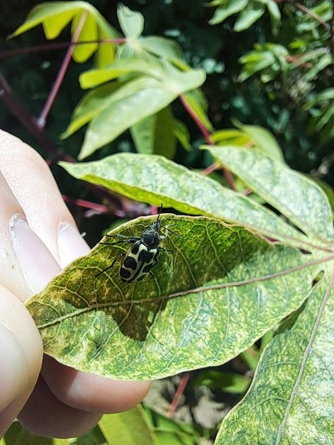

Rótulo histórico e Keras: Astylus variegatus. INT8 oficial: Percevejo-barriga-verde (Dichelops/Diceraeus).

### IMG_01540

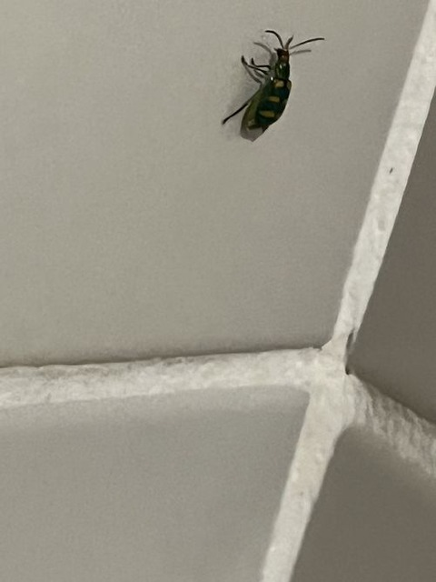

Rótulo histórico e Keras: Vaquinha (Diabrotica speciosa). INT8 oficial: Cigarrinha-das-pastagens (Deois flavopicta).

### IMG_01741

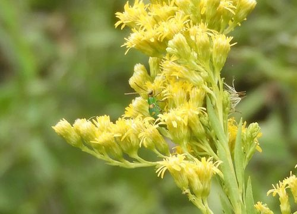

Rótulo histórico e Keras: Vaquinha (Diabrotica speciosa). INT8 oficial: Astylus variegatus.

### IMG_01812

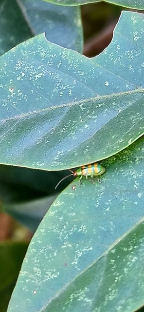

Rótulo histórico e Keras: Vaquinha (Diabrotica speciosa). INT8 oficial: Percevejo-verde (Nezara viridula).

### IMG_02004

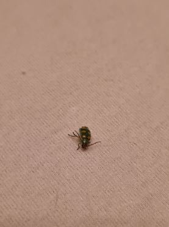

Rótulo histórico e Keras: Vaquinha (Diabrotica speciosa). INT8 oficial: Cigarrinha-das-pastagens (Deois flavopicta).

### IMG_02168

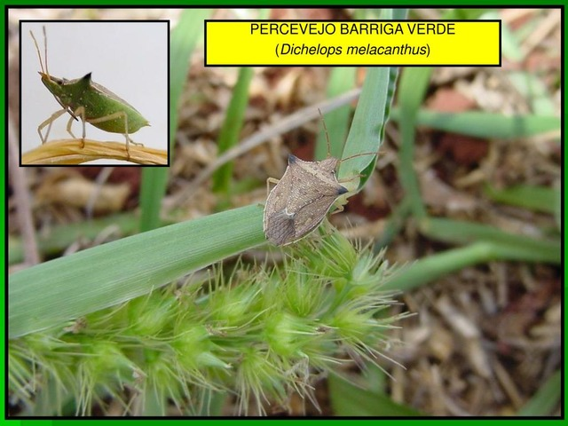

Rótulo histórico e Keras: Percevejo-barriga-verde (Dichelops/Diceraeus). INT8 oficial: Vaquinha (Diabrotica speciosa).

### IMG_02637

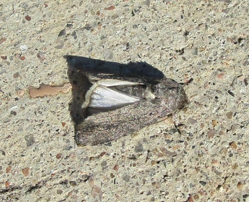

Rótulo histórico e Keras: Lagarta-do-cartucho (Spodoptera frugiperda). INT8 oficial: Lagarta-falsa-medideira (Chrysodeixis includens).

## Fotos originais e entradas do modelo

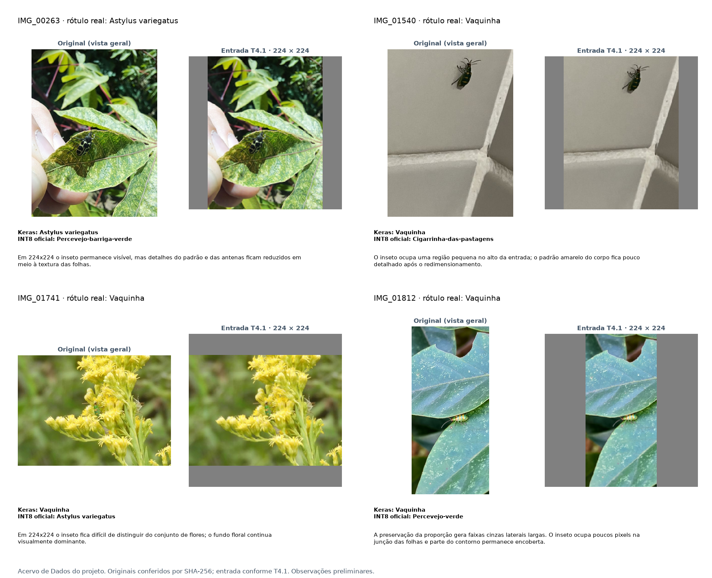

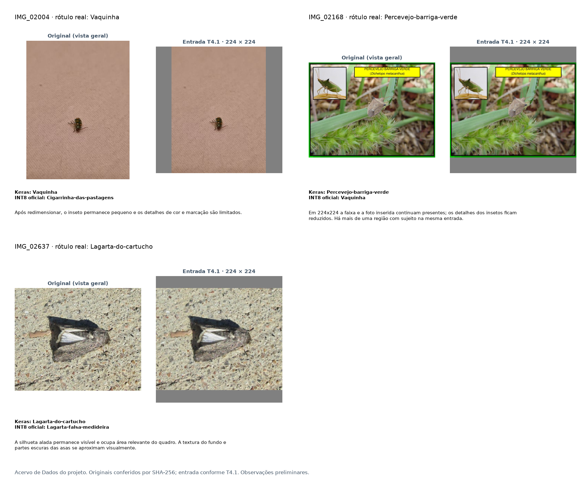

O arquivo revisao_visual.csv reúne observações, hipóteses, hashes e verificações sugeridas. IMG_02168 contém uma montagem com texto; IMG_02637 apresenta um adulto alado aparente. Ambos os casos ficam registrados para revisão da frente de Dados. Os rótulos do teste foram preservados.

## Gráficos

### Figura 1 — Matriz de confusão: Keras original (T5.6/T6.1)

Fonte: previsões da T7.2, consolidadas na T8.1 (2026).

### Figura 2 — Matriz de confusão: INT8 oficial (T7.3)

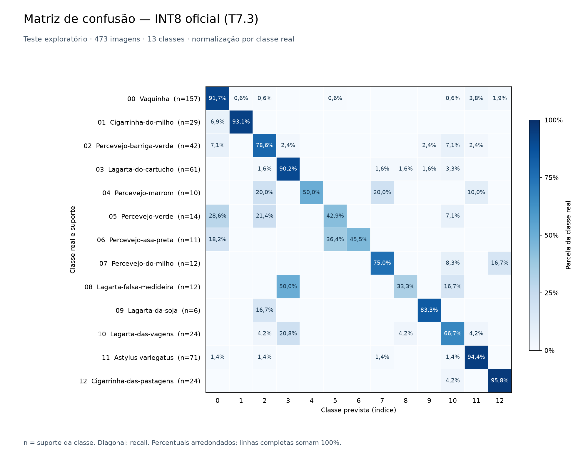

Fonte: previsões da T7.2, consolidadas na T8.1 (2026).

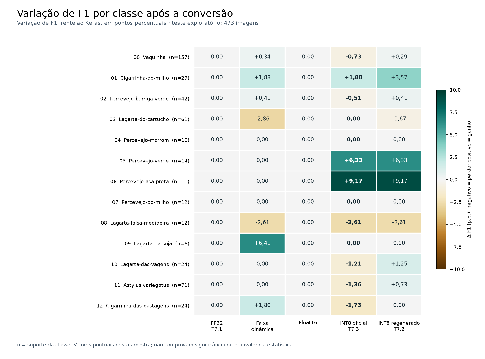

As matrizes são normalizadas por linha e usam a mesma escala de cores. O mapa de F1 inclui as cinco conversões frente ao Keras, em pontos percentuais. Suporte e valores exatos estão nos CSVs; os gráficos não indicam significância estatística.
