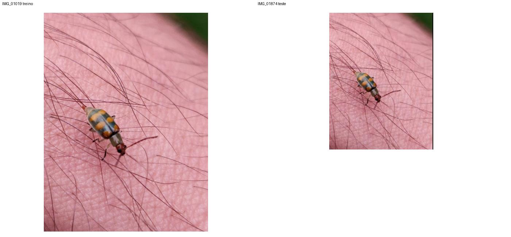
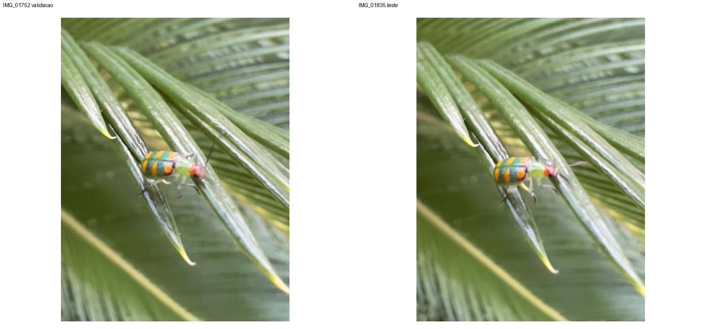

# Revisão da independência dos conjuntos de dados

Revisão realizada em 13/11/2026 sobre o índice efetivamente utilizado pelo candidato EfficientNet-Lite0 de 26/10/2026. Autor responsável pela entrega, Rui. Revisora prevista, Ana Célia. A revisão humana permanece pendente. A inspeção dos 45 pares foi assistida por IA e está registrada por imagem.

## Decisão sobre a avaliação

O índice histórico fica preservado para rastrear o treinamento e as avaliações existentes. Seus resultados devem ser identificados como **exploratórios**, inclusive quando uma nova conversão ou um novo build for executado sobre essas mesmas imagens.

A decisão considera a duplicata transformada entre treino e teste, uma relação suspeita entre validação e teste e a consulta prévia ao teste durante o desenvolvimento. A validação também participou da seleção de checkpoint e do limiar de confiança. A magnitude do efeito dessas limitações nas métricas permanece desconhecida.

São usos possíveis a comparação descritiva de versões no mesmo recorte, os testes de regressão e a análise de erros. Uma demonstração deve identificar seus exemplos e mantê-los separados de qualquer avaliação futura reservada. Os resultados disponíveis não comprovam generalização em novas observações.

A [decisão estruturada](decisao_avaliacao.json) vincula essas orientações ao hash do índice e ao [resumo reproduzido](resumo.json). Nenhum novo conjunto independente, acompanhado de manifesto e evidência de reserva anterior à avaliação, foi identificado nesta revisão.

## Recorte conferido

| Item | Resultado |
| --- | ---: |
| Imagens verificadas por SHA-256 e abertura | 3.156 |
| Treino | 2.209 |
| Validação | 474 |
| Teste histórico | 473 |
| Imagens iNaturalist com ID de observação localizado | 1.792 |
| Imagens AgroInsect | 1.364 |
| Grupos registrados compartilhados entre partições | 0 |
| SHA-256 de arquivo compartilhado entre partições | 0 |
| SHA-256 de pixels RGB/EXIF compartilhado entre partições | 0 |
| IDs de observação iNaturalist compartilhados entre partições | 0 |
| Pares perceptualmente próximos entre partições | 45 |
| Pares com duplicata confirmada | 1 |
| Pares com relação suspeita | 1 |
| Pares sem vínculo confirmado na inspeção | 43 |

O índice `assets/data/treino_T5_2/indice_dataset.csv` tem SHA-256 `28ee662885202f0bda3dec9660e44b28f99b8bd183210bcbdd795b103269b2eb`. O manifesto do candidato vincula esse mesmo hash ao treinamento. O recorte tem 13 classes e difere dos manifestos históricos de 3.163 imagens.

Os zeros nas verificações exatas descrevem as chaves disponíveis. A fotografia repetida sobreviveu a essas verificações porque as versões possuem arquivos, dimensões e grupos distintos. A ausência de ID de observação no AgroInsect também limita o rastreamento entre fontes.

## Casos e grupos relacionados

| Grupo da revisão | Imagens e partições | Evidência | Decisão para uma próxima versão do dataset |
| --- | --- | --- | --- |
| `REV-IMG_01019` | `IMG_01019` e `IMG_01020` em treino, `IMG_01874` em teste | `IMG_01019` e `IMG_01874` mostram a mesma fotografia de vaquinha sobre pele, com pelos e posições coincidentes. `IMG_01020` é outra foto da observação iNaturalist `142398716`. | Vincular a cópia e toda a observação à mesma unidade de partição. |
| `REV-IMG_01752` | `IMG_01752` em validação e `IMG_01835` em teste | Forte semelhança de cena, posição do inseto e nervuras das folhas. Mantida a classificação de relação suspeita da auditoria. | Agrupar preventivamente em uma próxima versão até esclarecer a origem. |





As figuras foram extraídas do pacote fornecido da auditoria e identificadas por hash em [origem_auditoria.json](origem_auditoria.json). Os originais correspondentes foram novamente abertos e conferidos contra o índice nesta revisão.

O [registro dos grupos](grupos_relacionados.csv) contém as cinco imagens afetadas, os grupos anteriores, caminhos e hashes originais. O agrupamento da revisão inclui vínculos de observação e uma associação preventiva. A presença em um grupo não afirma que todas as suas imagens sejam cópias da mesma fotografia.

Os outros 43 pares têm justificativas individuais em [pares_revisados.csv](pares_revisados.csv). Entre eles há insetos distintos com distância perceptual zero, mostrando que o hash perceptual precisa de inspeção. Fotos distintas podem pertencer a uma mesma sessão ainda sem metadados. A classificação `sem_vinculo_confirmado` expressa esse limite.

## Método e alcance

1. Conferir o hash do índice com o manifesto do candidato e o SHA-256 de cada original.
2. Aplicar EXIF, converter para RGB e calcular o hash das dimensões e dos pixels decodificados.
3. Para a triagem perceptual, converter para cinza, redimensionar para 32 × 32 com Lanczos, aplicar DCT-II e binarizar as 64 frequências iniciais pela mediana, incluindo DC.
4. Comparar todos os pares entre partições com distância de Hamming até 6. Essa regra reproduziu os 45 pares e suas distâncias do arquivo da auditoria.
5. Inspecionar visualmente os 45 pares sem consultar previsões do modelo e registrar confirmação, suspeita ou ausência de vínculo confirmado.
6. Expandir os vínculos confirmados e suspeitos pelos grupos existentes e IDs de observação conhecidos.

A busca é limitada ao recorte selecionado e à assinatura definida. Recortes fortes, rotações, espelhamentos e fotografias diferentes de uma mesma sessão podem escapar do limiar. Os metadados disponíveis também não identificam todas as relações por indivíduo, sessão, propriedade ou origem. A execução integral confirma a integridade do recorte e reproduz a triagem, com essas limitações.

## Tratamento na avaliação final

- Identificar cada resultado como avaliação exploratória sobre o teste histórico, com 473 imagens quando utilizado integralmente.
- Informar modelo/hash, build ou código, runtime, preprocessing, índice/hash, partição e suporte por classe. A correção do preprocessing e a escolha do build final precisam estar vinculadas à avaliação correspondente.
- Referenciar os pares e grupos registrados, a consulta prévia ao teste e a incerteza sobre outras relações entre fotos.
- Se houver análise excluindo imagens relacionadas, publicar a regra e a lista de IDs removidos, os novos suportes e os resultados integrais ao lado. Tratar essa análise como sensibilidade retrospectiva.
- Reservar conclusões de generalização para um novo conjunto representativo cuja separação anterior à avaliação esteja documentada.

Excluir `IMG_01874` do relatório atual não desfaz sua exposição durante o desenvolvimento. Reparticionar as imagens depois da escolha do modelo também não produz automaticamente uma avaliação independente.

## Protocolo para eventual novo teste

Antes da avaliação, preparar manifesto com IDs, SHA-256, rótulos revisados, estágios quando disponíveis, fonte, observação e unidade de agrupamento. Comparar as novas imagens com treino, validação, teste histórico, calibração e exemplos de demonstração, incluindo busca visual de cópias transformadas. Decidir sobre as relações antes de executar predições.

Versionar o manifesto e seu hash com data e registro da reserva. Congelar o modelo, preprocessing e política de confiança antes da abertura dos resultados. Preservar o registro de quem teve acesso ao conjunto e das avaliações executadas. Consultar o conjunto para ajustar o modelo, o limiar ou selecionar exemplos exige registrar essa exposição e rever a alegação de independência. Dimensionamento, classes e condições de captura precisam representar o uso acordado com o parceiro.

## Reprodução

Executar na raiz do repositório com o ambiente de `requirements-treino.txt`. A execução registrada utilizou Python 3.12.15, Pillow 12.2.0, NumPy 2.4.4 e SciPy 1.18.1. O SciPy, instalado com scikit-learn, deve ser fixado para reproduzir a assinatura desta revisão.

```bash
python -m pip install scipy==1.18.1
python -m src.independencia_t10_1 --acervo /caminho/que/contem/dataset --saida .work/reproducao_independencia
python -m unittest discover -s tests -p validar_independencia_t10_1.py
```

O acervo precisa conter `dataset/field/field_labels.csv` e os 3.156 arquivos do índice. Sem `--saida`, o comando atualiza os quatro CSVs gerados e `resumo.json` nesta pasta. `revisao_visual.csv` é a entrada de inspeção e deve receber revisão humana quando houver alteração dos pares. O comando recusa um conjunto de revisões que deixe pares sem cobertura ou acrescente pares alheios à triagem. Índice, partições, pesos e métricas permanecem como entradas históricas.

## Artefatos

- `assinaturas_imagens.csv` registra origem, partição, grupos, observações e assinaturas das 3.156 imagens.
- `sobreposicoes_exatas.csv` registra sobreposições por chaves e pixels, com apenas cabeçalho nesta execução.
- `candidatos_auditoria.csv` preserva o arquivo original de 45 pares recebido na auditoria.
- `revisao_visual.csv` registra as decisões de inspeção usadas pelo comando.
- `pares_revisados.csv` combina a triagem reproduzida e as decisões registradas.
- `grupos_relacionados.csv` expande os vínculos pelas observações e grupos conhecidos.
- `resumo.json` registra contagens, método, ambiente e hashes dos artefatos gerados.
- `decisao_avaliacao.json` registra a decisão sobre o histórico e o estado da reserva de um novo teste.
- `origem_auditoria.json` registra a procedência dos extratos e o estado da revisão humana.
