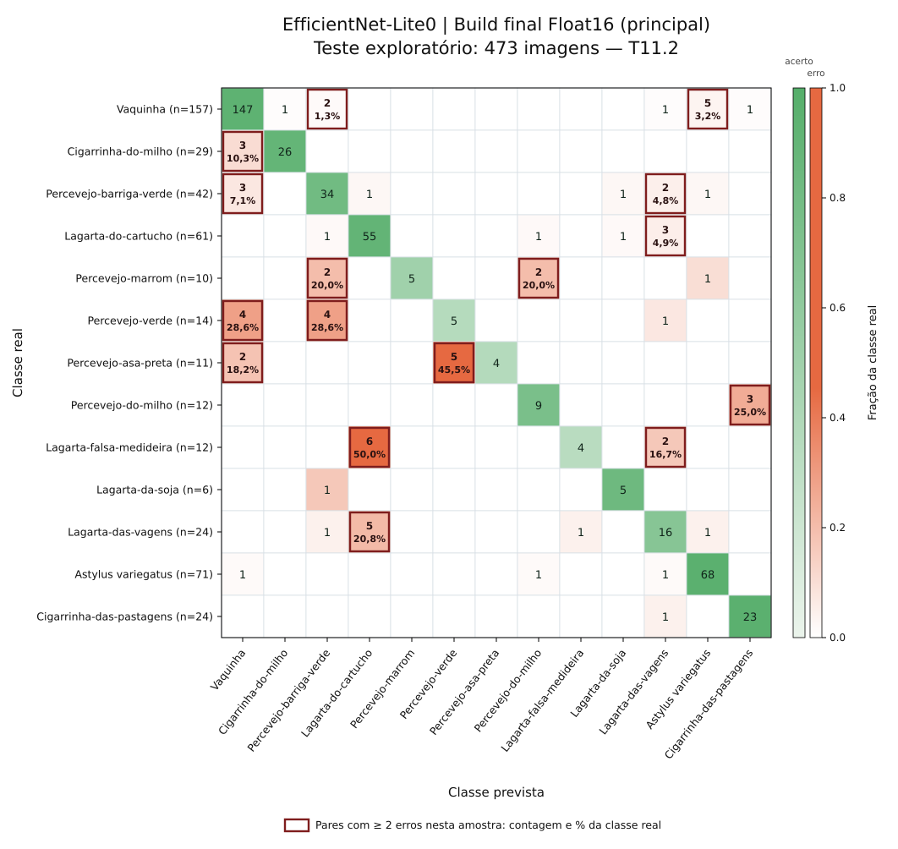

# T11.2 — Matriz de confusão e análise de erros

Relatório gerado por [`matriz_erros_t11_2.py`](../src/matriz_erros_t11_2.py) a partir das predições da [T11.1](Avaliacao_Final_T11_1.md) (build entregue, versão 1.0.0); artefatos em [`assets/data/matriz_erros_T11_2`](../assets/data/matriz_erros_T11_2/matrizes.json).

> **Classificação: análise exploratória.** O teste histórico já foi consultado no desenvolvimento e não é um conjunto independente ([T10.1](../assets/data/independencia_T10_1/README.md)). As matrizes descrevem o comportamento do build nesse recorte; não estimam desempenho em fotos novas de campo.

## Resumo

- Resultado de referência: **Float16 (principal) no teste histórico**, 473 imagens, 401 acertos e **72 erros** (acurácia 0,8478).
- Os 72 erros formam 35 pares direcionais (real → previsto); 16 deles têm pelo menos 2 erros e reúnem 53 imagens.
- Os erros vêm de **34 observações do iNaturalist e 19 fotos do AgroInsect** (estas sem identificador de observação). 52 dos 72 erros têm score ≥ 0,65 e, portanto, seriam mostrados ao usuário como hipótese principal.
- 4 das 13 classes têm F1 ou recall abaixo de 0,60: Percevejo-marrom; Percevejo-verde; Percevejo-asa-preta; Lagarta-falsa-medideira.
- Os 53 erros em fotos do iNaturalist vêm de 34 observações (1,56 por observação); 10 observações têm mais de um erro e reúnem 29 deles. Contar erros por foto superestima o número de ocorrências independentes.
- 37 dos 72 erros (51,4%) ocorrem entre classes do mesmo tipo de inseto (percevejos, lagartas, besouros ou cigarrinhas). Os outros 35 cruzam tipos, e 17 deles envolvem a Vaquinha, a classe com mais imagens.
- Entre as 13 classes, o F1 tem correlação de 0,64 com o logaritmo do número de fotos de treino (Pearson, n = 13): classes com menos fotos tendem a ir pior, mas 13 pontos não permitem concluir causa.

## Matriz de confusão — Float16 (principal), teste histórico

Linhas: classe real; colunas: classe prevista (índices da tabela de classes abaixo). Diagonal em negrito. É a mesma matriz da T11.1, reproduzida aqui das predições; o teste confere a igualdade.

| Real \ Prevista | 0 | 1 | 2 | 3 | 4 | 5 | 6 | 7 | 8 | 9 | 10 | 11 | 12 | Suporte |
| ---: | ---: | ---: | ---: | ---: | ---: | ---: | ---: | ---: | ---: | ---: | ---: | ---: | ---: | ---: |
| **0** | **147** | 1 | 2 | · | · | · | · | · | · | · | 1 | 5 | 1 | 157 |
| **1** | 3 | **26** | · | · | · | · | · | · | · | · | · | · | · | 29 |
| **2** | 3 | · | **34** | 1 | · | · | · | · | · | 1 | 2 | 1 | · | 42 |
| **3** | · | · | 1 | **55** | · | · | · | 1 | · | 1 | 3 | · | · | 61 |
| **4** | · | · | 2 | · | **5** | · | · | 2 | · | · | · | 1 | · | 10 |
| **5** | 4 | · | 4 | · | · | **5** | · | · | · | · | 1 | · | · | 14 |
| **6** | 2 | · | · | · | · | 5 | **4** | · | · | · | · | · | · | 11 |
| **7** | · | · | · | · | · | · | · | **9** | · | · | · | · | 3 | 12 |
| **8** | · | · | · | 6 | · | · | · | · | **4** | · | 2 | · | · | 12 |
| **9** | · | · | 1 | · | · | · | · | · | · | **5** | · | · | · | 6 |
| **10** | · | · | 1 | 5 | · | · | · | · | 1 | · | **16** | 1 | · | 24 |
| **11** | 1 | · | · | · | · | · | · | 1 | · | · | 1 | **68** | · | 71 |
| **12** | · | · | · | · | · | · | · | · | · | · | 1 | · | **23** | 24 |



### Matriz normalizada por classe real (recall na diagonal)

| Real \ Prevista | 0 | 1 | 2 | 3 | 4 | 5 | 6 | 7 | 8 | 9 | 10 | 11 | 12 | Suporte |
| ---: | ---: | ---: | ---: | ---: | ---: | ---: | ---: | ---: | ---: | ---: | ---: | ---: | ---: | ---: |
| **0** | **93,6%** | 0,6% | 1,3% | · | · | · | · | · | · | · | 0,6% | 3,2% | 0,6% | 157 |
| **1** | 10,3% | **89,7%** | · | · | · | · | · | · | · | · | · | · | · | 29 |
| **2** | 7,1% | · | **81,0%** | 2,4% | · | · | · | · | · | 2,4% | 4,8% | 2,4% | · | 42 |
| **3** | · | · | 1,6% | **90,2%** | · | · | · | 1,6% | · | 1,6% | 4,9% | · | · | 61 |
| **4** | · | · | 20,0% | · | **50,0%** | · | · | 20,0% | · | · | · | 10,0% | · | 10 |
| **5** | 28,6% | · | 28,6% | · | · | **35,7%** | · | · | · | · | 7,1% | · | · | 14 |
| **6** | 18,2% | · | · | · | · | 45,5% | **36,4%** | · | · | · | · | · | · | 11 |
| **7** | · | · | · | · | · | · | · | **75,0%** | · | · | · | · | 25,0% | 12 |
| **8** | · | · | · | 50,0% | · | · | · | · | **33,3%** | · | 16,7% | · | · | 12 |
| **9** | · | · | 16,7% | · | · | · | · | · | · | **83,3%** | · | · | · | 6 |
| **10** | · | · | 4,2% | 20,8% | · | · | · | · | 4,2% | · | **66,7%** | 4,2% | · | 24 |
| **11** | 1,4% | · | · | · | · | · | · | 1,4% | · | · | 1,4% | **95,8%** | · | 71 |
| **12** | · | · | · | · | · | · | · | · | · | · | 4,2% | · | **95,8%** | 24 |

Com suportes de 6 a 157 imagens, um erro move o percentual da menor classe em até 16,7 pontos; as porcentagens das classes pequenas são instáveis.

### Classes

| Índice | Classe | Suporte (teste) | Treino: fotos / grupos | Recall | Precisão | F1 | Erros (FN) | Falsos positivos (FP) |
| ---: | --- | ---: | ---: | ---: | ---: | ---: | ---: | ---: |
| 0 | Vaquinha (Diabrotica speciosa) | 157 | 735 / 592 | 0,94 | 0,92 | 0,93 | 10 | 13 |
| 1 | Cigarrinha-do-milho (Dalbulus maidis) | 29 | 135 / 135 | 0,90 | 0,96 | 0,93 | 3 | 1 |
| 2 | Percevejo-barriga-verde (Dichelops/Diceraeus) | 42 | 198 / 189 | 0,81 | 0,76 | 0,78 | 8 | 11 |
| 3 | Lagarta-do-cartucho (Spodoptera frugiperda) | 61 | 285 / 250 | 0,90 | 0,82 | 0,86 | 6 | 12 |
| 4 | Percevejo-marrom (Euschistus heros) | 10 | 45 / 31 | 0,50 | 1,00 | 0,67 | 5 | 0 |
| 5 | Percevejo-verde (Nezara viridula) | 14 | 64 / 33 | 0,36 | 0,50 | 0,42 | 9 | 5 |
| 6 | Percevejo-asa-preta (Edessa meditabunda) | 11 | 53 / 18 | 0,36 | 1,00 | 0,53 | 7 | 0 |
| 7 | Percevejo-do-milho (Leptoglossus zonatus) | 12 | 55 / 21 | 0,75 | 0,69 | 0,72 | 3 | 4 |
| 8 | Lagarta-falsa-medideira (Chrysodeixis includens) | 12 | 55 / 26 | 0,33 | 0,80 | 0,47 | 8 | 1 |
| 9 | Lagarta-da-soja (Anticarsia gemmatalis) | 6 | 28 / 20 | 0,83 | 0,71 | 0,77 | 1 | 2 |
| 10 | Lagarta-das-vagens (Spodoptera eridania e S. cosmioides) | 24 | 110 / 45 | 0,67 | 0,59 | 0,63 | 8 | 11 |
| 11 | Astylus variegatus | 71 | 332 / 182 | 0,96 | 0,89 | 0,93 | 3 | 8 |
| 12 | Cigarrinha-das-pastagens (Deois flavopicta) | 24 | 114 / 47 | 0,96 | 0,85 | 0,90 | 1 | 4 |

## Principais confusões

Pares direcionais com pelo menos 2 erros no Float16, teste histórico. "Obs." conta observações distintas do iNaturalist; "Agro" conta fotos do AgroInsect, que não têm esse identificador. "Aceitos" são erros com score ≥ 0,65. "INT8" é quantos desses erros o INT8 repete com a mesma classe prevista; "T6.3" é o número de erros do mesmo par no candidato Keras FP32.

| Real → Prevista | Erros / suporte | % da classe | Obs. | Agro | Aceitos | Score médio / máx. | INT8 | T6.3 |
| --- | ---: | ---: | ---: | ---: | ---: | ---: | ---: | ---: |
| Lagarta-falsa-medideira (Chrysodeixis includens) → Lagarta-do-cartucho (Spodoptera frugiperda) | 6 / 12 | 50,0% | 5 | 0 | 5 | 0,84 / 1,00 | 6 | 6 |
| Vaquinha (Diabrotica speciosa) → Astylus variegatus | 5 / 157 | 3,2% | 3 | 1 | 5 | 0,86 / 0,99 | 5 | 5 |
| Percevejo-asa-preta (Edessa meditabunda) → Percevejo-verde (Nezara viridula) | 5 / 11 | 45,5% | 1 | 0 | 4 | 0,82 / 1,00 | 4 | 5 |
| Lagarta-das-vagens (Spodoptera eridania e S. cosmioides) → Lagarta-do-cartucho (Spodoptera frugiperda) | 5 / 24 | 20,8% | 5 | 0 | 3 | 0,80 / 1,00 | 5 | 5 |
| Percevejo-verde (Nezara viridula) → Vaquinha (Diabrotica speciosa) | 4 / 14 | 28,6% | 3 | 0 | 3 | 0,82 / 1,00 | 3 | 4 |
| Percevejo-verde (Nezara viridula) → Percevejo-barriga-verde (Dichelops/Diceraeus) | 4 / 14 | 28,6% | 1 | 0 | 2 | 0,71 / 0,97 | 3 | 4 |
| Cigarrinha-do-milho (Dalbulus maidis) → Vaquinha (Diabrotica speciosa) | 3 / 29 | 10,3% | 0 | 3 | 2 | 0,75 / 0,97 | 2 | 3 |
| Percevejo-barriga-verde (Dichelops/Diceraeus) → Vaquinha (Diabrotica speciosa) | 3 / 42 | 7,1% | 0 | 3 | 2 | 0,71 / 0,85 | 2 | 3 |
| Lagarta-do-cartucho (Spodoptera frugiperda) → Lagarta-das-vagens (Spodoptera eridania e S. cosmioides) | 3 / 61 | 4,9% | 0 | 3 | 1 | 0,65 / 0,78 | 2 | 3 |
| Percevejo-do-milho (Leptoglossus zonatus) → Cigarrinha-das-pastagens (Deois flavopicta) | 3 / 12 | 25,0% | 2 | 0 | 2 | 0,65 / 0,96 | 2 | 3 |
| Vaquinha (Diabrotica speciosa) → Percevejo-barriga-verde (Dichelops/Diceraeus) | 2 / 157 | 1,3% | 1 | 0 | 1 | 0,66 / 0,83 | 1 | 2 |
| Percevejo-barriga-verde (Dichelops/Diceraeus) → Lagarta-das-vagens (Spodoptera eridania e S. cosmioides) | 2 / 42 | 4,8% | 0 | 2 | 1 | 0,69 / 0,82 | 2 | 2 |
| Percevejo-marrom (Euschistus heros) → Percevejo-barriga-verde (Dichelops/Diceraeus) | 2 / 10 | 20,0% | 2 | 0 | 2 | 0,96 / 0,98 | 2 | 2 |
| Percevejo-marrom (Euschistus heros) → Percevejo-do-milho (Leptoglossus zonatus) | 2 / 10 | 20,0% | 1 | 0 | 2 | 0,90 / 0,97 | 2 | 2 |
| Percevejo-asa-preta (Edessa meditabunda) → Vaquinha (Diabrotica speciosa) | 2 / 11 | 18,2% | 2 | 0 | 1 | 0,79 / 1,00 | 2 | 2 |
| Lagarta-falsa-medideira (Chrysodeixis includens) → Lagarta-das-vagens (Spodoptera eridania e S. cosmioides) | 2 / 12 | 16,7% | 1 | 0 | 2 | 0,97 / 1,00 | 2 | 2 |

Os outros 19 pares têm um único erro cada (lista completa em `pares_confusao.csv`).

### Confusões nos dois sentidos

| Par | Erros somados | Sentidos |
| --- | ---: | --- |
| Lagarta-do-cartucho ↔ Lagarta-das-vagens | 8 | 3→10: 3; 10→3: 5 |
| Vaquinha ↔ Astylus variegatus | 6 | 0→11: 5; 11→0: 1 |
| Lagarta-do-cartucho ↔ Lagarta-falsa-medideira | 6 | 3→8: 0; 8→3: 6 |
| Vaquinha ↔ Percevejo-barriga-verde | 5 | 0→2: 2; 2→0: 3 |
| Percevejo-verde ↔ Percevejo-asa-preta | 5 | 5→6: 0; 6→5: 5 |
| Vaquinha ↔ Cigarrinha-do-milho | 4 | 0→1: 1; 1→0: 3 |
| Vaquinha ↔ Percevejo-verde | 4 | 0→5: 0; 5→0: 4 |
| Percevejo-barriga-verde ↔ Percevejo-verde | 4 | 2→5: 0; 5→2: 4 |

## Classes com menor desempenho

Critério: F1 ou recall abaixo de 0,60 no Float16, teste histórico. Para cada classe aparecem o suporte e a cobertura de treino, o destino dos erros e quantas observações independentes estão por trás deles.

### Percevejo-marrom (Euschistus heros)

- **Desempenho:** recall 0,50 (5/10), precisão 1,00, F1 0,67; 5 falsos negativos e 0 falsos positivos.
- **Amostras:** 10 imagens no teste (de 8 observações do iNaturalist); treino com 45 fotos em 31 grupos (31 observações do iNaturalist e 0 fotos do AgroInsect).
- **Para onde erra:** Percevejo-barriga-verde (2); Percevejo-do-milho (2); Astylus variegatus (1).
- **Observações por trás dos erros:** 19890644 (3 erros), 244141188 (1 erro), 383982879 (1 erro) — 3 das 8 observações do iNaturalist da classe no teste e 0 foto(s) do AgroInsect.

### Percevejo-verde (Nezara viridula)

- **Desempenho:** recall 0,36 (5/14), precisão 0,50, F1 0,42; 9 falsos negativos e 5 falsos positivos.
- **Amostras:** 14 imagens no teste (de 8 observações do iNaturalist); treino com 64 fotos em 33 grupos (33 observações do iNaturalist e 0 fotos do AgroInsect).
- **Para onde erra:** Vaquinha (4); Percevejo-barriga-verde (4); Lagarta-das-vagens (1).
- **Observações por trás dos erros:** 368128786 (5 erros), 103771663 (2 erros), 17510523 (1 erro), 271581371 (1 erro) — 4 das 8 observações do iNaturalist da classe no teste e 0 foto(s) do AgroInsect.
- **Falsos positivos:** vêm sobretudo de Percevejo-asa-preta (5).

### Percevejo-asa-preta (Edessa meditabunda)

- **Desempenho:** recall 0,36 (4/11), precisão 1,00, F1 0,53; 7 falsos negativos e 0 falsos positivos.
- **Amostras:** 11 imagens no teste (de 5 observações do iNaturalist); treino com 53 fotos em 18 grupos (18 observações do iNaturalist e 0 fotos do AgroInsect).
- **Para onde erra:** Percevejo-verde (5); Vaquinha (2).
- **Observações por trás dos erros:** 147542055 (6 erros), 190994895 (1 erro) — 2 das 5 observações do iNaturalist da classe no teste e 0 foto(s) do AgroInsect.

### Lagarta-falsa-medideira (Chrysodeixis includens)

- **Desempenho:** recall 0,33 (4/12), precisão 0,80, F1 0,47; 8 falsos negativos e 1 falsos positivos.
- **Amostras:** 12 imagens no teste (de 7 observações do iNaturalist); treino com 55 fotos em 26 grupos (26 observações do iNaturalist e 0 fotos do AgroInsect).
- **Para onde erra:** Lagarta-do-cartucho (6); Lagarta-das-vagens (2).
- **Observações por trás dos erros:** 396445719 (3 erros), 10204316 (2 erros), 10704962 (1 erro), 40109463 (1 erro), 65503249 (1 erro) — 5 das 7 observações do iNaturalist da classe no teste e 0 foto(s) do AgroInsect.
- **Falsos positivos:** vêm sobretudo de Lagarta-das-vagens (1).

## Imagens da mesma observação

Fotos da mesma observação do iNaturalist costumam ser do mesmo indivíduo e da mesma cena, de modo que erros repetidos nelas não são ocorrências independentes. No Float16, teste histórico, as observações abaixo concentram mais de um erro:

| Observação | Erros | Real | Prevista | Imagens |
| --- | ---: | --- | --- | --- |
| [147542055](https://www.inaturalist.org/observations/147542055) | 6 | Percevejo-asa-preta | Vaquinha, Percevejo-verde | IMG_03086, IMG_03087, IMG_03088, IMG_03089, IMG_03090, IMG_03091 |
| [368128786](https://www.inaturalist.org/observations/368128786) | 5 | Percevejo-verde | Lagarta-das-vagens, Percevejo-barriga-verde | IMG_03254, IMG_03255, IMG_03256, IMG_03257, IMG_03258 |
| [19890644](https://www.inaturalist.org/observations/19890644) | 3 | Percevejo-marrom | Astylus variegatus, Percevejo-do-milho | IMG_03154, IMG_03155, IMG_03156 |
| [396445719](https://www.inaturalist.org/observations/396445719) | 3 | Lagarta-falsa-medideira | Lagarta-das-vagens, Lagarta-do-cartucho | IMG_03035, IMG_03036, IMG_03037 |
| [10204316](https://www.inaturalist.org/observations/10204316) | 2 | Lagarta-falsa-medideira | Lagarta-do-cartucho | IMG_02972, IMG_02973 |
| [103771663](https://www.inaturalist.org/observations/103771663) | 2 | Percevejo-verde | Vaquinha | IMG_03197, IMG_03198 |
| [106874039](https://www.inaturalist.org/observations/106874039) | 2 | Lagarta-das-vagens | Lagarta-do-cartucho, Lagarta-falsa-medideira | IMG_03303, IMG_03304 |
| [185718390](https://www.inaturalist.org/observations/185718390) | 2 | Vaquinha | Percevejo-barriga-verde | IMG_01068, IMG_01070 |
| [254992883](https://www.inaturalist.org/observations/254992883) | 2 | Vaquinha | Astylus variegatus | IMG_01175, IMG_01176 |
| [66858028](https://www.inaturalist.org/observations/66858028) | 2 | Percevejo-do-milho | Cigarrinha-das-pastagens | IMG_00942, IMG_00943 |

- 0 dos 72 erros têm a observação também em outra partição.
- 0 erros estão entre as imagens com vínculo registrado na T10.1.
- 19 dos 72 erros são fotos do AgroInsect; elas não têm identificador de observação, então a independência entre elas é desconhecida (os grupos do índice vêm da separação por hash e metadados, não de indivíduo).
- 72 dos 72 erros têm anotação na revisão visual da T6.3 (`revisao_por_imagem.csv`: estágio de vida e fatores observados); a coluna correspondente está em `erros_por_imagem.csv`. As anotações são hipóteses, não validação taxonômica.

## Float16 e INT8

| Modelo | Conjunto | Imagens | Erros | Acurácia | Erros em pares com ≥ 2 erros |
| --- | --- | ---: | ---: | ---: | ---: |
| Float16 | teste histórico | 473 | 72 | 0,8478 | 53 |
| Float16 | validação | 474 | 67 | 0,8586 | 47 |
| INT8 | teste histórico | 473 | 74 | 0,8436 | 51 |
| INT8 | validação | 474 | 67 | 0,8586 | 44 |

No teste histórico, 67 imagens são erradas nos dois formatos, 5 só no Float16 e 7 só no INT8.

## Limitações

1. **Sem conjunto independente.** O teste histórico foi consultado durante o desenvolvimento; os números servem à descrição e à análise de erros, não à estimativa de generalização.
2. **Suporte pequeno.** 9 das 13 classes têm menos de 30 imagens no teste. Os percentuais por classe e por par são instáveis, e não há intervalo de confiança por classe.
3. **Observações e grupos.** Só as fotos do iNaturalist têm identificador de observação. Contar observações distintas é um limite inferior da dependência entre fotos; para o AgroInsect não há como medir.
4. **Causas.** As contagens mostram onde o modelo erra e quão independentes são os erros, mas não provam por que erra. A revisão visual (T6.3) é por imagem e é hipótese, não validação por especialista; esta análise não reabriu as fotos.
5. **Rótulos.** Os rótulos são os do índice histórico e os nomes científicos seguem como referência a validar por agrônomo.
6. **Runtime.** As predições vêm do TFLite com XNNPACK em Python (T11.1), equivalente ao LiteRT.js CPU/WASM nos 18 casos da T10.2; WebGPU e aparelhos físicos não foram reavaliados.

## Reprodução

```powershell
python -m src.matriz_erros_t11_2
python -m src.matriz_erros_t11_2 --verificar
python tests/validar_matriz_erros_t11_2.py
```

O comando só lê arquivos versionados (predições da T11.1, índice, classes, vínculos da T10.1 e revisão da T6.3). Saídas: `matrizes.json`, `matriz_confusao_<modelo>_<conjunto>.csv`, as quatro figuras (`assets/matriz_confusao_T11_2_float16_teste.svg` e `matriz_<modelo>_<conjunto>.svg`), `pares_confusao.csv`, `desempenho_por_classe.csv`, `erros_por_imagem.csv`, `observacoes_com_varios_erros.csv` e este relatório.
