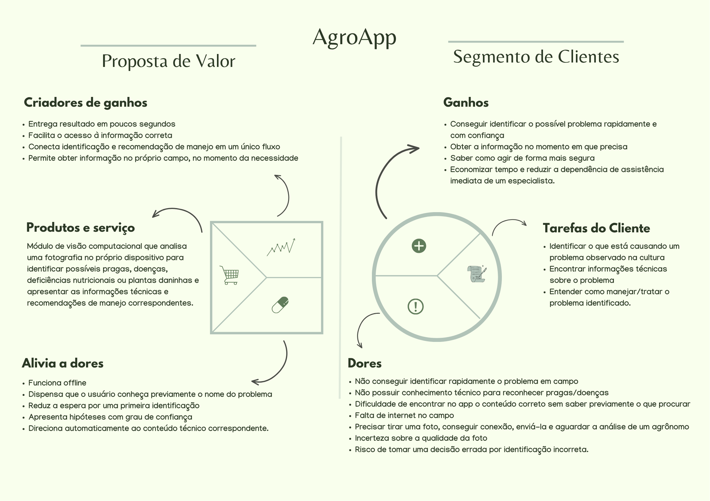

# Documentação do Projeto — AgroApp

## Sumário

<strong>1. Entendimento de Negócio</strong>

- [1.1 Matriz de riscos](#11-matriz-de-riscos)
- [1.2 Canvas de proposta de valor](#12-canvas-de-proposta-de-valor)
- [1.3 Persona e jornada do usuário](#13-persona-e-jornada-do-usuário)
- [1.4 Governança do acervo de imagens](#14-governança-do-acervo-de-imagens)

<strong>2. Especificação Técnica e Arquitetura</strong>

- [2.1 Requisitos e restrições técnicas](#21-requisitos-e-restrições-técnicas)
- [2.2 Glossário técnico do projeto](#22-glossário-técnico-do-projeto)
- [2.3 Levantamento de arquiteturas viáveis](#23-levantamento-de-arquiteturas-viáveis)
- [2.4 Diagrama da arquitetura da solução](#24-diagrama-da-arquitetura-da-solução)
- [2.5 Consolidação técnica](#25-consolidação-técnica)

---

# 1. Entendimento de Negócio

## 1.1 Matriz de riscos

Levantar e classificar os riscos da Seção 12 do TAP por probabilidade e impacto, iniciando a definição das mitigações.

**Documentação — a preencher**

| Risco | Probabilidade | Impacto | Mitigação | Responsável |
| --- | --- | --- | --- | --- |
| A preencher | A definir | A definir | A preencher | A definir |

**Critérios de classificação:** a preencher.

**Referências:** a preencher.

---

## 1.2 Canvas de proposta de valor

  

### 1. Contextualização

O Canvas de Proposta de Valor foi desenvolvido com o objetivo de compreender as principais necessidades do usuário do AgroApp durante a identificação de problemas em uma cultura e relacioná-las à solução proposta.

O problema analisado ocorre principalmente no contexto de campo, no qual o usuário pode observar alterações na cultura sem possuir conhecimento técnico suficiente para identificar sua causa. Além disso, a disponibilidade de conexão com a internet pode ser limitada, dificultando o acesso imediato a especialistas ou a informações que auxiliem na tomada de decisão.

A partir desse cenário, o Canvas foi dividido entre o **Segmento de Clientes**, que representa as tarefas, dores e ganhos esperados pelo usuário, e a **Proposta de Valor**, que apresenta como a solução busca responder a essas necessidades.

### 2. Segmento de Clientes

### 2.1 Tarefas do Cliente

As tarefas representam aquilo que o usuário procura realizar ao perceber um possível problema em sua cultura, independentemente da solução proposta.

A primeira tarefa é **identificar o que está causando o problema observado na cultura**. O usuário percebe algum sintoma ou alteração visual, mas precisa compreender sua possível origem.

Após a identificação, existe a necessidade de **encontrar informações técnicas sobre o problema**, de forma a compreender melhor suas características e consequências.

Por fim, o usuário precisa **entender como manejar ou tratar o problema identificado**, utilizando as informações obtidas para decidir como agir de maneira adequada.

Dessa forma, as tarefas estão relacionadas a três momentos principais: identificar o problema, compreender suas características e encontrar uma forma apropriada de manejo.

### 2.2 Dores

As dores representam os obstáculos, dificuldades e riscos encontrados pelo usuário durante a realização dessas tarefas.

Uma das principais dificuldades é **não conseguir identificar rapidamente o problema enquanto está em campo**. Essa dificuldade é ampliada quando o usuário não possui conhecimento técnico suficiente para reconhecer visualmente pragas ou doenças.

Mesmo utilizando o AgroApp, pode existir uma barreira para encontrar o conteúdo correto, já que o usuário pode não saber previamente qual termo, praga ou doença deve procurar.

Outro fator relevante é a **falta de conexão com a internet no campo**. No processo atual, o usuário pode precisar fotografar o problema, esperar até conseguir conexão, enviar a imagem e posteriormente aguardar a análise de um agrônomo. Esse fluxo aumenta o tempo entre a percepção do problema e o acesso a uma orientação.

Também existe uma incerteza relacionada à **qualidade da fotografia capturada**, já que o usuário pode não saber se a imagem possui condições adequadas para análise.

Por fim, uma identificação incorreta pode gerar uma decisão de manejo inadequada, criando um risco adicional para o usuário.

### 3. Ganhos esperados pelo cliente

Os ganhos representam os resultados desejados pelo usuário ao realizar essas tarefas.

O principal ganho esperado é **conseguir identificar rapidamente o possível problema e possuir confiança na informação recebida**. A rapidez é especialmente importante porque o usuário pode precisar tomar uma decisão enquanto ainda está no campo.

Também é desejável obter a informação **no momento em que ela é necessária**, sem precisar esperar por conexão ou pelo retorno imediato de um especialista.

Além da identificação, o usuário espera compreender **como agir de forma mais segura**, diminuindo a incerteza durante a tomada de decisão.

Consequentemente, espera-se também uma **economia de tempo e uma redução da dependência de assistência imediata de um especialista**, sem necessariamente substituir a atuação profissional em situações que exijam análise especializada.

### 4. Proposta de Valor

### 4.1 Produto e serviço

A solução proposta consiste em um **módulo de visão computacional capaz de analisar uma fotografia diretamente no dispositivo do usuário**, buscando identificar possíveis pragas, doenças, deficiências nutricionais ou plantas daninhas.

A partir da análise, o módulo apresenta ao usuário as informações técnicas e as recomendações de manejo correspondentes.

O objetivo, portanto, não é apenas apresentar uma classificação visual, mas reduzir o caminho entre a observação de um problema na cultura e o acesso à informação necessária para compreendê-lo e decidir como agir.

### 4.2 Aliviadores de dores

A proposta busca reduzir as principais dificuldades identificadas no segmento de clientes.

O funcionamento **offline** permite que a análise seja realizada mesmo em regiões sem conexão com a internet, eliminando uma das principais barreiras do contexto de uso.

A utilização da imagem como ponto de partida também reduz a necessidade de o usuário **conhecer previamente o nome da praga, doença ou outro problema** para encontrar a informação desejada.

A solução busca ainda **reduzir o tempo de espera por uma primeira identificação**, oferecendo uma análise diretamente no dispositivo.

Para lidar com as limitações e incertezas inerentes ao modelo, são apresentadas **hipóteses acompanhadas de grau de confiança**, evitando tratar toda previsão como uma identificação absoluta.

Por fim, a solução direciona o usuário ao **conteúdo técnico correspondente**, reduzindo o esforço necessário para localizar manualmente a informação relevante dentro da plataforma.

### 4.3 Criadores de ganhos

Além de reduzir dificuldades existentes, a proposta busca gerar novos benefícios para o usuário.

Um dos principais é a **entrega do resultado em poucos segundos**, diminuindo o intervalo entre a captura da imagem e a obtenção da informação.

O módulo também facilita o **acesso à informação relevante**, tornando o processo mais direto para usuários que não possuem conhecimento técnico aprofundado.

Outro ganho é a criação de um fluxo integrado entre **identificação do possível problema e recomendação de manejo**, evitando que o usuário tenha que realizar diferentes buscas após receber o resultado.

Por funcionar diretamente no dispositivo, a solução permite ainda que o usuário **acesse a informação no próprio campo e no momento em que surge a necessidade**.

### 5. Relação entre o Segmento de Clientes e a Proposta de Valor

O encaixe entre as duas partes do Canvas ocorre porque as características da solução respondem diretamente às necessidades levantadas no segmento de clientes.

A dificuldade de identificar um problema é atendida pela análise da fotografia por visão computacional. A ausência de internet é tratada pelo funcionamento offline. A necessidade de conhecer previamente a nomenclatura do problema é reduzida porque a interação começa por uma imagem. A demora por uma primeira análise é reduzida pela inferência realizada diretamente no dispositivo. Já a necessidade de compreender como agir é atendida pela apresentação das informações técnicas e recomendações de manejo relacionadas ao resultado.

Da mesma forma, os criadores de ganhos estão relacionados aos resultados esperados pelo usuário: a resposta em poucos segundos atende à necessidade de rapidez; o acesso facilitado à informação contribui para uma decisão mais segura; e o funcionamento em campo possibilita que essa informação esteja disponível justamente no momento em que é necessária.

### 6. Síntese da proposta de valor

A proposta de valor pode ser sintetizada como a possibilidade de **reduzir o caminho entre a identificação visual de uma anormalidade na cultura e o acesso à informação necessária para compreender e manejar o possível problema**.

Em vez de depender inicialmente do conhecimento técnico do usuário, de conexão com a internet ou da espera por uma primeira análise externa, o módulo utiliza uma fotografia como ponto de partida e busca disponibilizar rapidamente informações relevantes diretamente no dispositivo.

A proposta, portanto, concentra-se principalmente em três atributos: **rapidez, disponibilidade em campo e facilidade de acesso à informação técnica**.

---

## 1.3 Persona e jornada do usuário

Construir a persona e estruturar a jornada do usuário desde a observação do sintoma em campo até a decisão de manejo.

**Documentação — a preencher**

**Persona:** descrever perfil, contexto de trabalho, objetivos, dificuldades e familiaridade com tecnologia.

| Etapa da jornada | Ação do usuário | Dificuldade | Oportunidade de melhoria |
| --- | --- | --- | --- |
| Observação do sintoma em campo | A preencher | A preencher | A preencher |
| Captura da imagem | A preencher | A preencher | A preencher |
| Consulta ao diagnóstico | A preencher | A preencher | A preencher |
| Decisão de manejo | A preencher | A preencher | A preencher |

**Referências:** a preencher.

---

## 1.4 Governança do acervo de imagens

Documentar origem, propriedade, permissão de uso, armazenamento e descarte das imagens, considerando também possíveis dados pessoais e a LGPD.

**Documentação — a preencher**

| Acervo | Origem | Propriedade | Permissão de uso | Armazenamento e acesso | Retenção e descarte |
| --- | --- | --- | --- | --- | --- |
| A preencher | A preencher | A validar | A validar | A definir | A definir |

**Possíveis dados pessoais e tratamento previsto:** a avaliar e documentar.

**Evidências das permissões e referências:** inserir links aqui.

---

# 2. Especificação Técnica e Arquitetura

## 2.1 Requisitos e restrições técnicas

Levantar os requisitos da Seção 17 do TAP e identificar as principais restrições de tamanho, latência e execução embarcada.

**Documentação — a preencher**

| ID | Requisito ou restrição | Tipo | Valor ou limite | Critério de aceitação | Fonte |
| --- | --- | --- | --- | --- | --- |
| A definir | A preencher | A definir | A validar | A preencher | A preencher |

**Ambiente de execução:** a definir.

**Pendências de validação com o parceiro:** a preencher.

---

## 2.2 Glossário técnico do projeto

Construir a primeira versão do glossário com os principais termos técnicos utilizados no projeto.

**Documentação — a preencher**

| Termo ou sigla | Definição | Aplicação no projeto | Referência |
| --- | --- | --- | --- |
| A preencher | A preencher | A preencher | A preencher |

---

## 2.3 Levantamento de arquiteturas viáveis

Pesquisar arquiteturas compatíveis com execução embarcada e comparar número de parâmetros, tamanho e acurácia de referência com os limites levantados no T2.1.

**Documentação — a preencher**

| Arquitetura | Parâmetros | Tamanho | Acurácia de referência | Dataset e condições de avaliação | Compatibilidade com T2.1 | Fonte |
| --- | --- | --- | --- | --- | --- | --- |
| A pesquisar | A verificar | A verificar | A verificar | A verificar | A avaliar | A preencher |

**Análise comparativa e limitações:** a preencher.

**Arquitetura recomendada e justificativa:** a definir após a análise.

---

## 2.4 Diagrama da arquitetura da solução

Construir e finalizar o diagrama com captura da imagem, preprocessing, inferência local, política de confiança e associação ao conteúdo técnico.

**Documentação — a preencher**

**Diagrama:** inserir a imagem, o link ou um bloco Mermaid aqui.

| Componente | Responsabilidade | Entrada | Saída |
| --- | --- | --- | --- |
| Captura da imagem | A preencher | A preencher | A preencher |
| Pré-processamento | A preencher | A preencher | A preencher |
| Inferência local | A preencher | A preencher | A preencher |
| Política de confiança | A preencher | A preencher | A preencher |
| Associação ao conteúdo técnico | A preencher | A preencher | A preencher |

**Decisões de arquitetura e justificativas:** a preencher.

---

## 2.5 Consolidação técnica

Finalizar os requisitos e restrições técnicas com os valores acordados com o parceiro e revisar o glossário técnico do projeto.

**Documentação — a preencher**

| Item validado | Valor ou decisão acordada | Data | Participantes da validação | Evidência |
| --- | --- | --- | --- | --- |
| A preencher | A validar | A preencher | A preencher | A preencher |

