# Documentação do Projeto — AgroApp

## Sumário

<details>
<summary><strong>1. Entendimento de Negócio</strong></summary>

- [1.1 Matriz de riscos](#11-matriz-de-riscos)
- [1.2 Canvas de proposta de valor](#12-canvas-de-proposta-de-valor)
- [1.3 Persona e jornada do usuário](#13-persona-e-jornada-do-usuário)
- [1.4 Governança do acervo de imagens](#14-governança-do-acervo-de-imagens)

</details>

<details>
<summary><strong>2. Especificação Técnica e Arquitetura</strong></summary>

- [2.1 Requisitos e restrições técnicas](#21-requisitos-e-restrições-técnicas)
- [2.2 Glossário técnico do projeto](#22-glossário-técnico-do-projeto)
- [2.3 Levantamento de arquiteturas viáveis](#23-levantamento-de-arquiteturas-viáveis)
- [2.4 Diagrama da arquitetura da solução](#24-diagrama-da-arquitetura-da-solução)
- [2.5 Consolidação técnica](#25-consolidação-técnica)

- [Entendimento dos dados](#entendimento-dos-dados)
- [T3.4 — Dicionário de classes](#dicionário-de-classes-t34)

</details>

<details>
<summary><strong>3. Entendimento dos dados</strong></summary>

- [3.1 Inventário do acervo](#31-inventário-do-acervo)
- [3.2 Análise exploratória visual](#32-análise-exploratória-visual)
- [3.3 Diagnóstico de qualidade do acervo](#33-diagnóstico-de-qualidade-do-acervo)

</details>

<details>
<summary><strong>4. Preparação dos dados</strong></summary>

- [4.1 Padronização das imagens (T4.1)](#41-padronização-das-imagens)
- [4.2 Particionamento por grupo (T4.2)](#42-particionamento-por-grupo-t42)
- [4.3 Estratégia de balanceamento](#43-estratégia-de-balanceamento)
- [4.4 Rotinas de aumento de dados (T4.4)](#44-rotinas-de-aumento-de-dados)
- [4.5 Pipeline reprodutível (T4.5)](#45-pipeline-reprodutível-t45)

</details>

<details>
<summary><strong>5. Modelagem</strong></summary>

- [5.1 Pipeline de treinamento modular (T5.1)](#51-pipeline-de-treinamento-modular-t51)
- [5.2 Baseline de referência (T5.2)](#52-baseline-de-referência-t52)
- [5.3 Varredura de arquiteturas (T5.3)](#53-varredura-de-arquiteturas-t53)
- [5.4 Busca de hiperparâmetros (T5.4)](#54-busca-de-hiperparâmetros-t54)
- [5.5 Registro comparativo de experimentos (T5.5)](#55-registro-comparativo-de-experimentos-t55)
- [5.6 Seleção e versionamento do modelo (T5.6)](#56-seleção-e-versionamento-do-modelo-t56)

</details>

<details>
<summary><strong>6. Avaliação do modelo</strong></summary>

- [6.1 Métricas por classe (T6.1)](#61-métricas-por-classe-t61)
- [6.2 Matriz de confusão (T6.2)](#62-matriz-de-confusão-t62)
- [6.3 Análise de erros (T6.3)](#63-análise-de-erros-t63)
- [6.4 Proposta de tratamento de classes (T6.4)](#64-proposta-de-tratamento-de-classes-t64)
- [6.5 Política de confiança (T6.5)](#65-política-de-confiança-t65)

</details>

<details>
<summary><strong>7. Conversão e otimização do modelo</strong></summary>

- [7.1 Conversão para TFLite/LiteRT (T7.1)](#71-conversão-para-tflitelitert-t71)
- [7.2 Comparação das estratégias de quantização (T7.2)](#72-comparação-das-estratégias-de-quantização-t72)
- [7.3 Quantização INT8 com conjunto representativo (T7.3)](#73-quantização-int8-com-conjunto-representativo-t73)

</details>

<details>
<summary><strong>8. Avaliação e desempenho do modelo convertido</strong></summary>

- [8.1 Avaliação pós-conversão (T8.1)](#81-avaliação-pós-conversão-t81)
- [8.2 Benchmark de inferência (T8.2)](#82-benchmark-de-inferência-t82)
- [8.3 Seleção do modelo para mobile (T8.3)](#83-seleção-do-modelo-para-mobile-t83)

</details>

<details>
<summary><strong>9. Integração Mobile</strong></summary>

- [9.1 Pipeline de captura e processamento de imagens (T9.1)](#91-pipeline-de-captura-e-processamento-de-imagens-t91)
- [9.2 Tratamento do limiar de confiança (T9.2)](#92-tratamento-do-limiar-de-confiança-t92)
- [9.3 Associação da predição ao conteúdo técnico (T9.3)](#93-associação-da-predição-ao-conteúdo-técnico-t93)

</details>

<details>
<summary><strong>10. Consolidação da avaliação</strong></summary>

- [10.1 Independência dos conjuntos de dados](#101-independência-dos-conjuntos-de-dados)
- [10.2 Correspondência do preprocessing Python e web](#102-correspondência-do-preprocessing-python-e-web)
- [10.3 Comparação dos modelos Float16 e INT8 entre Python e web](#103-comparação-dos-modelos-float16-e-int8-entre-python-e-web)
- [10.4 Consolidação da seleção e versionamento do modelo final](#104-consolidação-da-seleção-e-versionamento-do-modelo-final-t104)

</details>

---

# 1. Entendimento de Negócio

## 1.1 Matriz de riscos

A matriz de riscos identifica os eventos que podem comprometer o desenvolvimento e os resultados do Módulo de Identificação de Pragas por Reconhecimento Visual integrado ao Agro App, avaliando cada um por probabilidade e impacto para priorizar as ações de mitigação. Foram levantados 12 riscos, dos quais 6 vêm do Termo de Abertura do Projeto (TAP) e 6 derivam dos requisitos do módulo, como nível mínimo de confiança, qualidade da imagem e rastreabilidade.

### Matriz de probabilidade e impacto

A Figura 1 mostra onde cada risco se posiciona ao cruzar probabilidade (eixo vertical) e impacto (eixo horizontal). Quanto mais próximo do canto superior direito, maior a prioridade de tratamento.

<div align="center">
  <p><strong>Figura 1 — Matriz de probabilidade e impacto</strong></p>
  
  <p><em>Fonte: feito pela própria equipe, 2026.</em></p>
</div>

### Critérios de classificação

Cada risco recebeu uma nota de 1 a 3 em probabilidade e em impacto. A probabilidade indica a chance de o risco ocorrer ao longo do projeto, e o impacto indica o quanto ele compromete a qualidade do modelo, o cronograma ou a entrega do MVP.

| Nota | Probabilidade | Impacto |
| --- | --- | --- |
| 1 | **Baixa:** ocorrência improvável ao longo do projeto | **Baixo:** efeito pequeno, absorvido na própria sprint |
| 2 | **Média:** pode ocorrer, dependendo de decisões ou condições em aberto | **Médio:** atrasa etapas ou reduz a qualidade de parte da solução, mas o MVP continua viável |
| 3 | **Alta:** ocorrência provável ou já esperada, dadas as características dos dados e do contexto de uso | **Alto:** compromete o desempenho do modelo, o cronograma ou os critérios de sucesso do MVP |

O nível de risco é o produto entre as duas notas:

| Produto | Nível de risco | Tratamento |
| --- | --- | --- |
| 1 a 2 | Baixo | Acompanhamento simples, sem ação imediata |
| 3 a 4 | Médio | Monitoramento e manutenção da mitigação planejada |
| 6 | Alto | Mitigação ativa, revisada a cada sprint |
| 9 | Crítico | Prioridade máxima, tratado desde as primeiras fases |

### Riscos identificados

A tabela apresenta os riscos ordenados por nível.

| Risco | Probabilidade | Impacto | Nível | Mitigação | Responsável |
| --- | --- | --- | --- | --- | --- |
| **R01.** Número insuficiente de imagens por classe, principalmente para pragas e doenças menos frequentes | Alta (3) | Alto (3) | 9 (Crítico) | Priorizar no MVP as classes com mais imagens, usar aumento de dados e complementar com bases públicas validadas pelo parceiro | Equipe de dados e Agro App |
| **R04.** Sintomas visualmente semelhantes entre agentes causais distintos geram confusão sistemática entre classes | Alta (3) | Alto (3) | 9 (Crítico) | Retornar as hipóteses mais prováveis com grau de confiança, em vez de diagnóstico único, e agrupar classes indistinguíveis quando validado pelo parceiro | Equipe de modelagem |
| **R02.** Desbalanceamento entre classes faz o modelo favorecer as mais representadas | Alta (3) | Médio (2) | 6 (Alto) | Balanceamento e ponderação de classes, avaliando por métricas por classe e não pela acurácia global | Equipe de modelagem |
| **R06.** Fotos de baixa qualidade tiradas em campo (sol forte, sombra, tremor) prejudicam a análise | Alta (3) | Médio (2) | 6 (Alto) | Definir padrão mínimo de nitidez, validar a foto antes da análise e pedir nova foto explicando o problema | Equipe de desenvolvimento |
| **R03.** Modelo excede o tamanho ou o tempo de resposta aceitáveis no aparelho | Média (2) | Alto (3) | 6 (Alto) | Arquiteturas leves desde o início, quantização e limites de tamanho e latência definidos com o parceiro | Equipe de modelagem |
| **R07.** Limiar mínimo de confiança mal calibrado: muito baixo gera diagnósticos errados, muito alto faz o modelo recusar quase tudo | Média (2) | Alto (3) | 6 (Alto) | Definir o limiar com base no conjunto de validação e em referências de mercado, e pedir nova foto ou mais informações quando não for atingido | Equipe de modelagem |
| **R09.** Diferença entre as imagens do acervo e as fotos reais de campo faz o modelo ir bem no teste e mal em uso | Média (2) | Alto (3) | 6 (Alto) | Aumento de dados com variações de luz, ângulo e fundo, e testes com fotos tiradas por celular em condições reais | Equipe de modelagem |
| **R11.** O produtor trata a hipótese como conclusão definitiva e decide o manejo com base nela | Média (2) | Alto (3) | 6 (Alto) | Apresentar hipóteses com confiança, permitir esclarecer dúvidas antes da conclusão e deixar claro que a dosagem não faz parte do módulo | Equipe de UX e produto |
| **R05.** Curva de aprendizado da equipe em visão computacional maior que a prevista | Média (2) | Médio (2) | 4 (Médio) | Bibliotecas e modelos pré-treinados de alto nível, acompanhamento da diretoria de tecnologia e divisão de tarefas por frente de trabalho | Diretoria de tecnologia |
| **R08.** Acervo do parceiro chega atrasado, sem rótulos ou em formato inadequado | Média (2) | Médio (2) | 4 (Médio) | Confirmar volume, rotulagem e formato na Fase 1 e reservar a rotulagem manual no cronograma da Fase 2 | Gestão do projeto |
| **R12.** Aumento de escopo por funcionalidades ainda não detalhadas no TAP, como diálogo com o usuário e logs de rastreabilidade | Média (2) | Médio (2) | 4 (Médio) | Definir com o parceiro o que entra no MVP e o que fica para ciclos posteriores, com registro formal da decisão | Gestão do projeto |
| **R10.** Diagnóstico direciona a um conteúdo técnico errado ou inexistente na base do Agro App | Baixa (1) | Alto (3) | 3 (Médio) | Mapeamento classe-conteúdo validado pelo parceiro, testes em todas as classes do MVP e sugestão de conteúdos relacionados quando não houver validação | Equipe de desenvolvimento e Agro App |

### Análise da distribuição dos riscos

Dos 12 riscos, 2 são críticos, 6 são altos e 4 são médios, e nenhum ficou no nível baixo. Os críticos (R01 e R04) decorrem das características dos dados, que são o volume de imagens por classe e a semelhança visual entre sintomas, e por isso suas mitigações devem orientar já as Fases 1 e 2 do cronograma. Os altos se concentram no desempenho e no uso do módulo, como qualidade das fotos, limites de tamanho e latência, limiar de confiança, diferença entre o acervo e o campo e interpretação do resultado, e vários dependem de decisões ainda em aberto com o parceiro. Os médios estão ligados à equipe, ao parceiro e ao escopo. O R10 tem baixa probabilidade porque o Agro App já organiza o conteúdo por cultura e praga, mas alto impacto, pois um direcionamento errado comprometeria a recomendação de manejo.

---

## 1.2 Canvas de proposta de valor


<p align="center">
  
</p>

### 1. Contextualização

O Canvas de Proposta de Valor foi desenvolvido com o objetivo de compreender as principais necessidades do usuário do AgroApp durante a identificação de problemas em uma cultura e relacioná-las à solução proposta.

O problema analisado ocorre principalmente no contexto de campo, no qual o usuário pode observar alterações na cultura sem possuir conhecimento técnico suficiente para identificar sua causa. Além disso, a disponibilidade de conexão com a internet pode ser limitada, dificultando o acesso imediato a especialistas ou a informações que auxiliem na tomada de decisão.

A partir desse cenário, o Canvas foi dividido entre o **Segmento de Clientes**, que representa as tarefas, dores e ganhos esperados pelo usuário, e a **Proposta de Valor**, que apresenta como a solução busca responder a essas necessidades.

### 2. Segmento de Clientes

### 2.1 Tarefas do Cliente

As tarefas representam aquilo que o usuário procura realizar ao perceber um possível problema em sua cultura, independentemente da solução proposta.

A primeira tarefa é **identificar o que está causando o problema observado na cultura**. O usuário percebe algum sintoma ou alteração visual, mas precisa compreender sua possível origem.

Após a identificação, existe a necessidade de **encontrar informações técnicas sobre o problema**, de forma a compreender melhor suas características e consequências.

Por fim, o usuário precisa **entender como manejar ou tratar o problema identificado**, utilizando as informações obtidas para decidir como agir de maneira adequada.

Dessa forma, as tarefas estão relacionadas a três momentos principais: identificar o problema, compreender suas características e encontrar uma forma apropriada de manejo.

### 2.2 Dores

As dores representam os obstáculos, dificuldades e riscos encontrados pelo usuário durante a realização dessas tarefas.

Uma das principais dificuldades é **não conseguir identificar rapidamente o problema enquanto está em campo**. Essa dificuldade é ampliada quando o usuário não possui conhecimento técnico suficiente para reconhecer visualmente pragas ou doenças.

Mesmo utilizando o AgroApp, pode existir uma barreira para encontrar o conteúdo correto, já que o usuário pode não saber previamente qual termo, praga ou doença deve procurar.

Outro fator relevante é a **falta de conexão com a internet no campo**. No processo atual, o usuário pode precisar fotografar o problema, esperar até conseguir conexão, enviar a imagem e posteriormente aguardar a análise de um agrônomo. Esse fluxo aumenta o tempo entre a percepção do problema e o acesso a uma orientação.

Também existe uma incerteza relacionada à **qualidade da fotografia capturada**, já que o usuário pode não saber se a imagem possui condições adequadas para análise.

Por fim, uma identificação incorreta pode gerar uma decisão de manejo inadequada, criando um risco adicional para o usuário.

### 3. Ganhos esperados pelo cliente

Os ganhos representam os resultados desejados pelo usuário ao realizar essas tarefas.

O principal ganho esperado é **conseguir identificar rapidamente o possível problema e possuir confiança na informação recebida**. A rapidez é especialmente importante porque o usuário pode precisar tomar uma decisão enquanto ainda está no campo.

Também é desejável obter a informação **no momento em que ela é necessária**, sem precisar esperar por conexão ou pelo retorno imediato de um especialista.

Além da identificação, o usuário espera compreender **como agir de forma mais segura**, diminuindo a incerteza durante a tomada de decisão.

Consequentemente, espera-se também uma **economia de tempo e uma redução da dependência de assistência imediata de um especialista**, sem necessariamente substituir a atuação profissional em situações que exijam análise especializada.

### 4. Proposta de Valor

### 4.1 Produto e serviço

A solução proposta consiste em um **módulo de visão computacional capaz de analisar uma fotografia diretamente no dispositivo do usuário**, buscando identificar possíveis pragas, doenças, deficiências nutricionais ou plantas daninhas.

A partir da análise, o módulo apresenta ao usuário as informações técnicas e as recomendações de manejo correspondentes.

O objetivo, portanto, não é apenas apresentar uma classificação visual, mas reduzir o caminho entre a observação de um problema na cultura e o acesso à informação necessária para compreendê-lo e decidir como agir.

### 4.2 Aliviadores de dores

A proposta busca reduzir as principais dificuldades identificadas no segmento de clientes.

O funcionamento **offline** permite que a análise seja realizada mesmo em regiões sem conexão com a internet, eliminando uma das principais barreiras do contexto de uso.

A utilização da imagem como ponto de partida também reduz a necessidade de o usuário **conhecer previamente o nome da praga, doença ou outro problema** para encontrar a informação desejada.

A solução busca ainda **reduzir o tempo de espera por uma primeira identificação**, oferecendo uma análise diretamente no dispositivo.

Para lidar com as limitações e incertezas inerentes ao modelo, são apresentadas **hipóteses acompanhadas de grau de confiança**, evitando tratar toda previsão como uma identificação absoluta.

Por fim, a solução direciona o usuário ao **conteúdo técnico correspondente**, reduzindo o esforço necessário para localizar manualmente a informação relevante dentro da plataforma.

### 4.3 Criadores de ganhos

Além de reduzir dificuldades existentes, a proposta busca gerar novos benefícios para o usuário.

Um dos principais é a **entrega do resultado em poucos segundos**, diminuindo o intervalo entre a captura da imagem e a obtenção da informação.

O módulo também facilita o **acesso à informação relevante**, tornando o processo mais direto para usuários que não possuem conhecimento técnico aprofundado.

Outro ganho é a criação de um fluxo integrado entre **identificação do possível problema e recomendação de manejo**, evitando que o usuário tenha que realizar diferentes buscas após receber o resultado.

Por funcionar diretamente no dispositivo, a solução permite ainda que o usuário **acesse a informação no próprio campo e no momento em que surge a necessidade**.

### 5. Relação entre o Segmento de Clientes e a Proposta de Valor

O encaixe entre as duas partes do Canvas ocorre porque as características da solução respondem diretamente às necessidades levantadas no segmento de clientes.

A dificuldade de identificar um problema é atendida pela análise da fotografia por visão computacional. A ausência de internet é tratada pelo funcionamento offline. A necessidade de conhecer previamente a nomenclatura do problema é reduzida porque a interação começa por uma imagem. A demora por uma primeira análise é reduzida pela inferência realizada diretamente no dispositivo. Já a necessidade de compreender como agir é atendida pela apresentação das informações técnicas e recomendações de manejo relacionadas ao resultado.

Da mesma forma, os criadores de ganhos estão relacionados aos resultados esperados pelo usuário: a resposta em poucos segundos atende à necessidade de rapidez; o acesso facilitado à informação contribui para uma decisão mais segura; e o funcionamento em campo possibilita que essa informação esteja disponível justamente no momento em que é necessária.

### 6. Síntese da proposta de valor

A proposta de valor pode ser sintetizada como a possibilidade de **reduzir o caminho entre a identificação visual de uma anormalidade na cultura e o acesso à informação necessária para compreender e manejar o possível problema**.

Em vez de depender inicialmente do conhecimento técnico do usuário, de conexão com a internet ou da espera por uma primeira análise externa, o módulo utiliza uma fotografia como ponto de partida e busca disponibilizar rapidamente informações relevantes diretamente no dispositivo.

A proposta, portanto, concentra-se principalmente em três atributos: **rapidez, disponibilidade em campo e facilidade de acesso à informação técnica**.

---

## 1.3 Persona e jornada do usuário

Uma persona é uma representação fictícia de um usuário, criada com base nas características, nos objetivos, nas necessidades e nas dificuldades do público que se pretende atender. Em nosso projeto, as personas funcionam como uma forma de validar se a solução proposta está realmente alinhada aos problemas e às expectativas de seus futuros usuários. Elas orientam as decisões da equipe ao longo do desenvolvimento, ajudando a avaliar funcionalidades, formas de interação e situações de uso do Módulo de Identificação de Pragas por Reconhecimento Visual integrado ao Agro App. Foram definidas duas personas para o projeto, e Vitória Lima, apresentada a seguir, é uma delas.

### Persona 1 — Rafael Mendes

<div align="center">
  <p><strong>Figura 2 — Persona Rafael Mendes</strong></p>
  
  <p><em>Fonte: feito pela própria equipe, 2026.</em></p>
</div>

Rafael Mendes tem 38 anos, é engenheiro agrônomo e produtor rural em Rio Verde, Goiás. Ele cuida da própria lavoura e, durante as rondas nos talhões, fotografa plantas com sintomas para descobrir o que está acontecendo e como tratar. Ele busca identificar rapidamente pragas, doenças e deficiências nutricionais, encontrar a recomendação de manejo adequada e evitar a aplicação de defensivo errado, mas encontra dificuldades para diferenciar sintomas visualmente semelhantes, nem sempre tem um consultor por perto e nem sempre conta com internet na lavoura. Por isso, precisa de um módulo que apresente as hipóteses mais prováveis, informe o grau de confiança do resultado, permita esclarecer dúvidas antes de uma conclusão e leve do diagnóstico ao manejo, inclusive offline.

### Jornada do usuário — Rafael Mendes

A jornada do usuário representa as etapas percorridas por uma pessoa ao interagir com uma solução, considerando suas ações, seus pensamentos, suas emoções e as dificuldades encontradas durante a experiência. No projeto, esse mapeamento permite compreender como Rafael utilizaria o módulo em uma situação real e identificar pontos de fricção e oportunidades de melhoria.

<div align="center">
  <p><strong>Figura 3 — Mapa da jornada do usuário de Rafael Mendes</strong></p>
  
  <p><em>Fonte: feito pela própria equipe, 2026.</em></p>
</div>

Na jornada mapeada, Rafael percebe plantas com aspecto diferente durante a ronda no talhão e fotografa a área afetada pelo módulo integrado ao Agro App. A análise é feita no próprio aparelho, mesmo sem conexão, e ele recebe as hipóteses com seus respectivos níveis de confiança. Caso a confiança fique abaixo do mínimo, o módulo não afirma o diagnóstico e pede uma nova foto ou mais informações. Em seguida, Rafael compara as hipóteses, esclarece suas dúvidas, consulta o conteúdo técnico relacionado e usa a recomendação de manejo para decidir o que fazer na lavoura.

O mapa evidencia necessidades importantes para o módulo, como validar a qualidade da imagem antes da análise, indicar o andamento do processamento, explicar o grau de confiança dos resultados, sugerir conteúdos do aplicativo quando não houver validação e conduzir do diagnóstico direto ao manejo. Como o custo de uma decisão equivocada recai sobre a própria safra, esses elementos aumentam a segurança de Rafael ao decidir e tornam o uso do módulo mais útil no dia a dia da lavoura.

### Persona 2 — Vitória Lima

<div align="center">
  <p><strong>Figura 4 — Persona Vitória Lima</strong></p>
  
  <p><em>Fonte: feito pela própria equipe, 2026.</em></p>
</div>

Vitória Lima tem 22 anos, cursa Agronomia e atua como pesquisadora em Piracicaba, São Paulo. Durante atividades de campo, fotografa sintomas em folhas e frutos para comparar possíveis doenças, pragas e deficiências nutricionais. Ela busca desenvolver experiência prática em diagnóstico vegetal e consultar referências técnicas confiáveis, mas encontra dificuldades para diferenciar sintomas visualmente semelhantes, avaliar hipóteses com segurança e acessar a internet em campo. Por isso, precisa de um módulo que apresente as hipóteses mais prováveis, informe o grau de confiança do resultado e permita acesso offline a conteúdos técnicos relacionados.

### Jornada do usuário — Vitória Lima

A jornada do usuário representa as etapas percorridas por uma pessoa ao interagir com uma solução, considerando suas ações, seus pensamentos, suas emoções e as dificuldades encontradas durante a experiência. No projeto, esse mapeamento permite compreender como Vitória utilizaria o módulo em uma situação real e identificar pontos de fricção e oportunidades de melhoria.

<div align="center">
  <p><strong>Figura 5 — Mapa da jornada do usuário de Vitória Lima</strong></p>
  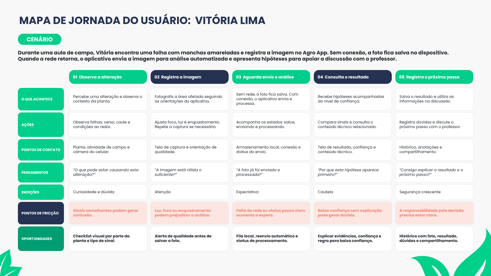
  <p><em>Fonte: feito pela própria equipe, 2026.</em></p>
</div>

Na jornada mapeada, Vitória encontra uma alteração em uma planta durante uma aula de campo e registra uma fotografia pelo módulo integrado ao Agro App. Caso esteja sem conexão, a imagem permanece salva no dispositivo até que possa ser enviada e processada. Em seguida, ela consulta as hipóteses apresentadas e seus respectivos níveis de confiança, compara os sinais com o conteúdo técnico disponível e registra as informações necessárias para discutir o resultado e o próximo passo com o professor.

O mapa evidencia necessidades importantes para o módulo, como orientar a captura de imagens com qualidade, informar claramente o estado do envio e do processamento, explicar o grau de confiança dos resultados e manter um histórico com fotos, análises e anotações. Esses elementos reduzem dúvidas ao longo da experiência e tornam seu uso mais seguro e útil em atividades de campo.

---

## 1.4 Governança do acervo de imagens

### 1. Objetivo

Estabelecer como as imagens usadas no desenvolvimento do diagnóstico visual serão recebidas, catalogadas, protegidas e descartadas. A governança permite verificar a procedência e a permissão de uso de cada imagem, manter a rastreabilidade do dataset e reduzir riscos de exposição indevida.

### 2. Origem das imagens

- **Acervo principal:** fornecido pelo Agro App para treinamento e avaliação do modelo. Pode conter imagens de pragas, doenças, deficiências nutricionais, plantas daninhas e culturas agrícolas.
- **Bases públicas complementares:** podem reforçar classes com poucas amostras, desde que sua utilização seja validada pelo parceiro e as condições de uso sejam verificadas.
- **Outras origens:** caso sejam incorporadas, deverão passar pelo mesmo registro de procedência e pela verificação das permissões antes do uso.

A origem de cada conjunto e, quando possível, de cada imagem deve ser registrada antes de sua inclusão no dataset.

### 3. Propriedade e permissão de uso

Para cada origem, deve-se identificar o titular dos direitos ou responsável pelo fornecimento, a autorização ou licença aplicável e suas limitações. O registro deve distinguir a permissão para **treinamento, validação, teste, documentação e apresentação**, além de eventuais restrições de compartilhamento, redistribuição ou publicação. O fornecimento de uma imagem, por si só, não comprova autorização para todos esses usos.

Até que a titularidade, as autorizações e as restrições do acervo principal sejam documentadas, as imagens não devem ser usadas fora das finalidades expressamente comprovadas. Isso inclui a publicação em documentos e apresentações. Imagens sem permissão identificada devem ficar fora dos conjuntos de uso até que a situação seja esclarecida.

### 4. Catalogação e rastreabilidade

**Proposta da equipe:** manter um registro por imagem ou por conjunto homogêneo, conforme a granularidade disponível, com os seguintes campos mínimos:

| Campo | Informação a registrar |
| --- | --- |
| Identificador | Código único da imagem ou do conjunto. |
| Origem e fornecimento | Fonte, referência de obtenção e responsável pelo fornecimento. |
| Conteúdo | Classe ou rótulo, cultura associada e observações relevantes, quando aplicáveis. |
| Direito de uso | Titular ou responsável, autorização ou licença, evidência e restrições conhecidas. |
| Histórico | Data de inclusão, alterações de rótulo e motivo de exclusão, quando ocorrer. |
| Uso no dataset | Partição de treino, validação ou teste e identificação de eventuais derivados. |

O identificador deve permitir localizar a imagem, sua origem e a evidência da permissão sem depender apenas do nome do arquivo.

### 5. Armazenamento e controle de acesso

**Proposta da equipe:** manter o acervo em local de acesso restrito, organizado por origem e etapa de tratamento. Preservar os arquivos brutos separadamente das versões processadas e registrar a ligação entre eles. Conceder acesso somente às pessoas que precisam das imagens para suas atividades, revisar esses acessos quando a participação mudar e evitar links públicos ou a inclusão acidental do acervo em repositórios públicos. Quando houver cópias de segurança, elas devem seguir as mesmas regras de acesso e o ciclo de retenção definido para os originais.

O local de armazenamento, a lista de pessoas autorizadas e as regras de cópia de segurança precisam ser definidos antes do recebimento do acervo. A escolha da ferramenta deve respeitar essas regras; esta seção não pressupõe uma solução específica.

### 6. Dados pessoais e LGPD

Embora o objetivo seja fotografar plantas, uma imagem pode incluir pessoas ao fundo, rostos, placas de veículos, localização em metadados EXIF ou elementos de uma propriedade rural que, em determinado contexto, permitam identificar uma pessoa natural. A presença desses elementos deve ser avaliada também nas bases públicas. A [ANPD define dado pessoal pela possibilidade de identificar uma pessoa natural direta ou indiretamente](https://www.gov.br/anpd/pt-br/assuntos/titular-de-dados); a avaliação de cada imagem depende do contexto.

**Proposta da equipe:** inspecionar as imagens e seus metadados antes de incluí-las no dataset; coletar e conservar somente o necessário para a finalidade definida; restringir o acesso; e remover metadados ou ocultar elementos identificadores quando não forem necessários à análise agronômica. Se a identificação for necessária ou a remoção não for suficiente, o uso deve passar por avaliação específica da finalidade, da base legal e das responsabilidades das partes, com apoio jurídico quando necessário. Essas medidas seguem os princípios de finalidade, necessidade e segurança da [LGPD](https://www.planalto.gov.br/ccivil_03/_ato2015-2018/2018/lei/l13709compilado.htm); sua aplicação concreta depende dos dados e do papel de cada parte.

Também é necessário verificar se o acervo inclui fotografias enviadas por usuários do aplicativo, quais informações lhes foram fornecidas e se existe política interna de privacidade aplicável. A definição dos responsáveis pelo tratamento de eventuais dados pessoais depende dessa análise.

### 7. Uso de bases públicas complementares

Uma base pública somente deve ser incorporada após registrar sua origem, versão ou endereço de referência, licença e condições de uso; verificar a compatibilidade dessas condições com as finalidades do projeto; avaliar adequação às culturas e classes do MVP, qualidade das imagens e presença de dados pessoais; e identificar duplicatas relevantes em relação ao acervo existente. A procedência e o resultado dessa avaliação devem acompanhar as imagens importadas.

Além da licença, a inclusão de cada base complementar depende de aprovação para o projeto. Essa aprovação deve registrar os limites de uso, redistribuição e publicação das imagens importadas.

### 8. Retenção e descarte

**Proposta da equipe:** conservar imagens de desenvolvimento enquanto forem necessárias às atividades autorizadas; identificar quais imagens integram o dataset final e sob qual responsabilidade permanecerão; e revisar periodicamente cópias temporárias, duplicatas e imagens rejeitadas para descarte quando não houver finalidade ou obrigação de conservação. O descarte deve abranger originais, derivados e cópias acessíveis, conforme o ambiente de armazenamento, com registro do que foi excluído, quando e por quem. Cópias de segurança devem seguir o procedimento de expiração aplicável. A [ANPD observa que não há prazo único de tratamento aplicável a todos os casos](https://www.gov.br/anpd/pt-br/acesso-a-informacao/perguntas-frequentes); o prazo depende da finalidade e das circunstâncias.

Os prazos de retenção por categoria, o destino do dataset final e o procedimento de exclusão após o projeto ainda precisam ser definidos. Até lá, a equipe deve evitar cópias desnecessárias e manter identificáveis as imagens que deverão ser revisadas para descarte.

### 9. Responsabilidades

| Parte | Responsabilidade |
| --- | --- |
| Agro App | Fornecer o acervo principal e esclarecer sua origem, permissões, restrições de uso e políticas aplicáveis. |
| Equipe do projeto | Organizar e preparar o dataset, aplicar os controles definidos e registrar o uso e o descarte das imagens. |
| Responsáveis técnicos/agronômicos | Apoiar a revisão da adequação agronômica das imagens, culturas, classes e rótulos. |
| Responsáveis pela governança do dataset | Manter o catálogo, as evidências de permissão, o histórico de alterações e a revisão de acessos e retenção. As pessoas que exercerão essa função ainda precisam ser designadas. |

As responsabilidades operacionais da tabela não definem, por si só, os papéis legais de controlador e operador previstos na LGPD. Caso haja tratamento de dados pessoais, esses papéis devem ser avaliados conforme as decisões efetivamente tomadas por cada parte sobre finalidade e meios do tratamento, considerando as [definições da ANPD para agentes de tratamento](https://www.gov.br/anpd/pt-br/assuntos/titular-de-dados).

### 10. Riscos e medidas de mitigação

| Risco | Impacto | Mitigação |
| --- | --- | --- |
| Imagem sem origem comprovada | Perda de rastreabilidade e dificuldade de justificar seu uso. | Registrar procedência e impedir a inclusão até esclarecimento. |
| Ausência de autorização de uso | Uso fora das condições permitidas. | Guardar evidência da permissão e verificar cada finalidade antes do uso. |
| Dados pessoais na imagem ou nos metadados | Exposição indevida de pessoas identificáveis. | Inspecionar imagens e metadados, minimizar dados e restringir acesso. |
| Vazamento do dataset | Divulgação não autorizada do acervo. | Restringir acessos, evitar exposição pública e aplicar controles ao armazenamento e às cópias. |
| Uso indevido de base pública | Violação de licença ou incorporação de dados inadequados. | Verificar licença, procedência, qualidade e aprovação antes da importação. |
| Imagens duplicadas | Distorção na composição e na avaliação do dataset. | Identificar duplicatas e revisar sua distribuição entre treino, validação e teste. |
| Rótulos incorretos | Treinamento e avaliação comprometidos. | Submeter rótulos duvidosos à revisão técnica e registrar correções. |
| Perda de rastreabilidade | Impossibilidade de reconstruir a origem e o uso das imagens. | Manter identificadores, catálogo, evidências e histórico de alterações. |

### 11. Definições necessárias para uso do acervo

| Definição | Por que é necessária |
| --- | --- |
| Direitos e autorizações do acervo principal para treinamento, validação e teste. | Delimitar as finalidades permitidas e documentar sua evidência. |
| Origem de fotografias enviadas por usuários e informações fornecidas a eles. | Avaliar permissões de uso e eventual tratamento de dados pessoais. |
| Ambiente de armazenamento, pessoas autorizadas e regras de segurança. | Proteger o acervo desde seu recebimento. |
| Uso em documentação, apresentações, compartilhamento e publicação. | Evitar divulgação além das permissões existentes. |
| Bases públicas complementares aprovadas e respectivas condições. | Verificar licença, adequação e limites de uso antes da importação. |
| Prazos de retenção por categoria, destino do dataset final e responsáveis pelo descarte. | Planejar a conservação e a exclusão de originais, derivados e cópias. |
| Políticas internas aplicáveis e papéis relativos a dados pessoais. | Alinhar os controles do projeto às regras existentes e às responsabilidades de cada parte. |

Essas definições devem ser registradas com a decisão tomada, o responsável e a evidência correspondente antes da etapa do projeto que dependa delas.

---

# 2. Especificação Técnica e Arquitetura

## 2.1 Requisitos e restrições técnicas

Esta seção reúne os requisitos do módulo de diagnóstico visual previstos na Seção 17 do TAP. Os requisitos funcionais descrevem o fluxo desde a escolha da fotografia até o acesso ao conteúdo técnico do Agro App. As restrições técnicas tratam da execução do modelo no dispositivo, incluindo limites de tamanho, tempo de resposta e recursos necessários para a inferência. A definição conjunta desses pontos orienta o desenvolvimento e a validação do MVP.

### Requisitos funcionais do diagnóstico visual (MVP)

| ID | Requisito Funcional | Descrição | Entrada | Comportamento esperado | Critério de aceitação |
| --- | --- | --- | --- | --- | --- |
| RF-01 | O sistema deve permitir que o usuário capture ou selecione uma fotografia para diagnóstico. | Disponibiliza as duas formas de fornecer uma imagem ao módulo. | Fotografia capturada pela câmera ou selecionada no dispositivo. | Recebe a fotografia escolhida e inicia o fluxo de análise. | Uma fotografia capturada e uma fotografia selecionada podem, cada uma, iniciar a análise. |
| RF-02 | O sistema deve preparar a fotografia para a entrada do modelo de classificação. | Aplica à imagem os ajustes exigidos pelo modelo embarcado. | Fotografia recebida no RF-01. | Produz uma imagem no formato de entrada definido para o modelo. | Para cada fotografia aceita, a saída da preparação atende às especificações de entrada do modelo utilizado no MVP. |
| RF-03 | O sistema deve classificar a imagem nas classes definidas para o MVP. | Identifica possíveis pragas, doenças, deficiências nutricionais ou plantas daninhas nas culturas contempladas. | Imagem preparada no RF-02. | Retorna uma classe e um grau de confiança para cada hipótese produzida. | Todas as classes retornadas pertencem ao catálogo de classes do MVP; cada hipótese possui um grau de confiança associado. O escopo inicial de culturas é soja e milho, conforme o glossário. |
| RF-04 | O sistema deve apresentar as hipóteses mais prováveis em ordem decrescente de confiança. | Exibe as identificações candidatas resultantes da análise. | Hipóteses retornadas no RF-03. | Apresenta o nome de cada hipótese selecionada para exibição, começando pela de maior confiança. | As hipóteses exibidas pertencem ao resultado da análise e aparecem em ordem decrescente de confiança. |
| RF-05 | O sistema deve apresentar o grau de confiança de cada hipótese exibida. | Permite consultar a confiança atribuída a cada identificação candidata. | Hipóteses e graus de confiança retornados no RF-03. | Mostra o grau de confiança junto à hipótese correspondente. | Cada hipótese exibida possui um valor visível que corresponde ao grau de confiança retornado para ela. |
| RF-06 | O sistema deve informar quando nenhuma hipótese atingir o limiar mínimo de confiança. | Trata o resultado inconclusivo da análise. | Hipóteses retornadas no RF-03 e limiar mínimo adotado no MVP. | Apresenta uma mensagem de identificação inconclusiva, sem indicar uma classe como diagnóstico obtido. | Se todos os graus de confiança forem inferiores ao limiar, a mensagem é exibida e nenhuma classe é indicada como identificação obtida. |
| RF-07 | O sistema deve associar as classes do MVP ao conteúdo técnico correspondente do Agro App. | Relaciona cada classe reconhecível às informações técnicas existentes no aplicativo. | Classe pertencente ao catálogo do MVP. | Identifica o conteúdo técnico vinculado à classe. | Para cada classe do catálogo do MVP, a associação aponta para um conteúdo técnico correspondente e acessível no Agro App. |
| RF-08 | O sistema deve permitir que o usuário acesse as informações e recomendações de manejo relacionadas à hipótese apresentada. | Oferece a navegação do resultado para o conteúdo técnico associado. | Hipótese exibida com conteúdo associado no RF-07. | Ao selecionar a hipótese, abre o conteúdo correspondente no Agro App. | A seleção de cada hipótese exibida abre o conteúdo técnico associado à sua classe. |


### Requisitos não funcionais e restrições técnicas

Consolidação dos requisitos não funcionais levantados para o módulo de diagnóstico visual, em formato verificável. Valores marcados com ⧗ dependem de resposta do parceiro e estão preenchidos com proposta da equipe.

| ID | Requisito | Métrica | Valor | Verificação |
| --- | --- | --- | --- | --- |
| RNF-01 | Tamanho do modelo embarcado | MB do .tflite | ≤ 8 MB ⧗ | Medição do arquivo gerado |
| RNF-02 | Acréscimo total ao pacote | MB | ≤ 9 MB ⧗ | Modelo + rótulos + índice |
| RNF-03 | Latência fim a fim | p95, device de referência | ≤ 3 s ⧗ | 50 execuções, modo avião |
| RNF-04 | Latência de inferência isolada | p95 | ≤ 300 ms ⧗ | TFLite Benchmark Tool |
| RNF-05 | Operação offline | Chamadas de rede no fluxo | 0 | Modo avião + inspeção de tráfego |
| RNF-06 | Perda por quantização | Δ acurácia macro float → int8 | ≤ 2 p.p. ⧗ | Avaliação no conjunto de teste |
| RNF-07 | Pico de memória na inferência | MB de RAM | ⧗ (RQ-C07) | Profiler no device de referência |
| RNF-08 | Resolução de rota do diagnóstico | % de classes que resolvem para conteúdo válido | 100% | Teste automatizado sobre o índice |
| RNF-09 | Degradação sem aceleração | Funcionamento com XNNPACK/CPU apenas | Obrigatório | Execução com delegates desativados |

**Ambiente de execução:** a definir.

---

## 2.2 Glossário técnico do projeto

### Glossário Técnico

Este glossário tem como objetivo estabelecer um vocabulário comum entre a equipe de desenvolvimento e o parceiro ao longo das dez semanas de projeto. A padronização dos termos busca reduzir ambiguidades durante discussões técnicas, definição de requisitos, preparação dos dados, treinamento e avaliação do modelo, análise dos resultados e validação do MVP.

Os conceitos apresentados estão relacionados às principais etapas da solução, desde a organização do dataset e treinamento do modelo até sua execução local no dispositivo, avaliação da qualidade da imagem, tratamento de situações de baixa confiança e associação dos resultados ao conteúdo técnico disponível no AgroApp.

Para o MVP, o escopo agronômico inicial contempla as culturas de **soja e milho**. As classes específicas de problemas que serão reconhecidas dentro dessas culturas serão definidas conforme a estrutura e a disponibilidade das imagens do dataset.

| Termo | Definição no contexto do projeto |
|---|---|
| **Dataset** | Conjunto organizado de imagens utilizado para desenvolver e avaliar o modelo. Será composto principalmente pelo acervo disponibilizado pelo AgroApp, podendo ser complementado por bases públicas quando necessário. |
| **Amostra** | Uma unidade individual do dataset. No projeto, corresponde normalmente a uma imagem utilizada em alguma etapa de treinamento, validação ou teste do modelo. |
| **Cultura** | Espécie agrícola à qual a imagem ou o problema analisado está relacionado. No MVP, as culturas contempladas serão **soja e milho**. |
| **Classe** | Categoria que o modelo deverá distinguir durante a classificação. No MVP, o conjunto de classes será composto por problemas associados às culturas de soja e milho, conforme a estrutura e a rotulagem definidas para o dataset. |
| **Rótulo (Label)** | Informação associada a uma amostra que indica sua classe considerada correta. É utilizada como referência durante o treinamento e a avaliação do modelo. |
| **Anotação / Rotulagem** | Processo de associar às imagens as informações necessárias para sua utilização no dataset, principalmente a classe correspondente a cada amostra. |
| **Partição do Dataset** | Divisão do dataset em conjuntos com funções distintas, normalmente treino, validação e teste, evitando que a avaliação final seja realizada sobre as mesmas imagens utilizadas para o aprendizado do modelo. |
| **Conjunto de Treino** | Parte do dataset utilizada para que o modelo ajuste seus parâmetros e aprenda os padrões relacionados às diferentes classes. |
| **Conjunto de Validação** | Parte do dataset utilizada durante o desenvolvimento para acompanhar o desempenho do modelo e auxiliar na comparação entre configurações e experimentos. |
| **Conjunto de Teste** | Parte separada do dataset utilizada para avaliar o desempenho final do modelo sobre imagens que não participaram de seu treinamento. |
| **Transfer Learning** | Estratégia em que um modelo previamente treinado é adaptado ao problema específico do projeto, evitando a necessidade de desenvolver e treinar uma arquitetura completamente do zero. |
| **Aumento de Dados (Data Augmentation)** | Aplicação de transformações sobre as imagens de treinamento para aumentar sua diversidade e reduzir problemas relacionados à quantidade limitada ou à pouca variedade de amostras. |
| **Inferência** | Processo em que o modelo já treinado recebe uma nova imagem e gera uma previsão sobre a classe à qual ela provavelmente pertence. |
| **Inferência Local** | Execução da inferência diretamente no dispositivo do usuário, sem depender de uma conexão com servidores externos, preservando o funcionamento offline do AgroApp. |
| **Quantização** | Técnica de otimização utilizada para reduzir o tamanho do modelo e seu consumo de memória e recursos computacionais, buscando viabilizar sua execução em dispositivos móveis. |
| **Validação da Imagem** | Etapa anterior à classificação responsável por verificar se a fotografia apresenta condições mínimas para análise, considerando fatores como nitidez e qualidade visual suficiente. Caso esses critérios não sejam atendidos, o sistema deverá solicitar uma nova imagem antes de realizar a análise. |
| **Classe Predita** | Classe indicada pelo modelo como resultado da análise de uma nova imagem. Ela representa a categoria considerada mais compatível com os padrões identificados pelo modelo. |
| **Hipótese Diagnóstica** | Possível identificação do problema apresentada ao usuário a partir da análise da imagem. O termo é utilizado para indicar que o resultado do modelo deve ser tratado considerando seu grau de confiança e possíveis ambiguidades, e não necessariamente como uma conclusão definitiva. |
| **Grau de Confiança** | Valor associado à previsão do modelo que representa o nível de confiança atribuído a determinada hipótese. Esse valor auxilia o sistema a decidir como apresentar o resultado ao usuário, mas não deve ser interpretado isoladamente como garantia de que a classificação está correta. |
| **Limiar de Confiança** | Valor mínimo estabelecido para que uma hipótese possa ser apresentada como suficientemente confiável. Esse limite deverá ser definido com base nos experimentos do projeto e em referências adequadas. Caso nenhuma hipótese alcance o limiar estabelecido, o sistema deverá adotar um comportamento alternativo. |
| **Fallback** | Comportamento adotado quando o sistema não possui informações ou confiança suficientes para apresentar uma hipótese adequada. Pode incluir solicitar uma nova fotografia, pedir informações adicionais ou direcionar o usuário para conteúdos relacionados disponíveis no AgroApp. |
| **Base de Conteúdo** | Conjunto de informações técnicas já existentes no AgroApp que será associado às classes reconhecidas pelo modelo, permitindo direcionar o usuário para informações e recomendações relacionadas ao problema analisado. |
| **Latência** | Tempo decorrido entre o início do processamento da imagem e a disponibilização do resultado ao usuário. Como a inferência será executada localmente, esse indicador será utilizado para avaliar a velocidade da solução em dispositivos móveis. |
| **Métricas de Avaliação** | Indicadores utilizados para analisar o desempenho do modelo. Entre as métricas previstas estão acurácia, precisão e recall, que devem ser avaliadas também individualmente por classe e não apenas de forma global. |
| **Matriz de Confusão** | Estrutura que compara as classes reais das imagens com as classes preditas pelo modelo, permitindo identificar quais categorias estão sendo classificadas corretamente e quais estão sendo confundidas entre si. |
| **Log** | Registro de eventos relevantes ocorridos durante a execução da solução. Pode armazenar informações como resultado obtido, nível de confiança, ocorrência de falhas, conteúdo recomendado e ações realizadas pelo usuário. |
| **Rastreabilidade** | Capacidade de reconstruir e analisar o comportamento da solução a partir dos registros gerados. No projeto, poderá permitir verificar se o sistema encontrou uma resposta, qual foi seu grau de confiança, quais conteúdos foram sugeridos e se o usuário acessou as informações recomendadas. |

### Evolução do Glossário

Este glossário representa uma versão inicial do vocabulário técnico compartilhado do projeto e não deve ser considerado uma lista definitiva. A tabela poderá ser expandida, revisada ou refinada ao longo das dez semanas conforme novos conceitos passem a fazer parte das decisões técnicas, das reuniões com o parceiro, dos experimentos realizados ou da documentação da solução.

Algumas definições também poderão se tornar mais específicas conforme decisões ainda em aberto forem tomadas. Isso se aplica principalmente à composição das **classes do modelo**, aos critérios mínimos utilizados na **validação da imagem**, ao valor adotado como **limiar de confiança** e às informações efetivamente armazenadas para fins de **rastreabilidade**.

Embora o MVP tenha sido delimitado inicialmente às culturas de **soja e milho**, ainda será necessário definir quais problemas e classes associados a essas culturas serão contemplados, considerando principalmente a disponibilidade, qualidade e distribuição das imagens fornecidas para treinamento.

Recomenda-se que o glossário seja atualizado sempre que um termo técnico passar a ser utilizado de maneira recorrente ou quando houver possibilidade de interpretações diferentes entre a equipe e o parceiro. Dessa forma, o documento permanece conciso e atua como uma referência compartilhada para comunicação, tomada de decisão e documentação técnica ao longo do projeto.

---

## 2.3 Levantamento de arquiteturas viáveis

Pesquisar arquiteturas compatíveis com execução embarcada e comparar número de parâmetros, tamanho e acurácia de referência com os limites levantados no T2.1.

| Arquitetura | Parâmetros | Tamanho | Acurácia de referência | Dataset e condições de avaliação | Compatibilidade com T2.1 | Fonte |
| --- | --- | --- | --- | --- | --- | --- |
| EfficientNet-Lite0 | 4,7M | ≈ 4,7 MB (INT8, estimado) | 75,1% FP32 / 74,4% INT8 (top-1) | ImageNet-1k, 224×224. Latência INT8 de 6,5 ms em CPU do Pixel 4, com 4 threads e batch 1. | Provável: suporte nativo a INT8, menor tamanho da família. | [1] |
| EfficientNet-Lite1 | 5,4M | ≈ 5,4 MB (INT8, estimado) | 76,7% FP32 / 75,9% INT8 (top-1) | ImageNet-1k, 240×240. Latência INT8 de 9,1 ms em CPU do Pixel 4, com 4 threads e batch 1. | Provável. | [1] |
| EfficientNet-Lite2 | 6,1M | ≈ 6,1 MB (INT8, estimado) | 77,6% FP32 / 77,0% INT8 (top-1) | ImageNet-1k, 260×260. Latência INT8 de 12 ms em CPU do Pixel 4, com 4 threads e batch 1. | Provável, dependendo do limite final de tamanho. | [1] |
| EfficientNet-Lite3 | 8,2M | ≈ 8,2 MB (INT8, estimado) | 79,8% FP32 / 79,0% INT8 (top-1) | ImageNet-1k, 280×280. Latência INT8 de 18 ms em CPU do Pixel 4, com 4 threads e batch 1. | Depende do limite final de tamanho. | [1] |
| EfficientNet-Lite4 | 13,0M | ≈ 13 MB (INT8, estimado) | 81,5% FP32 / 80,2% INT8 (top-1) | ImageNet-1k, 300×300. Latência INT8 de 30 ms em CPU do Pixel 4, com 4 threads e batch 1. | Improvável: maior opção da lista, adequada apenas se o limite permitir. | [1] |
| MobileNetV3-Small (1.0) | 2,9M | ≈ 2,9 MB (INT8, estimado) | 68,1% top-1 (float) | ImageNet-1k, 224×224. 66M MACs e 15,8 ms em CPU do Pixel 1 (float). | Provável em tamanho e latência, mas com acurácia de base mais baixa. | [2] |
| MobileNetV3-Large (1.0) | 5,4M | ≈ 5,4 MB (INT8, estimado) | 75,6% top-1 (float) | ImageNet-1k, 224×224. 217M MACs e 51,2 ms em CPU do Pixel 1 (float). | Provável, mas falta validar a queda de acurácia após quantização. | [2] |
| MobileNetV3-Large (0.75) | 4,0M | ≈ 4,0 MB (INT8, estimado) | 73,3% top-1 (float) | ImageNet-1k, 224×224. 155M MACs e 39,8 ms em CPU do Pixel 1 (float). | Provável; representa um meio-termo entre tamanho, custo computacional e acurácia. | [2] |
| MobileNetV2 (referência) | 3,5M | 14 MB (Keras, FP32) | 71,3% top-1 | ImageNet-1k, 224×224, pesos Keras. | Fora do escopo do TAP; usado apenas como comparação. | [3] |
| EfficientNet-B0 (referência) | 5,3M | 29 MB (Keras, FP32) | 77,1% top-1 | ImageNet-1k, 224×224, pesos Keras. | Descartada: não foi desenhada para INT8 e apresenta risco maior de perda na quantização. | [3], [4] |

Como as fontes consultadas não publicam o tamanho dos arquivos `.tflite` das variantes candidatas, os valores em MB para modelos INT8 foram estimados usando a regra aproximada de 1 byte por parâmetro. Os valores em MB de MobileNetV2 e EfficientNet-B0 são referentes aos arquivos Keras em FP32 e, portanto, não são diretamente comparáveis com as estimativas INT8.

### Análise comparativa e limitações

Dentro das duas famílias previstas no TAP, o EfficientNet-Lite oferece a escala de acurácia mais previsível: de 74,4% (Lite0) a 80,2% (Lite4) em INT8, com custo crescente de parâmetros e latência. O MobileNetV3-Large tem acurácia float próxima à do Lite0 (75,6% contra 75,1%) com número de parâmetros semelhante, enquanto o MobileNetV3-Small é a opção de menor custo, mas apresenta acurácia de base sensivelmente inferior (68,1%).

O diferencial técnico está na quantização. O EfficientNet-Lite foi adaptado para execução embarcada, removendo squeeze-and-excite e trocando swish por ReLU6 para facilitar a quantização pós-treino. Segundo o blog do TensorFlow, a quantização pós-treino do EfficientNet original derrubou o top-1 de 75% para 46% em um teste inicial. Por isso, o EfficientNet-B0 padrão foi descartado como arquitetura principal. O MobileNetV3 usa hard-swish e squeeze-and-excite; a documentação também indica que a variante minimalistic, sem esses blocos, é menos eficiente em CPU, embora possa ser mais performática em GPU/DSP.

O tamanho tende a ser o critério mais restritivo, já que o TAP limita o modelo ao espaço que o Agro App aceita no pacote. A latência dificilmente deve ser o gargalo inicial, pois todos os candidatos avaliados ficam na casa de dezenas de milissegundos nos benchmarks publicados. Ainda assim, essa leitura deve ser validada com o dispositivo-alvo definido no T2.1.

As principais limitações do levantamento são:

- A acurácia de referência vem do ImageNet-1k, com objetos genéricos, e não representa diretamente o desempenho em folhas, pragas e deficiências fotografadas em campo.
- As latências vêm de aparelhos diferentes (Pixel 4 para EfficientNet-Lite e Pixel 1 para MobileNetV3) e de precisões diferentes (INT8 e float), servindo apenas como ordem de grandeza.
- O levantamento bibliográfico não encontrou acurácia INT8 do MobileNetV3. A [T5.3](#53-varredura-de-arquiteturas-t53) mediu F1 macro e acurácia no acervo do projeto; esses resultados exploratórios não são diretamente comparáveis com o top-1 de referência do ImageNet.
- Os benchmarks foram feitos em celulares Google, enquanto o aparelho-alvo dos produtores rurais pode ser mais modesto.
- O tamanho em MB foi estimado considerando a cabeça de 1000 classes; o modelo final, com menos classes, pode ser menor.
- Os candidatos foram limitados às famílias previstas no TAP; outras arquiteturas recentes não foram levantadas nesta etapa.

### Arquitetura recomendada e justificativa

Recomenda-se preliminarmente adotar o **EfficientNet-Lite0** como arquitetura principal do MVP, com **EfficientNet-Lite2** e **MobileNetV3-Large (1.0)** como candidatas para comparação no fine-tuning.

O EfficientNet-Lite0 apresenta o menor tamanho entre as variantes com acurácia INT8 publicada (74,4%), o que reduz o risco em relação à restrição de espaço do TAP. Além disso, foi desenhado para quantização, diminuindo a chance de perda significativa de acurácia na conversão para TensorFlow Lite/LiteRT prevista no escopo do projeto.

O EfficientNet-Lite2 deve ser considerado como alternativa se o limite de tamanho permitir e o Lite0 ficar aquém no dataset real, pois ganha cerca de 2,6 pontos de top-1 INT8 em relação ao Lite0 (77,0% contra 74,4%). O MobileNetV3-Large entra como comparação por ser citado no TAP e estar disponível diretamente no Keras, mas precisa ser testado quanto à perda pós-quantização.

A escolha final deve sair de um experimento de fine-tuning no dataset do Agro App, medindo F1 por classe, tamanho do arquivo `.tflite` e latência no aparelho-alvo.

**Referências:**

[1] [Repositório oficial EfficientNet-Lite (tensorflow/tpu)](https://github.com/tensorflow/tpu/blob/master/models/official/efficientnet/lite/README.md)  
[2] [Documentação Keras: MobileNet e MobileNetV3](https://keras.io/api/applications/mobilenet/)  
[3] [Documentação Keras Applications](https://keras.io/api/applications/)  
[4] [TensorFlow Blog: Higher accuracy on vision models with EfficientNet-Lite](https://blog.tensorflow.org/2020/03/higher-accuracy-on-vision-models-with-efficientnet-lite.html)

---

## 2.4 Diagrama da arquitetura da solução

O fluxo previsto parte da captura da foto, passa pelo pré-processamento e pela inferência local e termina na apresentação das classes prováveis e do conteúdo técnico associado. Os requisitos funcionais da [seção 2.1](#21-requisitos-e-restrições-técnicas) descrevem o comportamento esperado. O diagrama da solução e as interfaces entre esses componentes ainda não foram aprovados; por isso, esta seção não apresenta uma arquitetura como definitiva.

---

## 2.5 Consolidação técnica

Os requisitos e limites conhecidos estão registrados na [seção 2.1](#21-requisitos-e-restrições-técnicas). Ainda falta registrar a validação com o parceiro para decisões de dispositivo-alvo, integração com o conteúdo técnico e critérios de aceitação do modelo. A [seção 5.3](#53-varredura-de-arquiteturas-t53) distingue as medições exploratórias em Colab das verificações que dependem do aparelho-alvo.


# 3. Entendimento dos dados

Para consultar o código e as etapas de geração dos arquivos desta seção, acesse o [notebook do AgroApp no Google Colab](https://colab.research.google.com/drive/18igL8eeSBvpOwm9mstFra3c0GXk4uCVB).

## 3.1 Inventário do acervo

Esta seção registra inicialmente o inventário produzido a partir do primeiro acervo
recebido pelo projeto. A atualização referente à base ampliada disponibilizada pelo
parceiro é apresentada na sequência.

### Inventário inicial

#### Objetivo

Realizar a contagem das imagens do Agro App por cultura,
classe e ocorrência, consolidando os dados para análise
do conjunto recebido.

#### Metodologia

O inventário foi realizado automaticamente com Python
no Google Colab, percorrendo a estrutura de diretórios
do conjunto de dados armazenado no Google Drive.

[Link do Colab](https://colab.research.google.com/drive/18igL8eeSBvpOwm9mstFra3c0GXk4uCVB)

Estrutura considerada:

```text
Agro App/
├── Soja/
│   ├── Doencas/
│   └── Pragas/
└── Milho/
    └── Pragas/
```

Cada subpasta de ocorrência foi identificada e a quantidade
de imagens presente nela foi contabilizada.

#### Resultados

| Cultura | Classe | Quantidade de imagens |
|---------|---------|----------------------:|
| Soja | Doenças | 97 |
| Soja | Pragas | 13 |
| Milho | Pragas | 16 |
| **Total** | | **126** |

Foram identificadas 126 imagens distribuídas em 55
ocorrências.

A relação completa das imagens por cultura, classe e ocorrência está disponível em:

[Inventário do Agro App](https://docs.google.com/spreadsheets/d/1VAnspzW3pkyijLxPsg4IY85lJJX28dmgtZ5hci610FI/edit?usp=sharing)

Além disso, a planilha do inventário também está versionada no repositório em:

`assets/data/inventario-acervo.xlsx`

#### Observação

A associação formal entre os nomes das ocorrências e seus
respectivos agentes causais será complementada a partir do
dicionário de classes desenvolvido na T3.4.

### Atualização do inventário com o novo dataset

Após a elaboração do inventário inicial, o parceiro disponibilizou um novo dataset,
maior e mais estruturado, voltado à identificação de pragas das culturas de soja e
milho. Para atender ao objetivo da T3.1 com a base ampliada, foi realizada uma nova
consolidação das imagens por classe, cultura e agente causal.

#### Metodologia da atualização

O dataset atualizado reúne duas fontes:

- **AgroInsect:** 1.510 imagens de 4 classes, com metadados disponíveis em
  `labels.csv`;
- **iNaturalist / field:** 1.824 imagens de 13 classes, com metadados disponíveis
  em `field/field_labels.csv`.

Os metadados das duas fontes foram consolidados por `class_id` e associados a uma
taxonomia unificada de 14 classes. Para cada classe, foram registrados o nome
padronizado, o agente causal, o nome comum, a cultura relacionada e a quantidade
de imagens em cada fonte. O total de cada classe corresponde à soma das colunas
`agroinsect_imagens` e `field_imagens`.

Quando a coluna `cultura` apresenta `milho/soja`, a classe está relacionada às duas
culturas. Essa indicação não representa uma divisão das imagens entre elas, pois
as contagens disponibilizadas estão agregadas por classe e fonte.

#### Resultados da atualização

O acervo atualizado contém **3.334 imagens**, distribuídas em **14 classes**:
**1.510 imagens do AgroInsect** e **1.824 imagens do iNaturalist / field**.

| class_id | class_name | agente_causal | nome_comum | cultura | agroinsect_imagens | field_imagens | total_imagens |
| ---: | --- | --- | --- | --- | ---: | ---: | ---: |
| 0 | diabrotica_speciosa | Diabrotica speciosa | vaquinha | milho/soja | 631 | 486 | 1.117 |
| 1 | dalbulus_maidis | Dalbulus maidis | cigarrinha-do-milho | milho | 217 | 0 | 217 |
| 2 | dichelops_sp | Diceraeus spp. | percevejo-barriga-verde | milho/soja | 279 | 14 | 293 |
| 3 | spodoptera_frugiperda | Spodoptera frugiperda | lagarta-do-cartucho | milho/soja | 383 | 79 | 462 |
| 4 | euschistus_heros | Euschistus heros | percevejo-marrom | soja | 0 | 65 | 65 |
| 5 | nezara_viridula | Nezara viridula | percevejo-verde | soja | 0 | 95 | 95 |
| 6 | edessa_meditabunda | Edessa meditabunda | percevejo-asa-preta | soja | 0 | 75 | 75 |
| 7 | leptoglossus_zonatus | Leptoglossus zonatus | percevejo-do-milho | milho | 0 | 79 | 79 |
| 8 | chrysodeixis_includens | Chrysodeixis includens | lagarta-falsa-medideira | soja | 0 | 82 | 82 |
| 9 | anticarsia_gemmatalis | Anticarsia gemmatalis | lagarta-da-soja | soja | 0 | 41 | 41 |
| 10 | spodoptera_eridania | Spodoptera eridania | lagarta-das-vagens | soja | 0 | 99 | 99 |
| 11 | spodoptera_cosmioides | Spodoptera cosmioides | lagarta-das-vagens | soja | 0 | 60 | 60 |
| 12 | astylus_variegatus | Astylus variegatus | larva-angorá | milho | 0 | 481 | 481 |
| 13 | deois_flavopicta | Deois flavopicta | cigarrinha-das-pastagens | milho | 0 | 168 | 168 |
| **Total** | **14 classes** |  |  | **soja e milho** | **1.510** | **1.824** | **3.334** |

#### Conclusão

O inventário atualizado consolida 3.334 imagens distribuídas em 14 classes de pragas associadas às culturas de soja e milho. A base combina imagens do AgroInsect e do iNaturalist, permitindo visualizar a distribuição das amostras por classe e fonte. Esses dados servirão de base para as etapas seguintes de análise de qualidade, definição das classes do MVP e preparação do dataset.

## 3.2 Análise exploratória visual

### Objetivo

Analisar amostras representativas de cada classe do acervo (Milho e Soja) e registrar
as principais características visuais que ajudam a diferenciar classes semelhantes,
identificando os pares e clusters de classes com maior risco de confusão para o modelo
e o que, na prática, permite distingui-los (cor, formato da lesão, textura, parte da
planta afetada).

### Metodologia


Etapas:

1. Observação em bloco. As imagens de cada classe foram reunidas em folhas de
   contato por bloco — Milho/Pragas, Soja/Pragas e Soja/Doenças —
   para permitir uma primeira varredura comparativa entre classes vizinhas.
2. Levantamento de pares candidatos. A partir da varredura e da semelhança de
   nomenclatura entre classes (ex.: várias classes com "podridão", "mancha" ou
   "nematóide" no nome), foram levantados pares e clusters candidatos a confusão.
3. Validação Cada par candidato só foi considerado
   efetivamente confuso após a checagem individual das imagens, pares com nomes parecidos mas distintas nessa
   checagem foram descartados (ver [Pares avaliados e descartados](#pares-avaliados-e-descartados)).

4. Registro. Para cada par/cluster confirmado, foi registrado o que efetivamente
   causa a confusão e o que permite diferenciar as classes, consolidado nas pranchas comparativas desta seção.

Como o acervo ainda é pequeno, todas as imagens disponíveis foram observadas, não
apenas uma amostra de 5 a 10 por classe.

### Resultados

#### Classes e imagens observadas

| Cultura | Bloco | Classes | Imagens observadas |
| --- | --- | --- | --- |
| Milho | Pragas | 4 | 16  |
| Soja | Pragas | 10 | 13  |
| Soja | Doenças | 41 | 97  |
| **Total** | | **55** | **126** |

#### Características visuais por classe

**Milho — Pragas**

| Classe | Característica visual predominante |
| --- | --- |
| Percevejo-do-milho | corpo em escudo, marrom-escuro/preto com faixa clara e pernas com pontas laranja; ninfas em cluster avermelhado; ovos em fileira |
| Pulgão-do-milho | sempre em colônia densa (nunca inseto isolado), concentrada no cartucho/base do pendão; textura granulada verde-escura/cinza com pontos brancos |
| Coró-do-milho | larva em "C", branco-acinzentada/azulada, cabeça marrom-alaranjada, sempre em ambiente de solo |
| Cigarrinha do milho | inseto adulto minúsculo, alongado, amarelo-pálido (raro nas fotos); maioria das imagens mostra o sintoma indireto — estrias cloróticas ou avermelhamento da folha |

**Soja — Pragas**

| Classe | Característica visual predominante |
| --- | --- |
| Percevejo da Soja | inseto escudo verde-acinzentado, adulto, sobre vagem |
| Broca-das-axilas-da-soja | lagarta verde-clara, corpo mole segmentado, dentro de broto/folha enrolada |
| Broca das vagens | mesma lagarta verde-clara, dentro da vagem |
| Lagarta-da-soja | lagarta listrada verde/preta, borda da folha consumida |
| Cascudinho-da-soja | besouro pequeno marrom-acinzentado, corpo oval compacto |
| Gorgulho-da-soja, Tamanduá-da-soja | besouro preto pequeno com marca clara em cruz/X sobre os élitros |
| Tamanduá-da-soja | mesmo padrão de besouro preto com marca clara em cruz/X |
| Coró da soja / Coró-da-soja, bicho-bolo / Coró-da-soja-do-cerrado | larva branca em "C", cabeça marrom, corpo translúcido, sobre terra |

**Soja — Doenças (agrupadas por padrão visual)**

| Grupo | Classes | Característica visual predominante |
| --- | --- | --- |
| Podridões de raiz/colo/haste | Podridão-de-raízes; Podridão-preta-das-raízes/Podridão-cinzenta-do-caule; Podridão-radicular; Estiolamento/Tombamento-de-mudas; Cancro-da-haste; Macrophomina; Podridão radicular de Phytophthora; Murcha-de-fusarium; Podridão-vermelha-da-raiz; Fusariose | raiz ou caule escurecido/apodrecido; variações vão de fibras enegrecidas a lesão roxo-avermelhada no colo |
| Manchas foliares | Mancha-aureolada; Mancha-parda/Septoriose; Crestamento bacteriano; Mancha alvo; Mancha-olho-de-rã; Pústula bacteriana; Clodosporiose/Verrugose; Oídio; Mela ou requeima; Ferrugem asiática; Míldio | folha verde/amarelada com manchas ou pontuações escuras; diferenciadores no detalhe, halo, formato circular, tamanho e densidade dos pontos |
| Nematoides | Nematóide-reniforme; nematóide de cisto da soja (NCS); Nematóide-espiralado; Nematóide de galhas; Nematóide das lesões; Nematóide de cisto | sintoma indireto (reboleira, planta atrofiada) ou sinal direto na raiz |
| Sementes/grãos e vagens armazenados | Fungo-de-armazenamento; Fungo de pós colheita; Tombamento; Fungo-de-pós-colheita/Podridão-dos-grãos-armazenados; Phomopsis-da-semente; Antracnose; Podridão da semente/Podridão de Fusarium; Seca da haste e da vagem |  semente/vagem coberta por esporos, cor e textura do mofo variam  |
| Sistêmicas / murcha / vírus | Mofo-branco/Podridão-de-sclerotinia; Murcha-de-Sclerotium; Damping-off/Podridão-aquosa; Nematoide-da-haste verde/Ponta Branca; Mosaico comum da soja | planta murcha ou com micélio branco visível no colo; mosaico é a única com padrão de mosqueado na folha e no grão |

#### Pares e clusters de classes visualmente confundíveis

| # | Classes | O que causa a confusão | O que diferencia | Prancha |
| --- | --- | --- | --- | --- |
| 1 | Coró da soja × Coró-da-soja, bicho-bolo × Coró-da-soja-do-cerrado | mesma larva branca em "C", cabeça marrom, sobre terra | sem escala de referência ou o besouro adulto ao lado, a foto isolada não identifica a espécie | Figura 1 |
| 2 | Tombamento × Fungo-de-pós-colheita, Podridão-dos-grãos-armazenados | textura granular idêntica (esporulação dourada/marrom cobrindo a semente) | praticamente nenhuma, pelo visual isolado, diferenciação depende do estágio/local relatado, não da imagem | Figura 1 |
| 3 | Ferrugem asiática × Míldio | folha verde/amarelada com pequenos pontos marrom-avermelhados espalhados entre nervuras | diferença real (pústula com esporulação × halo anguloso) só aparece de perto, na face inferior da folha | Figura 1 |
| 4 | Podridão-vermelha-da-raiz × Fusariose, Podridão vermelha da raiz | mesma lesão — estria roxo-avermelhada sobre caule bege, na altura da raiz | nenhuma diferença visual identificada; ver [duplicidades de rótulo](#possíveis-duplicidades-de-rótulo) | Figura 1 |
| 5 | Tamanduá-da-soja × Gorgulho-da-soja, Tamanduá-da-soja | mesmo besouro preto pequeno com marca clara em cruz/X sobre os élitros | não identificado no material disponível | Figura 2 |
| 6 | Broca das vagens × Broca-das-axilas-da-soja | mesma lagarta verde-clara, corpo mole segmentado, cabeça marrom | local da foto (dentro da vagem × dentro do broto/axila), sem esse contexto, a lagarta isolada é praticamente idêntica | Figura 2 |
| 7 | Podridão-preta-das-raízes/Podridão-cinzenta-do-caule × Podridão-cinzenta-do-caule/Podridão-preta-das-raízes | mesmo nome invertido; mesma imagem de caule acinzentado com casca descascando | nenhuma diferença visual identificada; ver [duplicidades de rótulo](#possíveis-duplicidades-de-rótulo) | Figura 3 |
| 8 | Mancha-parda/Septoriose × Crestamento bacteriano × Clodosporiose/Verrugose × Mancha alvo × Pústula bacteriana | folha verde/amarelada coberta de pequenas manchas escuras — padrão geral confunde à primeira vista | Mancha alvo: anéis concêntricos nítidos (único padrão "alvo"). Crestamento bacteriano: manchas angulares, delimitadas pelas nervuras. Pústula bacteriana: pontos muito menores e mais numerosos. Clodosporiose/Verrugose: manchas redondas maiores, levemente ásperas. Mancha-parda/Septoriose: manchas irregulares, mais escuras e densas, sem halo definido | Figura 4 |


#### Possíveis duplicidades de rótulo

Alguns pares acima não parecem ser apenas visualmente parecidos, mas sim a mesma
doença cadastrada duas vezes no acervo:

- **Podridão-vermelha-da-raiz** × **Fusariose, Podridão vermelha da raiz**, nomes já
  se sobrepõem; imagens mostram a mesma lesão.
- **Podridão-preta-das-raízes, Podridão-cinzenta-do-caule** × **Podridão-cinzenta-do-caule,
  Podridão-preta-das-raízes** , mesmo nome, apenas invertido.
- **nematóide de cisto da soja (NCS)** × **Nematóide de cisto**, mesmo padrão visual,
  raízes com pequenos cistos esféricos aderidos.


#### Pranchas comparativas

<div align="center">
  <p><strong>Figura 1 — Prancha comparativa, Soja (clusters de doenças e pragas)</strong></p>
  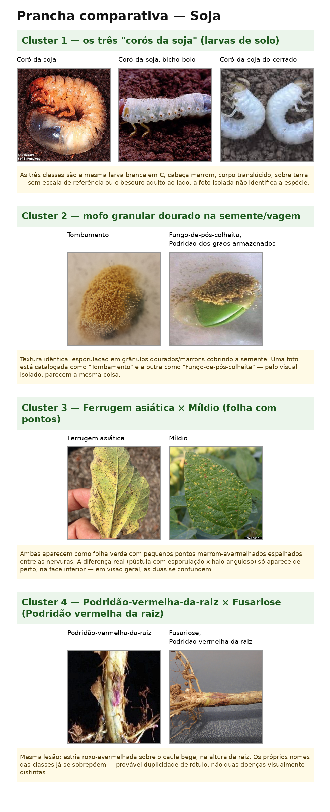
  <p><em>Fonte: Próprios autores (2026).</em></p>
</div>

<div align="center">
  <p><strong>Figura 2 — Prancha comparativa, Soja (pragas, continuação)</strong></p>
  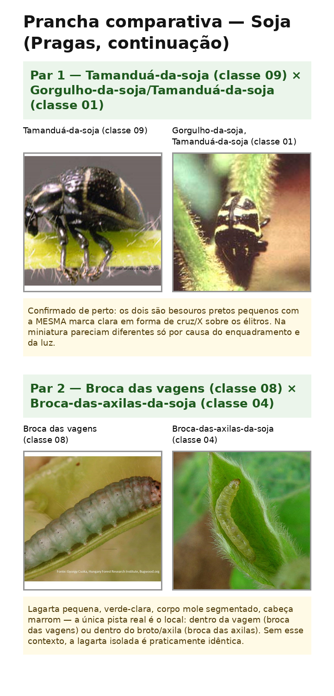
  <p><em>Fonte: Próprios autores (2026).</em></p>
</div>

<div align="center">
  <p><strong>Figura 3 — Prancha comparativa, Soja (duplicidade de rótulo — caule/raiz)</strong></p>
  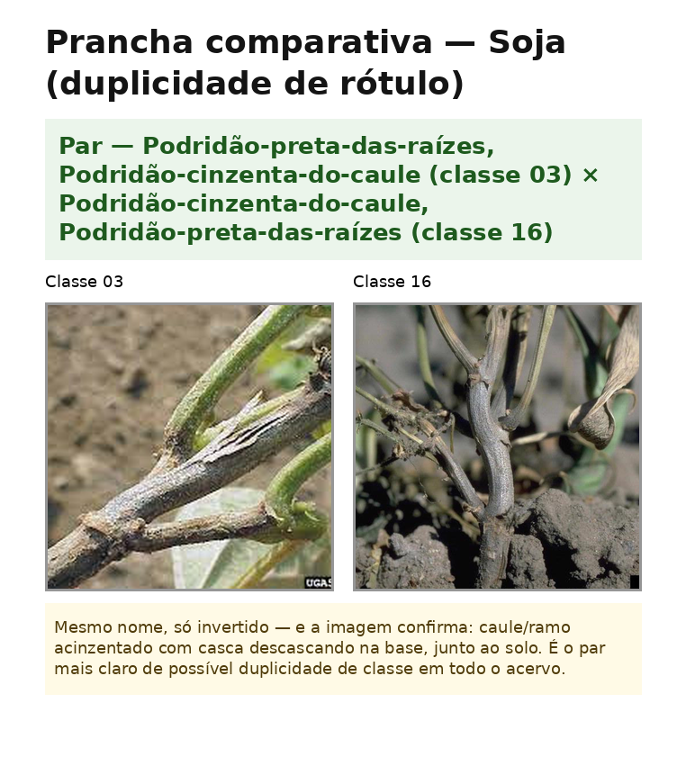
  <p><em>Fonte: Próprios autores (2026).</em></p>
</div>

<div align="center">
  <p><strong>Figura 4 — Prancha comparativa, Soja (cluster de manchas foliares)</strong></p>
  
  <p><em>Fonte: Próprios autores (2026).</em></p>
</div>

### Observação

Boa parte das classes de Soja/Doenças tem hoje apenas 1 a 3 imagens, abaixo do volume
desejável de 5 a 10 indicado como objetivo mínimo para avaliação visual, a análise foi feita com
todo o material disponível, mas os pares e clusters aqui identificados devem ser
revisados quando o acervo for complementado pelo parceiro ou por bases públicas

validadas (Seção 1.4, item 7). A associação formal entre os pares/clusters aqui
levantados e a decisão de unificar ou manter classes separadas será complementada a
partir do dicionário de classes desenvolvido na T3.4.

---

# 4. Preparação dos dados

## 4.3 Estratégia de balanceamento

### Objetivo e decisão

Adotar **ponderação de classes na função de perda**, com amostragem natural das imagens de treino, como estratégia inicial para reduzir a preferência do modelo pelas classes mais frequentes. A reamostragem será avaliada em um experimento separado caso a ponderação não ofereça recuperação adequada das classes minoritárias. Não aplicar as duas correções simultaneamente na configuração inicial.

Esta é a decisão inicial de balanceamento. O [pipeline T4.5](../assets/data/pipeline_T4_5/pesos_classes.json) calcula os pesos a partir do [particionamento das 13 classes](../assets/data/particionamento_T4_2/manifesto_modelo.csv). A [T5.3](#53-varredura-de-arquiteturas-t53) já treinou quatro modelos **exploratoriamente** com ponderação calculada somente a partir das 2.214 imagens de treino. A T5.3 não comparou os experimentos E0 e E1 previstos abaixo, portanto ainda não demonstra o ganho causado pela ponderação. Se o acervo, as classes ou a partição de treino mudarem, os pesos e os treinos terão de ser refeitos. A estratégia atende à mitigação do risco R02.

### Diagnóstico do acervo

O [inventário atualizado da T3.1](#31-inventário-do-acervo) reúne **3.334 imagens em 14 classes de origem**: 1.510 do AgroInsect e 1.824 do iNaturalist / field. A T3.5 define **13 classes de saída**, reunindo *Spodoptera eridania* e *S. cosmioides* em lagarta-das-vagens. Após as decisões de qualidade e escopo da T4.2, incluindo os complementos do acervo anterior, o manifesto atual contém **3.163 imagens**: **2.214 de treino, 475 de validação e 474 de teste**. As contagens de seleção da T3.5 e as do inventário bruto representam etapas anteriores; para balanceamento, prevalece o manifesto por imagem da T4.2.

A tabela usa o [resumo atual por classe](../assets/data/particionamento_T4_2/resumo_modelo.csv), com os mesmos índices da [lista definitiva](../assets/data/classes-modelo.csv). Os pesos foram calculados exclusivamente com os originais de treino e conferidos contra o [artefato da T4.5](../assets/data/pipeline_T4_5/pesos_classes.json); são exibidos com seis casas decimais, mantendo a precisão completa no JSON.

| Índice | Classe | Total no modelo | Treino | Validação | Teste | Peso de treino |
| ---: | --- | ---: | ---: | ---: | ---: | ---: |
| 0 | Vaquinha (Diabrotica speciosa) | 1.049 | 735 | 157 | 157 | 0,231711 |
| 1 | Cigarrinha-do-milho (Dalbulus maidis) | 198 | 138 | 30 | 30 | 1,234114 |
| 2 | Percevejo-barriga-verde (Dichelops/Diceraeus) | 282 | 198 | 42 | 42 | 0,860140 |
| 3 | Lagarta-do-cartucho (Spodoptera frugiperda) | 407 | 285 | 61 | 61 | 0,597571 |
| 4 | Percevejo-marrom (Euschistus heros) | 65 | 45 | 10 | 10 | 3,784615 |
| 5 | Percevejo-verde (Nezara viridula) | 92 | 64 | 14 | 14 | 2,661058 |
| 6 | Percevejo-asa-preta (Edessa meditabunda) | 75 | 53 | 11 | 11 | 3,213353 |
| 7 | Percevejo-do-milho (Leptoglossus zonatus) | 79 | 55 | 12 | 12 | 3,096503 |
| 8 | Lagarta-falsa-medideira (Chrysodeixis includens) | 79 | 55 | 12 | 12 | 3,096503 |
| 9 | Lagarta-da-soja (Anticarsia gemmatalis) | 43 | 30 | 7 | 6 | 5,676923 |
| 10 | Lagarta-das-vagens (Spodoptera eridania e S. cosmioides) | 158 | 110 | 24 | 24 | 1,548252 |
| 11 | Astylus variegatus | 474 | 332 | 71 | 71 | 0,512975 |
| 12 | Cigarrinha-das-pastagens (Deois flavopicta) | 162 | 114 | 24 | 24 | 1,493927 |
| **Total** | **13 classes** | **3.163** | **2.214** | **475** | **474** | — |

No treino, a razão entre a maior e a menor classe é **735/30 = 24,5:1**. A vaquinha concentra **33,2%** das imagens de treino, enquanto a lagarta-da-soja representa **1,4%**. Todas as classes têm grupos nas três partições, conforme a auditoria da T4.2. Essa distribuição fundamenta a ponderação inicial. Se houver modelos separados por cultura, as frequências e os pesos deverão ser recalculados separadamente para cada modelo.

A limitação principal combina desbalanceamento e escassez de exemplos independentes. Nenhuma técnica de balanceamento substitui a coleta de imagens novas ou a definição de classes visualmente distinguíveis.

### Comparação das abordagens

| Abordagem | Benefício | Limitação no acervo atual | Decisão |
| --- | --- | --- | --- |
| Ponderação de classes | Aumenta a contribuição das classes raras na perda e conserva todas as imagens disponíveis. | Também aumenta a influência de eventuais erros de rótulo e pode favorecer memorização de classes com poucos exemplos. | Aplicada exploratoriamente na T5.3; reavaliar quando o acervo for ampliado. |
| Sobreamostragem | Faz as classes raras aparecerem mais vezes nos lotes de treino. | Repete os mesmos exemplares; não acrescenta diversidade independente e pode causar sobreajuste. | Alternativa a comparar, sem pesos inversos simultâneos. |
| Subamostragem | Reduz a participação das classes mais frequentes. | Descartaria imagens úteis das classes majoritárias sem acrescentar diversidade às minoritárias. | Não adotar inicialmente. |
| Ponderação + sobreamostragem | Permite ajustar frequência e contribuição na perda separadamente. | Aplicar ambas integralmente sobrecorrige as classes raras e dificulta atribuir a origem de um ganho. | Não adotar inicialmente; exige novo experimento com pesos ajustados à distribuição efetivamente amostrada. |

A [documentação do TensorFlow sobre dados desbalanceados](https://www.tensorflow.org/tutorials/structured_data/imbalanced_data) apresenta ponderação e sobreamostragem e discute suas diferenças na atualização por lotes. Essa referência trata de classificação binária; a comparação experimental aqui será multiclasse, no acervo do Agro App, sem assumir transferência dos resultados do tutorial.

### Cálculo e aplicação dos pesos

Para cada classe aprovada `c`, calcular:

```text
N = número de imagens originais no conjunto de treino do modelo
K = número de classes aprovadas para esse modelo
n_c = número de imagens originais da classe c no treino
w_c = N / (K × n_c)
```

Essa é a regra de ponderação balanceada descrita pelo [scikit-learn em `compute_class_weight`](https://scikit-learn.org/stable/modules/generated/sklearn.utils.class_weight.compute_class_weight.html). Com amostragem natural, a contribuição potencial de cada classe passa a ser `n_c × w_c = N/K`. A média dos pesos sobre as imagens de treino é 1, preservando a escala média da ponderação.

No treinamento multiclasse, multiplicar a entropia cruzada de cada exemplo pelo peso de sua classe antes de calcular a média do lote. No fluxo Keras previsto para os experimentos, fornecer o mapa de índices de saída para pesos por meio de `class_weight`; não aplicar simultaneamente o mesmo peso via `sample_weight`. O mapa de índices deve corresponder exatamente ao manifesto de classes do modelo.

Na partição atual, **`N = 2.214` e `K = 13`**. Assim, vaquinha (`n_c = 735`) recebe `2214 / (13 × 735) ≈ 0,231711`, e lagarta-da-soja (`n_c = 30`) recebe `2214 / (13 × 30) ≈ 5,676923`. Validação, teste e versões aumentadas não entram em `N` nem em `n_c`.

O cálculo está implementado em `_pesos_balanceados` no [pipeline T4.5](../src/pipeline_preparacao_t4_5.py), que filtra `particao == "treino"` antes de contar os registros originais. Para reproduzir os pesos, executar `python -m src.pipeline_preparacao_t4_5` na raiz do repositório. O treinamento T5.1 consome esse contrato por meio de [dados_treino.py](../src/dados_treino.py). A sobreamostragem permanece apenas como alternativa E2 para comparação; não integra a configuração inicial.

Recalcular os pesos em cada partição de treinamento, inclusive em cada rodada de validação cruzada. Não utilizar as frequências de validação ou teste, nem contar versões aumentadas como novas imagens originais. Uma classe com `n_c = 0` torna a configuração inválida: revisar a partição ou o escopo antes de treinar, sem substituir a divisão por zero por um peso arbitrário.

### Partições, classes escassas e aumento de dados

1. Usar as classes e decisões de duplicidade registradas no inventário, com rastreabilidade das fusões e exclusões até os IDs de origem.
2. Separar treino, validação e teste por grupos de origem: imagens idênticas, versões derivadas e fotos correlacionadas da mesma planta ou captura devem permanecer na mesma partição. Preservar as proporções de classes quando houver grupos suficientes; a separação por grupos tem prioridade sobre a estratificação. A [documentação do scikit-learn sobre validação cruzada](https://scikit-learn.org/stable/modules/cross_validation.html) descreve a combinação de grupos e estratificação.
3. Conferir a presença de exemplos independentes de cada classe nas partições. Uma única imagem não permite avaliar a mesma classe em treino e em uma partição independente. Duas imagens ou grupos não permitem representá-la simultaneamente em treino, validação e teste. Não forçar uma divisão percentual fixa quando a integridade dos grupos exigir outra distribuição.
4. Priorizar a complementação das classes insuficientes. Até que haja grupos independentes para treinamento, seleção e avaliação, tratá-las como exploratórias e não declarar desempenho validado para elas. Se for necessário restringir o MVP, registrar o escopo efetivamente avaliado; agrupamentos só podem decorrer de decisão agronômica, não da necessidade de aumentar contagens.
5. Aplicar aumento de dados somente depois da divisão, durante o treino, preservando o ID e a partição do original. Usar transformações moderadas e agronomicamente plausíveis, que não removam lesões nem alterem cores diagnósticas. As transformações deverão ser inspecionadas por amostra; não fixar parâmetros sem observar as imagens.

Validação e teste mantêm suas imagens originais, com apenas o pré-processamento determinístico exigido pelo modelo, sem sobreamostragem, subamostragem ou pesos de balanceamento nas métricas. O teste T4.2 foi consultado na T5.3 e passou a ter caráter exploratório; a avaliação final dependerá do novo conjunto descrito na seção 5.3. Quando se usar validação cruzada para selecionar a estratégia, verificar previamente se cada classe possui grupos suficientes para as rodadas escolhidas.

### Plano de comparação e seleção

Comparar as configurações abaixo no mesmo escopo de classes avaliáveis e nas mesmas partições. Manter arquitetura, inicialização, transformações, orçamento de atualizações do otimizador e regra de parada equivalentes; registrar as sementes. Quando viável, usar três sementes por configuração e apresentar média e dispersão dos resultados.

| Experimento | Amostragem de treino | Peso na perda | Finalidade |
| --- | --- | --- | --- |
| E0 — Referência | Natural, embaralhada | 1 para todas as classes | Medir o comportamento sem correção. |
| E1 — Estratégia inicial | Natural, embaralhada | `N / (K × n_c)` | Medir o efeito da ponderação. |
| E2 — Alternativa | Selecionar a classe uniformemente e depois uma imagem dessa classe, com reposição | 1 para todas as classes | Medir o efeito da sobreamostragem sem dupla correção. |

Em E2, realizar exatamente o mesmo número de atualizações que nos demais experimentos e gerar transformações de treino a cada apresentação da imagem. A repetição não será registrada como aumento do número de imagens independentes. Não usar a quantidade de épocas isoladamente para igualar o orçamento se o tamanho lógico do conjunto amostrado mudar.

Selecionar a configuração pela **F1 macro na validação**, reportando também precisão, recall, F1 e suporte por classe, balanced accuracy (média do recall das classes) e matriz de confusão. A acurácia global será complementar. Classes sem exemplos em uma partição devem ser indicadas como não avaliadas, com a cobertura explicitada; não omitir silenciosamente essas classes nem interpretar métricas sem suporte como desempenho observado.

Verificar especialmente as classes minoritárias e os pares confundíveis apontados na análise visual. Se a correção elevar recall às custas de muitas identificações incorretas, investigar a matriz de confusão e a precisão por classe antes de adotá-la. Em caso de resultados próximos à variação entre sementes, preferir a configuração mais simples; se E1 não apresentar benefício demonstrável frente a E0, registrar o resultado e rever a decisão inicial. Não escolher a estratégia a partir do teste final.

Depois da seleção, ajustar a política de confiança usando somente dados de validação independentes: o balanceamento pode mudar a distribuição das saídas do modelo. Confirmar o desempenho e o comportamento inconclusivo no teste final, inclusive após a quantização. Não interpretar a confiança bruta como probabilidade calibrada sem avaliação.

### Registros e critérios de conclusão

O experimento deverá guardar versão do dataset, classes aprovadas e respectivos índices, IDs e grupos de cada partição, contagens originais de treino por classe, pesos aplicados, configuração de amostragem, transformações, sementes, orçamento de treinamento e métricas por classe. Esses registros permitem reproduzir o cálculo e identificar alterações após a ampliação do acervo.

A **definição da T4.3** fica consolidada nesta seção: ponderação como escolha inicial, justificativa baseada no dataset atualizado e nas 13 classes finais, pesos calculados somente sobre os originais de treino e integração com o contrato da T4.5. A verificação reproduzível está em `python tests/validar_pipeline_t4_5.py`, que confere as partições, o cálculo dos pesos e sua média ponderada igual a 1. A **validação experimental** ficará concluída após a execução de E0/E1 (e E2 se necessário), registro das métricas e justificativa da configuração selecionada. Até lá, não há evidência para afirmar melhora de desempenho ou generalização nas classes do modelo.

validadas (Seção 1.4, item 7). O [dicionário de classes da T3.4](#dicionário-de-classes-t34)
registra as relações entre os rótulos candidatos a duplicidade. A decisão de unificar
ou manter classes separadas depende de validação agronômica e do conteúdo técnico do parceiro.

## 3.3 Diagnóstico de qualidade do acervo

### Objetivo

Avaliar resolução, enquadramento, presença de duplicatas e proporção de imagens de campo e de catálogo no acervo de soja e milho. O diagnóstico registra como esses fatores podem afetar a generalização do modelo de reconhecimento visual.

**Fonte das imagens analisadas:** imagens disponibilizadas pela equipe do Agro APP.

### Metodologia

A análise reúne **3.460 imagens** de três fontes: **3.334** da pasta `dataset` e **126** dos acervos de Milho e Soja. As planilhas registram, para cada imagem, a cultura, a categoria, a ocorrência, o caminho do arquivo, as dimensões, a legibilidade, o hash SHA-256, o hash perceptual, os alertas de qualidade e a decisão de seleção. A verificação seguiu estas etapas:

1. **Resolução e leitura:** conferir se o arquivo era legível, registrar largura e altura e sinalizar imagens cuja menor dimensão fosse inferior à referência de 224 pixels.
2. **Duplicatas:** comparar hashes SHA-256 para localizar arquivos idênticos e examinar os pares sugeridos pelo hash perceptual para identificar versões da mesma fotografia, inclusive quando aparecem em classes diferentes.
3. **Revisão por imagem:** conferir o enquadramento, a visibilidade do problema, o formato da imagem, a duplicidade e a coerência do rótulo; registrar a decisão (**manter**, **revisar** ou **excluir**) e sua justificativa. As 379 pendências registradas nesta etapa foram examinadas visualmente.
4. **Consolidação:** agrupar os registros por fonte e classe, contar os alertas de qualidade e as decisões, e calcular as proporções de imagens de campo e de catálogo. Os alertas de resolução, desfoque e exposição podem se sobrepor e não determinam, isoladamente, a exclusão.

A unidade de contagem é o **registro de imagem**. Se uma mesma fotografia aparece em duas classes, ela contribui com um registro para cada classe. As abas de revisão e os resumos da planilha de decisões permitem rastrear os totais até cada imagem.

### Planilhas de diagnóstico e revisão

| Arquivo | Conteúdo e função |
| --- | --- |
| [Diagnóstico das três fontes](../assets/data/diagnostico_qualidade_T3_3_tres_fontes.xlsx) | Relatório de diagnóstico das 3.460 imagens de `dataset`, Milho e Soja, com indicadores de qualidade, resumos por classe e candidatos a duplicata. |
| [Planilha de decisões](../assets/data/diagnostico_qualidade_T3_3_revisado.xlsx) | Decisão **manter**, **excluir** ou **revisar** e justificativa por registro, além dos resumos e da conclusão dos pares de duplicatas visuais. |

 <p><em>Fonte: Próprios autores (2026).</em></p>

As abas de revisão preservam `largura`, `altura`, `menor_dimensao`, `megapixels`, `arquivo_legivel`, os alertas de nitidez e exposição, a decisão e a justificativa de cada foto. O **Resumo por classe** reúne os indicadores e as decisões por cultura, ocorrência e fonte. Megapixels medem o tamanho total da imagem, enquanto a menor dimensão e o enquadramento ajudam a verificar se o sinal relevante terá detalhe suficiente na entrada do modelo.

### Resultados

#### Visão geral

| Indicador | Resultado |
| --- | ---: |
| Imagens avaliadas | 3.460 |
| Ocorrências distintas registradas | 69 |
| Imagens legíveis | 3.460 |
| Imagens com menor dimensão abaixo de 224 pixels | 129 (3,7%) |
| Imagens possivelmente borradas | 29 (0,8%) |
| Imagens com exposição inadequada | 75 (2,2%) |
| Imagens de campo | 1.900 (54,9%) |
| Imagens de catálogo | 1.560 (45,1%) |
| Imagens marcadas para manter | 3.262 |
| Imagens marcadas para revisar | 0 |
| Imagens marcadas para excluir | 198 |

*Fonte: diagnóstico das três fontes e planilha de decisões (2026).*

Os **3.460 registros** incluem **1.824** fotos de campo e **1.510** imagens de catálogo de `dataset`, além de **16** imagens do acervo de Milho e **110** do acervo de Soja. Na pasta `dataset`, as decisões são **3.156 manter** e **178 excluir**. Das **379** pendências encontradas no conjunto, a inspeção visual indicou **214 manter** e **165 excluir**. Uma imagem adicional, anteriormente marcada para manter, foi excluída por repetir uma fotografia com rótulo conflitante. As justificativas individuais constam da planilha de decisões.

O limite de **224 pixels na menor dimensão** sinaliza imagens pequenas, mas não prova que sejam inutilizáveis; o detalhe relevante precisa ser conferido após o redimensionamento usado pelo modelo. O enquadramento manual foi registrado nas **126 imagens** dos acervos anteriores: **seis** receberam a marcação *distante*. Esse indicador não foi medido manualmente para as outras 3.334 imagens e, por isso, não aparece como total geral no quadro.

#### Duplicatas: critério essencial

Nas três fontes, foram encontrados **15 grupos de duplicatas exatas**, com **30 registros**, e **99 pares candidatos a duplicata visual** pelo hash perceptual. A inspeção dos 99 pares identificou **4 falsos positivos**, **2 pares da mesma foto com rótulos conflitantes** e **93 pares da mesma foto ou cena com versões redundantes**. Pares podem compartilhar imagens e não representam, necessariamente, 99 exclusões adicionais. Entre os 15 grupos exatos, **12** conservaram uma cópia; em **dois**, ambas foram excluídas por rótulos conflitantes; no grupo restante, foi selecionada uma versão equivalente fora do par exato. Os 30 registros desses grupos somam **12 manter** e **18 excluir**.

O quadro abaixo detalha **dois pares do acervo de Soja** que atravessam classes diferentes: um par exato, confirmado pelo SHA-256, e outro formado por versões da mesma fotografia. Esses casos exemplificam o risco de rótulos conflitantes preservado na análise visual:

| Classe de soja/doenças | Duplicatas exatas na classe | Versões quase iguais na classe | Imagem | Repetida de |
| --- | ---: | ---: | --- | --- |
| Estiolamento, Podridão-de-raízes, Tombamento-de-mudas | 1 | 0 | IMG_0030 | IMG_0098 |
| Podridão-de-raízes | 1 | 0 | IMG_0098 | IMG_0030 |
| Phomopsis-da-semente | 0 | 1 | IMG_0090 | IMG_0108 |
| Seca da haste e da vagem, Phomopsis-da-semente | 0 | 1 | IMG_0108 | IMG_0090 |

 <p><em>Fonte: Próprios autores (2026).</em></p>

IMG_0030 e IMG_0098 formam o par exato; IMG_0090 e IMG_0108 são versões da mesma foto. Os quatro registros foram excluídos da seleção para treinamento até que seus rótulos sejam conferidos e corrigidos. Antes de separar dados de treino e teste, deve-se manter versões da mesma fotografia no mesmo conjunto ou remover a redundância. Caso contrário, o modelo pode memorizar a imagem e a avaliação aparentar um desempenho maior do que teria em fotos novas. Rótulos conflitantes também podem ensinar associações contraditórias. A conclusão de cada par candidato está na aba **Duplicatas visuais** da planilha de decisões.

#### Campo e catálogo: critério essencial

**Campo** representa a imagem no contexto da lavoura. **Catálogo** representa uma imagem de referência, frequentemente isolada ou com apresentação controlada. É uma classificação do tipo de foto, não uma decisão automática de descarte.

| Fonte | Campo | Catálogo | Total |
| --- | ---: | ---: | ---: |
| `dataset` | 1.824 | 1.510 | 3.334 |
| Milho | 14 | 2 | 16 |
| Soja | 62 | 48 | 110 |
| **Total** | **1.900** | **1.560** | **3.460** |

 <p><em>Fonte: Próprios autores (2026).</em></p>

Em `dataset`, **54,7%** das imagens são de campo e **45,3%** de catálogo. Na avaliação manual dos acervos anteriores, **15 classes** tinham apenas imagens de catálogo, **18** apenas imagens de campo e **22** apresentavam os dois tipos. Se o uso real do AgroApp for fotografar plantas em campo, um modelo treinado em excesso com imagens de catálogo pode aprender fundos, iluminação ou enquadramentos que não representam esse uso. Isso pode reduzir sua capacidade de reconhecer a mesma ocorrência em fotos reais. Recomenda-se avaliar o modelo em fotos de campo separadas por fotografia de origem e acompanhar o desempenho por tipo de imagem e por classe. Este diagnóstico aponta um risco de generalização; ele não quantifica uma queda de desempenho.

#### Resolução e enquadramento: critério desejável

No conjunto das três fontes, **129 imagens** têm menor dimensão abaixo de 224 pixels, **29** foram sinalizadas como possivelmente borradas e **75** apresentam exposição inadequada. Esses alertas podem se sobrepor. Entre as **12 imagens pequenas** dos acervos anteriores, **5** foram excluídas e **7** mantidas após inspeção visual; as **6** com enquadramento distante foram excluídas. O limite de 224 pixels funciona como alerta, não como critério isolado de exclusão. As imagens abaixo preservam exemplos das decisões e justificativas da inspeção.

##### Imagens pequenas mantidas

| Imagem | Classe | Dimensões | Decisão |
| --- | --- | ---: | --- |
| IMG_0017 | Antracnose | 216 × 322 pixels | Manter |
| IMG_0018 | Antracnose | 322 × 211 pixels | Manter |
| IMG_0045 | Mancha-aureolada | 259 × 194 pixels | Manter |
| IMG_0099 | Podridão-preta-das-raízes, Podridão-cinzenta-do-caule | 259 × 195 pixels | Manter |
| IMG_0119 | Coró-da-soja-do-cerrado | 279 × 181 pixels | Manter |
| IMG_0121 | Coró-da-soja, bicho-bolo | 200 × 190 pixels | Manter |
| IMG_0122 | Gorgulho-da-soja, Tamanduá-da-soja | 287 × 220 pixels | Manter |

*Fonte: imagens disponibilizadas pela equipe do Agro APP.*

A decisão de manter essas imagens não elimina o alerta de resolução. A qualidade do sinal deve continuar sendo acompanhada após o redimensionamento do fluxo de treinamento.

##### Imagens pequenas excluídas

As cinco imagens abaixo foram retiradas da seleção para treinamento porque sua resolução é inferior à referência de 224 pixels na menor dimensão e o detalhe útil foi considerado insuficiente na revisão. A planilha preserva cada arquivo e registra **excluir** na coluna `decisao`, com a justificativa individual.

| Foto | Classe e dimensões | Por que excluir |
| --- | --- | --- |
|  | **IMG_0021** — Clodosporiose, Verrugose; 300 × 214 pixels | As lesões perdem detalhe com a baixa resolução.Além da imagem possuir outra imagem sobreposta. |
| 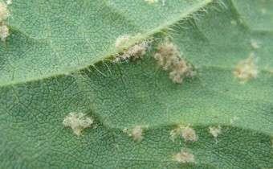 | **IMG_0055** — Míldio; 340 × 210 pixels | O detalhe do sintoma fica limitado pelo tamanho do arquivo. |
| 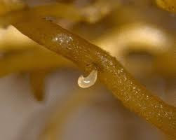 | **IMG_0087** — Nematóide-reniforme; 251 × 200 pixels | O elemento observado dispõe de poucos pixels para reconhecimento junto a imagem ser de microcóspio. |
|  | **IMG_0117** — Cascudinho-da-soja; 274 × 184 pixels | Os insetos têm detalhe insuficiente para uma entrada de treinamento confiável. |
| 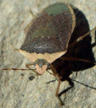 | **IMG_0125** — Percevejo da Soja; 121 × 136 pixels | A resolução é muito baixa e limita fortemente a identificação do inseto. |

*Fonte: imagens disponibilizadas pela equipe do Agro APP.*

##### Imagens com enquadramento distante excluídas

Foram marcadas como **excluir** as imagens **IMG_0014**, **IMG_0029**, **IMG_0042**, **IMG_0072**, **IMG_0073** e **IMG_0078**. Nelas, a infestação, a muda ou os sinais associados à classe aparecem pequenos demais ou não são visíveis. Mesmo quando o arquivo tem dimensões grandes, a informação necessária para reconhecer a ocorrência ocupa poucos pixels. Por isso, essas fotos não são adequadas para treinar o reconhecimento da ocorrência específica. Os exemplos abaixo preservam as justificativas dessa inspeção visual.

| Foto | Classe e motivo da exclusão |
| --- | --- |
|  | **IMG_0042 — Macrophomina.** A fotografia mostra a lavoura à distância. O sinal específico da classe não pode ser distinguido na imagem. |
|  | **IMG_0078 — Nematóide de cisto.** A fotografia mostra as linhas da lavoura, mas não as raízes ou os cistos necessários para identificar a ocorrência. |

*Fonte: imagens disponibilizadas pela equipe do Agro APP.*

As fotos acima são exemplos de um problema de **escala do objeto na cena**, não de tamanho do arquivo. Fotos distantes podem levar o modelo a aprender características gerais da lavoura ou do fundo em vez dos sinais da classe, prejudicando a generalização para novas capturas.

#### Imagem incompatível com o rótulo

A **IMG_0067** também foi marcada como **excluir**. Ela está na pasta `Soja/Doencas/21 - Murcha-de-fusarium, Murcha`, mas mostra plantas com **frutos vermelhos** e tem baixa qualidade visual. O conteúdo não corresponde de forma confiável à cultura e à ocorrência registradas. Não deve ser usada no treinamento do modelo; o rótulo precisa de validação técnica antes de qualquer reaproveitamento.

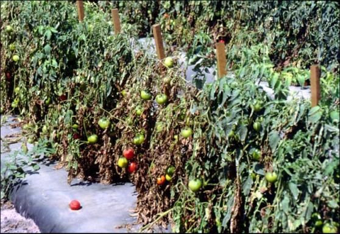

*Fonte: imagens disponibilizadas pela equipe do Agro APP.*

Imagens com conteúdo incompatível com a classe, cultura não confirmada ou qualidade visual insuficiente devem ser retiradas da seleção de treinamento. Caso se deseje reaproveitá-las em outro conjunto, é necessário validar a origem e o rótulo antes.


#### Imagens em formato técnico ou de montagem

As imagens **IMG_0031**, **IMG_0036** e **IMG_0070** também foram marcadas como **excluir**. A [persona e sua jornada](#13-persona-e-jornada-do-usuário) descrevem uma estudante que fotografa plantas durante atividades de campo com o AgroApp. A entrada esperada para o modelo é, portanto, uma fotografia única capturada nessa situação. Uma imagem de microscópio ou uma montagem preparada apresenta enquadramento e pistas visuais diferentes dos que o aplicativo receberá. Incluí-las no treinamento pode fazer o modelo aprender características do material técnico, como bordas, margens e divisão da imagem, em vez dos sinais da ocorrência.

| Foto | Classe e justificativa da exclusão |
| --- | --- |
| 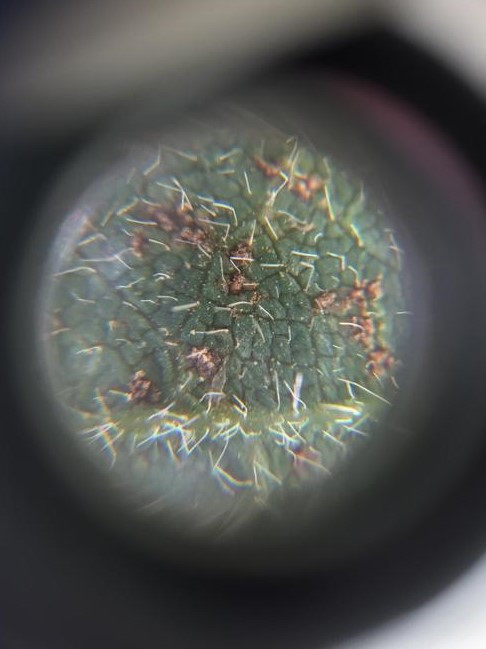 | **IMG_0031 — Ferrugem asiática.** O campo circular indica uma captura microscópica de laboratório, que não corresponde à fotografia da planta feita pela persona em campo. |
| 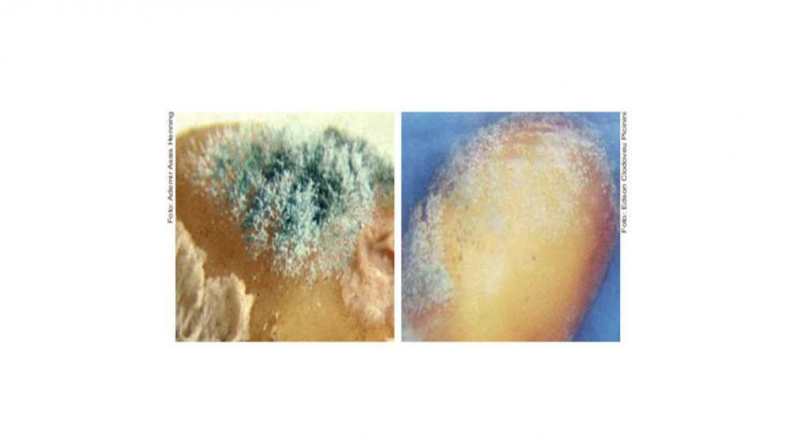 | **IMG_0036 — Fungo-de-armazenamento.** Duas imagens pequenas foram reunidas em uma apresentação técnica com margens amplas; o arquivo não representa uma captura única no aplicativo. |
| 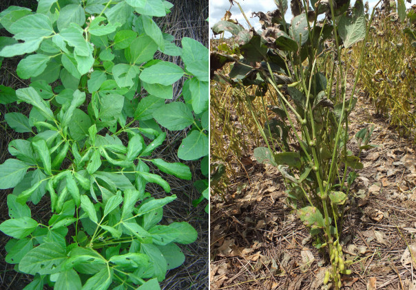 | **IMG_0070 — Nematoide-da-haste verde, Ponta Branca.** A montagem compara duas cenas em um único arquivo. Embora as cenas mostrem plantas, esse formato preparado não corresponde à foto única que a persona enviará. |

*Fonte: imagens disponibilizadas pela equipe do Agro APP.*

Essas exclusões se referem ao treinamento do modelo de reconhecimento por fotos capturadas no uso previsto. Os arquivos originais continuam preservados como material técnico de referência.

### Observação

**Nenhuma imagem permanece em revisar** na planilha de decisões desta etapa. A inspeção visual registrada nela cobriu as **126 imagens** dos acervos anteriores e **381 imagens distintas de `dataset`**, incluindo as pendências e amostras adicionais. As outras **2.953 imagens de `dataset` não receberam inspeção visual individual**; a ausência de pendências na planilha não equivale a uma revisão visual completa do acervo. A marcação **excluir** retira a imagem da seleção de treinamento; os arquivos originais foram preservados. Não foram feitos testes de desempenho do modelo para quantificar o efeito das exclusões.
## Dicionário de classes (T3.4)

O dicionário relaciona as **55 ocorrências e 126 imagens** do inventário às culturas, aos agentes causais de referência e ao vínculo de conteúdo técnico. Cobre 4 ocorrências de milho/pragas (16 imagens), 10 de soja/pragas (13 imagens) e 41 de soja/doenças (97 imagens). Não inclui classes de plantas daninhas, deficiências ou plantas sadias, pois não há registros dessas categorias no inventário recebido.

O arquivo [dicionario-classes.json](../assets/data/dicionario-classes.json) é a fonte estruturada desta entrega. A origem dos rótulos e das contagens é o [inventário versionado](../assets/data/inventario-acervo.xlsx). Os agentes indicados são referências bibliográficas para a descrição das classes; o dicionário não substitui o registro de origem de cada imagem.

### Campos e convenções

| Campo JSON | Significado e regra |
| --- | --- |
| `id` | Identificador único e estável, de `AGRO-001` a `AGRO-055`. A ordem inicial acompanha as linhas preenchidas do inventário. Não reutilizar IDs nem renumerar após revisão. Não representa o índice de saída do modelo. |
| `cultura` | Soja ou Milho; faz parte da identidade da ocorrência. |
| `categoria` | Pragas ou Doenças; o campo `classe` da planilha representa esta categoria, não uma classe individual de treinamento. |
| `rotulo_origem` | Texto exato da planilha, inclusive acentos decompostos, grafias e separadores. Permite rastrear a ocorrência. |
| `nome_comum` | Rótulo convertido para Unicode NFC para exibição, preservando a nomenclatura recebida. Correções de nomes exigem revisão, mantendo o rótulo de origem. |
| `quantidade_imagens` | Contagem registrada no inventário. |
| `agente_causal` | Táxon ou conjunto de táxons de referência; `null` quando o rótulo não permite associação suficientemente segura. Gênero seguido de `spp.` não identifica uma espécie. |
| `status_agente` | `referencia_a_validar` ou `indeterminado`; nenhuma imagem foi confirmada agronomicamente nesta entrega. |
| `fontes` | Códigos de referências bibliográficas definidos no objeto `fontes` do JSON. Lista vazia para agentes indeterminados. |
| `chave_conteudo` | Chave **oficial** do conteúdo técnico do Agro App. Atualmente `null` em todos os registros: o catálogo oficial não está no repositório. |
| `chave_conteudo_proposta` | Chave local única em ASCII (`cultura.ocorrencia.agro-NNN`) para organizar a futura integração. Não é uma URL, rota ou identificador existente do aplicativo. |
| `status_conteudo` | `aguardando_catalogo_agroapp`; mudar para `validado` somente após confirmar a chave oficial e a abertura do conteúdo correto. |
| `relacoes` | IDs de ocorrências candidatas a duplicidade ou revisão de identidade. Não autoriza união de classes. |

### Catálogo

Todas as chaves abaixo são **propostas locais**, ainda sem correspondência oficial validada. “Indeterminado” é uma pendência explícita, não uma nova classe do modelo.

<!-- tabela:inicio -->
| ID | Cultura | Categoria | Rótulo no inventário / nome comum | Agente causal de referência | Chave proposta |
| --- | --- | --- | --- | --- | --- |
| AGRO-001 | Milho | Pragas | Cigarrinha do milho | Dalbulus maidis | `milho.ocorrencia.agro-001` |
| AGRO-002 | Milho | Pragas | Coró-do-milho | Indeterminado — revisão necessária | `milho.ocorrencia.agro-002` |
| AGRO-003 | Milho | Pragas | Percevejo-do-milho | Indeterminado — revisão necessária | `milho.ocorrencia.agro-003` |
| AGRO-004 | Milho | Pragas | Pulgão-do-milho | Rhopalosiphum maidis | `milho.ocorrencia.agro-004` |
| AGRO-005 | Soja | Doenças | Antracnose | Colletotrichum truncatum | `soja.ocorrencia.agro-005` |
| AGRO-006 | Soja | Doenças | Cancro-da-haste | Diaporthe aspalathi; Diaporthe caulivora | `soja.ocorrencia.agro-006` |
| AGRO-007 | Soja | Doenças | Clodosporiose, Verrugose | Indeterminado — revisão necessária | `soja.ocorrencia.agro-007` |
| AGRO-008 | Soja | Doenças | Crestamento bacteriano | Pseudomonas savastanoi pv. glycinea | `soja.ocorrencia.agro-008` |
| AGRO-009 | Soja | Doenças | Damping-off, Podridão-aquosa, Tombamento | Indeterminado — revisão necessária | `soja.ocorrencia.agro-009` |
| AGRO-010 | Soja | Doenças | Estiolamento, Podridão-de-raízes, Tombamento-de-mudas | Indeterminado — revisão necessária | `soja.ocorrencia.agro-010` |
| AGRO-011 | Soja | Doenças | Ferrugem asiática | Phakopsora pachyrhizi | `soja.ocorrencia.agro-011` |
| AGRO-012 | Soja | Doenças | Fungo de pós colheita | Indeterminado — revisão necessária | `soja.ocorrencia.agro-012` |
| AGRO-013 | Soja | Doenças | Fungo-de-armazenamento | Indeterminado — revisão necessária | `soja.ocorrencia.agro-013` |
| AGRO-014 | Soja | Doenças | Fungo-de-pós-colheita, Podridão-dos-grãos-armazenados | Indeterminado — revisão necessária | `soja.ocorrencia.agro-014` |
| AGRO-015 | Soja | Doenças | Fusariose, Podridão vermelha da raiz | Fusarium spp. (complexo de podridão vermelha da raiz) | `soja.ocorrencia.agro-015` |
| AGRO-016 | Soja | Doenças | Macrophomina | Macrophomina phaseolina | `soja.ocorrencia.agro-016` |
| AGRO-017 | Soja | Doenças | Mancha alvo | Corynespora cassiicola | `soja.ocorrencia.agro-017` |
| AGRO-018 | Soja | Doenças | Mancha-aureolada | Indeterminado — revisão necessária | `soja.ocorrencia.agro-018` |
| AGRO-019 | Soja | Doenças | Mancha-olho-de-rã | Cercospora sojina | `soja.ocorrencia.agro-019` |
| AGRO-020 | Soja | Doenças | Mancha-parda, Septoriose | Septoria glycines | `soja.ocorrencia.agro-020` |
| AGRO-021 | Soja | Doenças | Mela ou requeima | Rhizoctonia solani AG1 | `soja.ocorrencia.agro-021` |
| AGRO-022 | Soja | Doenças | Míldio | Peronospora manshurica | `soja.ocorrencia.agro-022` |
| AGRO-023 | Soja | Doenças | Mofo-branco, Podridão-de-sclerotinia | Sclerotinia sclerotiorum | `soja.ocorrencia.agro-023` |
| AGRO-024 | Soja | Doenças | Mosaico comum da soja | Soybean mosaic virus (SMV) | `soja.ocorrencia.agro-024` |
| AGRO-025 | Soja | Doenças | Murcha-de-Sclerotium | Sclerotium rolfsii | `soja.ocorrencia.agro-025` |
| AGRO-026 | Soja | Doenças | Murcha-de-fusarium, Murcha | Fusarium spp. | `soja.ocorrencia.agro-026` |
| AGRO-027 | Soja | Doenças | Nematoide-da-haste verde, Ponta Branca | Aphelenchoides besseyi | `soja.ocorrencia.agro-027` |
| AGRO-028 | Soja | Doenças | Nematóide das lesões | Pratylenchus spp. | `soja.ocorrencia.agro-028` |
| AGRO-029 | Soja | Doenças | Nematóide de cisto | Heterodera glycines | `soja.ocorrencia.agro-029` |
| AGRO-030 | Soja | Doenças | Nematóide de galhas | Meloidogyne spp. | `soja.ocorrencia.agro-030` |
| AGRO-031 | Soja | Doenças | Nematóide-espiralado, Nematóide | Helicotylenchus spp. | `soja.ocorrencia.agro-031` |
| AGRO-032 | Soja | Doenças | Nematóide-reniforme | Rotylenchulus reniformis | `soja.ocorrencia.agro-032` |
| AGRO-033 | Soja | Doenças | Oídio | Microsphaera diffusa (sinônimo: Erysiphe diffusa) | `soja.ocorrencia.agro-033` |
| AGRO-034 | Soja | Doenças | Phomopsis-da-semente | Diaporthe spp. (Phomopsis spp.) | `soja.ocorrencia.agro-034` |
| AGRO-035 | Soja | Doenças | Podridão da semente, Podridão de Fusarium | Fusarium spp. | `soja.ocorrencia.agro-035` |
| AGRO-036 | Soja | Doenças | Podridão radicular de Phytophthora | Phytophthora sojae | `soja.ocorrencia.agro-036` |
| AGRO-037 | Soja | Doenças | Podridão-cinzenta-do-caule, Podridão-preta-das-raízes | Macrophomina phaseolina | `soja.ocorrencia.agro-037` |
| AGRO-038 | Soja | Doenças | Podridão-de-raízes | Indeterminado — revisão necessária | `soja.ocorrencia.agro-038` |
| AGRO-039 | Soja | Doenças | Podridão-preta-das-raízes, Podridão-cinzenta-do-caule | Macrophomina phaseolina | `soja.ocorrencia.agro-039` |
| AGRO-040 | Soja | Doenças | Podridão-radicular | Indeterminado — revisão necessária | `soja.ocorrencia.agro-040` |
| AGRO-041 | Soja | Doenças | Podridão-vermelha-da-raiz | Fusarium spp. (complexo de podridão vermelha da raiz) | `soja.ocorrencia.agro-041` |
| AGRO-042 | Soja | Doenças | Pústula bacteriana | Xanthomonas axonopodis pv. glycines | `soja.ocorrencia.agro-042` |
| AGRO-043 | Soja | Doenças | Seca da haste e da vagem, Phomopsis-da-semente | Diaporthe spp. (Phomopsis spp.) | `soja.ocorrencia.agro-043` |
| AGRO-044 | Soja | Doenças | Tombamento | Indeterminado — revisão necessária | `soja.ocorrencia.agro-044` |
| AGRO-045 | Soja | Doenças | nematóide de cisto da soja (NCS) | Heterodera glycines | `soja.ocorrencia.agro-045` |
| AGRO-046 | Soja | Pragas | Broca das vagens - Soja | Indeterminado — revisão necessária | `soja.ocorrencia.agro-046` |
| AGRO-047 | Soja | Pragas | Broca-das-axilas-da-soja | Crocidosema aporema | `soja.ocorrencia.agro-047` |
| AGRO-048 | Soja | Pragas | Cascudinho-da-soja | Myochrous armatus | `soja.ocorrencia.agro-048` |
| AGRO-049 | Soja | Pragas | Coró da soja | Indeterminado — revisão necessária | `soja.ocorrencia.agro-049` |
| AGRO-050 | Soja | Pragas | Coró-da-soja-do-cerrado | Phyllophaga capillata | `soja.ocorrencia.agro-050` |
| AGRO-051 | Soja | Pragas | Coró-da-soja_ bicho-bolo | Indeterminado — revisão necessária | `soja.ocorrencia.agro-051` |
| AGRO-052 | Soja | Pragas | Gorgulho-da-soja_ Tamanduá-da-soja | Sternechus subsignatus | `soja.ocorrencia.agro-052` |
| AGRO-053 | Soja | Pragas | Lagarta-da-soja | Anticarsia gemmatalis | `soja.ocorrencia.agro-053` |
| AGRO-054 | Soja | Pragas | Percevejo da Soja | Indeterminado — revisão necessária | `soja.ocorrencia.agro-054` |
| AGRO-055 | Soja | Pragas | Tamanduá-da-soja | Sternechus subsignatus | `soja.ocorrencia.agro-055` |
<!-- tabela:fim -->

### Ambiguidades e duplicidades

- **AGRO-015 / AGRO-041:** fusariose e podridão vermelha da raiz; revisar a identidade e o complexo de espécies antes de unificar.
- **AGRO-016 / AGRO-037 / AGRO-039:** Macrophomina e os nomes invertidos de podridão cinzenta/preta; verificar se representam o mesmo conteúdo e a mesma classe.
- **AGRO-029 / AGRO-045:** nematoide de cisto, com agente de referência comum; manter os registros separados no mapeamento.
- **AGRO-052 / AGRO-055:** gorgulho/tamanduá; possível duplicidade de nomenclatura.
- **AGRO-049 / AGRO-050 / AGRO-051:** os nomes de corós não justificam atribuir a mesma espécie a todos. A referência de AGRO-050 é específica ao coró-do-cerrado; os demais permanecem indeterminados.
- **AGRO-046 / AGRO-047:** broca das vagens e broca das axilas requerem revisão de espécie e do local de ataque. Semelhança visual não confirma igualdade de agente.
- **AGRO-012 / AGRO-013 / AGRO-014 / AGRO-044:** fungos pós-colheita, armazenamento e tombamento são rótulos abrangentes. Não atribuir Aspergillus, Penicillium ou outro agente apenas pela aparência das sementes.
- **AGRO-002 / AGRO-003 / AGRO-054:** coró e percevejos podem representar diferentes espécies; o rótulo disponível não resolve essa escolha.
- **AGRO-007 / AGRO-018:** manter “Clodosporiose” e “Mancha-aureolada” como recebidos, sem correção automática da nomenclatura.
- **AGRO-009 / AGRO-010 / AGRO-038 / AGRO-040:** tombamentos e podridões genéricos admitem causas distintas; não completar o agente por inferência do nome.

As relações registradas não modificam as 55 ocorrências do inventário. A seleção das classes do MVP e qualquer fusão devem registrar os IDs de origem, a justificativa e a evidência da decisão. O modelo deverá ter um manifesto próprio que associe cada índice de saída ao ID aprovado, sem depender da posição no JSON.

### Vinculação ao conteúdo técnico

1. Receber do Agro App o catálogo com chaves oficiais, cultura, título e mecanismo de acesso ao conteúdo.
2. Conferir, para cada ocorrência, a correspondência de cultura, agente e nome comum com o catálogo recebido.
3. Preencher `chave_conteudo` com a chave real, mantendo a chave proposta apenas como referência local. Mais de uma ocorrência pode apontar ao mesmo conteúdo após aprovação.
4. Registrar a evidência e o responsável pela validação em novo campo `validacao_conteudo` (responsável, data e evidência) e mudar `status_conteudo` para `validado`.
5. Verificar a abertura do conteúdo correto, inclusive offline, para todas as classes selecionadas para o MVP, conforme RF-07, RF-08 e RNF-08.

Enquanto `chave_conteudo` for `null` ou o status não for `validado`, a integração não deve tentar navegar usando a chave proposta. Tratar a associação como indisponível. A entrega organiza o mapeamento, mas a resolução de 100% das rotas permanece dependente do catálogo oficial.

### Referências e manutenção

As associações usam como referência os [manuais de doenças de soja da Embrapa](https://www.embrapa.br/en/web/soja/busca-de-publicacoes/-/publicacao/991687/manual-de-identificacao-de-doencas-de-soja) e de [insetos e outros invertebrados da soja](https://www.embrapa.br/en/busca-de-publicacoes/-/publicacao/991685/manual-de-identificacao-de-insetos-e-outros-invertebrados-da-cultura-da-soja). As referências complementares estão identificadas no JSON por registro. Essa bibliografia não comprova a identidade dos exemplares do acervo nem substitui o catálogo técnico do parceiro.

Para atualizar a tabela após editar o JSON: `python assets/data/gerar_dicionario.py`. Para verificar cobertura do inventário, contagens, unicidade e integridade das relações: `python tests/validar_dicionario.py`. Os comandos usam somente a biblioteca padrão do Python.

## 3.5. Classes do MVP

### Objetivo

Definir quais classes de pragas e doenças entram e quais ficam de fora do MVP, com a justificativa de cada decisão.

### Metodologia

A definição partiu do [Inventário do acervo](#inventário-do-acervo) do Agro App, complementado por fotos de campo do iNaturalist e pelas imagens do AgroInsect. Os dados foram tratados como uma base única, desconsiderando imagens repetidas e figuras que não são fotografias. Classes com mais de uma pasta ou nome na base foram reunidas em uma só (por exemplo, os corós e as duas espécies da lagarta-das-vagens).

A decisão considerou dois pontos: o **volume de imagens**, principal critério, porque um volume maior dá melhores condições de treinar e avaliar o modelo, e a **qualidade das imagens**, isto é, se o inseto ou o sintoma aparece com nitidez. Entram as classes com maior volume e imagens adequadas; ficam de fora as que têm poucas imagens.

**Fontes e créditos.** Acervo do Agro App; fotos do iNaturalist, observações do Brasil com identificação confirmada pela comunidade, sob licenças CC0 e CC BY, em que o crédito de cada autor deve acompanhar o uso das fotos; e o conjunto AgroInsect, sob licença CC BY 4.0.

### Decisões

- **Base do primeiro modelo:** as 14 espécies do novo dataset (13 classes, pelo agrupamento abaixo), com as imagens do acervo das três pragas que também estão no novo dataset (Cigarrinha-do-milho, Percevejo-do-milho e Lagarta-da-soja). As demais classes do acervo anterior ficam fora.
- **Spodoptera eridania e S. cosmioides:** agrupadas na classe Lagarta-das-vagens (IDs 10 e 11). Têm o mesmo nome comum no dataset, as larvas são visualmente muito parecidas e juntas somam 159 imagens. A Spodoptera frugiperda (ID 3) continua separada.

### Resultados

#### Resumo

| Grupo | Status | Classes | Imagens |
| --- | --- | --- | --- |
| Pragas | Entra | 13 | 3.233 |
| Pragas | Fora do MVP | 7 | 18 |
| Doenças | Entra | 0 | 0 |
| Doenças | Fora do MVP | 36 | 95 |
| **Total** | | **56** | **3.346** |

#### Lista definitiva de classes do modelo

| Índice | Classe | Cultura | ID e nome no inventário | Imagens | Justificativa |
| --- | --- | --- | --- | --- | --- |
| 0 | **Vaquinha (Diabrotica speciosa)** | Milho/Soja | 0 · diabrotica_speciosa | 1.055 | Maior volume da base, com o inseto nítido e um padrão verde com manchas alaranjadas inconfundível. |
| 1 | **Cigarrinha-do-milho (Dalbulus maidis)** | Milho | 1 · dalbulus_maidis; AGRO-001 | 212 | Alto volume, com a cigarrinha em posições variadas; as imagens do acervo mostram também o sintoma na folha. |
| 2 | **Percevejo-barriga-verde (Dichelops/Diceraeus)** | Milho/Soja | 2 · dichelops_sp | 283 | Alto volume, com o percevejo em diferentes plantas e posições. |
| 3 | **Lagarta-do-cartucho (Spodoptera frugiperda)** | Milho/Soja | 3 · spodoptera_frugiperda | 434 | Alto volume, com o inseto bem visível em fundos e posições variadas. |
| 4 | **Percevejo-marrom (Euschistus heros)** | Soja | 4 · euschistus_heros | 65 | Volume adequado, com o inseto bem visível e a mancha clara característica no dorso. |
| 5 | **Percevejo-verde (Nezara viridula)** | Soja | 5 · nezara_viridula | 94 | Bom volume, com adultos e ninfas de cores diferentes. |
| 6 | **Percevejo-asa-preta (Edessa meditabunda)** | Soja | 6 · edessa_meditabunda | 75 | Bom volume e padrão de cor verde e marrom bem distinto. |
| 7 | **Percevejo-do-milho (Leptoglossus zonatus)** | Milho | 7 · leptoglossus_zonatus; AGRO-003 | 83 | Bom volume, com adultos, ninfas e ovos; as pernas dilatadas ficam bem visíveis. |
| 8 | **Lagarta-falsa-medideira (Chrysodeixis includens)** | Soja | 8 · chrysodeixis_includens | 82 | Bom volume, com a mariposa nítida e as marcas prateadas nas asas. |
| 9 | **Lagarta-da-soja (Anticarsia gemmatalis)** | Soja | 9 · anticarsia_gemmatalis; AGRO-053 | 43 | Menor volume entre as pragas que entram, mas ainda com dezenas de imagens e a mariposa bem visível. |
| 10 | **Lagarta-das-vagens (Spodoptera eridania e S. cosmioides)** | Soja | 10 · spodoptera_eridania; 11 · spodoptera_cosmioides | 159 | Bom volume e a maior presença de lagartas (larvas) entre as classes de lagartas. |
| 11 | **Astylus variegatus** | Milho | 12 · astylus_variegatus | 480 | Alto volume, com o besouro nítido e o padrão preto e amarelo marcante. |
| 12 | **Cigarrinha-das-pastagens (Deois flavopicta)** | Milho | 13 · deois_flavopicta | 168 | Bom volume, com o inseto nítido e o padrão preto e amarelo característico. |

O índice é a posição da classe na saída do modelo, e não o ID do inventário, as classes seguem a ordem do `class_id`. As imagens são as aproveitáveis, sem repetidas nem figuras, as contagens do inventário estão em `assets/data/classes-modelo.csv`.

#### Classes fora do MVP

| Grupo | Classes | Imagens por classe | Justificativa |
| --- | --- | --- | --- |
| Pragas | Pulgão-do-milho; Coró-da-soja; Brocas-da-soja (vagens + axilas); Coró-do-milho; Tamanduá-da-soja; Cascudinho-da-soja; Percevejo da Soja (sem espécie definida) | 1 a 5 | Poucas imagens por classe, o que não permite ao modelo aprender e ser avaliado de forma confiável. |
| Doenças | Nematóide de cisto; Podridão-cinzenta-do-caule (Macrophomina); Nematóide das lesões; Ferrugem asiática; Mancha-olho-de-rã; Mosaico comum da soja; Míldio; Phomopsis / Seca da haste e da vagem; Podridão-vermelha-da-raiz | 4 a 6 | Poucas imagens por classe. |
| Doenças | Damping-off, Podridão-aquosa, Tombamento; Estiolamento, Podridão-de-raízes, Tombamento-de-mudas; Mancha-aureolada; Murcha-de-Sclerotium; Murcha-de-fusarium; Nematóide de galhas; Nematóide-espiralado, Nematóide; Antracnose; Cancro-da-haste; Crestamento bacteriano; Mancha alvo; Mancha-parda / Septoriose; Nematoide-da-haste verde, Ponta Branca; Nematóide-reniforme; Oídio; Podridão radicular de Phytophthora; Podridão-de-raízes; Podridão-radicular; Pústula bacteriana; Tombamento | 2 a 3 | Muito poucas imagens por classe. |
| Doenças | Clodosporiose, Verrugose; Fungo de pós colheita; Fungo-de-armazenamento; Fungo-de-pós-colheita, Podridão-dos-grãos-armazenados; Mela ou requeima; Mofo-branco, Podridão-de-sclerotinia; Podridão da semente, Podridão de Fusarium | 1 | Uma única imagem por classe. |

### Observação

As classes que ficaram de fora podem entrar à medida que o acervo for complementado. Nas classes de lagartas, parte das imagens mostra o inseto adulto; complementar com fotos de lagartas e do dano na planta deixa a base mais próxima do uso em campo.

### Referências

ALMEIDA, G.; NAZARIO, L.; TEIXEIRA, M.; STIRLE, J.; FRANCA, H.; OLIVEIRA, M.; OLIVEIRA, R.; NOVAK, S.; BAILÃO, A.; GONTIJO, P. **AGROINSECT: A dataset for identifying agricultural insects and pests of interest**. Versão 2. Mendeley Data, 2026. DOI: 10.17632/4jyp4m9gxj.2.

INATURALIST. **Observações de pragas de soja e milho no Brasil**. Disponível em: https://www.inaturalist.org. Acesso em: 4 out. 2026. Os créditos individuais das fotos acompanham os metadados da base.

# 4. Preparação dos dados

## 4.1 Padronização das imagens

### Objetivo e entradas

Definir um único processamento de entrada para o modelo, aplicado da mesma forma no treinamento e na inferência, para que as fotos dos acervos e as fotos tiradas em campo cheguem ao modelo no mesmo formato. O [notebook da T4.1](../notebooks/T4_1_padronizacao_imagens.ipynb) usa como entrada o [manifesto das 13 classes da T4.2](../assets/data/particionamento_T4_2/manifesto_modelo.csv), com **3.163 imagens**. A lógica fica em [`src/preprocessamento.py`](../src/preprocessamento.py), para que o notebook e o restante do código usem a mesma função.

### Método

A função `preparar_imagem` executa, nesta ordem:

1. **Orientação EXIF:** aplica a rotação gravada pelo celular, para que fotos tiradas em retrato não cheguem deitadas ao modelo.
2. **Conversão para RGB:** imagens em escala de cinza ou com canal alfa passam a ter três canais.
3. **Redimensionamento proporcional para 224 × 224 px:** a maior dimensão é ajustada a 224 px e a proporção é preservada, com reamostragem bicúbica.
4. **Preenchimento neutro:** o restante do quadro recebe cinza `(128, 128, 128)`. Não há recorte, para não remover lesões nas bordas da foto.
5. **Normalização:** os valores de pixel são convertidos para `float32` no intervalo [0, 1].

As decisões e o motivo de cada uma estão registradas no notebook. O tamanho de 224 px segue a referência do diagnóstico da T3.3 e do candidato EfficientNet-Lite0, mas é um parâmetro, porque a arquitetura final ainda não foi escolhida.

**Verificação automatizada.** O script [`tests/validar_preprocessamento.py`](../tests/validar_preprocessamento.py) usa imagens sintéticas para checar o contrato da função: formato e faixa de valores, preservação da proporção com faixas de preenchimento, ampliação de imagens menores que 224 px, conversão de modos de cor, aplicação da orientação EXIF e determinismo. Para executar, use `python tests/validar_preprocessamento.py`.

### Resultado e atualização da entrada

O notebook agora lê o manifesto das 13 classes. O arquivo [`referencia_entrada.csv`](../assets/data/padronizacao_T4_1/referencia_entrada.csv) foi reduzido às **3.163 imagens** desse manifesto e recebeu as partições atuais. Os hashes de entrada foram preservados da execução anterior para as mesmas imagens, pois o pré-processamento não depende da partição. O recálculo desses hashes com os arquivos originais ainda não foi registrado. O arquivo de [parâmetros](../assets/data/padronizacao_T4_1/parametros.json) registra tamanho, cor de preenchimento, normalização, EXIF e versão do Pillow da execução anterior.

### Limites e próximos passos

- A normalização em [0, 1] é uma escolha simples. Antes do treinamento, a faixa exigida pelo backbone escolhido deve ser confirmada, e a normalização ajustada se necessário.
- Os hashes foram gerados em um ambiente específico. Se outro ambiente usar outra versão do Pillow ou outra implementação de reamostragem, os valores podem diferir e a referência deve ser regenerada.
- A inspeção visual foi feita por uma amostra fixa de 8 imagens, e não por revisão individual do conjunto.
- A padronização trata a geometria e a cor de entrada. Ela não corrige a qualidade da foto; essa validação precisa ser tratada na etapa de validação da imagem.

## 4.2 Particionamento por grupo

### Escopo

O particionamento atual distribui **3.163 imagens das 13 classes do primeiro modelo** entre treino, validação e teste. As classes e seus índices vêm da [lista T3.5](../assets/data/classes-modelo.csv); as decisões de qualidade por imagem vêm da [T3.3](../assets/data/diagnostico_qualidade_T3_3_revisado.xlsx), e os IDs do acervo anterior vêm do [dicionário T3.4](../assets/data/dicionario-classes.json).

As imagens `AGRO-001` e `AGRO-053` complementam classes já existentes. `DATASET-10` e `DATASET-11` compartilham a classe de índice 10 (*Spodoptera eridania* e *S. cosmioides*). As quatro imagens `AGRO-003` não entram enquanto a espécie estiver indeterminada; a classe *Leptoglossus zonatus* permanece no modelo com as imagens `DATASET-07`. Outras **95 imagens** mantidas na triagem ficam fora do escopo das 13 classes.

### Método

1. **Selecionar as imagens:** manter apenas registros aprovados na triagem que correspondem às 13 classes e aplicar seus índices de saída.
2. **Formar grupos indivisíveis:** unir registros com o mesmo `grupo_origem`, duplicatas exatas e pares visuais confirmados. Vínculos adicionais da mesma planta ou sessão podem ser registrados em `assets/data/vinculos_mesma_planta.csv`.
3. **Distribuir os grupos:** usar a semente **42** e metas de **70% treino, 15% validação e 15% teste**, equilibrando classes e fontes. A integridade dos grupos tem prioridade sobre as proporções.
4. **Auditar:** verificar se nenhum grupo de origem, grupo de partição ou hash SHA-256 aparece em mais de uma partição e se cada classe avaliável tem exemplos nas três.

### Resultado

| Partição | Grupos | Imagens |
| --- | ---: | ---: |
| Treino | 1.594 | 2.214 |
| Validação | 352 | 475 |
| Teste | 353 | 474 |
| **Total** | **2.299** | **3.163** |

Todas as **13 classes** têm grupos em treino, validação e teste. Nenhuma ficou exploratória por falta de grupos. A auditoria não encontrou cruzamento entre os grupos de origem, grupos de partição ou hashes exatos registrados. As **99 imagens mantidas na triagem mas fora do modelo** estão resumidas em [fora_modelo.csv](../assets/data/particionamento_T4_2/fora_modelo.csv).

Os resultados estão no [manifesto do modelo](../assets/data/particionamento_T4_2/manifesto_modelo.csv), no [resumo por classe](../assets/data/particionamento_T4_2/resumo_modelo.csv) e na [auditoria reproduzível](../assets/data/particionamento_T4_2/auditoria_modelo.json). O código está em [`src/gerar_manifesto_modelo_t4_2.py`](../src/gerar_manifesto_modelo_t4_2.py) e [`src/particionamento_t4_2.py`](../src/particionamento_t4_2.py). Para refazer a separação, execute `python -m src.gerar_manifesto_modelo_t4_2` na raiz do repositório.

### Limites e próximos passos

O CSV T3.5 informa **3.233 imagens aproveitáveis**, enquanto o manifesto contém **3.163**. A [auditoria](../assets/data/particionamento_T4_2/auditoria_modelo.json) detalha a diferença por classe; a decomposição numérica da diferença está descrita abaixo. Quatro modelos foram treinados com esta versão do manifesto na [T5.3](#53-varredura-de-arquiteturas-t53). Seus resultados são exploratórios porque as imagens da partição de teste foram consultadas durante a comparação.

O agrupamento registrado impede que vínculos conhecidos e duplicatas confirmadas atravessem as partições. **A independência entre plantas nas imagens de catálogo ainda não foi confirmada**: fotos da mesma planta sem vínculo identificado podem estar em partições diferentes. A [auditoria](../assets/data/particionamento_T4_2/auditoria_modelo.json) registra tanto essa confirmação quanto a inspeção visual completa como pendentes. As 474 imagens da partição de teste atual já foram avaliadas na varredura T5.3; portanto, essa partição não pode voltar a ser tratada como teste inédito para a escolha final. A avaliação final independente exigirá novas imagens de plantas ainda não consultadas na seleção do modelo.

### Conferência complementar das contagens (21/10/2026)

A conferência do [manifesto](../assets/data/particionamento_T4_2/manifesto_modelo.csv) com a planilha [T3.3 revisada](../assets/data/diagnostico_qualidade_T3_3_revisado.xlsx) encontrou **3.163 imagens mantidas no modelo** e **178 imagens excluídas das mesmas classes candidatas**. A T3.5 registrava 3.233 imagens aproveitáveis, mas não fornece uma lista nominal que permita identificar, uma a uma, quais imagens compunham essa contagem. A diferença de 70 se divide em **4 imagens AGRO-003**, mantidas no acervo e fora do escopo das 13 classes do modelo, e **66 imagens de diferença líquida** entre as contagens T3.5 e as decisões da T3.3 revisada. A origem individual dessas 66 não pode ser determinada apenas com a contagem agregada da T3.5; não foram adicionadas nem excluídas imagens do manifesto nesta conferência.

No manifesto, nenhum `grupo_particao`, `grupo_origem`, grupo de duplicatas exatas ou visuais confirmado, nem hash SHA-256 presente atravessa duas partições. Essa verificação usa os vínculos disponíveis nos arquivos versionados.

## 4.4 Rotinas de aumento de dados

### Objetivo e entradas

Ampliar a diversidade das imagens de treino com variações que aparecem na captura em campo, como luz do sol, sombra, balanço de branco do celular, ângulo da folha, tremor e ruído do sensor. O aumento responde ao risco **R09** (diferença entre o acervo e as fotos reais de campo) e ajuda a mitigar o **R01** (poucas imagens por classe). O [notebook da T4.4](../notebooks/T4_4_aumento_dados.ipynb) usa como entrada o [manifesto das 13 classes da T4.2](../assets/data/particionamento_T4_2/manifesto_modelo.csv) e a saída de `preparar_imagem` da T4.1. A lógica fica em [`src/aumento.py`](../src/aumento.py).

### Método

A função `aplicar_aumento` recebe a imagem já padronizada (224 × 224 px, float32 em [0, 1]) e a partição de origem. Cada uma das cinco transformações é sorteada de forma independente, com probabilidade de 50%:

1. **Brilho e contraste:** simula sol forte e sombra, com contraste entre 0,8 e 1,2 e brilho entre 0,75 e 1,25.
2. **Balanço de branco:** ganho de ±5% em cada canal de cor, para representar celulares com correções de cor diferentes.
3. **Ângulo de captura:** rotação de 0°, 90°, 180° ou 270°, com espelhamento horizontal em metade dos casos. Não há rotação arbitrária, para não criar bordas de interpolação.
4. **Tremor ou foco leve:** desfoque gaussiano com raio entre 0,5 e 1,5 px.
5. **Ruído do sensor:** ruído gaussiano com desvio-padrão entre 0,005 e 0,03.

**Aplicação restrita ao treino.** A função recusa qualquer partição diferente de `treino` com `ValueError`. Assim, validação e teste nunca recebem uma variação aumentada, nem por engano de quem chama a função.

**Sem recorte.** Como na T4.1, o aumento não corta a imagem, para não remover lesões nas bordas.

**Preenchimento preservado.** As faixas de cinza adicionadas pela T4.1 são artificiais e não representam a cena fotografada. Por isso, brilho, balanço de branco, desfoque e ruído são aplicados somente ao conteúdo da imagem. Em rotações e espelhamentos, a máscara do preenchimento acompanha a transformação e as faixas permanecem no cinza neutro original.

A função recebe um gerador de números aleatórios com semente explícita (o notebook usa a semente 42), e os parâmetros são gravados em [`parametros.json`](../assets/data/aumento_T4_4/parametros.json) para permitir a reprodução.

### Resultado da execução

- **Aplicação:** das **3.163 imagens** do manifesto atual, **2.214** são de treino e aceitam aumento. As **949** de validação e teste foram recusadas no teste automatizado.
- **Inspeção visual:** o notebook gera uma grade com quatro imagens de treino, cada uma com a entrada original e três variações sorteadas. A inspeção precisa ser repetida com as imagens do manifesto atual.
- **Verificação automatizada:** o script [`tests/validar_aumento.py`](../tests/validar_aumento.py) confirma formato e faixa de valores, entrada não alterada, determinismo com semente fixa, preservação do preenchimento neutro, variação real (menos de 10% das saídas iguais à entrada) e bloqueio fora do treino em todas as linhas do manifesto.

### Limites e próximos passos

- **Imagens sem variação suficiente:** classes com 1 ou 2 imagens no treino continuam com pouca diversidade. Aumentar uma única foto gera variações parecidas, então essas classes seguem como exploratórias, sem ganho real de generalização.
- **Cor como sinal diagnóstico:** o balanço de branco foi limitado a ±5% porque a cor pode indicar sintomas como amarelamento. Uma faixa maior precisa ser validada com o parceiro.
- **Fundo e condições reais:** o aumento não simula fundos de campo nem chuva ou poeira. Esses casos dependem de fotos reais, previstas nos testes com celular da fase de validação.
- **Balanceamento:** esta task não equilibra as classes. Essa decisão pertence à T4.3, que trata da estratégia de balanceamento.
- **Probabilidade fixa:** a probabilidade de 50% por transformação ainda não foi comparada com outras opções. Ela pode ser ajustada depois de um primeiro treino.

## 4.5 Pipeline reprodutível (T4.5)

### Objetivo e entradas

Executar a preparação dos dados por um único ponto de entrada, preservando os
contratos definidos nas etapas anteriores. O pipeline usa a lista das **13 classes**
da T3.5, recompõe o particionamento da T4.2, incorpora os parâmetros de
padronização da T4.1, calcula os pesos da T4.3 e associa o augmentation da T4.4
exclusivamente às amostras de treino.

As entradas versionadas são:

- `assets/data/classes-modelo.csv`;
- `assets/data/diagnostico_qualidade_T3_3_revisado.xlsx`;
- `assets/data/dicionario-classes.json`;
- parâmetros de T4.1 e T4.4;
- manifesto aprovado da T4.2, usado como referência de reprodução.

### Execução

O ponto de entrada é [`src/pipeline_preparacao_t4_5.py`](../src/pipeline_preparacao_t4_5.py):

```bash
python -m src.pipeline_preparacao_t4_5
```

Esse modo não precisa das imagens originais: ele recompõe e compara as partições,
calcula os pesos e gera o índice consumido pelo treinamento. Quando todas as fontes
de imagem estiverem disponíveis em uma pasta que contenha `dataset/`, `Milho/` e
`Soja/`, a mesma execução também pode abrir e processar todas as entradas:

```bash
python -m src.pipeline_preparacao_t4_5 --raiz-imagens /caminho/para/as/fontes
```

### Reprodutibilidade e isolamento

- A semente global é **42**.
- A T4.2 é executada novamente em uma pasta temporária; seus quatro artefatos devem
  ser idênticos aos arquivos aprovados antes que o pipeline continue.
- Cada imagem de treino recebe uma semente estável derivada de `semente + image_id`.
- Os pesos seguem `N / (K × n_c)` e usam somente as imagens originais de treino.
- Validação e teste não recebem peso de treino nem augmentation.
- As imagens não são copiadas para o repositório; o pipeline versiona somente
  índices, parâmetros, pesos e hashes de auditoria.

### Saídas

Os artefatos ficam em `assets/data/pipeline_T4_5/`:

| Arquivo | Conteúdo |
| --- | --- |
| `indice_pipeline.csv` | Classe, grupo, partição, peso e decisão de augmentation por imagem. |
| `pesos_classes.json` | Contagens de treino e peso calculado para cada uma das 13 classes. |
| `parametros.json` | Semente e parâmetros consolidados de T4.1, T4.3 e T4.4. |
| `auditoria.json` | Prova de reprodução da T4.2, contagens e regras de isolamento. |

### Verificação automatizada

O teste [`tests/validar_pipeline_t4_5.py`](../tests/validar_pipeline_t4_5.py) executa
o pipeline duas vezes em pastas vazias e exige saídas idênticas. Ele também confirma
as 3.163 imagens, as 13 classes, as partições 2.214/475/474, a média ponderada dos
pesos igual a 1 e a ausência de augmentation em validação e teste.

```bash
python tests/validar_pipeline_t4_5.py
```

### Limites

A execução sem `--raiz-imagens` valida integralmente os índices e as decisões do
pipeline, mas não reabre as fotografias. A validação dos hashes de preprocessamento
e das variações aumentadas exige acesso às três fontes externas, que não são
versionadas neste repositório.

# 5. Modelagem

## 5.1 Pipeline de treinamento modular (T5.1)

### Objetivo

Treinar qualquer backbone candidato com o mesmo protocolo de treino e avaliação,
controlado por um arquivo de configuração. Trocar de arquitetura exige alterar
apenas a linha `backbone` da configuração, sem criar outro notebook. O pipeline
consome o contrato da T4.5 (índice, sementes e pesos), a padronização da T4.1 e o
augmentation da T4.4, e segue o guia de transfer learning do TensorFlow/Keras.

### Como funciona

- **Configuração:** [`config_base.json`](../assets/data/treino_T5_1/config_base.json)
  define backbone, semente, determinismo, otimizador e taxa de aprendizado, lote,
  épocas, critério de parada (`val_f1_macro` ou `val_loss`, paciência e restauração
  dos melhores pesos), augmentation, `class_weight`, dropout da cabeça e fine-tuning.
  O tamanho de entrada não é configurável: ele vem do backbone.
- **Backbones:** [`src/backbones.py`](../src/backbones.py) registra
  `cnn_baseline`, `mobilenet_v3_small`, `mobilenet_v3_large`, `mobilenet_v3_large_075`,
  `mobilenet_v2`, `efficientnet_b0` e `efficientnet_lite0`, com tamanho de entrada,
  faixa esperada e origem dos pesos. A conversão a partir de [0, 1] é a primeira
  camada do modelo; assim, a entrada do modelo continua sendo a saída de
  `preparar_imagem`, como no aparelho. A EfficientNet-Lite0 vem do KerasHub
  (preset `efficientnet_lite0_ra_imagenet`). Um backbone novo exige só uma entrada
  no registro.
- **Modelo:** entrada em [0, 1] → conversão → base chamada com `training=False` →
  `GlobalAveragePooling2D` → `Dropout` → `Dense` com softmax. As bases pré-treinadas
  começam congeladas; a CNN de referência, sem pesos prévios, treina desde o início.
- **Fine-tuning:** opcional. Tem o mesmo significado para todos os backbones:
  descongelar os N últimos blocos da base (o stem permanece congelado, o topo
  convolucional acompanha o último bloco e as camadas de BatchNormalization
  continuam congeladas), recompilando com taxa de aprendizado menor.
- **Dados:** [`src/dados_treino.py`](../src/dados_treino.py) lê o índice e os pesos da
  T4.5, confere o hash de cada original, padroniza cada imagem uma vez no tamanho do
  backbone e a mantém em memória. No treino, a ordem é embaralhada a cada época e o
  augmentation usa a semente da imagem registrada na T4.5 combinada com o número da
  época: a variação muda a cada época e se repete na mesma (imagem, época). A
  validação nunca recebe augmentation, e a partição de teste é recusada.
- **Avaliação:** [`src/avaliacao.py`](../src/avaliacao.py) calcula, em NumPy, F1 macro,
  precisão, recall, F1 e suporte por classe, balanced accuracy e matriz de confusão.
  As mesmas funções alimentam o critério de parada a cada época e a avaliação final
  da validação. Classes sem exemplos são marcadas como não avaliadas.

### Execução

As dependências de treino estão em
[`requirements-treino.txt`](../requirements-treino.txt) (Python 3.12, TensorFlow
2.21, Keras 3.15 e KerasHub 0.32):

```bash
python -m src.treinamento_t5_1 --config assets/data/treino_T5_1/config_base.json --raiz-imagens /caminho/para/as/fontes
```

A pasta informada em `--raiz-imagens` deve conter `dataset/`, `Milho/` e `Soja/`,
como na T4.5. A opção `--saida` muda a pasta das rodadas (padrão: `runs/`).

### Saídas

Cada rodada grava `runs/<AAAAMMDD-HHMMSS>_<backbone>_s<semente>/`, que não é versionada:

| Arquivo | Conteúdo |
| --- | --- |
| `config_usada.json` | Cópia da configuração da rodada. |
| `ambiente.json` | Versões de Python, TensorFlow, Keras, KerasHub, NumPy e Pillow, commit do git e sha256 do índice, dos pesos e da configuração. |
| `historico.csv` | Perda, acurácia, `val_loss` e `val_f1_macro` por época e fase (cabeça e fine-tuning). |
| `metricas_validacao.json` | Esquema fixo: backbone, origem dos pesos, épocas, melhor época, parâmetros totais e treináveis e as métricas da validação. |
| `melhor_modelo.keras` | Modelo com os pesos finais (os da melhor época, se configurado). |

### Verificação automatizada

O teste [`tests/validar_treinamento_t5_1.py`](../tests/validar_treinamento_t5_1.py)
confere o esquema da configuração, a montagem e a conversão de entrada de cada
backbone, o fine-tuning por blocos, a recusa do teste, o `class_weight`, o
augmentation por época, as métricas num caso calculado à mão e, com imagens
sintéticas, um treino de ponta a ponta de duas configurações que diferem só na
linha `backbone`. As partes que dependem de TensorFlow são puladas se ele não
estiver instalado.

```bash
python tests/validar_treinamento_t5_1.py
```

### Limites

- O pipeline T5.1 foi verificado com imagens sintéticas e com o baseline no acervo real.
  A varredura T5.3 comparou quatro backbones em notebooks independentes; ela ainda
  não demonstra uma comparação executada pelo pipeline modular T5.1.
- A EfficientNet-Lite2 ficou fora do registro: o Keras 3/KerasHub não oferece preset
  nem conversor para essa variante. Os pesos da Lite0 são do timm
  (`efficientnet_lite0.ra_in1k`, ImageNet-1k), e não o checkpoint original do Google.
- O TensorFlow 2.11 em diante não usa GPU no Windows nativo; treinos longos devem
  rodar no Colab ou em Linux/WSL2.
- A validação é usada tanto na parada antecipada quanto na seleção no T5.1; o
  carregador desse pipeline recusa a partição de teste durante o treino. As 474
  imagens dessa partição foram consultadas separadamente na T5.3, e a avaliação
  final independente exigirá um novo conjunto.

## 5.2 Baseline de referência (T5.2)

### Objetivo

Estabelecer um piso reproduzível de desempenho para os experimentos seguintes. O
baseline usa uma CNN pequena treinada do zero pelo pipeline modular da seção 5.1,
sem transferência de aprendizado, para que os backbones candidatos possam ser
comparados contra uma referência simples.

### Dados e arquitetura

O recorte inclui somente as imagens da fonte `dataset/`. As sete imagens dos
acervos antigos não entram nesta execução, sem alteração do manifesto original da
T4.5. O índice específico e a auditoria registram **3.156 imagens** de **13 classes**:
**2.209** no treino, **474** na validação e **473** no teste. Os pesos foram
recalculados exclusivamente sobre o treino desse recorte.

A arquitetura possui três blocos convolucionais, com 16, 32 e 64 filtros, cada um
seguido de max pooling. A saída passa por global average pooling, dropout de 0,2 e
uma camada softmax de 13 classes. O modelo completo tem **24.429 parâmetros**.

### Protocolo

- entrada de 224 × 224 px, normalizada em [0, 1];
- Adam com taxa de aprendizado 0,001 e lotes de 32 imagens;
- ponderação de classes e augmentation somente no treino;
- semente 42 e operações determinísticas;
- máximo de 20 épocas;
- parada antecipada por F1 macro de validação, com paciência de 4 épocas;
- restauração dos pesos da melhor época;
- conjunto de teste preservado, sem carregamento durante o treinamento.

### Resultado

O treinamento terminou após **14 épocas** e restaurou os pesos da época **10**.

| Métrica de validação | Resultado |
| --- | ---: |
| F1 macro | 0,1203 |
| Balanced accuracy | 0,1596 |
| Acurácia | 0,1709 |

Duas execuções independentes com a mesma configuração produziram históricos e
métricas idênticos. Os oito arrays de pesos carregados dos modelos também foram
idênticos, confirmando a reprodução da rodada.

### Artefatos

Os arquivos de entrada ficam em `assets/data/treino_T5_2/`, e o modelo e seus
resultados ficam em `assets/modelos/baseline_T5_2/`:

| Arquivo | Conteúdo |
| --- | --- |
| `config_baseline.json` | Configuração completa do treinamento. |
| `indice_dataset.csv` | Recorte versionado com somente a fonte `dataset/`. |
| `pesos_dataset.json` | Pesos recalculados sobre as 2.209 imagens de treino. |
| `auditoria_dataset.json` | Regra de inclusão, contagens, hashes e IDs excluídos. |
| `melhor_modelo.keras` | Modelo restaurado na melhor época. |
| `historico.csv` | Métricas das 14 épocas executadas. |
| `metricas_validacao.json` | Métricas globais, por classe e matriz de confusão. |
| `ambiente.json` | Versões, commit e hashes das entradas. |
| `reprodutibilidade.json` | Comparação das duas execuções independentes. |

### Interpretação e limites

O resultado representa deliberadamente um piso: quatro classes tiveram F1 igual a
zero na validação, e a F1 macro baixa mostra que uma CNN pequena treinada do zero
não é suficiente para o objetivo final. O valor serve como referência para medir o
ganho dos modelos pré-treinados em futuras rodadas com o mesmo recorte e protocolo.
As métricas desta validação não são diretamente comparáveis às métricas de teste da
T5.3. Nenhuma métrica do conjunto de teste foi usada nesta etapa.

## 5.3 Varredura de arquiteturas (T5.3)

### Objetivo e entradas

**Auditoria em 20/10/2026.** Objetivo: comparar arquiteturas candidatas para o primeiro modelo do Agro App. Critério de aceite: no mínimo quatro backbones da lista da [seção 2.3](#23-levantamento-de-arquiteturas-viáveis), treinados sob o mesmo protocolo, com desempenho por classe, tamanho do modelo e tempo de inferência para cada um.

As entradas são o manifesto de 3.163 imagens das 13 classes, com 2.214 para treino, 475 para validação e 474 para teste, e os artefatos das quatro rodadas vinculados abaixo.

### Método

#### Rodadas usadas nesta auditoria

[Pasta principal `Agro_App` no Drive](https://drive.google.com/drive/folders/1INVwX0RAXV_X8Z_riEtdvcM9rzyN6SEE) · [pasta de resultados `Agro_App/outputs`](https://drive.google.com/drive/folders/1K9eLSY4Mam0ygQdQ-5bzFAPVrIL5OzoH).

Cada pasta de rodada na tabela contém o `config.json` do experimento, o histórico, os resultados por classe (`por_classe_fp32.csv` e `por_classe_int8.csv`), as matrizes de confusão, os resumos `resultados_fp32.json` e `resultados_int8.json` e os modelos exportados. Os notebooks vinculados mostram o código de treinamento e avaliação. Assim, os valores transcritos abaixo podem ser conferidos diretamente nos artefatos de cada rodada.

| Backbone | Notebook de treinamento no Drive | Pasta da rodada completa em `outputs` | Treino |
| --- | --- | --- | --- |
| EfficientNet-Lite0 | [Notebook Lite0](https://drive.google.com/file/d/12nzuwgklbpOISnH6NLToVY1u0GUBdFy2/view?usp=drivesdk) | [lite0_20261019_130322](https://drive.google.com/drive/folders/1ZCMnQ4cFQT5F1O2T8QO4MwpEDsomBHRN) | GPU visível |
| MobileNetV3-Small 1.0 | [Notebook Small 1.0](https://drive.google.com/file/d/11law0KDdxjGTfKZA6anUa3AUVNGl-m2q/view?usp=drivesdk) | [mobilenetv3_small_100_20261019_143421](https://drive.google.com/drive/folders/1PDZBrt2DOE8wtESszOu5o982b4qFa4UA) | GPU visível |
| MobileNetV3-Large 0.75 | [Notebook Large 0.75](https://drive.google.com/file/d/1l2Rj3K9lytqMXIk-2VQYZIt3p2B7VABS/view?usp=drivesdk) | [mobilenetv3_large_075_20261020_113954](https://drive.google.com/drive/folders/1xSFvPN25-bM_H-6hDPuHcYmQ1ehPbGyM) | CPU |
| MobileNetV3-Large 1.0 | [Notebook Large 1.0](https://drive.google.com/file/d/109goABvXTXXZ3qNpk9bApq4cpJtYx-Vg/view?usp=drivesdk) | [mobilenetv3_large_100_20261019_215020](https://drive.google.com/drive/folders/1WvInzx9Izm0cV6CfAOHrUTJfNdtz4DKM) | GPU não visível no registro |

As outras pastas Large 0.75 são tentativas incompletas. Há uma segunda rodada Large 1.0 com resultados FP32; a tabela abaixo usa a rodada mais recente que contém o conjunto completo de artefatos FP32 e INT8, critério de registro independente da pontuação de teste. As 474 imagens de teste foram consultadas nos quatro candidatos e em mais de uma rodada Large 1.0. Por isso, todos os números dessa partição são exploratórios e não fundamentam a escolha de arquitetura, rodada, calibração ou hiperparâmetros. Essa escolha depende dos dados de treino e validação; a avaliação final requer um novo conjunto independente.

#### Protocolo de treino e balanceamento

Os quatro `config.json` registram semente 42, batch 32, até 10 épocas de cabeça com Adam `1e-3`, até 20 épocas de ajuste dos três blocos finais com `1e-5`, paciência 4, dropout 0,2, pesos de classe calculados no treino e seleção por F1 macro de validação. Os notebooks verificam os hashes do manifesto, da lista de classes e dos arquivos de imagem antes do treino. O pré-processamento é 224 × 224 e entrada `[0,1]`; as MobileNets usam adaptador `x * 255` antes do pré-processamento interno. A quantização usa 200 imagens de treino como amostra representativa.

**Balanceamento efetivamente aplicado nos quatro treinamentos.** Cada imagem de treino recebeu um peso conforme sua classe, e esse peso foi usado pelo Keras na função de perda como `sample_weight`. Para a classe `c`, o peso foi `N / (K × n_c)`, calculado apenas com as contagens originais das 2.214 imagens de treino (`N` = total de imagens de treino, `K` = 13 classes, `n_c` = imagens de treino da classe). Assim, imagens de classes menos frequentes contribuíram mais para a perda; imagens da mesma classe receberam o mesmo peso.

A [T4.3](#43-estratégia-de-balanceamento) previa fornecer esses pesos por `class_weight`. Nos quatro notebooks, o carregador `Lotes` devolve `(imagens, rótulos, pesos)`, e o Keras recebe o terceiro elemento como `sample_weight`. Essa implementação realiza a ponderação por classe prevista na T4.3. Os notebooks não registram uma justificativa textual para a escolha dessa interface. Não houve aplicação simultânea de `class_weight`, nem ponderação dos lotes de validação e teste. As quantidades de imagens por classe nessas partições permaneceram as originais.

### Resultados

#### Situação do critério de aceite

**Critério mínimo atendido, com resultados exploratórios.** O Drive contém quatro rodadas completas, uma por backbone, com histórico, checkpoint, métricas de 13 classes, matriz de confusão, modelos TFLite FP32 e INT8 e medições de latência. Os notebooks de treinamento e os artefatos de execução ficam no Drive; esta seção reúne o protocolo, as evidências, os resultados e seus limites de interpretação.

| Requisito | Evidência | Situação |
| --- | --- | --- |
| Quatro backbones da seção 2.3 | EfficientNet-Lite0, MobileNetV3-Small 1.0, MobileNetV3-Large 0.75 e MobileNetV3-Large 1.0 | Atendido |
| Protocolo comum | Mesmo manifesto SHA-256 `e3728187…bf591c4`, 2.214/475/474 imagens, 13 classes, 224 × 224, semente 42, batch 32, duas fases de treino, seleção por F1 macro de validação | Atendido com ressalvas de ambiente e pré-treino |
| Desempenho por classe | Arquivos `por_classe_fp32.csv` e `por_classe_int8.csv`, com suporte, precisão, recall e F1, mais matrizes de confusão | Atendido |
| Tamanho real | Arquivos `.tflite` e bytes registrados em `resultados_*.json` | Atendido |
| Inferência | Batch 1, 4 threads, 20 aquecimentos, 100 repetições, p50/p95 no CPU x86_64 do Colab | Atendido como medição de laboratório; falta benchmark controlado no celular |

#### Resultado comparativo no teste de 474 imagens

Valores transcritos dos `resultados_fp32.json` e `resultados_int8.json` de cada pasta. MB significa 1.000.000 bytes. O p95 cobre a chamada de inferência e o manuseio do tensor dentro de `prever`; não cobre leitura da foto e pré-processamento.

**Conferência dos artefatos em 26/10/2026.** Nas quatro rodadas vinculadas, os valores desta tabela e os F1 por classe abaixo conferem com os arquivos de resultados, respeitando os arredondamentos apresentados. F1 macro e acurácia também foram recalculados a partir das matrizes de confusão dos oito resultados FP32/INT8; os tamanhos em bytes conferem com os metadados dos arquivos `.tflite` no Drive. O código dos quatro notebooks foi conferido quanto ao protocolo de treino, à ponderação somente no treino, à calibração e à medição de latência. Esta conferência não incluiu uma nova execução dos treinamentos ou das inferências.

| Backbone | FP32 F1 macro | FP32 acurácia | FP32 MB | FP32 p95 ms | INT8 F1 macro | INT8 acurácia | INT8 MB | INT8 p95 ms | Δ F1 INT8, p.p. |
| --- | ---: | ---: | ---: | ---: | ---: | ---: | ---: | ---: | ---: |
| EfficientNet-Lite0 | 0,674 | 0,804 | 13,52 | 14,77 | 0,689 | 0,806 | 4,00 | 23,98 | +1,47 |
| MobileNetV3-Small 1.0 | 0,565 | 0,696 | 3,78 | 3,66 | 0,386 | 0,570 | 1,24 | 10,67 | -17,85 |
| MobileNetV3-Large 0.75 | 0,671 | 0,776 | 7,24 | 10,22 | 0,543 | 0,677 | 2,24 | 19,03 | -12,82 |
| MobileNetV3-Large 1.0 | 0,652 | 0,789 | 11,97 | 15,04 | 0,353 | 0,572 | 3,53 | 335,68 | -29,95 |

Nas medições FP32, Lite0 teve o maior F1 macro (0,674), próximo do Large 0.75 (0,671). Após a conversão INT8, Lite0 também apresentou o maior F1 macro (0,689), com arquivo de 4,00 MB; as três MobileNets perderam F1 macro nessa amostra. Esses resultados descrevem as rodadas auditadas e não definem, por si, a arquitetura final.

O ganho INT8 de Lite0 é uma observação desta amostra, não evidência de ganho geral. A piora INT8 nas três MobileNets ainda não foi explicada pela análise da conversão, da calibração e do contrato de entrada. O p95 de 335,68 ms do Large 1.0 INT8 também depende de nova medição controlada. As latências desta tabela foram obtidas no Colab, não no aparelho-alvo.

#### F1 por classe, TFLite FP32

O suporte é comum às quatro avaliações. Precisão, recall e matrizes completas constam dos arquivos `por_classe_fp32.csv` e `matriz_confusao_fp32.csv` em cada pasta de rodada.

| Classe | Suporte | Lite0 | Small 1.0 | Large 0.75 | Large 1.0 |
| --- | ---: | ---: | ---: | ---: | ---: |
| Vaquinha | 157 | 0,913 | 0,828 | 0,862 | 0,887 |
| Cigarrinha-do-milho | 30 | 0,952 | 0,885 | 0,912 | 0,949 |
| Percevejo-barriga-verde | 42 | 0,712 | 0,537 | 0,627 | 0,652 |
| Lagarta-do-cartucho | 61 | 0,850 | 0,829 | 0,882 | 0,880 |
| Percevejo-marrom | 10 | 0,471 | 0,452 | 0,636 | 0,476 |
| Percevejo-verde | 14 | 0,471 | 0,364 | 0,345 | 0,483 |
| Percevejo-asa-preta | 11 | 0,435 | 0,222 | 0,556 | 0,471 |
| Percevejo-do-milho | 12 | 0,667 | 0,529 | 0,632 | 0,621 |
| Lagarta-falsa-medideira | 12 | 0,286 | 0,381 | 0,364 | 0,190 |
| Lagarta-da-soja | 6 | 0,706 | 0,462 | 0,667 | 0,615 |
| Lagarta-das-vagens | 24 | 0,553 | 0,500 | 0,612 | 0,553 |
| Astylus variegatus | 71 | 0,871 | 0,711 | 0,843 | 0,865 |
| Cigarrinha-das-pastagens | 24 | 0,875 | 0,644 | 0,784 | 0,840 |

### Limites e próximos passos

As classes com 6 a 14 imagens de teste têm estimativas instáveis; os F1 baixos de percevejos e lagarta-falsa-medideira merecem revisão de exemplos e erros na matriz de confusão. Vaquinha representa 157 das 474 imagens de teste (33,1%), proporção próxima à do acervo usado no modelo (1.049 de 3.163; 33,2%). Manter essa distribuição no teste não é um erro: ela mostra o desempenho na composição atual do acervo, embora a frequência real de fotos em campo ainda não tenha sido medida. A acurácia global favorece as classes mais frequentes e, por isso, deve ser lida junto da F1 macro, das métricas por classe e de seus suportes. A ponderação aplicada à perda durante o treino não altera a quantidade de imagens por classe na validação ou no teste.

Para avaliar melhor as classes raras, é preciso reunir novas fotos independentes delas e formar um conjunto final de teste separado por planta ou origem, com suporte suficiente por classe. Os resultados devem informar tanto as métricas por classe quanto o desempenho na distribuição de uso esperada. Rebalancear agora as 474 imagens de teste já consultadas não transformaria essa partição em uma avaliação final independente.

**Relação com os RNFs da seção 2.1.** A variação apresentada aqui é de **F1 macro**, enquanto o RNF-06 está escrito como “acurácia macro”; as duas métricas não são intercambiáveis. O critério de aceite da perda por INT8 ainda precisa ser definido, com a outra métrica mantida como complementar. Até essa definição, a tabela não comprova o RNF-06. O RNF-04 depende de p95 medido com o **TFLite Benchmark Tool no mesmo celular de referência**, com threads e delegate definidos para o produto; os tempos do Colab são apenas referência de laboratório. O RNF-03 também depende de medição separada do fluxo completo no aparelho.

As diferenças relevantes são: Lite0 usa o preset `efficientnet_lite0_ra_imagenet` do KerasHub, enquanto as MobileNets usam pesos ImageNet de Keras Applications; as versões Keras registradas são 3.13.2 no Lite0 e 3.15.1 nas MobileNets; e o hardware de treino foi diferente. Assim, o protocolo de treino está alinhado, mas a comparação não isola perfeitamente apenas a arquitetura. A latência foi medida no ambiente de cada rodada, embora a família de CPU apareça como x86_64 e o número de threads seja 4. Não há identificação física suficiente para provar que foi o mesmo host, nem medições em dispositivo móvel.

**Diferenças na conversão e na execução do Large 1.0.** Na célula final de conversão desse notebook, `supported_ops` usa `TFLITE_BUILTINS`, enquanto os outros três usam `TFLITE_BUILTINS_INT8`. Essa configuração permite operadores em ponto flutuante; portanto, o nome “INT8” do artefato Large 1.0 não comprova quantização inteira de todos os operadores. A avaliação dessa versão também usa `BUILTIN_WITHOUT_DEFAULT_DELEGATES`, desativando os delegates padrão, enquanto os outros notebooks usam o interpretador padrão. Essas diferenças limitam a comparação direta de latência, inclusive a interpretação dos 335,68 ms. Antes de atribuir a diferença à arquitetura ou à quantização, é necessário inspecionar os operadores exportados e repetir as medições com configurações equivalentes.

### Base de estudo

- [Keras Applications](https://keras.io/api/applications/) — modelos com pesos pré-treinados e uso para extração de características e fine-tuning.
- [Keras MobileNetV3](https://keras.io/api/applications/mobilenet/mobilenet_models/) — contrato de entrada e pré-processamento.
- [CS231n Transfer Learning](https://cs231n.github.io/transfer-learning/) — extrator congelado e ajuste das camadas finais.
ganho dos modelos pré-treinados nas próximas comparações. Nenhuma métrica do
conjunto de teste foi usada nesta etapa.

## 5.4 Busca de hiperparâmetros (T5.4)

### Objetivo

Avaliar automaticamente, sobre os backbones candidatos mais promissores, como a
taxa de aprendizado, o tamanho de lote, a política de fine-tuning e a
estratégia de augmentation afetam o F1 macro de validação — reutilizando o
mesmo protocolo de treino e avaliação da T5.1, variando só a configuração.

### Backbones candidatos

A seção 4 já recomendava preliminarmente o **EfficientNet-Lite0** como
arquitetura principal, com **EfficientNet-Lite2** e **MobileNetV3-Large (1.0)**
como candidatas de comparação. O Lite2 não tem preset nem conversor no Keras 3
nem no KerasHub disponíveis (ver nota em
[`src/backbones.py`](../src/backbones.py)), então o **MobileNetV2** entra como
terceira candidata leve no lugar dele.

### Espaço de busca e amostragem

[`src/busca_hiperparametros_t5_3.py`](../src/busca_hiperparametros_t5_3.py)
faz uma busca com cobertura obrigatória seguida de amostragem aleatória (não
uma grade completa, para manter o custo viável). Para cada backbone, três
combinações reservadas cobrem todos os valores de cada dimensão; os demais
trials são sorteados sem repetição de:

| Dimensão | Valores |
| --- | ---: |
| Taxa de aprendizado (cabeça) | 0,01 / 0,001 / 0,0001 |
| Tamanho de lote | 16 / 32 / 64 |
| Augmentation | ativo / inativo |
| Política de fine-tuning | sem fine-tuning / raso / profundo |

A execução exige dois ou três backbones distintos e de 3 a 54 trials por
backbone. A mesma semente reproduz a amostragem. Ao final, o campo `cobertura`
de `melhores_por_backbone.json` registra, por dimensão, os valores sem avaliação
de validação concluída. Se um trial falhar e deixar algum valor descoberto, a
busca grava os artefatos e termina com erro, para não declarar o critério
atendido indevidamente.

A política de fine-tuning é expressa como **fração dos blocos da base**, não
contagem fixa, porque os candidatos têm quantidades de blocos muito diferentes
(16 para o Lite0, 15 para o MobileNetV3-Large, 17 para o MobileNetV2): "raso"
descongela os últimos ~15% dos blocos com taxa de aprendizado da cabeça
dividida por 10, e "profundo" descongela ~50% com taxa dividida por 100. A
taxa de aprendizado do fine-tuning deriva sempre da taxa sorteada no mesmo
trial, preservando a regra da T5.1 de que ela deve ser menor que a da cabeça.

A estratégia de augmentation só tem o alavanque que
[`src/aumento.py`](../src/aumento.py) expõe hoje: ligado ou desligado. Variar a
intensidade das transformações individuais exigiria estender esse módulo, o
que fica fora do escopo desta busca.

### Execução

Antes da busca, instalar as dependências de `requirements-treino.txt` em um
ambiente Python compatível e conferir o acervo. As imagens estão na pasta
[Agro_App do Drive](https://drive.google.com/drive/folders/1INVwX0RAXV_X8Z_riEtdvcM9rzyN6SEE),
que contém `dataset/`, `Milho/` e `Soja/`. A pasta deve ser montada ou
transferida para o ambiente que executará o treino:

```
python -m src.busca_hiperparametros_t5_4 \
    --raiz-imagens <pasta com dataset/, Milho/ e Soja/> \
    --verificar-entradas
```

Essa verificação confere o índice, os pesos e a presença das imagens de treino
e validação antes de carregar Keras. Não usa as imagens de teste. No workspace
local atual, 2.689 imagens de treino/validação do índice estão ausentes; a
existência da pasta no Drive não as torna acessíveis pelo Python local. Depois
de disponibilizar o acervo e passar na verificação:

```
python -m src.busca_hiperparametros_t5_4 \
    --raiz-imagens <pasta com dataset/, Milho/ e Soja/> \
    --backbones efficientnet_lite0 mobilenet_v3_large mobilenet_v2 \
    --trials-por-backbone 8
```

Cada trial reaproveita `treinar()` da T5.1 e grava sua rodada normalmente em
`runs/busca_t5_4/<backbone>/`; a busca acrescenta `resultados.csv` (todas as
rodadas, grava incrementalmente) e `melhores_por_backbone.json` (a melhor
configuração de cada backbone, o ranking geral e a auditoria de cobertura) na
pasta de saída.

As execuções de referência abaixo precedem a garantia de cobertura. Seus
resultados são históricos: na execução completa, o MobileNetV3-Large não
recebeu trial sem fine-tuning, então ela não demonstra a avaliação de todas
as políticas nesse backbone. Se os artefatos das 24 rodadas históricas estiverem
disponíveis e forem comparáveis pelo mesmo índice e protocolo, basta executar
um trial complementar sem fine-tuning para esse backbone, em vez de repetir
toda a busca. Sem os artefatos individuais, a tabela histórica sozinha não
permite auditar a cobertura e a comparabilidade da consolidação.

### Pendência para a próxima execução (26/10/2026)

**Estado:** a implementação e os testes da amostragem, da auditoria de cobertura
e da verificação das entradas estão prontos. O ambiente de treino e o acervo
estão disponíveis fora deste workspace; a limitação para repetir os 24 trials
agora é o tempo de execução. O critério de aceite da T5.4 ainda não está
comprovado integralmente: falta a política sem fine-tuning no MobileNetV3-Large
e a auditoria consolidada dos resultados. Isso pode ficar para a próxima
etapa, sem bloquear a revisão do código agora.

1. Localizar os CSVs, configurações e métricas por trial das 24 rodadas
   históricas. Conferir o índice da T4.5, o protocolo e os valores das quatro
   dimensões em cada backbone. A tabela abaixo indica apenas uma lacuna:
   `mobilenet_v3_large` sem fine-tuning.
2. No ambiente de treino já disponível, rodar `--verificar-entradas` pelo
   comando acima. Se os artefatos históricos forem comparáveis, executar só o
   [trial complementar](../assets/data/treino_T5_4/config_complemento_mobilenet_v3_large_sem_ft.json)
   com o mesmo orçamento de 12 épocas de cabeça e paciência 3:

   ```
   python -m src.treinamento_t5_1 \
       --config assets/data/treino_T5_4/config_complemento_mobilenet_v3_large_sem_ft.json \
       --raiz-imagens <pasta com dataset/, Milho/ e Soja/> \
       --saida runs/busca_t5_4_complemento
   ```

3. Conferir o F1 macro de validação e a configuração em
   `metricas_validacao.json` e `config_usada.json` da nova rodada. Consolidar
   os resultados por backbone e por dimensão, contando apenas trials
   concluídos, e registrar a origem de cada artefato. A cobertura deve incluir
   as três políticas de fine-tuning em cada backbone.
4. Acrescentar a esta seção a métrica complementar e a auditoria consolidada,
   mantendo os resultados anteriores identificados como exploratórios. Se os
   artefatos históricos não estiverem acessíveis ou não forem comparáveis,
   então executar a busca padrão completa (24 trials, cerca de 8 a 24 horas em
   CPU). A retomada automática ainda não está implementada.

### Execução de referência (orçamento reduzido, CPU)

Este ambiente de desenvolvimento não tem GPU (confirmado pelo próprio
TensorFlow: *"GPU support is not available on native Windows for
TensorFlow >= 2.11"*), então a rodada registrada aqui usa um orçamento bem
menor que o padrão do módulo — 3 trials por backbone em vez de 8, no máximo 3
épocas de cabeça (paciência 2) e no máximo 3 (raso) ou 4 (profundo) épocas de
fine-tuning, em vez de 12/8/12. O objetivo não foi convergência, e sim validar
o mecanismo de busca ponta a ponta com números reais e já obter um primeiro
sinal de ranking entre backbones e hiperparâmetros.

Os 9 trials rodaram sobre o índice completo da T4.5 (3.163 imagens; 2.214 no
treino e 475 na validação desta partição — 5 e 1 imagens a mais,
respectivamente, que o recorte `dataset/`-only da T5.2), então os valores de F1
macro abaixo não são diretamente comparáveis byte a byte com o baseline da
T5.2, embora a diferença seja de 0,2% das imagens.

| Backbone | lr cabeça | lote | augment. | fine-tuning | blocos | F1 macro | balanced acc. | acurácia |
| --- | ---: | ---: | :---: | --- | :---: | ---: | ---: | ---: |
| efficientnet_lite0 | 0,01 | 64 | não | raso | 2/16 | 0,704 | 0,701 | 0,815 |
| efficientnet_lite0 | 0,001 | 64 | sim | profundo | 8/16 | 0,708 | 0,710 | 0,804 |
| **efficientnet_lite0** | **0,01** | **16** | **não** | **profundo** | **8/16** | **0,778** | **0,758** | **0,855** |
| mobilenet_v3_large | 0,0001 | 64 | não | profundo | 8/15 | 0,195 | 0,258 | 0,259 |
| **mobilenet_v3_large** | **0,001** | **16** | **não** | **raso** | **2/15** | **0,731** | **0,713** | **0,832** |
| mobilenet_v3_large | 0,001 | 32 | sim | profundo | 8/15 | 0,677 | 0,697 | 0,773 |
| mobilenet_v2 | 0,0001 | 32 | sim | profundo | 8/17 | 0,325 | 0,359 | 0,476 |
| **mobilenet_v2** | **0,001** | **32** | **sim** | **sem FT** | **0/17** | **0,548** | **0,579** | **0,697** |
| mobilenet_v2 | 0,01 | 32 | não | sem FT | 0/17 | 0,538 | 0,540 | 0,688 |

(linhas em negrito: melhor trial de cada backbone, também em
`runs/busca_t5_3/melhores_por_backbone.json`.)

### Execução completa (orçamento padrão, CPU)

Com o mecanismo já validado pela execução reduzida acima, a busca foi refeita
com o orçamento padrão do módulo — 8 trials por backbone, até 12 épocas de
cabeça (paciência 3) e até 8 (raso) ou 12 (profundo) épocas de fine-tuning —
ainda em CPU, já que não houve acesso a uma máquina com GPU para isso. A
rodada levou várias horas e foi dividida em lotes porque o processo foi
interrompido 2 vezes por falta de memória da máquina de desenvolvimento; os
24 trials (8 por backbone) ficaram espalhados em `runs/busca_t5_3_completa/`
e subpastas (`continuacao_efficientnet_lite0/`, `continuacao_mobilenet/`,
`trial_<backbone>_<semente>/`), cada lote com sua própria semente de
amostragem para não repetir nem sobrescrever trials já concluídos — o módulo
não tem checkpoint/resume nativo.

| Backbone | lr cabeça | lote | augment. | fine-tuning | blocos | F1 macro |
| --- | ---: | ---: | :---: | --- | :---: | ---: |
| **efficientnet_lite0** | **0,01** | **64** | **não** | **raso** | **2/16** | **0,7624** |
| efficientnet_lite0 | 0,001 | 64 | sim | profundo | 8/16 | 0,7314 |
| efficientnet_lite0 | 0,01 | 16 | não | profundo | 8/16 | 0,7480 |
| efficientnet_lite0 | 0,0001 | 64 | não | profundo | 8/16 | 0,6235 |
| efficientnet_lite0 | 0,01 | 16 | não | sem FT | 0/16 | 0,7058 |
| efficientnet_lite0 | 0,001 | 32 | não | profundo | 8/16 | 0,7435 |
| efficientnet_lite0 | 0,01 | 64 | sim | profundo | 8/16 | 0,7563 |
| efficientnet_lite0 | 0,01 | 16 | sim | sem FT | 0/16 | 0,6702 |
| mobilenet_v3_large | 0,01 | 64 | não | raso | 2/15 | 0,7403 |
| mobilenet_v3_large | 0,001 | 64 | sim | profundo | 8/15 | 0,7286 |
| mobilenet_v3_large | 0,01 | 16 | não | profundo | 8/15 | 0,7138 |
| mobilenet_v3_large | 0,0001 | 64 | não | profundo | 8/15 | 0,5477 |
| **mobilenet_v3_large** | **0,01** | **64** | **sim** | **raso** | **2/15** | **0,7471** |
| mobilenet_v3_large | 0,01 | 32 | sim | raso | 2/15 | 0,7124 |
| mobilenet_v3_large | 0,01 | 64 | não | raso | 2/15 | 0,7214 |
| mobilenet_v3_large | 0,0001 | 32 | não | profundo | 8/15 | 0,5826 |
| mobilenet_v2 | 0,01 | 32 | sim | sem FT | 0/17 | 0,6157 |
| mobilenet_v2 | 0,0001 | 64 | não | profundo | 8/17 | 0,5466 |
| **mobilenet_v2** | **0,001** | **16** | **não** | **raso** | **3/17** | **0,7446** |
| mobilenet_v2 | 0,0001 | 32 | não | profundo | 8/17 | 0,5468 |
| mobilenet_v2 | 0,01 | 64 | não | profundo | 8/17 | 0,7274 |
| mobilenet_v2 | 0,0001 | 16 | sim | sem FT | 0/17 | 0,5369 |
| mobilenet_v2 | 0,0001 | 32 | sim | profundo | 8/17 | 0,5596 |
| mobilenet_v2 | 0,001 | 64 | não | raso | 3/17 | 0,6964 |

(linhas em negrito: melhor trial de cada backbone; dados completos em
`.claude/busca_t5_3_resultados.md`, não versionado. **Correção:** uma versão
anterior desta tabela marcava como "melhor" do `efficientnet_lite0` a
configuração com augmentation e fine-tuning profundo (F1 0,7563), mas o
próprio CSV bruto mostra que o trial com F1 0,7624 — sem augmentation,
fine-tuning raso — é maior; a marcação em negrito foi corrigida.)

**Resumo — melhor configuração por backbone (orçamento completo):**

| Backbone | Melhor F1 macro | Configuração |
| --- | ---: | --- |
| efficientnet_lite0 | 0,7624 | lr=0,01, lote=64, sem augmentation, fine-tuning raso (2/16) |
| mobilenet_v3_large | 0,7471 | lr=0,01, lote=64, com augmentation, fine-tuning raso (2/15) |
| mobilenet_v2 | 0,7446 | lr=0,001, lote=16, sem augmentation, fine-tuning raso (3/17) |

Os três backbones ficaram muito próximos (diferença de ~0,018 entre o melhor
e o pior) — diferente do sinal da execução reduzida, em que o MobileNetV2
parecia bem atrás (0,548 vs. 0,778 do Lite0). Com orçamento completo de
épocas, ele fecha quase todo o gap, confirmando a suspeita já registrada na
seção anterior de que o orçamento reduzido estava subestimando
backbones/configurações que precisam de mais épocas para convergir —
sobretudo com fine-tuning profundo e/ou taxa de aprendizado baixa.

### Interpretação e limites (execução reduzida)

- **Ranking entre backbones:** o EfficientNet-Lite0 venceu, confirmando a
  recomendação preliminar da seção 4, com F1 macro de 0,778 mesmo sob um
  orçamento de épocas drasticamente reduzido — bem acima do piso de 0,12 da
  CNN baseline (T5.2, orçamento completo). O MobileNetV3-Large chegou perto
  (0,731) e é um segundo candidato sólido. O MobileNetV2 ficou atrás dos dois
  (0,548), mas ainda muito acima do baseline.
- **Taxa de aprendizado:** 0,0001 foi consistentemente ruim para
  MobileNetV3-Large e MobileNetV2 dentro de só 3 épocas de cabeça — é
  provavelmente um artefato do orçamento reduzido (poucas épocas para uma taxa
  baixa convergir), não uma conclusão válida para o treino completo. Isso
  precisa ser conferido na retomada com o orçamento cheio.
- **Política de fine-tuning:** o fine-tuning profundo (~50% dos blocos) venceu
  para o Lite0, o raso (~15%) para o MobileNetV3-Large, e nenhum fine-tuning
  venceu para o MobileNetV2 — mas com só 3 trials por backbone (amostragem
  aleatória, não grade completa), a cobertura das três políticas não foi
  uniforme por backbone; não dá para generalizar essa diferença ainda.
- **Augmentation:** os dois melhores resultados (Lite0 e MobileNetV3-Large)
  vieram sem augmentation, enquanto o melhor do MobileNetV2 veio com
  augmentation ativo. Com um orçamento de só 3 épocas de cabeça, é esperado que
  o augmentation (que adiciona variabilidade) atrase a convergência inicial;
  seu benefício de generalização só aparece em treinos mais longos, então esta
  busca reduzida não é a melhor evidência contra usá-lo.
- **Amostra pequena:** 3 trials por backbone cobre uma fração pequena do
  espaço de 3×3×2×3 = 54 combinações por backbone. O objetivo desta rodada foi
  validar o mecanismo e levantar um primeiro sinal, não esgotar a busca.

### Interpretação e limites (execução completa)

- **Ranking entre backbones:** com 8/8 trials por backbone, os três ficaram
  tecnicamente empatados (0,7624 / 0,7471 / 0,7446 — diferença de ~1,8 pontos
  percentuais entre o melhor e o pior), dentro do ruído esperado de uma busca
  aleatória com amostra ainda limitada. `efficientnet_lite0` segue como
  primeira escolha por ter o melhor número, mas sem vantagem decisiva sobre
  `mobilenet_v3_large` ou `mobilenet_v2` — a decisão final de arquitetura deve
  considerar também tamanho do `.tflite` e latência (seção 4), não só F1 macro.
- **Taxa de aprendizado:** 0,0001 continuou sendo a pior opção nos três
  backbones mesmo com orçamento completo de épocas (F1 macro entre 0,55 e
  0,62), confirmando que não era só artefato do orçamento reduzido — para
  estes backbones e esta quantidade de dados, 1e-4 converge mal mesmo com mais
  épocas disponíveis.
- **Política de fine-tuning:** as melhores configs de `efficientnet_lite0` e
  `mobilenet_v3_large` usaram fine-tuning (profundo e raso, respectivamente);
  a melhor de `mobilenet_v2` usou fine-tuning raso também. Fine-tuning
  profundo com lr=0,0001 foi consistentemente ruim (a combinação mais comum
  entre os piores resultados dos três backbones) — sugere que descongelar
  muitos blocos com taxa de aprendizado baixa não dá tempo suficiente de
  convergência dentro do orçamento de épocas usado.
- **Amostra ainda não exaustiva:** 8 trials por backbone cobre ~15% do espaço
  de 54 combinações — suficiente para um sinal mais confiável que a execução
  reduzida, mas ainda não uma grade completa.
- **Ambiente:** toda a busca completa também rodou em CPU (sem acesso a GPU
  neste ambiente de desenvolvimento), com o processo de busca precisando ser
  dividido em lotes por limitação de memória da máquina — não afeta os
  resultados de F1 macro, só o tempo e a forma de execução.

### Retreino com orçamento completo da T5.1

Seguindo o primeiro próximo passo acima, a melhor configuração de cada
backbone (tabela da seção anterior) foi retreinada com
[`src/treinamento_t5_1.py`](../src/treinamento_t5_1.py) usando o orçamento
completo de [`config_base.json`](../assets/data/treino_T5_1/config_base.json)
— até 30 épocas de cabeça (paciência 5) e até 20 de fine-tuning — em vez do
orçamento reduzido da busca (12/3 e 8-12). As configs usadas estão em
`assets/data/retreino_t5_3/config_<backbone>.json`:

| Backbone | lr cabeça | lote | augment. | fine-tuning | blocos | lr fine-tuning |
| --- | ---: | ---: | :---: | --- | :---: | ---: |
| efficientnet_lite0 | 0,01 | 64 | não | raso | 2/16 | 0,001 |
| mobilenet_v3_large | 0,01 | 64 | sim | raso | 2/15 | 0,001 |
| mobilenet_v2 | 0,001 | 16 | não | raso | 3/17 | 0,0001 |

Resultado (mesmo recorte de dados da busca — índice completo da T4.5, 2.214
imagens de treino / 475 de validação — ainda não o recorte `dataset`-only da
T5.2; ver observação na seção "Próximos passos"):

| Backbone | F1 macro | Balanced acc. | Acurácia | Melhor época (cabeça+FT) |
| --- | ---: | ---: | ---: | ---: |
| **mobilenet_v3_large** | **0,7564** | 0,7324 | 0,8274 | 22 (11 cabeça + 11 FT) |
| efficientnet_lite0 | 0,7457 | 0,7641 | 0,8295 | 23 (21 cabeça + 2 FT) |
| mobilenet_v2 | 0,7284 | 0,6992 | 0,8337 | 28 (22 cabeça + 6 FT) |

Comparando com o melhor trial de cada backbone na busca (orçamento reduzido
de épocas):

| Backbone | Busca (melhor trial) | Retreino (orçamento cheio) | Variação |
| --- | ---: | ---: | ---: |
| efficientnet_lite0 | 0,7624 | 0,7457 | -0,0167 |
| mobilenet_v3_large | 0,7471 | 0,7564 | +0,0093 |
| mobilenet_v2 | 0,7446 | 0,7284 | -0,0162 |

O orçamento cheio **não** melhorou os três igualmente: só o
`mobilenet_v3_large` ganhou F1 macro; `efficientnet_lite0` e `mobilenet_v2`
pioraram em relação ao melhor trial da busca. Nos históricos de treino dos
dois, a acurácia de treino sobe perto de 1,0 (loss perto de zero) bem antes
do fim da fase de fine-tuning, enquanto o `val_f1_macro` oscila e cai em
algumas épocas — sinal de overfitting com o orçamento de épocas maior, não
de um problema no mecanismo de treino.

Isso muda o ranking da seção anterior: com o treino completo,
**`mobilenet_v3_large` passa a ter o melhor F1 macro dos três** (0,7564),
não o `efficientnet_lite0` como a busca sugeria. A diferença entre os três
continua pequena (~2,8 pontos percentuais entre melhor e pior), então a
decisão final de arquitetura ainda deve considerar tamanho do `.tflite` e
latência (seção 4), não só F1 macro. Artefatos completos (modelo `.keras`,
métricas por classe, matriz de confusão) em
`runs/retreino_t5_3_completo/<pasta_da_rodada>/` (não versionado).

### Retreino no recorte `dataset`-only da T5.2 e decisão final

Para fechar a comparação apples-to-apples pendente, as mesmas três configs
do retreino acima foram treinadas de novo, agora sobre o recorte
`dataset`-only da T5.2 (`assets/data/treino_T5_2/indice_dataset.csv` +
`pesos_dataset.json`: 2.209 imagens de treino, 474 de validação — o mesmo
recorte do baseline), em vez do índice completo da T4.5.

| Backbone | F1 macro | Balanced acc. | Acurácia |
| --- | ---: | ---: | ---: |
| efficientnet_lite0 | 0,7457 | 0,7623 | 0,8354 |
| mobilenet_v3_large | 0,7461 | 0,7302 | 0,8291 |
| mobilenet_v2 | 0,6990 | 0,6675 | 0,8143 |

Nesse recorte, `efficientnet_lite0` e `mobilenet_v3_large` ficam
tecnicamente empatados em F1 macro (diferença de 0,0004, dentro do ruído),
mas `efficientnet_lite0` tem balanced accuracy consistentemente maior
(0,7623 vs. 0,7302) — a mesma vantagem já tinha aparecido no retreino sobre
o índice completo da T4.5 (0,7641 vs. 0,7324), então não é ruído de uma
única rodada. `mobilenet_v2` ficou atrás dos dois nos dois recortes.

Comparando com o baseline CNN da T5.2 no mesmo recorte exato (F1 macro
0,1203, balanced accuracy 0,1596, acurácia 0,1709), os três candidatos
representam um salto de **5,8× a 6,2× no F1 macro** — a transferência de
aprendizado com qualquer um dos três backbones é decisivamente melhor que
uma CNN pequena treinada do zero.

**Decisão final de arquitetura: `efficientnet_lite0`**, com a config do
retreino (lr cabeça 0,01, lote 64, sem augmentation, fine-tuning raso 2/16
blocos, lr fine-tuning 0,001). Critério: o F1 macro por si só não desempata
`efficientnet_lite0` de `mobilenet_v3_large` (diferença de 0,0004), mas (a)
a balanced accuracy favorece o Lite0 de forma consistente nos dois recortes
testados, e (b) o levantamento da seção 4 já estimava o Lite0 como a opção
de menor tamanho entre os dois em `.tflite` (≈4,7 MB vs. ≈5,4 MB,
estimativa INT8 da literatura — **ainda não medido no modelo real desta
rodada**, isso continua pendente, ver RNF-01/03/04 na seção 2). `mobilenet_v2`
foi descartado por ter o F1 macro mais baixo nos dois recortes, sem
compensação de tamanho que justifique a perda de desempenho.

**Adição ao pipeline de treinamento:**
[`assets/data/treino_T5_1/config_base.json`](../assets/data/treino_T5_1/config_base.json)
— a configuração padrão usada pelo comando documentado na seção 5.1
(`python -m src.treinamento_t5_1 --config assets/data/treino_T5_1/config_base.json ...`)
— foi atualizada para refletir essa decisão: `otimizador.taxa_aprendizado`
0,001→0,01, `batch` 32→64, `augmentation.ativo` true→false,
`fine_tuning.blocos_descongelados` 3→2, `fine_tuning.taxa_aprendizado`
0,00001→0,001. O backbone (`efficientnet_lite0`), as épocas máximas (30
cabeça / 20 fine-tuning) e a paciência (5) já estavam corretos e não
mudaram. `tests/validar_treinamento_t5_1.py` continua passando com a
config atualizada, incluindo o teste que exige
`fine_tuning.taxa_aprendizado < otimizador.taxa_aprendizado` (0,001 < 0,01).
A partir de agora, rodar o comando padrão da seção 5.1 já treina com os
hiperparâmetros validados pela T5.3, não com os valores de exemplo
originais.

### Próximos passos

1. ~~Retreinar a melhor configuração de cada backbone com o orçamento
   completo da T5.1, no índice completo da T4.5 e no recorte `dataset`-only
   da T5.2~~ — feito, ver as duas seções acima.
2. ~~Decidir a arquitetura final e aplicá-la como padrão do pipeline de
   treinamento~~ — feito: `efficientnet_lite0`, com `config_base.json`
   atualizado (ver acima).
3. Medir o tamanho real do `.tflite` (após conversão/quantização) e a
   latência no aparelho-alvo para o modelo final — os RNF-01/03/04 da seção
   2 ainda exigem essa medição real, que não foi feita nesta etapa (a
   comparação de tamanho usada na decisão acima é só a estimativa da
   literatura, feita na seção 4).

### Artefatos

| Arquivo | Conteúdo |
| --- | --- |
| `src/busca_hiperparametros_t5_3.py` | Módulo da busca: amostragem, montagem de config e execução. |
| `src/busca_hiperparametros_t5_4.py` | Entrada de execução da T5.4; mantém o nome histórico do módulo compatível. |
| `tests/validar_busca_hiperparametros_t5_3.py` | Testes da amostragem, montagem de config e um smoke test com dados sintéticos. |
| `runs/busca_t5_3/resultados.csv` | Execução reduzida (3 trials/backbone): uma linha por trial, grau incremental (não versionado). |
| `runs/busca_t5_3/melhores_por_backbone.json` | Melhor configuração de cada backbone na execução reduzida (não versionado). |
| `runs/busca_t5_3/<backbone>/<rodada>/` | Rodada completa de cada trial da execução reduzida, no mesmo formato da T5.1 (não versionado). |
| `runs/busca_t5_3_completa/` e subpastas | Execução completa (8 trials/backbone, orçamento padrão): `resultados.csv` por lote + rodadas de cada trial (não versionado). |
| `.claude/busca_t5_3_resultados.md` | Tabela consolidada dos 24 trials da execução completa (não versionado). |
| `assets/data/retreino_t5_3/config_<backbone>.json` | Configs da melhor combinação de cada backbone, com o orçamento completo da T5.1. |
| `runs/retreino_t5_3_completo/` | Rodadas do retreino com orçamento completo, índice completo da T4.5 (modelo `.keras`, métricas e logs; não versionado). |
| `runs/retreino_t5_3_dataset_only/` | Rodadas do retreino com orçamento completo, recorte `dataset`-only da T5.2 — comparação final com o baseline (não versionado). |

### Verificação automatizada

`python tests/validar_busca_hiperparametros_t5_3.py` cobre a amostragem
determinística e sem repetição, a montagem de config (válida em
`validar_config`, frações de blocos corretas, taxa de fine-tuning sempre menor
que a da cabeça), a seleção dos melhores por backbone ignorando trials com
erro, e um smoke test de ponta a ponta com imagens sintéticas. As partes que
dependem de TensorFlow/Keras são puladas se eles não estiverem instalados.
- A validação é usada tanto na parada antecipada quanto na seleção; o teste
  permanece reservado para a avaliação final.

## 5.5 Registro comparativo de experimentos (T5.5)

### Objetivo e tabela única

Consolidar todas as execuções disponíveis em uma tabela, incluindo as descartadas
e incompletas, para comparar arquitetura, hiperparâmetros, macro F1, desempenho
por classe, tamanho do modelo e latência estimada. O consolidador está em
[`src/registro_experimentos_t5_5.py`](../src/registro_experimentos_t5_5.py) e usa
somente a biblioteca padrão do Python. Não carrega modelos nem acessa o teste.

A [tabela comparativa](../assets/data/experimentos_T5_5/experimentos.md) e sua
[versão CSV](../assets/data/experimentos_T5_5/experimentos.csv) são duas representações
do mesmo registro, com uma linha por execução disponibilizada. A tabela versionada
contém **quatro execuções reais**: o baseline CNN da seção 5.2 e as três novas
rodadas da seção 5.6, com métricas das 13 classes, tamanho real do checkpoint
`.keras` e proveniência. As duas novas rodadas não selecionadas preservam seus
resultados e o motivo de descarte. As medições das conversões TFLite ficam
separadas na seção 5.6, para não atribuir sua latência ou precisão ao arquivo
Keras. A latência dos checkpoints Keras permanece explicitamente pendente,
sem substituir esse valor por zero ou por benchmark bibliográfico.

As seções 5.3 e 5.4 já documentam outros treinamentos. Os notebooks e resultados
da varredura estão no Drive referenciado na seção 5.3; os arquivos brutos da busca
e dos retreinos da seção 5.4 ainda não estão versionados neste checkout. Essas
rodadas precisam ser disponibilizadas no formato de entrada do consolidador antes
de integrar a tabela única. A tabela atual não representa todas as execuções do
projeto nem estabelece uma classificação final dos candidatos.

### Geração e atualização

Na raiz do repositório, executar para reproduzir a tabela versionada:

```bash
python -m src.registro_experimentos_t5_5 --entrada assets/modelos --saida assets/data/experimentos_T5_5
```

O comando busca recursivamente pastas com `config_usada.json`,
`metricas_validacao.json`, `ambiente.json` ou `registro_t5_5.json`, ordena-as pelo
caminho e regenera a tabela de forma determinística. Apontar `--entrada` para a
pasta que reúna todas as rodadas; manter também as pastas das execuções descartadas.
Sem `--entrada`, o comando usa `assets/modelos`, onde o baseline e as novas rodadas
da seção 5.6 estão versionados.
Para analisar rodadas locais, usar `--entrada runs --saida runs/registro_T5_5`,
preservando a tabela oficial até reunir todas as fontes numa única entrada.
As pastas `runs/` e as imagens originais ficam fora do Git; o baseline, as novas
rodadas e o pacote selecionado da seção 5.6 são preservados em `assets/modelos/`.
Versionar a tabela consolidada
após cada atualização. JSON inválido ou incompatível interrompe a consolidação,
para que a rodada não seja omitida silenciosamente.

| Coluna | Origem e interpretação |
| --- | --- |
| `execucao` | Caminho relativo da rodada, incluindo subpastas para evitar colisão de nomes. |
| `status` e `motivo_descarte` | `concluida`, `incompleta` ou `descartada`; descarte exige justificativa textual. |
| `arquitetura` | Backbone da configuração, conferido com as métricas quando ambos existem. |
| `hiperparametros` | Configuração completa em JSON: semente, batch, otimizador, taxas, épocas, parada, dropout, fine-tuning, augmentation e ponderação. |
| `f1_macro_validacao` | Valor salvo pela T5.1, na escala de 0 a 1. |
| `desempenho_por_classe` | Lista JSON com índice, nome, precisão, recall, F1, suporte e status de avaliação, preservada das métricas. |
| `tamanho_modelo_bytes` e `formato_modelo` | Tamanho real do artefato serializado e sua extensão; por padrão, `melhor_modelo.keras`. Não é estimativa pelo número de parâmetros. |
| `latencia_estimada_ms` e `contexto_latencia` | Estimativa em milissegundos e registro de dispositivo, runtime, precisão, batch, método e fonte. Ausência permanece pendente. |
| `proveniencia` | Conteúdo de `ambiente.json`, incluindo commit, versões e hashes do índice e dos pesos. |
| `pendencias` | Campos ainda sem evidência; ausências não são convertidas em zero. |

### Descarte, falhas e latência

Para acrescentar decisões e latência a uma rodada, copiar o
[modelo de metadados](../assets/data/experimentos_T5_5/registro_exemplo.json) para
`runs/<execucao>/registro_t5_5.json`. Ajustar `status` para `concluida` somente
quando a execução tiver terminado, ou para `descartada`, preenchendo
`motivo_descarte` com a razão concreta (por exemplo, falha por memória insuficiente,
violação do protocolo ou resultado de validação inferior identificado na análise).
Sem metadados, a presença das métricas indica conclusão; sua ausência indica
execução incompleta. A coluna de pendências permanece independente desse status.

A T5.1 cria a pasta ao final do treino. Para registrar uma falha anterior a essa
gravação, criar uma pasta com ID único sob `runs/`, salvar a configuração tentada
como `config_usada.json` e registrar o descarte e o motivo em `registro_t5_5.json`.
Métricas disponíveis de uma execução descartada são mantidas na tabela; métricas
que não chegaram a ser calculadas ficam ausentes. Não registrar uma arquitetura
apenas estudada como se tivesse sido executada.

`artefato_modelo` pode apontar para um arquivo relativo dentro da pasta da rodada,
como um `.tflite` exportado. A latência informada deve corresponder a esse mesmo
artefato; registrar o caminho ou hash e a evidência em `fonte`. Para estimá-la,
usar inferência com batch 1 no dispositivo-alvo, fazer aquecimento e registrar a
mediana de pelo menos 30 inferências, sincronizando o dispositivo antes de encerrar
cada medição quando necessário. Identificar em `metodo` o número de repetições,
aquecimento, threads/delegate e se o tempo inclui pré-processamento. Registrar
dispositivo, runtime/versão e precisão; uma medição no computador de desenvolvimento
deve ser identificada como tal. Não extrapolar latências bibliográficas como
medições do modelo treinado. O consolidador exige esses campos quando há estimativa,
mas não executa o benchmark nem verifica a evidência externa.

### Protocolo de comparação e referência

A base de estudo é o [Scikit-learn Model Evaluation](https://scikit-learn.org/stable/modules/model_evaluation.html),
especialmente as métricas de classificação e as médias macro. A macro F1 atribui
o mesmo peso ao F1 de cada classe incluída. O registro preserva a convenção da
T5.1: classes sem suporte são marcadas como não avaliadas e excluídas dessa média;
isso deve ser considerado antes de comparar rodadas com cobertura diferente.
Precisão sem previsões positivas é zero, conforme a convenção `zero_division=0`.

Comparar candidatos apenas com o mesmo dataset, partições, classes, orçamento e
protocolo de validação; verificar os hashes e as configurações na tabela. Manter
uma linha por semente, sem substituir execuções individuais por uma média. Usar
macro F1 de validação como critério principal, inspecionando precisão, recall e F1
das minoritárias. Comparar tamanho e latência somente entre formatos, precisões e
ambientes equivalentes. A tabela não escolhe automaticamente o melhor modelo.
As métricas de teste da seção 5.3 são exploratórias e não devem ser misturadas
com a F1 de validação desta tabela; uma avaliação final independente requer
novas imagens, conforme os limites descritos naquela seção.

### Verificação e conclusão

```bash
python tests/validar_registro_t5_5.py
```

Os testes usam arquivos sintéticos temporários e verificam consolidação, preservação
das métricas por classe e hiperparâmetros, tamanho do artefato, rodadas incompletas
e descartadas, reprodutibilidade, tabela vazia e rejeição de descarte sem motivo,
latência sem contexto, métricas fora da faixa e artefatos fora da rodada.
Também conferem a inclusão do baseline real pela entrada padrão, preservando suas
métricas, o tamanho do modelo e a ausência de medição de latência.

O mecanismo de registro e as quatro execuções disponíveis estão versionados.
A cobertura integral do histórico depende de incorporar as execuções antigas
das seções 5.3 e 5.4,
incluindo rodadas incompletas e descartadas, com justificativas de descarte e
evidências de tamanho e latência. A seleção do modelo deve apontar para uma linha
rastreável dessa tabela e conferir as restrições de tamanho e latência; uma
configuração de retreino, sozinha, não substitui o artefato treinado.

## 5.6 Seleção e versionamento do modelo (T5.6)

### Protocolo e origem das rodadas

Foram executados **novos treinamentos em 26/10/2026**, com as três configurações
de retreino da seção 5.4 e o pipeline modular da seção 5.1. Os checkpoints
históricos da busca não estavam disponíveis; estas execuções têm identidades,
históricos e métricas próprios e não substituem os números históricos da seção 5.4.

A comparação usa exclusivamente o recorte `dataset` da seção 5.2: **2.209 imagens
de treino e 474 de validação**, com 13 classes e semente 42. Os hashes de todas
as fotografias abertas são conferidos. Não foram abertas as 473 imagens de teste
durante o treino, a calibração ou a seleção. O uso histórico da partição de teste
na seção 5.3 permanece uma limitação; esta campanha não a transforma em avaliação
final independente.

Os candidatos usam os pesos ImageNet e os hiperparâmetros fixados anteriormente,
com até 30 épocas de cabeça, até 20 de fine-tuning e parada antecipada por
F1 macro de validação, com paciência 5. O melhor checkpoint é restaurado entre
as fases e ao final. O baseline continua sendo um piso de comparação; seu orçamento
de 20 épocas não é o mesmo dos candidatos retreinados.

### Comparação e decisão

| Arquitetura | F1 macro de validação Keras | Balanced accuracy | Acurácia | Melhor época | Épocas executadas |
| --- | ---: | ---: | ---: | ---: | ---: |
| EfficientNet-Lite0 | **0,7811** | **0,7550** | **0,8565** | 14 | 19 |
| MobileNetV3-Large | 0,7780 | 0,7436 | 0,8439 | 31 | 36 |
| MobileNetV2 | 0,7078 | 0,6733 | 0,8101 | 27 | 32 |
| Baseline CNN da seção 5.2 | 0,1203 | 0,1596 | 0,1709 | 10 | 14 |

O candidato escolhido é o **EfficientNet-Lite0**: obteve a maior F1 macro de
validação entre as novas rodadas comparáveis que atendem ao limite proposto
de tamanho. O desempate, caso os valores completos fossem exatamente iguais,
seria por balanced accuracy e depois pelo nome da arquitetura. A diferença de
aproximadamente **0,0031** para a MobileNetV3-Large é descritiva de uma única
semente, sem demonstração de significância estatística. A balanced accuracy
também favoreceu o Lite0 nesta campanha.

As métricas por classe e as matrizes completas dos três candidatos estão em
[`comparacao.json`](../assets/data/selecao_T5_6/comparacao.json) e nos arquivos
originais das rodadas. Na Lite0 Keras, lagarta-falsa-medideira teve **F1 0,3333**
com suporte 12, e lagarta-das-vagens teve **F1 0,5854** com suporte 24. A média
global não elimina essas limitações das classes menos representadas.

### Conversão e restrição de tamanho

Cada checkpoint foi reaberto e suas métricas completas de validação foram
reproduzidas antes da exportação. As versões TFLite FP32 e INT8 derivam do mesmo
checkpoint da respectiva rodada. A calibração INT8 usa **200 imagens somente
do treino**, com semente 42 e pelo menos uma imagem de cada classe. Não há
augmentation nessa etapa. O grafo exportado é inspecionado para rejeitar tensores
FLOAT32 na versão inteira; entrada e saída também são INT8.

O Lite0 selecionado tem **4.003.624 bytes** em INT8, abaixo do limite proposto
de **8.000.000 bytes** do RNF-01. Sua F1 macro de validação passou de **0,7811**
em TFLite FP32 para **0,7856** em INT8, diferença de **+0,45 ponto percentual**.
É uma observação desta amostra, não uma garantia de melhoria pela quantização.

Na MobileNetV3-Large, a versão INT8 teve **3.534.344 bytes**, mas a F1 macro
caiu de **0,7780** para **0,5335**, aproximadamente **24,45 pontos percentuais**.
A perda está registrada separadamente e não é escondida pela métrica do checkpoint
Keras. A MobileNetV2 INT8 teve **2.750.824 bytes** e F1 macro de validação de
**0,6873**, queda de aproximadamente **2,04 pontos percentuais** em relação à
sua versão FP32. Os três modelos atendem ao limite proposto de tamanho.
A F1 de validação não comprova o RNF-06, cujo critério de acurácia macro
e avaliação final ainda depende de definição e de novas imagens independentes.

### Pacote, registro e rastreabilidade

O pacote está em
[`assets/modelos/candidato_T5_6_20261026/`](../assets/modelos/candidato_T5_6_20261026/).
Na T5.6, o arquivo destinado ao embarque era **`modelo_int8.tflite`**; o checkpoint Keras
e o TFLite FP32 eram referências de auditoria, não componentes do pacote móvel.

> **Histórico:** este pacote não é mais o embarcado. Desde a
> [T8.3](#83-seleção-do-modelo-para-mobile-t83), consolidada na
> [T10.4](#104-consolidação-da-seleção-e-versionamento-do-modelo-final-t104),
> o modelo principal é o **Float16 da [T7.2](#72-comparação-das-estratégias-de-quantização-t72)**
> e a contingência é o **INT8 da [T7.3](#73-quantização-int8-com-conjunto-representativo-t73)**.
> O `modelo_int8.tflite` abaixo permanece apenas como registro histórico.

| Arquivo | Conteúdo |
| --- | --- |
| `modelo.keras`, `modelo_fp32.tflite`, `modelo_int8.tflite` | Checkpoint selecionado e suas conversões. |
| `classes.json` | Ordem exata dos 13 índices e nomes de saída. |
| `configuracao_treino.json`, `historico.csv`, `ambiente_treino.json` | Configuração, execução por época e ambiente da rodada. |
| `avaliacao_validacao.json`, `conversao.json` | Métricas originais, calibração, hashes e desempenho de cada formato. |
| `registro_t5_5.csv` | Cópia da tabela comparativa usada na decisão. |
| `manifesto.json` | Identificação por data, rodada e linha da T5.5, regra de seleção, hashes dos artefatos e do código e pendências de validação técnica. |

As três rodadas completas são preservadas em
[`assets/modelos/rodadas_T5_6_20261026/`](../assets/modelos/rodadas_T5_6_20261026/).
A tabela da seção 5.5 inclui o baseline e as três novas execuções. As duas rodadas
não selecionadas mantêm modelos, métricas e motivo de descarte no registro.

### Execução e verificação

O fluxo reutiliza o ambiente de `requirements-treino.txt`. Para uma nova campanha,
usar outra pasta de saída e outra data, preservando as versões existentes:

```bash
python -m src.rodadas_t5_6 --raiz-imagens /caminho/das/fontes --saida runs/rodadas_T5_6_NOVA_DATA --threads 4
python -m src.finalizar_t5_6 --treinos runs/rodadas_T5_6_NOVA_DATA --raiz-imagens /caminho/das/fontes --data AAAA-MM-DD
python -m src.selecao_t5_6 --verificar assets/modelos/candidato_T5_6_20261026
python tests/validar_selecao_t5_6.py
```

A publicação recusa rodadas incompletas, classes ou partições incompatíveis,
orçamentos diferentes, conversões de outro checkpoint e modelos acima do limite.
O pacote existente não é sobrescrito. O verificador confere os hashes e o vínculo
da linha da T5.5 com sua cópia congelada. Os testes também cobrem essas rejeições,
a amostragem de calibração sem imagens de teste e a detecção de artefato alterado.

### Latência e condição de aprovação

O pacote é um **candidato versionado, com tamanho verificado**. A aprovação para
embarque continua condicionada ao benchmark no celular de referência:
**p95 de inferência de até 300 ms**, conforme a proposta do RNF-04. Dispositivo
e limites ainda dependem de validação com o parceiro.

O comando abaixo prepara uma medição local repetível, com batch 1, aquecimento,
p50/p95, runtime, threads, delegate e hash do modelo:

```bash
python -m src.benchmark_t5_6 --modelo assets/modelos/candidato_T5_6_20261026/modelo_int8.tflite --saida runs/benchmark_T5_6_local.json --dispositivo "identificacao do aparelho ou computador" --threads 4 --delegate desativado --aquecimento 20 --repeticoes 100
```

O benchmark usa um tensor sintético de zeros e inclui alimentação do tensor,
inferência e leitura da saída; não inclui preparação de fotografias. O relatório
identifica a medição como local e não aprova automaticamente o RNF-04. A confirmação
no aparelho-alvo exige o TFLite Benchmark Tool, com threads e delegate controlados.
O tempo fim a fim do aplicativo, a política de confiança e a avaliação final
independente permanecem entregas distintas.

Na medição local após o término dos treinos, o Lite0 INT8 apresentou **p50 de
6,76 ms e p95 de 8,13 ms** em CPU arm64 do Mac, com quatro threads, delegates
desativados, 20 aquecimentos e 100 repetições. O
[relatório original](../assets/data/selecao_T5_6/benchmark_local_lite0_int8.json)
preserva as durações individuais e o hash do modelo. Esses tempos não são
atribuídos ao celular de referência.

# 6. Avaliação do modelo

## 6.1 Métricas por classe (T6.1)

### Objetivo e protocolo

Calcular precisão, recall e F1 individualmente para cada classe na **partição de
teste**, usando **macro F1 como métrica principal**. A acurácia global é apenas
complementar. A base de estudo é o [Scikit-learn Model Evaluation — métricas de
classificação](https://scikit-learn.org/stable/modules/model_evaluation.html#classification-metrics).

O fluxo está em [`src/avaliacao_t6_1.py`](../src/avaliacao_t6_1.py) e reutiliza
[`src/avaliacao.py`](../src/avaliacao.py). Para cada classe `c`:

```text
precisão_c = TP_c / (TP_c + FP_c)
recall_c = TP_c / (TP_c + FN_c)
F1_c = 2 × precisão_c × recall_c / (precisão_c + recall_c)
macro F1 = média aritmética dos F1 das classes com suporte no teste
```

Uma classe com suporte, mas sem previsões positivas, recebe precisão e F1 iguais
a zero, seguindo `zero_division=0`. Classes sem exemplos no teste permanecem na
tabela com suporte zero, status `não avaliada` e métricas nulas; são excluídas da
média macro, conforme a convenção já usada pela T5.1. A cobertura é reportada
explicitamente. No índice atual, as 13 classes têm suporte no teste, de modo que
a macro F1 considera todas elas com o mesmo peso, independentemente da frequência.

Escolher a arquitetura, os hiperparâmetros e o checkpoint usando somente treino e
validação antes desta etapa. As 474 imagens de teste do índice atual já foram
consultadas na T5.3; qualquer métrica calculada nelas é exploratória e não deve
ser usada para escolher candidatos, ajustar limiares ou retreinar. O bloqueio
da partição de teste em `dados_treino.py` continua ativo. O comando recusa
sobrescrever relatórios existentes, mas não impede uma nova execução em outro
diretório.

### Execução

Usar o ambiente de treinamento com as dependências de `requirements-treino.txt`,
uma rodada real concluída da T5.1 e os arquivos originais das imagens:

```bash
python -m src.avaliacao_t6_1 --rodada runs/<rodada_selecionada> --raiz-imagens /caminho/para/fontes --saida runs/<rodada_selecionada>/avaliacao_teste
```

A raiz das fontes contém `dataset/`, `Milho/` e `Soja/`. `--indice` permite indicar
o índice da T4.5 (padrão: `assets/data/pipeline_T4_5/indice_pipeline.csv`);
`--batch` controla apenas o tamanho do lote de inferência (padrão: 32). O índice
informado deve ter o mesmo hash registrado em `ambiente.json` da rodada; o avaliador
ainda não aceita um conjunto de teste independente posterior.

O avaliador confere o hash do índice contra `ambiente.json` da rodada, os nomes e
índices das classes contra `metricas_validacao.json`, IDs únicos e ausência de
grupos ou hashes originais compartilhados entre partições. Carrega
`melhor_modelo.keras` sem recompilar nem treinar e verifica suas dimensões de
entrada e saída. Somente registros com `particao == "teste"` são abertos; os hashes
das imagens são verificados antes da padronização T4.1. A inferência usa ordem fixa,
sem augmentation, reamostragem ou pesos de balanceamento. O rótulo previsto é o
argmax da saída softmax; valores inválidos interrompem a avaliação.

### Saídas e rastreabilidade

| Arquivo | Conteúdo |
| --- | --- |
| `metricas_teste.json` | Macro F1, precisão/recall/F1/suporte por classe, cobertura, matriz de confusão (real nas linhas, previsto nas colunas), balanced accuracy e acurácia complementar; hashes do modelo e do índice, ambiente de treinamento e configuração da avaliação. |
| `metricas_por_classe.csv` | Uma linha para cada classe, incluindo as não avaliadas. |
| `predicoes_teste.csv` | ID de cada imagem de teste, índice real e índice previsto, para auditoria dos cálculos. |
| `relatorio_teste.md` | Macro F1 em destaque e tabela de precisão, recall, F1 e suporte por classe. |

O índice completo da T4.5 tem **474 imagens de teste em 13 classes**. O recorte
`dataset` da T5.2, utilizado pelo candidato selecionado, tem **473 imagens de teste**.
O comando aceita o índice efetivamente usado pela rodada, em vez de fixar essa
contagem no código.

### Resultado do candidato selecionado

Em **27/10/2026**, o avaliador existente foi executado sobre o checkpoint
**EfficientNet-Lite0 Keras FP32 selecionado na T5.6**, sem retreino ou alteração
dos pesos. O modelo da rodada
`20261026-213017_efficientnet_lite0_s42` tem o mesmo hash do `modelo.keras` do
pacote `candidato_T5_6_20261026`. O índice utilizado é o recorte `dataset` da T5.2,
com o hash registrado no treinamento e no manifesto de seleção.

| Métrica no teste exploratório | Resultado |
| --- | ---: |
| **Macro F1 — principal** | **0,732928** |
| Balanced accuracy | 0,712632 |
| Acurácia — complementar | 0,847780 |
| Imagens avaliadas | 473 |
| Classes avaliadas | 13/13 |

Os resultados são preservados em
[`avaliacao_T6_1/candidato_T5_6_20261026_keras`](../assets/data/avaliacao_T6_1/candidato_T5_6_20261026_keras/):
o [relatório](../assets/data/avaliacao_T6_1/candidato_T5_6_20261026_keras/relatorio_teste.md)
e o [CSV por classe](../assets/data/avaliacao_T6_1/candidato_T5_6_20261026_keras/metricas_por_classe.csv)
apresentam precisão, recall, F1 e suporte. Também estão versionados o JSON de
métricas, a matriz de confusão nele contida e as 473 previsões por imagem.
O arquivo `proveniencia_avaliacao.json` registra ambiente, hashes, identidade
da rodada e vínculo ao pacote selecionado e à linha da T5.5.

Os menores F1 foram **percevejo-verde: 0,416667** (suporte 14),
**lagarta-falsa-medideira: 0,470588** (suporte 12) e
**percevejo-asa-preta: 0,533333** (suporte 11). A média global não elimina essas
limitações por classe, e os pequenos suportes tornam as estimativas instáveis.

Para reproduzir em uma saída nova, mantendo os relatórios preservados:

```bash
python -m src.avaliacao_t6_1 --rodada assets/modelos/rodadas_T5_6_20261026/20261026-213017_efficientnet_lite0_s42 --raiz-imagens /caminho/das/fontes --indice assets/data/treino_T5_2/indice_dataset.csv --saida runs/reproducao_T6_1_candidato_keras --batch 32
```

A execução abriu somente as imagens de teste, com hashes conferidos, sem
augmentation, reamostragem ou pesos nas métricas. Precisão, recall, F1 e suporte
das 13 classes, macro F1, balanced accuracy e acurácia foram recalculados com
scikit-learn a partir das previsões salvas e coincidem com o relatório.

### Verificação e situação da entrega

```bash
python tests/validar_avaliacao_t6_1.py
```

Os testes usam imagens e um preditor sintéticos em diretórios temporários. Conferem
os resultados com um caso calculado à mão e com `precision_recall_fscore_support`
e `f1_score` do scikit-learn (necessário para executar esse teste). Também verificam
que somente imagens de teste são abertas, classes sem suporte são explicitadas,
relatórios não são sobrescritos, e índices, hashes, grupos cruzados e saídas
inválidas são rejeitados. Esses testes não substituem a inferência com um modelo
Keras real e os arquivos originais.

O avaliador integrado pelo PR #28 foi reutilizado sem alterações para produzir
os resultados reais acima; seus **sete testes passaram**. A execução complementa
a implementação com os artefatos do checkpoint selecionado. A F1 0,7209 mencionada
na revisão daquele PR não identifica essa mesma rodada e não é reaproveitada
como resultado do candidato atual.

**O artefato avaliado é o checkpoint Keras, não o TFLite INT8 destinado ao embarque.**
As métricas de validação da conversão na seção 5.6 não são métricas de teste e não
devem ser confundidas com estes resultados. A partição já foi consultada
historicamente na T5.3: esta avaliação é exploratória e não deve orientar nova
seleção, retreino ou ajuste de limiar. Uma avaliação final independente exigirá
novas imagens separadas por planta ou origem e uma extensão do contrato do
avaliador para aceitar esse novo índice sem confundi-lo com o índice de treino.


## 6.2 Matriz de confusão (T6.2)

### Candidato selecionado na T5.6 — Keras FP32

A matriz abaixo corresponde ao **EfficientNet-Lite0 do pacote `candidato_T5_6_20261026`**, o mesmo checkpoint avaliado na [T6.1](#61-metricas-por-classe-t61). Foi reconstruída a partir das previsões salvas naquela avaliação: **473 imagens de teste, 13 classes, 401 acertos e 72 erros**. Não houve nova inferência ou treinamento. As matrizes históricas de 474 imagens, apresentadas adiante, pertencem às rodadas anteriores.

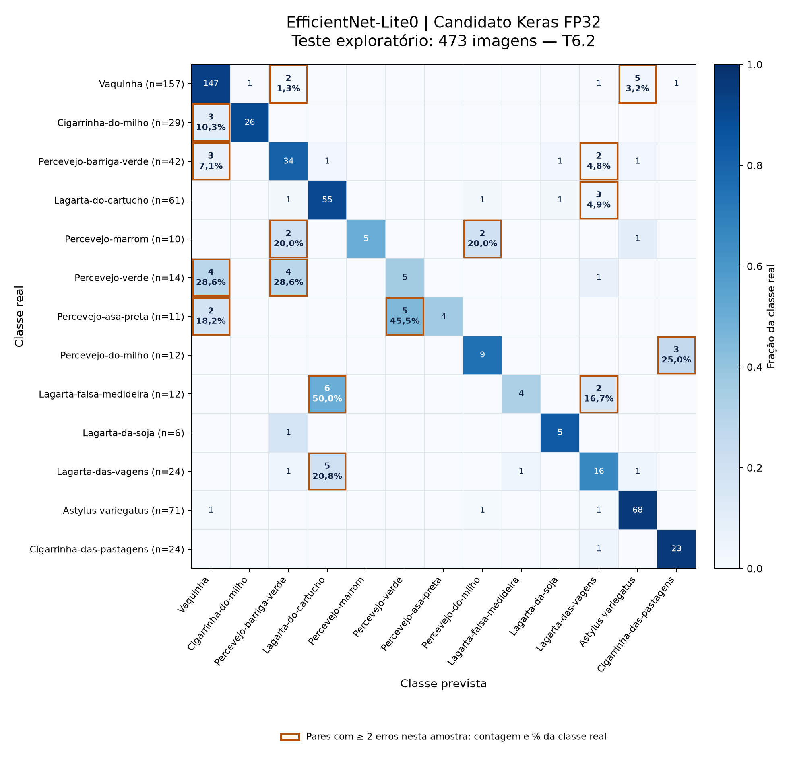

As linhas representam a classe real; as colunas, a prevista. Os números são contagens e a cor representa a fração da classe real, permitindo comparar classes com suportes diferentes. O contorno laranja destaca pares direcionais com **pelo menos dois erros nesta amostra**; a segunda linha mostra a porcentagem relativa ao suporte da classe real. Esse critério é descritivo: não comprova confusão sistemática em dados novos nem determina a causa dos erros.

| Classe real → prevista | Erros | Suporte real | Parcela da classe |
| --- | ---: | ---: | ---: |
| Lagarta-falsa-medideira → Lagarta-do-cartucho | 6 | 12 | 50,0% |
| Percevejo-asa-preta → Percevejo-verde | 5 | 11 | 45,5% |
| Lagarta-das-vagens → Lagarta-do-cartucho | 5 | 24 | 20,8% |
| Vaquinha → Astylus variegatus | 5 | 157 | 3,2% |
| Percevejo-verde → Vaquinha | 4 | 14 | 28,6% |
| Percevejo-verde → Percevejo-barriga-verde | 4 | 14 | 28,6% |

A acurácia global de **84,8% (401/473)** deve ser lida junto com o recall por classe, isto é, a parcela das imagens reais daquela classe que foi reconhecida corretamente. Os menores recalls nesta amostra são os de **lagarta-falsa-medideira: 33,3% (4/12)**, **percevejo-verde: 35,7% (5/14)** e **percevejo-asa-preta: 36,4% (4/11)**. Assim, o total de acertos não representa um desempenho uniforme entre as classes. Esses resultados têm suportes pequenos e podem variar bastante com poucos exemplos adicionais.

O par com maior número de erros é **lagarta-falsa-medideira → lagarta-do-cartucho**, com seis casos, equivalentes a 50,0% das 12 imagens reais de falsa-medideira. A linha completa da matriz mostra, porém, **oito erros nessa classe**: além dos seis classificados como lagarta-do-cartucho, dois foram classificados como lagarta-das-vagens. Portanto, o maior par não resume todas as dificuldades de reconhecimento da classe.

Contagem e proporção também levam a leituras diferentes: **vaquinha → Astylus variegatus** e **percevejo-asa-preta → percevejo-verde** têm cinco erros cada, mas representam, respectivamente, **3,2% de 157 imagens** e **45,5% de 11 imagens** da classe real. Para orientar a T6.3, a revisão deve considerar a contagem, a proporção de erros e o suporte de cada classe. O destaque de pelo menos dois erros serve à leitura da figura e não deve ser o único critério de prioridade; os casos de um único erro também permanecem disponíveis para revisão individual, sem causa atribuída automaticamente.

O [relatório completo](../assets/data/avaliacao_T6_2/candidato_T5_6_20261026_keras/relatorio_matriz.md) identifica nominalmente os 16 pares com pelo menos dois erros. A tabela de [todos os pares confundidos](../assets/data/avaliacao_T6_2/candidato_T5_6_20261026_keras/pares_confundidos.csv) também preserva os casos de um único erro. Os artefatos publicados incluem:

- [Matriz de contagens](../assets/data/avaliacao_T6_2/candidato_T5_6_20261026_keras/matriz_contagens.csv) e [matriz normalizada por classe real](../assets/data/avaliacao_T6_2/candidato_T5_6_20261026_keras/matriz_normalizada.csv), com nomes completos e a mesma ordem das 13 classes do pacote selecionado.
- [Fila dos 72 erros por imagem](../assets/data/avaliacao_T6_2/candidato_T5_6_20261026_keras/erros_por_imagem.csv), com ID, caminho, classes real e prevista e hash da imagem original, para orientar a análise da T6.3. A fila não atribui causas aos erros.
- [Proveniência e hashes](../assets/data/avaliacao_T6_2/candidato_T5_6_20261026_keras/proveniencia.json), vinculando os resultados às previsões da T6.1, ao índice, ao manifesto do candidato, à rodada registrada na T5.5 e ao código gerador.

O script [matriz_candidato_t6_2.py](../src/matriz_candidato_t6_2.py) verifica a integridade dos artefatos de origem, a identidade do modelo, a ordem das classes e a cobertura exata dos IDs de teste. Recalcula a matriz pelas previsões e exige concordância com as métricas salvas na T6.1 antes de publicar. Para gerar e conferir os arquivos:

```bash
python -m src.matriz_candidato_t6_2
python -m src.matriz_candidato_t6_2 --verificar
python tests/validar_matriz_candidato_t6_2.py
```

Este resultado corresponde ao **checkpoint Keras FP32**; a conversão TFLite INT8 exige avaliação própria. A partição já foi consultada em etapas anteriores, portanto esta análise é exploratória e não constitui avaliação final independente. Não foram ajustados pesos, limiares ou critérios de seleção com esses resultados.

As matrizes históricas abaixo correspondem a outros checkpoints e a um recorte de 474 imagens, enquanto o candidato foi avaliado em 473. A diferença entre suas métricas, isoladamente, não demonstra melhoria do modelo; uma comparação direta exigiria avaliar os checkpoints sobre o mesmo conjunto de casos e sob o mesmo protocolo.

### Matrizes históricas da varredura

### Objetivo e escopo

Publicar as matrizes de confusão das quatro arquiteturas avaliadas na [T5.3](#53-varredura-de-arquiteturas-t53) e identificar nominalmente os erros que se repetem entre elas. Esta análise usa as **474 imagens da partição de teste já consultada** na varredura e, portanto, tem caráter **exploratório**. Não representa a avaliação final independente nem seleciona uma arquitetura vencedora.

### Método e artefatos

As matrizes originais vieram dos arquivos `matriz_confusao_fp32.csv` e `matriz_confusao_int8.csv` das quatro [rodadas no Drive](https://drive.google.com/drive/folders/1K9eLSY4Mam0ygQdQ-5bzFAPVrIL5OzoH). Cada matriz tem 13 linhas e 13 colunas, na ordem dos índices de [`classes-modelo.csv`](../assets/data/classes-modelo.csv). **Linhas são as classes reais e colunas são as classes previstas**; a célula `i, j` contém o número de imagens reais da classe `i` previstas como `j`. Os valores são contagens de imagens, sem pesos de balanceamento. As cópias abaixo acrescentam os nomes das classes às linhas e colunas, preservando as contagens originais. Cada linha deve somar o suporte daquela classe no [resumo da T4.2](../assets/data/particionamento_T4_2/resumo_modelo.csv), e cada matriz deve somar 474 imagens.

| Backbone | Matriz FP32 publicada | Matriz INT8 publicada |
| --- | --- | --- |
| EfficientNet-Lite0 | [CSV com nomes](../assets/data/avaliacao_T6_2/efficientnet_lite0_fp32.csv) · [origem no Drive](https://drive.google.com/file/d/1hcdDWuqstdOLEVO9Kj_Wz5wXjJLdCEP2/view?usp=drivesdk) | [CSV com nomes](../assets/data/avaliacao_T6_2/efficientnet_lite0_int8.csv) · [origem no Drive](https://drive.google.com/file/d/15v4AlwHMbpoYxr0egEqgefUt5vfq8HFf/view?usp=drivesdk) |
| MobileNetV3-Small 1.0 | [CSV com nomes](../assets/data/avaliacao_T6_2/mobilenetv3_small_100_fp32.csv) · [origem no Drive](https://drive.google.com/file/d/1lyMWn93UzExo2dcvdIHfSXjhUBOpMveg/view?usp=drivesdk) | [CSV com nomes](../assets/data/avaliacao_T6_2/mobilenetv3_small_100_int8.csv) · [origem no Drive](https://drive.google.com/file/d/1WfmwxR6VulAWZRmNgOfGSr5vmNLjP2xs/view?usp=drivesdk) |
| MobileNetV3-Large 0.75 | [CSV com nomes](../assets/data/avaliacao_T6_2/mobilenetv3_large_075_fp32.csv) · [origem no Drive](https://drive.google.com/file/d/1RnoU_g2pGl2zBuAUWt-wHHq7QmXxWga5/view?usp=drivesdk) | [CSV com nomes](../assets/data/avaliacao_T6_2/mobilenetv3_large_075_int8.csv) · [origem no Drive](https://drive.google.com/file/d/1Z_vsbLjM2JhNHApUDky-yELM12F3d444/view?usp=drivesdk) |
| MobileNetV3-Large 1.0 | [CSV com nomes](../assets/data/avaliacao_T6_2/mobilenetv3_large_100_fp32.csv) · [origem no Drive](https://drive.google.com/file/d/1mWxh5YvmBR04OTPnprtR2O08qU36UeNY/view?usp=drivesdk) | [CSV com nomes](../assets/data/avaliacao_T6_2/mobilenetv3_large_100_int8.csv) · [origem no Drive](https://drive.google.com/file/d/1lB7neGFyi5kT1AInQz_alHzdMrZWQto8/view?usp=drivesdk) |

O script [`src/analise_confusao_t6_2.py`](../src/analise_confusao_t6_2.py) confere nomes, ordem, suportes e total das oito matrizes; a partir das quatro FP32, reproduz a tabela de quatro campos e os pares recorrentes. Para regenerar os dois CSVs derivados, execute `python -m src.analise_confusao_t6_2`. Para apenas conferir os artefatos publicados, execute `python -m src.analise_confusao_t6_2 --verificar`.

### Resultado: matriz publicada

A figura apresenta a matriz **EfficientNet-Lite0 FP32** como exemplo visual da varredura, sem indicar escolha final de arquitetura. Os números nas células são as contagens; a cor representa a parcela da linha, permitindo ler também os erros de classes com poucos exemplos. O contorno laranja destaca os pares recorrentes nos quatro modelos FP32; nessas células, a segunda linha mostra a porcentagem das imagens da classe real. A diagonal reúne os acertos. As matrizes das outras arquiteturas e da quantização INT8 estão nos CSVs da tabela acima. A figura pode ser regenerada com `python -m src.plotar_matriz_confusao_t6_2`.

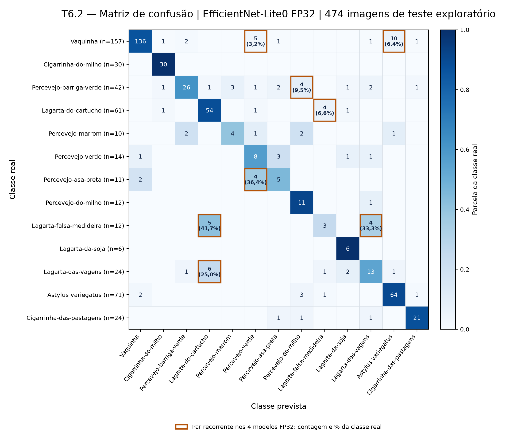

Na matriz exibida, **381 das 474 imagens** estão na diagonal (acurácia de 80,4%). Esse total confere com o resultado FP32 da T5.3. Cada linha soma o suporte da respectiva classe; por exemplo, vaquinha soma 157 imagens, e lagarta-falsa-medideira soma 12.

#### Leitura em quatro campos por classe

Os **quatro campos — verdadeiro positivo (VP), falso positivo (FP), falso negativo (FN) e verdadeiro negativo (VN)** — descrevem uma classificação binária. Como o modelo prevê uma entre **13 classes**, a matriz geral acima tem 13 × 13 células. Para obter os quatro campos, considera-se **uma classe como positiva e as outras 12 como negativas**, repetindo o cálculo para cada classe. Assim, a visão binária complementa a matriz geral, que mostra *qual* classe foi confundida com *qual* outra.

Para **vaquinha** no Lite0 FP32, a matriz de quatro campos é:

| Classe real \ previsão | Vaquinha | Outra classe |
| --- | ---: | ---: |
| Vaquinha | **VP = 136** | **FN = 21** |
| Outra classe | **FP = 5** | **VN = 312** |

A mesma decomposição para todas as classes está publicada em [`quatro_campos_lite0_fp32.csv`](../assets/data/avaliacao_T6_2/quatro_campos_lite0_fp32.csv):

| Classe considerada positiva | VP | FP | FN | VN |
| --- | ---: | ---: | ---: | ---: |
| Vaquinha | 136 | 5 | 21 | 312 |
| Cigarrinha-do-milho | 30 | 3 | 0 | 441 |
| Percevejo-barriga-verde | 26 | 5 | 16 | 427 |
| Lagarta-do-cartucho | 54 | 12 | 7 | 401 |
| Percevejo-marrom | 4 | 3 | 6 | 461 |
| Percevejo-verde | 8 | 12 | 6 | 448 |
| Percevejo-asa-preta | 5 | 7 | 6 | 456 |
| Percevejo-do-milho | 11 | 10 | 1 | 452 |
| Lagarta-falsa-medideira | 3 | 6 | 9 | 456 |
| Lagarta-da-soja | 6 | 5 | 0 | 463 |
| Lagarta-das-vagens | 13 | 10 | 11 | 440 |
| Astylus variegatus | 64 | 12 | 7 | 391 |
| Cigarrinha-das-pastagens | 21 | 3 | 3 | 447 |

Em cada linha, `VP + FP + FN + VN = 474` e `VP + FN` é o suporte da classe. Por exemplo, lagarta-falsa-medideira teve **3 VP e 9 FN entre 12 imagens reais**: recall de 25,0%. O VN alto nessa linha conta as outras classes corretamente não previstas como lagarta-falsa-medideira; isoladamente, ele não demonstra que a classe rara foi bem reconhecida.

### Pares de classes com confusão recorrente

Para priorizar os erros, a [lista reproduzível de pares](../assets/data/avaliacao_T6_2/pares_recorrentes_fp32.csv) usa um **limiar descritivo**, definido para esta revisão: pares **direcionais** fora da diagonal com pelo menos **dois erros em cada um dos quatro modelos FP32** e pelo menos **três erros no Lite0 FP32**. O limiar filtra erros isolados, mas não é um teste estatístico nem define uma taxa aceitável de erro. As quatro contagens se referem às mesmas 474 imagens avaliadas por modelos diferentes; não devem ser somadas como se fossem imagens independentes. A porcentagem usa como denominador o suporte da classe real no teste.

| Classe real → classe prevista | Lite0 FP32 | Small 1.0 | Large 0.75 | Large 1.0 | Parcela da classe real no Lite0 |
| --- | ---: | ---: | ---: | ---: | ---: |
| Vaquinha → Astylus variegatus | 10 | 11 | 9 | 7 | 10/157 (6,4%) |
| Lagarta-falsa-medideira → Lagarta-do-cartucho | 5 | 4 | 4 | 5 | 5/12 (41,7%) |
| Lagarta-das-vagens → Lagarta-do-cartucho | 6 | 4 | 4 | 4 | 6/24 (25,0%) |
| Percevejo-barriga-verde → Percevejo-do-milho | 4 | 3 | 4 | 4 | 4/42 (9,5%) |
| Vaquinha → Percevejo-verde | 5 | 5 | 2 | 2 | 5/157 (3,2%) |
| Lagarta-falsa-medideira → Lagarta-das-vagens | 4 | 3 | 3 | 4 | 4/12 (33,3%) |
| Lagarta-do-cartucho → Lagarta-falsa-medideira | 4 | 3 | 2 | 4 | 4/61 (6,6%) |
| Percevejo-asa-preta → Percevejo-verde | 4 | 2 | 3 | 3 | 4/11 (36,4%) |

Os erros de lagarta-falsa-medideira e percevejo-asa-preta representam parcelas altas de classes com apenas **12** e **11** imagens de teste, respectivamente. O erro vaquinha → Astylus variegatus tem a maior contagem absoluta no Lite0, mas corresponde a 6,4% das 157 imagens reais de vaquinha. Esses pares orientam a revisão de fotos e rótulos e a coleta dirigida de novos exemplos, especialmente entre lagartas e percevejos. A quantização INT8 do Lite0 preserva os principais pares observados, mas sua matriz deve ser interpretada separadamente da FP32.

### Registro por imagem para revisão dos erros

Três rodadas MobileNet em `outputs` já contêm `predicoes_teste_keras.csv`: [Small 1.0](https://drive.google.com/file/d/11J5itnXcyyKdqeU-fKlATWR2IjA-Ao9d/view), [Large 0.75](https://drive.google.com/file/d/1DfUbejrPc9jOCBGdXr1YNsx-GzHibaKg/view) e [Large 1.0](https://drive.google.com/file/d/1tSYeo0bGjksT6fpnqYJ0n4z0ER7Wtdir/view). O script [`src/consolidar_predicoes_t6_2.py`](../src/consolidar_predicoes_t6_2.py) associa cada caminho ao `image_id` e ao hash do manifesto T4.2, confere rótulos e previsões e exige que as contagens reproduzam as três matrizes FP32 publicadas. A execução gera [previsões por imagem](../assets/data/avaliacao_T6_2/predicoes_por_imagem_keras_3_modelos.csv) (1.422 linhas: 474 fotos × 3 modelos) e uma [fila de revisão](../assets/data/avaliacao_T6_2/erros_por_imagem_keras_3_modelos.csv) (177 fotos com pelo menos um erro), ordenada pela quantidade de modelos que erraram e pela maior confiança em uma previsão errada. Para conferir os arquivos derivados, execute `python -m src.consolidar_predicoes_t6_2 --verificar`.

Os valores de confiança desses arquivos vêm da **inferência Keras FP32**, não do TFLite FP32. As matrizes agregadas coincidem, mas essa coincidência não demonstra que o TFLite previu a mesma classe para cada foto. A rodada **EfficientNet-Lite0 não possui arquivo de previsões por imagem em `outputs`**. Para obter as previsões TFLite FP32 dos quatro modelos, incluindo o Lite0, use [`src/revisar_erros_t6_2.py`](../src/revisar_erros_t6_2.py) com as imagens originais e as quatro rodadas em `outputs`; o script confere o hash de cada foto e só grava o CSV se as quatro matrizes forem reproduzidas exatamente:

```bash
python -m src.revisar_erros_t6_2 --raiz-imagens /caminho/Agro_App --outputs /caminho/Agro_App/outputs
```

As colunas `revisao_visual` e `observacao_revisao` estão vazias até a inspeção humana das fotos. Confiança alta orienta a ordem de revisão, mas não comprova erro de rótulo. Os registros atuais permitem localizar as fotos; a classificação de cada caso como erro do modelo, imagem ambígua ou rótulo suspeito depende de abrir a imagem original.

### Limites e critério de conclusão

Os quatro modelos viram a mesma partição de teste, já consultada na T5.3. A repetição de um par entre modelos indica **confusão recorrente nesta amostra**; pode envolver as mesmas fotos em todas as rodadas. Ela não prova uma taxa estável em fotos novas nem identidade incorreta dos rótulos. Classes com suporte baixo podem mudar muito com poucos erros adicionais. A revisão individual começou com os registros Keras das três MobileNets, mas as fotos ainda não foram inspecionadas e o Lite0 ainda requer inferência por imagem. A confirmação exigirá novas imagens independentes, revisão dos exemplos confundidos e uma matriz de confusão da configuração final no novo conjunto de teste.


**Base de estudo:** [scikit-learn — Model evaluation: Confusion matrix](https://scikit-learn.org/stable/modules/model_evaluation.html#confusion-matrix) e [referência de `confusion_matrix`](https://scikit-learn.org/stable/modules/generated/sklearn.metrics.confusion_matrix.html).

## 6.3 Análise de erros (T6.3)

### Candidato selecionado na T5.6 — cobertura da revisão

Esta complementação analisa o **EfficientNet-Lite0 Keras FP32 do pacote `candidato_T5_6_20261026`**, usando as mesmas previsões e os mesmos rótulos da T6.1 e da matriz do candidato na T6.2. Foram inspecionadas visualmente, com assistência de IA, **todas as 72 imagens classificadas incorretamente**, após conferir seus hashes contra o índice. São 35 pares direcionais; os 16 pares com pelo menos dois erros reúnem 53 imagens. As outras 19 imagens, de pares com um erro, também têm registro individual. A revisão não substitui validação taxonômica por especialista.

Os resultados anteriores, mantidos adiante, não são usados como contagem dos erros deste candidato. Apenas 23 das 72 imagens aparecem no registro visual histórico; as anotações desta complementação foram feitas após reabrir as imagens, sem transportar automaticamente hipóteses de outro modelo ou destino previsto.

### Principais erros do candidato

Na tabela, o sentido é **classe real do índice → classe prevista**. Observações de enquadramento e estágio descrevem as fotos; semelhança e escassez continuam sendo hipóteses de causa, não conclusões demonstradas.

| Classe real → prevista | Erros / suporte | Evidência e interpretação |
| --- | ---: | --- |
| Falsa-medideira → Cartucho | 6 / 12 | Seis mariposas adultas aparentes de cinco observações iNaturalist. Forma, cor e desenho das asas motivam investigar semelhança visual; fase adulta não comprova rótulo errado. |
| Asa-preta → Verde | 5 / 11 | As cinco fotos são da observação **147542055**, com metadado `Nymph`. O erro se concentra em uma observação, sem demonstrar cinco ocorrências independentes. Investigar cobertura de ninfas e semelhança visual. |
| Das-vagens → Cartucho | 5 / 24 | Cinco observações: quatro fotos com adultos aparentes e uma com larva (`IMG_03427`). Há foto distante e foto com duas mariposas. Semelhança é hipótese; não foi isolada uma causa única. |
| Vaquinha → Astylus | 5 / 157 | `IMG_01175` e `IMG_01176` mostram múltiplos insetos; `IMG_01516` mostra sujeito pequeno, e não um close-up nítido como dizia a anotação antiga. As outras duas fotos permitem investigar padrão visual; nenhuma espécie foi reidentificada. |
| Verde → Vaquinha | 4 / 14 | Três observações, com uma delas representada por duas fotos. Há oclusão em `IMG_03216` e pouco detalhe em `IMG_03246`; as outras duas mostram o corpo. A causa do par permanece indeterminada. |
| Verde → Barriga-verde | 4 / 14 | Quatro fotos da observação **368128786**, com corpo verde em escudo e diferentes distâncias. Semelhança de forma é hipótese; não demonstra recorrência em quatro exemplares. |
| Percevejo-do-milho → Cigarrinha-das-pastagens | 3 / 12 | Duas observações; o corpo alongado aparece nas três fotos. Não há evidência suficiente para atribuir o erro a rótulo, escassez ou semelhança real. |
| Cigarrinha-do-milho → Vaquinha | 3 / 29 | Três fotos AgroInsect com inseto pequeno sobre folha. Pouco detalhe diagnóstico é um fator observado; fotos visualmente próximas não comprovam identidade do exemplar. |
| Barriga-verde → Vaquinha | 3 / 42 | Três fotos AgroInsect; duas têm sujeito pequeno e uma permite ver o corpo. Não há confirmação de causa comum às três. |
| Cartucho → Das-vagens | 3 / 61 | Três fotos AgroInsect de mariposas adultas aparentes. Semelhança de forma e desenho das asas é hipótese; nome comum larval não indica erro de espécie. |
| Marrom → Barriga-verde | 2 / 10 | Duas observações com insetos castanhos em escudo e corpo visível. Investigar semelhança visual e cobertura, sem reidentificação de espécie nesta revisão. |
| Marrom → Percevejo-do-milho | 2 / 10 | Duas fotos da observação **19890644**, ambas com múltiplos insetos de aspectos distintos. Ambiguidade de sujeito é hipótese relevante para classificação da foto inteira. |
| Asa-preta → Vaquinha | 2 / 11 | Duas observações com metadado `Nymph`. A lacuna de estágio documentado no treino também se aplica; o destino vaquinha não tem causa visual isolada. |
| Falsa-medideira → Das-vagens | 2 / 12 | Duas fotos da observação **396445719**, ambas com mariposa pequena sobre a mão. A mesma observação também tem uma foto prevista como cartucho; não são três exemplares independentes. |
| Barriga-verde → Das-vagens | 2 / 42 | Duas fotos AgroInsect, uma com inseto pequeno e outra com oclusão por folhas. Qualidade e enquadramento são hipóteses, sem comprovar semelhança real entre espécies. |
| Vaquinha → Barriga-verde | 2 / 157 | Duas fotos da observação **185718390**, com inseto muito pequeno no quadro. Detalhe diagnóstico limitado, sem evidência de erro taxonômico. |

### Cobertura por estágio e suspeita de rótulo

O índice do treino contém **53 imagens de asa-preta em 18 grupos**, todas de campo: 27 têm metadado `Adult`, 26 não têm estágio preenchido e nenhuma está explicitamente marcada como `Nymph`. No teste, sete das 11 imagens da classe têm metadado `Nymph`, e as sete foram classificadas incorretamente: cinco como verde e duas como vaquinha. Isso sustenta investigar a cobertura de estágios, **sem afirmar que não existam ninfas nas 26 imagens de treino sem estágio informado**, nem que escassez tenha sido comprovada como causa.

Uma suspeita de rótulo apareceu fora dos pares principais: **`IMG_02602`, Cartucho → Barriga-verde**. A imagem mostra dois insetos com aspecto de percevejos e contorno em escudo, em contraste com o rótulo *Spodoptera frugiperda*. A conferência do `dataset/labels.csv` mostra o mesmo rótulo na fonte, portanto a divergência visual já está presente antes desta análise. O caso foi marcado como **suspeita de rótulo inconsistente, com validação especializada pendente**. Não se confirmou a espécie dos insetos nem se alterou o rótulo ou o resultado da avaliação. Esta suspeita decorre do conteúdo da foto, não da presença de uma mariposa adulta sob um nome comum iniciado por “lagarta”.

### Artefatos e reprodução da análise do candidato

- [Revisão das 72 imagens](../assets/data/avaliacao_T6_3/candidato_T5_6_20261026_keras/revisao_por_imagem.csv): ID, caminho, hash, classes, grupo, observação iNaturalist, estágio do metadado, estágio visual aparente, fatores observados, hipóteses e status da causa.
- [Análise dos 35 pares](../assets/data/avaliacao_T6_3/candidato_T5_6_20261026_keras/analise_por_par.csv): contagens, cobertura do treino e avaliação explícita de rótulo inconsistente, escassez e semelhança. Não demonstrado não equivale a descartado.
- [Cobertura das classes por partição](../assets/data/avaliacao_T6_3/candidato_T5_6_20261026_keras/cobertura_classes.csv): 13 classes em treino, validação e teste, com fotos, grupos e estágios informados nas imagens de campo. Os grupos do índice não garantem indivíduos independentes; AgroInsect não tem identificador iNaturalist e seus estágios não foram preenchidos automaticamente.
- [Anotações visuais de origem](../assets/data/avaliacao_T6_3/candidato_T5_6_20261026_keras/anotacoes_visuais.json), [relatório](../assets/data/avaliacao_T6_3/candidato_T5_6_20261026_keras/relatorio_erros.md) e [proveniência com hashes](../assets/data/avaliacao_T6_3/candidato_T5_6_20261026_keras/proveniencia.json).

O script [analise_candidato_t6_3.py](../src/analise_candidato_t6_3.py) exige a cobertura exata dos erros, confere as imagens originais e as previsões da T6.1/T6.2, cruza os metadados com as partições do índice e produz os artefatos de forma determinística. O modo de verificação não reescreve arquivos:

```bash
python -m src.analise_candidato_t6_3 --raiz-imagens /caminho/das/fontes
python -m src.analise_candidato_t6_3 --raiz-imagens /caminho/das/fontes --verificar
python tests/validar_analise_candidato_t6_3.py
```

A raiz deve conter `dataset/field/field_labels.csv`, `dataset/labels.csv` e as imagens originais. A complementação preserva o modelo, os rótulos e as métricas: não há treinamento, nova inferência ou ajuste de limiar. O teste já consultado mantém caráter exploratório; o resultado do Keras FP32 não substitui a análise do TFLite INT8. Nenhuma causa está confirmada por especialista. A suspeita de rótulo, a cobertura de estágios e as hipóteses dos pares precisam de validação antes de orientar correções no acervo ou decisões de agrupamento.

### Análise histórica dos modelos anteriores

### Objetivo e escopo

Investigar os oito pares de classes com confusão recorrente identificados na
[seção 6.2](#62-matriz-de-confusão-t62), distinguindo observações das fotos,
metadados e hipóteses de causa. A análise usa os registros de erro das três
MobileNets sobre a mesma partição de teste consultada na varredura. Seus
resultados são exploratórios e não demonstram causalidade nem desempenho
independente em novas imagens.

### Método, cobertura e artefatos

O script [`analise_erros_t6_3.py`](../src/analise_erros_t6_3.py) reúne:

1. Quantidade de fotos de erro por par e observações distintas do iNaturalist.
   Fotos da mesma observação são correlacionadas e não equivalem a novos
   exemplares independentes.
2. Distribuição do estágio de vida nas fotos de campo de cada classe, conforme
   `field/field_labels.csv`. Esses totais descrevem o acervo bruto de campo,
   não a distribuição por estágio no treino, nem uma validação taxonômica.
3. Anotações da revisão visual original de 48 fotos e suas correções. O CSV
   explicita se a causa é uma hipótese ou permanece indeterminada; não representa
   confirmação por especialista.

Os [indicadores por par](../assets/data/avaliacao_T6_3/estatisticas_por_par.csv)
e o [registro visual](../assets/data/avaliacao_T6_3/revisao_visual_pares.csv)
têm geração determinística. São **48 fotos únicas e 49 relações foto/par**:
`IMG_03008` pertence tanto a falsa-medideira → cartucho quanto a
falsa-medideira → das-vagens, e aparece nos dois pares. As outras 129 fotos da
fila de 177 registros não correspondem aos oito pares selecionados e não têm
causa determinada por esta análise. A cobertura é conferida contra a fila;
uma foto ausente ou extra interrompe a geração.

O registro contém ID, caminho, classe real, classe prevista, `inat_obs_id`,
`life_stage_metadado`, categorias, status da causa e observação. O estágio e o
ID da observação são copiados dos metadados externos, sem inferi-los pelo nome
da classe. A revisão pode registrar um adulto mesmo quando o estágio não foi
preenchido pelo fotógrafo; os dois campos não são tratados como equivalentes.

```bash
python -m src.analise_erros_t6_3 --raiz-imagens /caminho/Agro_App
python -m src.analise_erros_t6_3 --raiz-imagens /caminho/Agro_App --verificar
python tests/validar_analise_erros_t6_3.py
```

A raiz deve conter `dataset/field/field_labels.csv`. O modo `--verificar`
não reescreve os artefatos. Os testes conferem a cobertura dos pares, a
preservação de fotos com múltiplos destinos e a reprodução com diferentes
valores de `PYTHONHASHSEED`.

### Estágio de vida não equivale a erro de espécie

As classes são definidas por espécie ou agrupamento taxonômico no
[dicionário do modelo](../assets/data/classes-modelo.csv). Não há, nesse contrato,
uma restrição a imagens exclusivamente larvais. Uma mariposa adulta pode ter
o rótulo correto de *Spodoptera frugiperda* ou *Chrysodeixis includens*, apesar
de o nome comum começar por “lagarta”. A
[Embrapa descreve larva, pupa e adulto no ciclo de Spodoptera](https://www.infoteca.cnptia.embrapa.br/infoteca/bitstream/doc/1124694/1/DOC-178-internet.pdf).
Por isso, adultos sob esses nomes comuns **não comprovam rótulo taxonômico errado**.

| Classe | Fotos de campo | Adult | Larva | Pupa | Sem estágio informado |
| --- | ---: | ---: | ---: | ---: | ---: |
| Lagarta-falsa-medideira (*Chrysodeixis includens*) | 82 | 68 | 1 | 0 | 13 |
| Lagarta-do-cartucho (*Spodoptera frugiperda*) | 79 | 63 | 4 | 0 | 12 |
| Lagarta-das-vagens (*S. eridania* + *S. cosmioides*) | 159 | 44 | 66 | 8 | 41 |

A documentação do AgroInsect informa que suas 383 fotos de *S. frugiperda* são
de adultos. A revisão visual original também registra adultos em 19 das 20
fotos únicas dos quatro pares entre classes “lagarta”; isso descreve o estágio
observado, **não 19 erros de rótulo confirmados**. A exceção, `IMG_03424`,
mostra duas larvas escuras sobre banana. A imagem, por si só, não confirma que
elas pertencem a espécies diferentes, nem que a semelhança foi a causa do erro.

Os dados justificam investigar cobertura e distribuição dos estágios, inclusive
por partição. Não permitem afirmar que o modelo reconhece melhor larvas que
adultos: isso exige métricas separadas por estágio e rótulos conferidos. Não foi
demonstrado erro taxonômico nesta revisão; tampouco foi comprovado que todos os
rótulos estejam corretos. Uma mudança de escopo para reconhecer apenas larvas
exige decisão explícita e validação agronômica antes de relabelar ou excluir fotos.

### Hipóteses e limites por par

| Classe real → prevista | Fotos na fila | Leitura sustentada e limite |
| --- | ---: | --- |
| Falsa-medideira → Cartucho | 6 | Fotos de três observações iNaturalist; adultos frequentes. Investigar cobertura dos estágios; causa do erro ainda indeterminada. |
| Das-vagens → Cartucho | 6 | Cinco observações de campo; revisão registra cinco adultos e uma foto com larvas. Semelhança e cobertura de estágios são hipóteses, sem confirmação de erro de espécie. |
| Falsa-medideira → Das-vagens | 4 | Duas observações de campo; compartilha `IMG_03008` com outro par. Variação de estágio não prova rótulo errado. |
| Cartucho → Falsa-medideira | 5 | Fotos do AgroInsect registradas como adultos; avaliar representação dos estágios, sem concluir erro taxonômico pelo nome comum. |
| Percevejo-asa-preta → Percevejo-verde | 5 | Ninfas provenientes de duas observações; escassez de exemplos e semelhança visual são hipóteses. Oito fotos têm metadado Nymph em cada classe; os estágios ausentes não podem ser classificados automaticamente como adultos. |
| Percevejo-barriga-verde → Percevejo-do-milho | 5 | Uma foto de campo e quatro do AgroInsect; baixa cobertura de campo, oclusão/enquadramento e semelhança de porte/cor são hipóteses concorrentes. |
| Vaquinha → Astylus | 13 | Há fotos com pouco detalhe e fotos com múltiplos insetos; semelhança visual permanece hipótese para os demais casos. A contagem global de imagens não exclui escassez de exemplos de uma condição específica. |
| Vaquinha → Percevejo-verde | 5 | As anotações registram distância, sombra ou pouco detalhe diagnóstico. A categoria é `qualidade_imagem`, não uma confirmação de semelhança real entre as espécies. |

As quantidades são da união dos erros das três MobileNets, não a contagem de
uma única matriz. Por exemplo, as cinco fotos de Edessa → Nezara da fila não
substituem os quatro erros do Lite0 apresentados na seção 6.2. Uma mesma foto
em dois pares conta uma vez em cada relação e uma vez no total de fotos únicas.

### Correções das observações e rastreabilidade

As fotos `IMG_01175` e `IMG_01176` foram reabertas e mostram mais de um inseto:
um besouro na parte inferior e um inseto alado listrado em destaque. A identidade
deste último não foi confirmada; foi retirada a afirmação de que seria um
“Astylus de verdade”. A revisão o classifica como conteúdo com múltiplos insetos,
com causa indeterminada, e não o usa para comprovar semelhança entre as duas
espécies. As fotografias e seus rótulos originais foram preservados.

Os metadados identificam `IMG_02978` como observação **10704962**, enquanto
`IMG_03035`, `IMG_03036` e `IMG_03037` são da observação **396445719**.
Foi retirada a alegação de que `IMG_02978` e `IMG_03037` seriam do mesmo
indivíduo; os identificadores passam a constar diretamente no CSV.

### Conclusão e dependências da interpretação

A revisão cobre todos os vínculos dos oito pares e mantém as evidências e
hipóteses auditáveis. O estágio ausente em parte do acervo, a correlação entre
fotos e o uso histórico do mesmo teste limitam as conclusões. `rotulo_inconsistente`
fica reservado a evidência de identificação incompatível com a classe, não ao
nome comum do estágio. Variação de estágio, qualidade da imagem e múltiplos
sujeitos são registradas separadamente, evitando encaixá-las à força em uma
causa taxonômica.

A determinação agronômica das espécies e das causas ainda depende de validação.
As propostas de separar estágios, agrupar classes ou retornar hipóteses
concorrentes devem ser avaliadas na seção de tratamento das classes; este
relatório não autoriza uma correção automática dos rótulos nem comprova a causa
dominante em cada par.

## 6.4 Proposta de tratamento de classes (T6.4)

**Autor:** Rui. **Revisora:** Ana Célia. **Data da proposta:** 31/10/2026. **Estado:** proposta técnica; revisão e validação agronômica do parceiro pendentes.

### Decisão e fundamento

A proposta é **preservar as 13 classes do candidato e apresentar identidades separadas como hipóteses concorrentes**, sujeitas ao ranking e à política de confiança. Nenhum novo agrupamento em classe única é recomendado nesta rodada. A análise da T6.3 registra hipóteses de semelhança, cobertura de estágios, qualidade e múltiplos sujeitos, mas não demonstra que os pares sejam indistinguíveis ou que uma identificação conjunta preserve o conteúdo necessário ao parceiro.

O TAP, seção 12, pp. 5–6, prevê hipóteses com confiança como mitigação para confusões e condiciona o agrupamento de classes indistinguíveis à validação técnica do parceiro. A equivalência de manejo ou de conteúdo **não é presumida** a partir de uma confusão do modelo, de nomes comuns parecidos ou da presença na mesma cultura.

O agrupamento já existente de *Spodoptera eridania* e *S. cosmioides* na classe das-vagens, assim como os demais rótulos do pacote selecionado, é preservado. A proposta não altera as saídas do modelo, o dicionário, os dados ou as métricas, nem transforma adultos em erros de rótulo por causa do nome comum larval.

### Cobertura das decisões

Os 35 pares direcionais com pelo menos um erro no candidato correspondem a **26 relações entre duas classes**. Cada relação recebe uma decisão que vale para ambos os sentidos, preservando suas contagens separadas. Acrescenta-se barriga-verde × percevejo-do-milho, analisado nas rodadas anteriores, mas sem erros na matriz do candidato: são **27 decisões documentadas**, cobrindo também os oito pares recorrentes históricos. Os 72 erros atuais não são somados aos erros históricos.

Na tabela, **A** é a primeira classe e **B** a segunda. As contagens são erros reais A previstos como B e reais B previstos como A, respectivamente, na avaliação **Keras FP32 de 473 imagens**. Os IDs identificam as justificativas e os campos de validação do [registro completo por par](../assets/data/tratamento_T6_4/proposta_tratamento.md) e da [proposta estruturada](../assets/data/tratamento_T6_4/proposta_tratamento.json). Não houve avaliação de probabilidades top-k nesta proposta.

| ID | A × B | A → B / B → A | Alternativa recomendada |
| --- | --- | ---: | --- |
| PAR-03-10 | Cartucho × Das-vagens | 3 / 5 | Hipóteses concorrentes |
| PAR-00-11 | Vaquinha × Astylus | 5 / 1 | Hipóteses concorrentes |
| PAR-03-08 | Cartucho × Falsa-medideira | 0 / 6 | Hipóteses concorrentes |
| PAR-00-02 | Vaquinha × Barriga-verde | 2 / 3 | Hipóteses concorrentes |
| PAR-05-06 | Verde × Asa-preta | 0 / 5 | Hipóteses concorrentes |
| PAR-02-03 | Barriga-verde × Cartucho | 1 / 1 | Hipóteses concorrentes |
| PAR-00-01 | Vaquinha × Cigarrinha-do-milho | 1 / 3 | Hipóteses concorrentes |
| PAR-00-05 | Vaquinha × Verde | 0 / 4 | Hipóteses concorrentes |
| PAR-02-05 | Barriga-verde × Verde | 0 / 4 | Hipóteses concorrentes |
| PAR-02-10 | Barriga-verde × Das-vagens | 2 / 1 | Hipóteses concorrentes |
| PAR-07-12 | Percevejo-do-milho × Cigarrinha-das-pastagens | 3 / 0 | Hipóteses concorrentes |
| PAR-08-10 | Falsa-medideira × Das-vagens | 2 / 1 | Hipóteses concorrentes |
| PAR-00-06 | Vaquinha × Asa-preta | 0 / 2 | Hipóteses concorrentes |
| PAR-02-04 | Barriga-verde × Marrom | 0 / 2 | Hipóteses concorrentes |
| PAR-02-09 | Barriga-verde × Lagarta-da-soja | 1 / 1 | Hipóteses concorrentes |
| PAR-04-07 | Marrom × Percevejo-do-milho | 2 / 0 | Hipóteses concorrentes |
| PAR-10-11 | Das-vagens × Astylus | 1 / 1 | Hipóteses concorrentes |
| PAR-02-07 | Barriga-verde × Percevejo-do-milho — evidência histórica | 0 / 0 | Hipóteses concorrentes |
| PAR-00-10 | Vaquinha × Das-vagens | 1 / 0 | Hipóteses concorrentes |
| PAR-00-12 | Vaquinha × Cigarrinha-das-pastagens | 1 / 0 | Hipóteses concorrentes |
| PAR-02-11 | Barriga-verde × Astylus | 1 / 0 | Hipóteses concorrentes |
| PAR-03-07 | Cartucho × Percevejo-do-milho | 1 / 0 | Hipóteses concorrentes |
| PAR-03-09 | Cartucho × Lagarta-da-soja | 1 / 0 | Hipóteses concorrentes |
| PAR-04-11 | Marrom × Astylus | 1 / 0 | Hipóteses concorrentes |
| PAR-05-10 | Verde × Das-vagens | 1 / 0 | Hipóteses concorrentes |
| PAR-07-11 | Percevejo-do-milho × Astylus | 0 / 1 | Hipóteses concorrentes |
| PAR-10-12 | Das-vagens × Cigarrinha-das-pastagens | 0 / 1 | Hipóteses concorrentes |

Para cada par, o registro completo apresenta separadamente a evidência, a razão para não recomendar agrupamento nesta rodada, a justificativa das hipóteses concorrentes, o impacto agronômico a validar e o encaminhamento. Contagens de uma única observação não são tratadas como exemplares independentes. Os casos isolados também recebem decisão; a ausência de erros em um sentido não comprova ausência de confusão em novas imagens.

### Pontos prioritários para a validação agronômica

- **Cartucho, falsa-medideira e das-vagens:** confirmar se o conteúdo precisa distinguir essas identidades por cultura e estágio, incluindo a presença de adultos no escopo. A dificuldade com mariposas não autoriza fundir todas as imagens ou estender o grupo das-vagens às outras classes.
- **Asa-preta × verde e asa-preta × vaquinha:** confirmar o conteúdo e os critérios de diferenciação para ninfas. Cinco erros asa-preta → verde vêm de uma observação; a ausência de ninfas explicitamente marcadas no treino não comprova que não existam nas fotos sem estágio informado.
- **Barriga-verde × cartucho:** validar a identificação de `IMG_02602`, marcada na T6.3 como suspeita de rótulo inconsistente. Um possível problema de anotação deve ser conferido na fonte, sem ser ocultado por agrupamento de classes.
- **Vaquinha × Astylus e pares com múltiplos insetos:** validar o sujeito-alvo e o conteúdo associado a cada identidade. Hipóteses concorrentes não significam que as duas espécies estejam presentes na foto.
- **Demais pares:** confirmar, pelas perguntas individuais do registro, se manter as identidades separadas atende ao conteúdo e ao encaminhamento esperado. Não se afirma que os pares tenham manejo igual ou diferente sem essa validação.

### Relação com a política de confiança e o aplicativo

Esta é uma decisão proposta de apresentação e identidade das classes; o registro não é uma regra de inferência. O aplicativo deve ordenar as hipóteses por confiança decrescente, preservando os scores do modelo e os critérios aprovados de confiança. A relação entre duas classes **não obriga a incluir a outra no resultado**, não soma scores, não altera o ranking e não cria agrupamentos por transitividade.

Quando nenhuma hipótese satisfizer a política adotada, o resultado deve ser inconclusivo e orientar nova captura, sem completar a lista com classes deste registro. Se duas classes do par estiverem entre as hipóteses elegíveis, seus nomes, confianças e conteúdos devem permanecer separados, sem apresentação de manejo como conclusão confirmada.

Em 31/10/2026, o PR da T6.5 propõe três hipóteses e limiar top-1 de 0,65 em Keras FP32. Esses parâmetros continuam sob responsabilidade da política de confiança e não são aprovados ou recalibrados nesta seção. As contagens top-1 da T6.2/T6.3 não comprovam que a classe correta estará entre as hipóteses exibidas. A eficácia da apresentação e o comportamento após a conversão embarcada exigem verificação própria.

### Registro da validação e rastreabilidade

Ana Célia deve revisar as justificativas e a cobertura dos pares. Para cada decisão, o parceiro deve confirmar se a apresentação proposta e o conteúdo associado preservam as distinções agronômicas necessárias ao escopo do MVP. O registro deve conter **decisão validada, impacto ou observação, responsável, data e evidência**. Uma concordância em bloco pode identificar explicitamente todos os IDs e a versão aprovada; os campos da proposta estão inicialmente pendentes, sem aprovação presumida.

Se o parceiro preferir um agrupamento, devem ser definidos o conjunto completo de classes, o nome e significado do grupo, culturas e estágios abrangidos, exceções e conteúdo associado. A aprovação de um par não autoriza fundir outras classes ligadas a ele. A mudança exigirá nova versão do contrato e dos dados ou do pós-processamento, conforme a abordagem escolhida, com avaliação e reconferência da política de confiança. O pacote atual não será alterado retroativamente.

Os [hashes de rastreabilidade](../assets/data/tratamento_T6_4/rastreabilidade.json) vinculam a proposta ao modelo, à ordem de classes, às métricas e matrizes do candidato, à análise por imagem e aos pares históricos. O hash do TAP original consultado também está registrado. A revisão da T6.3 é assistida por IA e exploratória; esta proposta não a transforma em confirmação taxonômica. A validação agronômica permanece necessária para fechar a decisão de produto.


## 6.5 Política de confiança (T6.5)

### Objetivo e decisão

Definir quantas hipóteses o aplicativo apresenta, a partir de que confiança as apresenta e o que faz quando nenhuma classe atinge o mínimo (RF-04, RF-05 e RF-06 da [seção 2.1](#21-requisitos-e-restrições-técnicas)). O símbolo ⧗ marca a proposta da equipe a validar com o parceiro, como na seção 2.1.

| Decisão | Valor |
| --- | --- |
| Número de hipóteses | **3** ⧗ |
| Limiar mínimo de confiança | **0,65** ⧗, aplicado à hipótese mais provável (top-1); confiança igual ao limiar é aceita |
| Abaixo do limiar | Nenhuma classe é indicada como identificação obtida; o aplicativo mostra a mensagem de resultado inconclusivo ⧗, orienta uma nova foto e, quando existir o catálogo de conteúdo (RF-07), oferece conteúdos relacionados |

**Regra.** Se a confiança do top-1 for **maior ou igual a 0,65**, o aplicativo mostra as três hipóteses mais prováveis em ordem decrescente, cada uma com a sua confiança (RF-04 e RF-05) e abrindo o seu conteúdo (RF-08). O limiar vale só para a primeira hipótese; a segunda e a terceira são mostradas mesmo com confiança menor. No empate, vale a maior probabilidade e, depois, o menor índice de classe. Se o top-1 for **menor que 0,65**, aplica-se o RF-06.

**Mensagem ⧗:** "Resultado inconclusivo: não foi possível identificar o problema com segurança nesta foto." **Orientação ⧗:** "Fotografe de novo, mais perto, com o inseto ou a parte da planta afetada em foco e bem iluminada." O texto não afirma diagnóstico e não diz que a foto não mostra uma praga. Os valores estão em [`parametros.json`](../assets/data/politica_T6_5/parametros.json).

### Critérios de aceite verificáveis

- **Quantidade e ordem:** quando aceita, a saída contém exatamente as três classes de maior score, em ordem decrescente, cada uma com seu score. Empates são resolvidos pelo menor índice de classe. A escolha de k=3 é sustentada pelo ganho top-3 sobre top-2: 2,09 p.p. entre as aceitas em 0,65 (96,7% contra 94,7%).
- **Limiar:** a decisão considera somente o score top-1; `top-1 >= 0,65` aceita e `top-1 < 0,65` recusa. A calibração seleciona o menor limiar da grade de 0,30 a 0,95, em passos de 0,05, cujo acerto top-1 entre aceitas seja pelo menos 90%. Na validação, 0,60 resulta em 89,3% e 0,65 em 90,7%, com 430/474 imagens aceitas.
- **Resultado inconclusivo:** abaixo do limiar, nenhuma classe é apresentada como identificação. São exibidas a mensagem e a orientação de nova foto definidas acima; conteúdos relacionados são oferecidos somente se houver catálogo.
- **Verificação de fronteira:** a igualdade com 0,65 é aceita e um valor abaixo é inconclusivo. Os testes automatizados devem cobrir essa fronteira, o desempate, a ordenação e o indicador `indica_classe=false` no resultado inconclusivo.
- **Rastreabilidade e base:** os parâmetros registram caminho e SHA-256 do modelo e do índice, além da origem das probabilidades. A análise usa todas e somente as imagens da validação, confere os rótulos e registra o SHA-256 do CSV de probabilidades. Nenhuma imagem de teste é usada.
- **Interpretação do score:** os valores exibidos são scores softmax não calibrados e não devem ser apresentados como probabilidade de acerto.

Antes de aplicar o limiar no aparelho, a T6.6 deve reconferi-lo no modelo INT8. A validação usada aqui também participou da escolha do candidato, portanto os resultados desta calibração são exploratórios.

### Método e artefatos

A política foi calibrada somente na partição de validação (474 imagens), com o modelo oficial da [seção 5.6](#56-seleção-e-versionamento-do-modelo-t56), em inferência Keras FP32: [`modelo.keras`](../assets/modelos/candidato_T5_6_20261026/modelo.keras), sha256 `089a8d903a78898badf385f0d57006a4fb556d76e3e8fae719babdaf564aa51a`, F1 macro de validação **0,7811** (TFLite INT8: 0,7856, conforme a seção 5.6). O índice é [`indice_dataset.csv`](../assets/data/treino_T5_2/indice_dataset.csv), sha256 `28ee662885202f0bda3dec9660e44b28f99b8bd183210bcbdd795b103269b2eb`, o mesmo do manifesto do candidato. Nenhuma imagem de teste foi aberta. O argmax das probabilidades gravadas reproduz o F1 macro (0,7811), a acurácia (0,8565) e a matriz de confusão do `avaliacao_validacao.json` do candidato.

O limiar é o **menor da grade de 0,30 a 0,95 (passo 0,05) em que o acerto do top-1 entre as aceitas é de pelo menos 0,90**. Para selecionar k, usa-se k=2 como referência e passa-se a k=3 se o acerto top-3 superar o top-2 em pelo menos 2 p.p.; k nunca é maior que 3. Nesta validação, o ganho foi 2,09 p.p., então foram selecionadas três hipóteses.

```bash
python -m src.probabilidades_validacao_t6_5 --modelo assets/modelos/candidato_T5_6_20261026/modelo.keras --indice assets/data/treino_T5_2/indice_dataset.csv --raiz-imagens /caminho/das/fontes --saida assets/data/politica_T6_5/probabilidades_validacao.csv
python -m src.politica_confianca_t6_5 --probabilidades assets/data/politica_T6_5/probabilidades_validacao.csv --indice assets/data/treino_T5_2/indice_dataset.csv --meta-acerto 0.90 --limiar 0.65
python tests/validar_politica_confianca_t6_5.py
```
### Rastreabilidade

| Arquivo | Conteúdo |
| --- | --- |
| `assets/data/politica_T6_5/parametros.json` | Número de hipóteses, limiar, comportamento abaixo do limiar e base da calibração. |
| `assets/data/politica_T6_5/probabilidades_validacao.csv` | `image_id`, `indice_real` e as 13 probabilidades por imagem; sha256 `6f42fa5920e5405fd8811d57dc3ab1137fd243627c01fcef8f2f0d25c402e277`. |
| `assets/data/politica_T6_5/curva_limiar_validacao.csv` | Cobertura e acerto top-k entre as aceitas, por limiar. |
| `assets/data/politica_T6_5/cobertura_por_classe_validacao.csv` | Cobertura e recall por classe em 0,65. |
| `src/probabilidades_validacao_t6_5.py`, `src/politica_confianca_t6_5.py` | Geração das probabilidades (TensorFlow) e análise (NumPy), com recusa de qualquer imagem fora da validação. |
| `tests/validar_politica_confianca_t6_5.py` | Ordem e desempate do top-k, fronteira do limiar, contagens, recusas e esquema do `parametros.json`. |

### Resultado

Acerto sem limiar, nas 474 imagens:

| k | Acertos | Acerto | Ganho sobre o k anterior |
| ---: | ---: | ---: | ---: |
| 1 | 406/474 | 85,7% | — |
| 2 | 436/474 | 92,0% | +6,3 p.p. |
| 3 | 448/474 | 94,5% | +2,5 p.p. |
| 5 | 463/474 | 97,7% | +3,2 p.p. |

Curva por limiar, com o acerto calculado entre as imagens aceitas (top-1 maior ou igual ao limiar):

| Limiar | Cobertura | Inconclusivos | top-1 | top-2 | top-3 | top-5 |
| ---: | ---: | ---: | ---: | ---: | ---: | ---: |
| 0,50 | 96,2% | 3,8% | 87,5% | 93,4% | 95,6% | 97,8% |
| 0,55 | 94,7% | 5,3% | 88,2% | 93,3% | 95,5% | 97,8% |
| 0,60 | 93,0% | 7,0% | 89,3% | 93,9% | 95,9% | 98,0% |
| **0,65** | **90,7%** | **9,3%** | **90,7%** | **94,7%** | **96,7%** | **98,6%** |
| 0,70 | 88,8% | 11,2% | 91,2% | 95,2% | 97,4% | 99,0% |
| 0,75 | 87,3% | 12,7% | 92,3% | 96,1% | 98,1% | 99,0% |
| 0,80 | 85,4% | 14,6% | 93,3% | 96,3% | 98,3% | 99,0% |

A grade completa (0,30 a 0,95) está em [`curva_limiar_validacao.csv`](../assets/data/politica_T6_5/curva_limiar_validacao.csv). Em 0,65, **430 das 474 imagens** são aceitas e **390** delas têm o top-1 correto; as outras 44 ficam inconclusivas, e 16 dessas teriam o top-1 correto. Entre as aceitas, o top-3 supera o top-2 em **2,09 p.p.** (9 imagens); sem limiar, em 2,53 p.p. (12 imagens). Pela regra, **k = 3**.

Cobertura e recall por classe em 0,65. O recall no limiar conta a imagem inconclusiva como não reconhecida:

| Índice | Classe | Suporte | Aceitas | Cobertura | Acertos nas aceitas | Recall no limiar |
| ---: | --- | ---: | ---: | ---: | ---: | ---: |
| 0 | Vaquinha | 157 | 152 | 96,8% | 146 | 93,0% |
| 1 | Cigarrinha-do-milho | 29 | 27 | 93,1% | 26 | 89,7% |
| 2 | Percevejo-barriga-verde | 42 | 36 | 85,7% | 34 | 81,0% |
| 3 | Lagarta-do-cartucho | 61 | 56 | 91,8% | 50 | 82,0% |
| 4 | Percevejo-marrom | 10 | 8 | 80,0% | 6 | 60,0% |
| 5 | Percevejo-verde | 14 | 7 | 50,0% | 5 | 35,7% |
| 6 | Percevejo-asa-preta | 11 | 8 | 72,7% | 6 | 54,5% |
| 7 | Percevejo-do-milho | 12 | 12 | 100,0% | 10 | 83,3% |
| 8 | Lagarta-falsa-medideira | 12 | 10 | 83,3% | 3 | 25,0% |
| 9 | Lagarta-da-soja | 7 | 7 | 100,0% | 6 | 85,7% |
| 10 | Lagarta-das-vagens | 24 | 16 | 66,7% | 11 | 45,8% |
| 11 | *Astylus variegatus* | 71 | 69 | 97,2% | 65 | 91,5% |
| 12 | Cigarrinha-das-pastagens | 24 | 22 | 91,7% | 22 | 91,7% |

### Limites

- **Validação usada na seleção.** A validação serviu também à parada antecipada e à escolha do candidato (seções 5.1 e 5.6), então o limiar tende a ser otimista; a confirmação exigirá o novo conjunto de teste final.
- **Calibração só em Keras FP32.** O valor de 0,65 precisa ser reconferido no `modelo_int8.tflite` (T6.6) antes de valer no aparelho.
- **Confiança do softmax não é probabilidade calibrada.** O valor mostrado não deve ser lido como chance de acerto (risco R11): em 0,65, **40 das 430 imagens aceitas continuam erradas**, e a Lagarta-falsa-medideira tem **3 acertos em 10 aceitas**.
- **k = 3 por margem estreita.** O ganho do top-3 sobre o top-2 entre as aceitas (2,09 p.p.) passa da regra de 2 p.p. por menos de uma imagem (em 0,75 cairia para 1,93 p.p.). O k = 3 também cobre o trio de lagartas com pares recorrentes na [T6.2](#62-matriz-de-confusão-t62) e na [T6.3](#63-análise-de-erros-t63).
- **Fora do escopo e conteúdo.** Fotos de doenças, outras culturas ou plantas sadias não foram medidas, e o limiar é um filtro fraco para elas. O catálogo de conteúdo não existe (`chave_conteudo` é `null`), então "conteúdos relacionados" é uma regra sem implementação.

**Base de estudo:** [scikit-learn — `top_k_accuracy_score`](https://scikit-learn.org/stable/modules/generated/sklearn.metrics.top_k_accuracy_score.html), [scikit-learn — Probability calibration](https://scikit-learn.org/stable/modules/calibration.html) e GUO, C.; PLEISS, G.; SUN, Y.; WEINBERGER, K. Q. [On Calibration of Modern Neural Networks](https://arxiv.org/abs/1706.04599). ICML, 2017.

# 7. Conversão e otimização do modelo

## 7.1 Conversão para TFLite/LiteRT (T7.1)

O fluxo está em [`src/conversao_t7_1.py`](../src/conversao_t7_1.py).
Recebe a rodada final escolhida por treino/validação e converte
`melhor_modelo.keras` pela API oficial
[`tf.lite.TFLiteConverter.from_keras_model`](https://www.tensorflow.org/api_docs/python/tf/lite/TFLiteConverter).
A conversão desta etapa é float32, sem quantização, restrita aos operadores
TFLite nativos. Operações incompatíveis interrompem a conversão.

### Execução

No ambiente com as dependências de `requirements-treino.txt` (treino documentado
em Python 3.12; conversão também verificada em Python 3.13.5 no Windows):

```bash
python -m pip install -r requirements-treino.txt
python -m src.conversao_t7_1 --rodada runs/<rodada_selecionada> --saida runs/<rodada_selecionada>/tflite
```

A rodada deve conter `melhor_modelo.keras` e `metricas_validacao.json` da T5.1.
A seleção da rodada é explícita; o comando não escolhe o modelo por métricas de teste.
Antes de converter, confere os hashes do checkpoint, das métricas e das classes
contra `manifesto.json` e `classes.json` do pacote selecionado na T5.6. O pacote
também é conferido contra seus próprios hashes. Nomes trocados com índices ainda
sequenciais, checkpoint substituído ou métricas de outra rodada são recusados
antes de importar TensorFlow ou publicar saídas.
Para acrescentar fotos reais à comparação, repetir `--imagem caminho/foto.jpg`.
A imagem recebe o mesmo preprocessamento T4.1 usado no treinamento.

Para reproduzir a conversão do candidato oficial, em uma pasta nova:

```bash
python -m src.conversao_t7_1 --rodada assets/modelos/rodadas_T5_6_20261026/20261026-213017_efficientnet_lite0_s42 --pacote assets/modelos/candidato_T5_6_20261026 --saida runs/reproducao_T7_1
```

`--pacote` tem como padrão o pacote acima. Uma futura seleção pode ser indicada
explicitamente, desde que seu manifesto vincule pesos, métricas e ordem de classes.

### Contrato de entrada e saída

| Tensor | Formato alocado | Tipo | Significado |
| --- | --- | --- | --- |
| Entrada | `[1, H, H, 3]` | `float32` | Uma imagem RGB, layout NHWC, valores em [0, 1]. |
| Saída | `[1, C]` | `float32` | Probabilidades softmax na ordem das classes da rodada. |

`H` vem de `tamanho_entrada` da rodada; `C` vem de `validacao.por_classe`
(atualmente o projeto prevê 13 classes). Esses valores não são presumidos:
o comando confere as dimensões Keras e as dimensões reais do interpretador.
A entrada preserva proporção, aplica orientação EXIF e completa o quadro com
cinza RGB 128 antes de dividir por 255. A conversão de faixa específica do
backbone já faz parte do modelo e não deve ser reaplicada pelo consumidor.
O índice da previsão é o argmax da saída.

### Validação e artefatos

O arquivo convertido é gravado temporariamente e reaberto por
[`tf.lite.Interpreter`](https://www.tensorflow.org/api_docs/python/tf/lite/Interpreter).
Após `allocate_tensors()`, o fluxo executa `set_tensor()`, `invoke()` e
`get_tensor()` para entradas de zeros, uns e ruído com semente 42, além das
imagens opcionais. Verifica formato, tipo, valores finitos, probabilidades e
soma unitária. As saídas Keras e TFLite devem satisfazer `allclose` com
`atol=1e-5` e `rtol=1e-4`; divergências interrompem a entrega.
Os argmax de ambos são registrados, inclusive para identificar empates próximos.

Somente após essa validação são escritos:

- `modelo.tflite`: modelo convertido.
- `contrato_tensores.json`: nomes, índices, shapes alocados, assinaturas e tipos
  obtidos do interpretador; classes em ordem, preprocessamento, hashes SHA-256,
  versão TensorFlow, tamanho em bytes, erros por amostra e vínculo com o manifesto
  de seleção, as classes e as métricas da rodada.
- `relatorio_conversao.md`: contrato dos tensores e resumo da validação.

Arquivos de conversão existentes não são sobrescritos. As saídas podem permanecer
em `runs/`, que já é ignorada pelo Git. As entradas sintéticas verificam execução
e equivalência numérica; não medem qualidade diagnóstica ou desempenho no celular.

### Conversão do candidato selecionado

Em **04/11/2026**, o fluxo foi executado com o checkpoint real
`20261026-213017_efficientnet_lite0_s42`, selecionado na T5.6. O SHA-256 Keras
`089a8d903a78898badf385f0d57006a4fb556d76e3e8fae719babdaf564aa51a` confere com
o manifesto do candidato. Foram publicados:

- [Modelo TFLite FP32](../assets/modelos/conversao_T7_1_candidato_T5_6_20261026/modelo.tflite).
- [Contrato dos tensores e evidência de execução](../assets/modelos/conversao_T7_1_candidato_T5_6_20261026/contrato_tensores.json).
- [Relatório com hashes, classes e preprocessamento](../assets/modelos/conversao_T7_1_candidato_T5_6_20261026/relatorio_conversao.md).

O arquivo foi reaberto do disco com `tf.lite.Interpreter`, alocado e executado.
A entrada é **`[1, 224, 224, 3]`, float32**, RGB/NHWC em [0, 1]; a saída é
**`[1, 13]`, float32**, com probabilidades na ordem conferida das 13 classes.
Ambos preservam assinatura de batch dinâmico (`-1`). A comparação nas três
entradas sintéticas passou nas tolerâncias documentadas acima. O tamanho do
FlatBuffer é **13.531.184 bytes**.

Esta entrega comprova conversão, carregamento, execução e contrato do candidato.
As entradas sintéticas não medem qualidade diagnóstica ou latência no celular.
O artefato FP32 desta etapa não substitui o INT8 já preservado no pacote T5.6;
quantização e otimização permanecem nas etapas próprias.

### Testes

```bash
python tests/validar_conversao_t7_1.py
```

Em 04/11/2026, os **11 testes passaram, sem testes pulados**, em macOS arm64,
Python 3.12.15, TensorFlow 2.21.0, Keras 3.15.1, KerasHub 0.32.0 e NumPy 2.4.4.
Cobrem conversão e inferência de um modelo sintético com foto adicional e de uma
MobileNetV3Small do pipeline, além das recusas de saída inválida, classes
desordenadas ou com nomes trocados, tamanho inválido, checkpoint ausente ou
substituído, métricas de outra rodada, pacote alterado e preservação de saídas.
Os modelos de teste continuam temporários; a entrega acima usa os pesos agrícolas
selecionados e versionados. `git diff --check` também passou.

## 7.2 Comparação das estratégias de quantização (T7.2)

O fluxo [`comparacao_quantizacao_t7_2.py`](../src/comparacao_quantizacao_t7_2.py) gera e compara as três estratégias de [quantização pós-treinamento](https://ai.google.dev/edge/litert/conversion/tensorflow/quantization/post_training_quantization) do LiteRT. Todas partem do mesmo checkpoint do EfficientNet-Lite0 selecionado na T5.6. A referência é o FlatBuffer FP32 da T7.1.

| Estratégia | Como foi obtida nesta etapa | Pesos | Ativações | Entrada/saída |
| --- | --- | --- | --- | --- |
| FP32 (referência) | Reaproveitada da [T7.1](#71-conversão-para-tflitelitert-t71), sem otimização | float32 | float32 | float32 |
| Faixa dinâmica | `Optimize.DEFAULT`, sem conjunto representativo | int8 | float32 (quantizadas em tempo de execução nos operadores híbridos) | float32 |
| Float16 | `Optimize.DEFAULT` + `target_spec.supported_types = [tf.float16]` | float16 | float32 | float32 |
| INT8 inteira | **Regenerada nesta etapa** pelo fluxo da [T7.3](#73-quantização-int8-com-conjunto-representativo-t73), com o mesmo conjunto de calibração versionado (200 imagens de treino) | int8 | int8 | int8 |

Antes de converter, o fluxo:

- reaplica a verificação de origem da T7.1;
- confere os hashes dos FlatBuffers FP32 e INT8 publicados contra os contratos das respectivas etapas;
- exige que a INT8 regenerada consuma exatamente os mesmos IDs e o mesmo manifesto de calibração da T7.3.

A execução também é interrompida se o checkpoint Keras não reproduzir exatamente o F1 macro de validação registrado no pacote (0,7811). A inspeção do grafo confirma pesos INT8 na faixa dinâmica, tensores FLOAT16 no float16 e ausência de tensores em ponto flutuante no INT8.

### Reprodutibilidade da INT8

A INT8 regenerada no Windows **não é idêntica byte a byte** ao artefato publicado na T7.3, gerado em macOS arm64. Os dois artefatos foram avaliados lado a lado:

| | Artefato T7.3 | Regenerada na T7.2 |
| --- | --- | --- |
| SHA-256 | `456caec5…1340` | `a0fa1ec2…f8e2` |
| Tamanho | 4.003.624 bytes | 4.003.624 bytes |
| IDs de calibração | 200 IDs | Os mesmos 200, na mesma ordem |
| Entrada | escala 0,0039215689; zero point −128 | Idênticos |
| Saída | escala 0,00390625; zero point −128 | Idênticos |
| Tipos de tensores do grafo | 121 INT8 + 53 INT32 | Idênticos |
| Fotos da revisão visual da T7.3 | 49/49 com mesmo argmax do Keras | 49/49 com mesmo argmax do Keras |

A diferença está nas escalas internas, que dependem dos valores em ponto flutuante observados durante a calibração. Esses valores variam ligeiramente entre CPUs e bibliotecas numéricas (oneDNN no x86, outra implementação no arm64). Os testes estatísticos apresentados abaixo comparam cada versão INT8 ao FP32; não foi realizado um teste direto entre a INT8 da T7.3 e a regenerada na T7.2. Portanto, esses resultados não permitem concluir que as duas versões INT8 sejam estatisticamente equivalentes ou que a diferença entre elas seja significativa. **O artefato oficial continua sendo o da T7.3**, que é o versionado e contratado. A versão regenerada demonstra que o fluxo documentado produz um modelo com o mesmo contrato e conjunto de calibração, sem garantir identidade dos bytes ou das previsões. Seus números pontuais ligeiramente melhores não bastam para justificar a substituição do artefato oficial.

### Protocolo de medição

- **Tamanho:** bytes do FlatBuffer `.tflite`, comparados ao limite de 8.000.000 bytes do RNF-01.
- **Desempenho:**
  - **Métricas:** F1 macro (métrica principal), acurácia macro (balanced accuracy, a métrica do RNF-06) e acurácia, calculadas com [`src/avaliacao.py`](../src/avaliacao.py), além de concordância do top-1 com o FP32.
  - **Partições:** a **validação (474 imagens)** é a partição principal. O **teste (473 imagens)** já foi consultado em etapas anteriores e aparece apenas como leitura exploratória; nenhuma estratégia foi escolhida por ele.
- **Estatística:** cada versão quantizada é comparada ao FP32 nas mesmas imagens.
  - **Intervalo de confiança:** IC 95% por bootstrap pareado (2.000 reamostras de imagens, semente 42) para a diferença de F1 macro e de acurácia macro.
  - **Teste de McNemar exato:** compara as imagens que só o FP32 acertou com as que só a versão quantizada acertou.
- **Latência:**
  - **O que é medido:** tempo de `set_tensor` + `invoke` + `get_tensor`, incluindo a (des)quantização da entrada e da saída no INT8, para uma imagem real de validação `1×224×224×3`.
  - **Configurações:** cinco, todas com `tf.lite.Interpreter`: XNNPACK com 1, 2 e 4 threads e **sem delegate** com 1 e 4 threads (o modo do RNF-09).
  - **Repetições:** 20 execuções de aquecimento e 5 rodadas intercaladas de 40 execuções, ou seja, 200 medições por modelo e por configuração.
  - **Energia:** o comando registra a fonte de energia e se recusa a medir com o notebook na bateria.
- **Execução sem delegates (RNF-09):** as 5 versões são executadas com `BUILTIN_WITHOUT_DEFAULT_DELEGATES` em uma imagem de validação por classe (13 imagens) e comparadas com a execução XNNPACK.
- **Ambiente:** Windows 11, Intel Core Ultra 5 235U (x86, sem GPU), **conectado à tomada**, Python 3.12.10, TensorFlow 2.21.0, Keras 3.15.1, KerasHub 0.32.0 e NumPy 2.4.4, em 05/11/2026.

### Tabela comparativa

| Estratégia | Tamanho (bytes) | Redução vs FP32 | RNF-01 (≤ 8 MB) | Latência XNNPACK 1 thread: mediana / p95 (ms) | Latência XNNPACK 4 threads: mediana / p95 (ms) | F1 macro val. | Δ F1 val. [IC 95%] | Acurácia macro val. | Δ acurácia macro val. em p.p. [IC 95%] | Acurácia val. | Divergências top-1 vs FP32 (val.) | McNemar p (val.) | F1 macro teste (expl.) |
| --- | ---: | ---: | --- | ---: | ---: | ---: | --- | ---: | --- | ---: | ---: | ---: | ---: |
| FP32 (T7.1) | 13.531.184 | — | **não** | 8,12 / 9,86 | 6,31 / 7,24 | 0,7811 | — | 0,7550 | — | 0,8565 | — | — | 0,7329 |
| Faixa dinâmica | 3.753.152 | 72,3% | sim | 38,74 / 43,05 | 107,10 / 157,24 | 0,7755 | −0,0056 [−0,0296; +0,0169] | 0,7517 | −0,33 [−2,48; +1,98] | 0,8565 | 9 | 1,000 | 0,7371 |
| Float16 | 6.833.548 | 49,5% | sim | 8,34 / 10,46 | 5,68 / 6,83 | 0,7830 | +0,0019 [0,0000; +0,0062] | 0,7563 | +0,13 [0,00; +0,40] | 0,8587 | 1 | 1,000 | 0,7329 |
| INT8 (artefato T7.3) | 4.003.624 | 70,4% | sim | 5,67 / 7,34 | 4,05 / 4,77 | 0,7767 | −0,0044 [−0,0373; +0,0293] | 0,7528 | −0,22 [−3,26; +2,93] | 0,8587 | 15 | 1,000 | 0,7400 |
| INT8 (regenerada na T7.2) | 4.003.624 | 70,4% | sim | 5,90 / 7,38 | 3,98 / 4,67 | 0,7832 | +0,0021 [−0,0259; +0,0317] | 0,7578 | +0,28 [−2,48; +3,20] | 0,8587 | 14 | 1,000 | 0,7471 |

Latência sem delegate (RNF-09), mediana / p95 em ms:

| Estratégia | 1 thread | 4 threads |
| --- | ---: | ---: |
| FP32 (T7.1) | 58,99 / 140,81 | 51,88 / 126,64 |
| Faixa dinâmica | 477,41 / 1.020,15 | 264,56 / 356,24 |
| Float16 | 102,82 / 148,64 | 70,48 / 124,68 |
| INT8 (artefato T7.3) | 542,62 / 1.180,87 | 293,01 / 348,73 |
| INT8 (regenerada na T7.2) | 905,69 / 1.197,11 | 308,82 / 410,21 |

As 5 versões executaram sem delegates, com saídas finitas e válidas nas 13 imagens. O top-1 coincidiu com a execução XNNPACK em todas as imagens para FP32, float16 e INT8 da T7.3. Na faixa dinâmica e na INT8 regenerada, houve divergência em 1 das 13 imagens (92,3%), por diferenças numéricas entre os kernels. A latência com 2 threads, os percentis p90/p99, a média, o desvio, os extremos e as matrizes de confusão estão no [JSON da comparação](../assets/modelos/comparacao_T7_2_candidato_T5_6_20261026/comparacao.json).

### Leitura dos resultados

- **Tamanho (RNF-01):** todas as versões quantizadas atendem ao limite de 8 MB; o FP32 não atende. A faixa dinâmica (−72,3%) e o INT8 (−70,4%) ficam em cerca de 4 MB; o float16 reduz o arquivo à metade.
- **Latência com XNNPACK:** o INT8 foi a única estratégia consistentemente mais rápida que o FP32, com 27% a 37% a menos na mediana, com 1 e 4 threads. No CPU, o float16 se comporta como o FP32, porque os pesos são convertidos para float32 ao carregar; o ganho dessa estratégia aparece com o delegate de GPU. A faixa dinâmica foi a mais lenta (cerca de 4,8 vezes o FP32 com 1 thread). Ela piorou ao aumentar as threads, com grande variação: o desvio passou de 5 ms com 1 thread para 31 ms com 4 threads. O processador combina núcleos de desempenho e de eficiência, o que é compatível com essa piora, mas a causa não foi isolada.
- **Latência sem delegate (RNF-09):** todas as versões funcionam, mas os kernels de referência do x86 sem XNNPACK são lentos para inteiros. INT8 e faixa dinâmica passam de 260 ms de mediana e de 340 ms de p95. Isso **não** indica o desempenho no celular: em ARM, os kernels inteiros nativos do LiteRT são otimizados para NEON. É, no entanto, o primeiro ponto a medir no aparelho. Se o p95 sem aceleração ultrapassar 300 ms lá, o modo degradado do RNF-09 não atenderá ao RNF-04.
- **Desempenho:**
  - **Diferença em relação ao FP32:** o teste exato de McNemar não detectou diferença significativa nas proporções de acertos e erros pareados entre cada estratégia e o FP32 na validação (p = 1,000 em todas). O teste não avalia diretamente o F1 macro, não comprova equivalência entre os modelos e não garante perda inferior a 2 p.p. de acurácia macro. As diferenças de F1 macro e acurácia macro são descritas pelos respectivos intervalos de confiança do bootstrap. Os erros novos e os acertos novos foram: 3/3 na faixa dinâmica, 5/6 no INT8 da T7.3 e 4/5 no INT8 regenerado.
  - **Float16:** é praticamente idêntico ao FP32, com uma única divergência de top-1.
  - **Percevejo-verde:** concentra a maior queda por classe nas versões inteiras. Com 14 imagens de validação, o recall passa de 8/14 para 6/14. Isso é compatível com a fragilidade do cluster de percevejos registrada na [T6.3](#63-análise-de-erros-t63), mas o suporte é pequeno demais para ser conclusivo.
- **RNF-06 (perda ≤ 2 p.p. de acurácia macro):**
  - **Estimativa pontual:** todas as estratégias atendem, na validação e no teste exploratório.
  - **Intervalo de confiança:** com 474 imagens, o IC 95% da faixa dinâmica e das duas INT8 desce abaixo de −2 p.p. na validação. Ou seja, a amostra atual **não tem tamanho suficiente para garantir, com 95% de confiança, que a perda fica dentro de 2 p.p.**; ela também não indica perda.
  - **Conjunto final:** o RNF-06 prevê avaliação no conjunto de teste, e o teste atual já foi consultado. O requisito depende do conjunto independente previsto na seção 5.3, idealmente dimensionado para estreitar esse intervalo.

### Conclusão

**O INT8 inteiro (artefato da T7.3) continua sendo a estratégia recomendada para o aplicativo.** Ele:

- é o único entre as versões de cerca de 4 MB que também reduz a latência;
- apresentou F1 macro de validação 0,0044 abaixo do FP32 e nenhuma diferença significativa de acertos e erros no teste de McNemar; isso não comprova equivalência nem o atendimento ao RNF-06;
- já tem contrato de entrada e saída e conjunto de calibração documentados.

O **float16** é a alternativa quando a fidelidade ao FP32 for prioritária ou o aplicativo usar o delegate de GPU. Ele custa cerca de 2,8 MB a mais que o INT8 e não traz ganho de latência no CPU. A **faixa dinâmica** não é recomendada: tem tamanho semelhante ao INT8, métricas próximas às do FP32 nesta amostra e foi a mais lenta e instável no CPU medido.

### Pendências e limites

- **Medição no celular de referência:** a aprovação do RNF-04 (p95 ≤ 300 ms) e do modo degradado do RNF-09 exige medir no aparelho com a ferramenta oficial de benchmark ([TFLite/LiteRT benchmark tool](https://www.tensorflow.org/lite/performance/measurement)), o que não foi possível sem um aparelho conectado. O protocolo está pronto. Copiar os modelos para `/data/local/tmp/` e, para cada um, executar:

  ```bash
  adb push assets/modelos/quantizacao_T7_3_candidato_T5_6_20261026/modelo_int8.tflite /data/local/tmp/
  # Com XNNPACK (RNF-04) e sem delegate (RNF-09), 4 threads, mesmos aquecimentos e repetições desta etapa
  adb shell /data/local/tmp/benchmark_model --graph=/data/local/tmp/modelo_int8.tflite --num_threads=4 --use_xnnpack=true --warmup_runs=20 --num_runs=200
  adb shell /data/local/tmp/benchmark_model --graph=/data/local/tmp/modelo_int8.tflite --num_threads=4 --use_xnnpack=false --warmup_runs=20 --num_runs=200
  # Float16 com delegate de GPU, se o aplicativo for usá-lo
  adb shell /data/local/tmp/benchmark_model --graph=/data/local/tmp/modelo_float16.tflite --use_gpu=true --warmup_runs=20 --num_runs=200
  ```

  Registrar o modelo do aparelho, a versão do Android e do runtime, o hash de cada `.tflite` e o p95, com o celular em modo avião e carregado.
- **Política de confiança:** os scores do INT8 diferem até 0,42 dos scores FP32 na validação. Os limiares da [política de confiança (T6.5)](#65-política-de-confiança-t65), ajustados sobre as saídas FP32, precisam ser reconferidos com a versão embarcada.
- **Unidade do bootstrap:** os intervalos reamostram imagens, não grupos de fotos da mesma planta; por isso podem ser otimistas.
- **Latência local:** as medições no notebook valem para comparar as estratégias entre si, não como valores absolutos do aplicativo.

### Correções de ambiente feitas nesta etapa

Reproduzir a T7.3 no Windows expôs dois problemas de quebra de linha:

1. **`preparar` da T7.3:** a função gravava o `manifesto_calibracao.csv` com `\r\n` no Windows, mas registrava o hash do texto com `\n`. Por isso 3 dos 10 testes da T7.3 falhavam no Windows. A gravação passou a usar `newline=""`, e os 10 testes passam. O conteúdo gerado em macOS/Linux não muda, mas o hash do código que consta no `contrato_int8.json` da T7.3 já não corresponde ao arquivo atual. O contrato da INT8 regenerada registra o hash atualizado.
2. **Cópia de trabalho de `src/preprocessamento.py`:** o arquivo estava com CRLF, embora o repositório o guarde em LF (`.gitattributes` com `eol=lf`). Com isso, a verificação de proveniência da T7.3 recusava o conjunto de calibração. A cópia foi normalizada para LF; o conteúdo versionado não mudou (blob `3896cf7`).

### Artefatos

Em [`assets/modelos/comparacao_T7_2_candidato_T5_6_20261026/`](../assets/modelos/comparacao_T7_2_candidato_T5_6_20261026/):

- `modelo_faixa_dinamica.tflite`, `modelo_float16.tflite` e `modelo_int8.tflite` (regenerada) com `contrato_int8_regenerado.json`. O FP32 e o INT8 oficial permanecem nas pastas da T7.1 e da T7.3.
- `tabela_comparativa.csv`: todas as configurações de latência (mediana e p95), métricas, intervalos de confiança, McNemar e RNFs, por estratégia e partição.
- `relatorio_comparacao.md`: o relatório gerado pela execução.
- `comparacao.json`:
  - hashes de origem, do código e de cada modelo;
  - tipos de tensores do grafo e contratos de entrada e saída;
  - métricas completas, estatística e concordância com FP32 e Keras;
  - execução sem delegates, latência detalhada, avaliação de RNFs e ambiente.
- `metricas_por_classe.csv` e `predicoes.csv`: métricas por classe e previsão de cada imagem em cada versão.

### Reprodução e testes

Com o acervo original contendo `dataset/` na raiz informada, com o computador na tomada e uma pasta de saída nova (o comando recusa sobrescrever):

```bash
python -m src.comparacao_quantizacao_t7_2 --raiz-imagens /caminho/das/fontes --saida runs/reproducao_T7_2
python tests/validar_comparacao_t7_2.py
python tests/validar_quantizacao_t7_3.py
```

Opções disponíveis:

- `--sem-teste`: restringe a avaliação à validação.
- `--rodadas` e `--por-rodada`: ajustam a quantidade de medições de latência.
- `--reamostras`: ajusta o bootstrap.
- `--permitir-bateria`: aceita medir fora da tomada; o relatório registra a fonte de energia.

A execução completa leva cerca de 20 minutos neste notebook.

Os **12 testes da T7.2 passaram** em Windows 11 com Python 3.12.10 e TensorFlow 2.21.0. Eles cobrem:

- estatísticas de latência com p95, concordância, McNemar exato, determinismo do bootstrap e pior classe;
- avaliação dos RNF-01, RNF-04, RNF-06 e RNF-09;
- montagem da tabela e do relatório, publicação em LF e recusa de sobrescrita;
- obrigatoriedade da validação e recusa de medir na bateria;
- recusa de artefatos FP32/INT8 com hash ou origem divergente e de INT8 regenerada com calibração diferente;
- conversão de um modelo sintético nas duas novas estratégias, com execução com e sem delegate. Esse teste é pulado se o TensorFlow não estiver instalado.

Os **10 testes da T7.3** também passam no mesmo ambiente após a correção.

## 7.3 Quantização INT8 com conjunto representativo (T7.3)

### Conjunto de calibração e origem

O EfficientNet-Lite0 selecionado na T5.6 foi quantizado em INT8 usando **200 imagens reais da partição de treino**, retiradas do acervo já indexado na preparação de Dados. A seleção foi constituída nesta entrega a partir de [`indice_dataset.csv`](../assets/data/treino_T5_2/indice_dataset.csv), o mesmo recorte vinculado ao candidato. Não havia manifesto específico de calibração fornecido separadamente pela frente de Dados; a origem e a seleção agora estão documentadas, sem atribuir uma revisão formal a essa frente.

Usar uma amostra do treino é compatível com a [orientação oficial do Google para quantização pós-treinamento](https://developers.google.com/edge/litert/conversion/tensorflow/quantization/post_training_quantization), que descreve conjuntos representativos de aproximadamente 100–500 exemplos. Os rótulos servem à conferência de cobertura das classes; a calibração fornece apenas as imagens ao conversor. Não há atualização dos pesos por treinamento, uso de validação ou teste, nem augmentation.

O [manifesto de calibração](../assets/data/calibracao_T7_3/manifesto_calibracao.csv) registra ID, caminho relativo, hash original, classe, grupo, origem, brilho e hash do tensor float32 de cada imagem. São **149 fotos de campo e 51 do AgroInsect**, sem repetição de arquivo, hash ou grupo do índice. Isso evita fotos de um mesmo grupo na amostra; os grupos não garantem indivíduos biologicamente independentes. As imagens originais permanecem no acervo de Dados, sem duplicação dos arquivos no repositório.

### Seleção e cobertura de iluminação

A seleção usa semente **42**, quotas de 15 ou 16 imagens por classe e alternância entre as faixas de brilho disponíveis, respeitando a restrição de um arquivo por grupo. O brilho é a média de `0,2126 R + 0,7152 G + 0,0722 B`, com canais em [0, 1], calculada no conteúdo redimensionado e **excluindo o padding cinza**. Os limites descritivos são: baixo, abaixo de 0,30; intermediário, de 0,30 a menos de 0,60; alto, a partir de 0,60.

Essas faixas são uma medida de brilho da imagem, afetada pelo fundo e pela cor do sujeito. Não representam exposição da câmera ou iluminação física medida. Por isso, a seleção foi complementada por **inspeção visual assistida por IA de 49 fotos**, cobrindo as 13 classes: 37 exemplos de extremos/pontos intermediários por classe/faixa disponível e 12 exemplos adicionais de campo com baixo brilho. A [revisão de iluminação](../assets/data/calibracao_T7_3/revisao_iluminacao.json) registra observações por ID, incluindo sombra/baixa luz aparente, luz suave, realces e iluminação mista. Quatro exemplos têm iluminação não inferível; não foram classificados à força a partir do fundo claro ou escuro. As categorias visuais podem coexistir na mesma foto e não constituem medição fotométrica.

| Índice | Classe | Baixo brilho | Intermediário | Alto brilho | Total |
| ---: | --- | ---: | ---: | ---: | ---: |
| 0 | Vaquinha | 6 | 5 | 5 | 16 |
| 1 | Cigarrinha-do-milho | 6 | 5 | 5 | 16 |
| 2 | Percevejo-barriga-verde | 6 | 5 | 5 | 16 |
| 3 | Lagarta-do-cartucho | 6 | 5 | 5 | 16 |
| 4 | Percevejo-marrom | 3 | 7 | 6 | 16 |
| 5 | Percevejo-verde | 3 | 6 | 6 | 15 |
| 6 | Percevejo-asa-preta | 0 | 9 | 6 | 15 |
| 7 | Percevejo-do-milho | 0 | 10 | 5 | 15 |
| 8 | Lagarta-falsa-medideira | 3 | 6 | 6 | 15 |
| 9 | Lagarta-da-soja | 4 | 6 | 5 | 15 |
| 10 | Lagarta-das-vagens | 2 | 7 | 6 | 15 |
| 11 | Astylus variegatus | 4 | 6 | 5 | 15 |
| 12 | Cigarrinha-das-pastagens | 3 | 6 | 6 | 15 |
| **Total** | **13 classes** | **46** | **83** | **71** | **200** |

O [registro do conjunto](../assets/data/calibracao_T7_3/conjunto.json) também informa a disponibilidade das faixas no treino. Asa-preta e percevejo-do-milho não têm imagens abaixo de 0,30 nessa estatística, portanto não se declara cobertura de todas as faixas em todas as classes. Isso não prova ausência de sombra: fotos com fundo claro podem conter regiões sombreadas. Novas condições de campo poderão exigir complementar a calibração e avaliar novamente o resultado.

### Conversão e contrato INT8

O fluxo [`quantizacao_t7_3.py`](../src/quantizacao_t7_3.py) confere o pacote selecionado com a validação de origem da T7.1 e recusa imagens fora do treino, arquivos alterados, classes ausentes, grupos repetidos e divergências no manifesto ou na cobertura documentada. Os exemplos recebem o mesmo preprocessamento T4.1: orientação EXIF, RGB, proporção preservada, padding cinza e float32 em [0, 1]. A normalização específica do backbone já pertence ao modelo.

Em **04/11/2026**, a conversão foi executada com `tf.lite.TFLiteConverter.from_keras_model`, `Optimize.DEFAULT`, o gerador das 200 fotos em `representative_dataset`, operadores `TFLITE_BUILTINS_INT8` e entrada/saída `tf.int8`. O fluxo registrou que o conversor consumiu exatamente os 200 IDs do manifesto. A inspeção do FlatBuffer não encontrou tensores FLOAT16, FLOAT32 ou FLOAT64.

| Tensor | Shape alocado | Tipo | Escala | Zero point |
| --- | --- | --- | ---: | ---: |
| Entrada | `[1, 224, 224, 3]` | INT8 | 0,003921568859368563 | -128 |
| Saída | `[1, 13]` | INT8 | 0,00390625 | -128 |

Para a entrada, aplicar `q = clip(round(x / escala) + zero_point, -128, 127)` ao tensor T4.1 em [0, 1]. Para interpretar a saída, usar `y = (q - zero_point) * escala`, preservando a ordem das 13 classes. O contrato inclui as assinaturas de batch dinâmico, nomes e índices dos tensores. Scores desquantizados não equivalem a probabilidades calibradas de acerto.

O novo arquivo tem **4.003.624 bytes**. Foi reaberto, alocado e executado nas 49 fotos reais da revisão visual, cobrindo as 13 classes. Nessas fotos, os argmax Keras/INT8 coincidiram; a maior diferença absoluta entre os scores foi **0,010212183**. Essa concordância na própria calibração verifica execução, **não é avaliação de generalização nem medição da perda de F1**. A comparação de qualidade e a reconferência da política de confiança exigem avaliação própria.

Os artefatos estão versionados em uma pasta específica desta conversão:

- [Modelo INT8](../assets/modelos/quantizacao_T7_3_candidato_T5_6_20261026/modelo_int8.tflite).
- [Contrato, origem, hashes e registros de execução](../assets/modelos/quantizacao_T7_3_candidato_T5_6_20261026/contrato_int8.json).
- [Relatório de quantização](../assets/modelos/quantizacao_T7_3_candidato_T5_6_20261026/relatorio_quantizacao.md).

O checkpoint Keras, a conversão FP32 da T7.1 e a conversão INT8 anterior da T5.6 foram preservados. O tamanho informado acima é do novo arquivo, cujo hash vincula esta execução ao novo conjunto documentado; não é uma atribuição de evidência da conversão antiga.

### Reprodução e verificação

A reprodução requer o acervo original com `dataset/` na raiz informada. Para consumir diretamente o conjunto versionado e criar uma nova saída:

```bash
python -m src.quantizacao_t7_3 converter --raiz-imagens /caminho/das/fontes --conjunto assets/data/calibracao_T7_3 --saida runs/reproducao_T7_3
python tests/validar_quantizacao_t7_3.py
```

Para gerar uma nova proposta de conjunto, preservando a atual:

```bash
python -m src.quantizacao_t7_3 preparar --raiz-imagens /caminho/das/fontes --saida runs/calibracao_T7_3 --total 200 --semente 42
```

A revisão visual deve corresponder aos IDs e hashes efetivamente selecionados e cobrir as classes e condições documentadas antes da conversão. Não se deve transportar anotações de uma seleção diferente. O comando recusa sobrescrever conjuntos ou conversões existentes.

Os **10 testes passaram**, incluindo seleção determinística, cobertura e diversidade de grupos, brilho sem padding, saturação/arredondamento, recusa de validação/teste mesmo com hash de manifesto atualizado, imagem alterada, classe ausente, grupo repetido, cobertura falsa e revisão visual incompleta. Ambiente da conversão: Python 3.12.15, TensorFlow 2.21.0, Keras 3.15.1, KerasHub 0.32.0 e NumPy 2.4.4, em macOS arm64. A entrega comprova conjunto documentado e conversão INT8 executada, com as limitações de cobertura descritas acima.

# 8. Avaliação e desempenho do modelo convertido

## 8.1 Avaliação pós-conversão (T8.1)

Comparação do EfficientNet-Lite0 Keras selecionado na T5.6 com suas versões TFLite. As métricas foram recalculadas a partir das previsões da T7.2 e conferidas com a avaliação Keras da [T6.1](#61-métricas-por-classe-t61). Não houve novo treinamento, conversão ou inferência.

### Método

- **Teste:** 473 imagens, 13 classes, conforme [`indice_dataset.csv`](../assets/data/treino_T5_2/indice_dataset.csv). As previsões foram pareadas por `image_id` e rótulo.
- **Referências:** Keras original para medir o efeito total; TFLite FP32 da T7.1 para separar conversão e quantização. Ambos produziram as mesmas classificações neste teste.
- **Métricas:** F1 macro, acurácia macro (balanced accuracy), acurácia global, precisão, recall e suporte por classe. Foi usada a classe de maior pontuação, sem limiar de confiança ou ponderação.
- **Integridade:** modelos, contratos, classes e índice conferidos por SHA-256. Fontes e ambientes estão em [`proveniencia.json`](../assets/data/avaliacao_T8_1/candidato_T5_6_20261026/proveniencia.json).

### Resultados gerais

| Versão | F1 macro | Acurácia macro | Acurácia global | Δ F1 vs Keras (p.p.) | Acertos perdidos / ganhos vs Keras |
| --- | ---: | ---: | ---: | ---: | ---: |
| Keras original | 0,7329 | 0,7126 | 0,8478 | — | — |
| TFLite FP32 T7.1 | 0,7329 | 0,7126 | 0,8478 | 0,0000 | 0 / 0 |
| Faixa dinâmica | 0,7371 | 0,7127 | 0,8478 | +0,4128 | 2 / 2 |
| Float16 | 0,7329 | 0,7126 | 0,8478 | 0,0000 | 0 / 0 |
| INT8 oficial T7.3 | 0,7400 | 0,7234 | 0,8436 | +0,7091 | 7 / 5 |
| INT8 regenerado T7.2 | 0,7471 | 0,7270 | 0,8541 | +1,4212 | 4 / 7 |

Deltas em pontos percentuais, calculados antes do arredondamento. FP32 e float16 mantiveram as 473 classificações do Keras. O INT8 oficial apresentou F1 macro maior, mas passou de 401 para 399 acertos. A [tabela completa](../assets/data/avaliacao_T8_1/candidato_T5_6_20261026/metricas_gerais.csv) contém os deltas das demais métricas.

### Resultados por classe

| Índice | Classe | Suporte | F1 Keras | F1 INT8 oficial | Δ F1 (p.p.) |
| ---: | --- | ---: | ---: | ---: | ---: |
| 0 | Vaquinha | 157 | 0,9274 | 0,9201 | −0,7317 |
| 1 | Cigarrinha-do-milho | 29 | 0,9286 | 0,9474 | +1,8797 |
| 2 | Percevejo-barriga-verde | 42 | 0,7816 | 0,7765 | −0,5139 |
| 3 | Lagarta-do-cartucho | 61 | 0,8594 | 0,8594 | 0,0000 |
| 4 | Percevejo-marrom | 10 | 0,6667 | 0,6667 | 0,0000 |
| 5 | Percevejo-verde | 14 | 0,4167 | 0,4800 | +6,3333 |
| 6 | Percevejo-asa-preta | 11 | 0,5333 | 0,6250 | +9,1667 |
| 7 | Percevejo-do-milho | 12 | 0,7200 | 0,7200 | 0,0000 |
| 8 | Lagarta-falsa-medideira | 12 | 0,4706 | 0,4444 | −2,6144 |
| 9 | Lagarta-da-soja | 6 | 0,7692 | 0,7692 | 0,0000 |
| 10 | Lagarta-das-vagens | 24 | 0,6275 | 0,6154 | −1,2066 |
| 11 | Astylus variegatus | 71 | 0,9252 | 0,9116 | −1,3605 |
| 12 | Cigarrinha-das-pastagens | 24 | 0,9020 | 0,8846 | −1,7345 |

O INT8 oficial perdeu F1 em seis classes. A maior queda foi na lagarta-falsa-medideira: −2,6144 p.p., com 12 imagens. O recall permaneceu em 4/12; a precisão caiu de 0,8000 para 0,6667. No percevejo-barriga-verde, o recall passou de 34/42 para 33/42.

As 13 classes das seis versões estão em [`comparacao_por_classe.csv`](../assets/data/avaliacao_T8_1/candidato_T5_6_20261026/comparacao_por_classe.csv), com precisão, recall, F1, suporte e deltas contra Keras e TFLite FP32.

<div align="center">
  <p><strong>Figura 1 — Variação de F1 por classe em relação ao Keras</strong></p>
  
  <p><em>Fonte: previsões da T7.2, consolidadas na T8.1 (2026).</em></p>
</div>

As Figuras 2 e 3 comparam o Keras original e o INT8 oficial. Cada linha soma 100%, e a diagonal corresponde ao recall. As duas matrizes usam a mesma escala de cores.

<div align="center">
  <p><strong>Figura 2 — Matriz de confusão: Keras original</strong></p>
  
  <p><em>Fonte: previsões da T7.2, conferidas com a T6.1 e consolidadas na T8.1 (2026).</em></p>
</div>

<div align="center">
  <p><strong>Figura 3 — Matriz de confusão: INT8 oficial da T7.3</strong></p>
  
  <p><em>Fonte: previsões da T7.2, consolidadas na T8.1 (2026).</em></p>
</div>

### Revisão dos sete acertos perdidos

Os casos foram selecionados pela condição `previsto_keras == indice_real` e `previsto_int8_t7_3 != indice_real`, aplicada às 473 imagens de [`predicoes_teste.csv`](../assets/data/avaliacao_T8_1/candidato_T5_6_20261026/predicoes_teste.csv).

| Resultado por foto | Quantidade |
| --- | ---: |
| Ambos os modelos acertaram | 394 |
| Keras acertou e INT8 oficial errou | **7** |
| Keras errou e INT8 oficial acertou | 5 |
| Ambos os modelos erraram | 67 |
| **Total** | **473** |

O INT8 oficial errou 74 imagens: sete que Keras acertou e 67 que ambos erraram. A revisão visual abrange os sete acertos perdidos. Os originais foram conferidos por hash e observados também após a T4.1, em 224 × 224 pixels.

| Foto | Rótulo real e previsão Keras | Previsão INT8 oficial | Observação visual |
| --- | --- | --- | --- |
| [IMG_00263](../assets/data/avaliacao_T8_1/candidato_T5_6_20261026/aprofundamento/fotos/IMG_00263.jpg) | Astylus variegatus | Percevejo-barriga-verde | Inseto sobre folha com textura e mão no quadro; os detalhes do corpo e das antenas ficam reduzidos em 224 × 224. |
| [IMG_01540](../assets/data/avaliacao_T8_1/candidato_T5_6_20261026/aprofundamento/fotos/IMG_01540.jpg) | Vaquinha | Cigarrinha-das-pastagens | Inseto pequeno e escuro na parte superior de uma parede; o fundo ocupa grande parte da entrada. |
| [IMG_01741](../assets/data/avaliacao_T8_1/candidato_T5_6_20261026/aprofundamento/fotos/IMG_01741.jpg) | Vaquinha | Astylus variegatus | Inseto muito pequeno entre flores amarelas; pouco contraste local e contorno parcialmente encoberto. |
| [IMG_01812](../assets/data/avaliacao_T8_1/candidato_T5_6_20261026/aprofundamento/fotos/IMG_01812.jpg) | Vaquinha | Percevejo-verde | Inseto parcialmente encoberto pela folha em foto alta e estreita; o preenchimento cinza lateral preserva a proporção, mas o sujeito ocupa poucos pixels. |
| [IMG_02004](../assets/data/avaliacao_T8_1/candidato_T5_6_20261026/aprofundamento/fotos/IMG_02004.jpg) | Vaquinha | Cigarrinha-das-pastagens | Inseto pequeno e escuro sobre fundo rosado texturizado, com pouco detalhe após redimensionar. |
| [IMG_02168](../assets/data/avaliacao_T8_1/candidato_T5_6_20261026/aprofundamento/fotos/IMG_02168.jpg) | Percevejo-barriga-verde | Vaquinha | Composição com faixa de texto, moldura e foto inserida, mantendo duas vistas de insetos na entrada. |
| [IMG_02637](../assets/data/avaliacao_T8_1/candidato_T5_6_20261026/aprofundamento/fotos/IMG_02637.jpg) | Lagarta-do-cartucho | Lagarta-falsa-medideira | Adulto alado aparente, com aspecto de mariposa, sobre superfície áspera de cores próximas às asas. A aparência adulta não demonstra erro do rótulo da espécie. |

#### Imagens inspecionadas

As cópias abaixo preservam o enquadramento e a proporção. A comparação com as entradas T4.1 está nas [pranchas dos casos 1 a 4](../assets/data/avaliacao_T8_1/candidato_T5_6_20261026/aprofundamento/pranchas/revisao_visual_01.png) e [dos casos 5 a 7](../assets/data/avaliacao_T8_1/candidato_T5_6_20261026/aprofundamento/pranchas/revisao_visual_02.png).

<div align="center">
  <p><strong>Figura 4 — IMG_00263: Astylus variegatus → percevejo-barriga-verde</strong></p>
  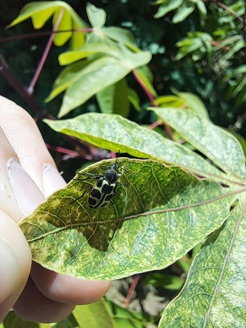
  <p><em>Fonte: acervo de Dados do projeto; cópia redimensionada.</em></p>
</div>

<div align="center">
  <p><strong>Figura 5 — IMG_01540: vaquinha → cigarrinha-das-pastagens</strong></p>
  
  <p><em>Fonte: acervo de Dados do projeto; cópia redimensionada.</em></p>
</div>

<div align="center">
  <p><strong>Figura 6 — IMG_01741: vaquinha → Astylus variegatus</strong></p>
  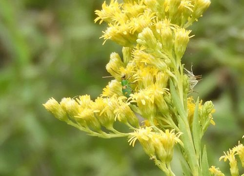
  <p><em>Fonte: acervo de Dados do projeto; cópia redimensionada.</em></p>
</div>

<div align="center">
  <p><strong>Figura 7 — IMG_01812: vaquinha → percevejo-verde</strong></p>
  
  <p><em>Fonte: acervo de Dados do projeto; cópia redimensionada.</em></p>
</div>

<div align="center">
  <p><strong>Figura 8 — IMG_02004: vaquinha → cigarrinha-das-pastagens</strong></p>
  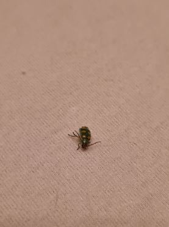
  <p><em>Fonte: acervo de Dados do projeto; cópia para documentação.</em></p>
</div>

<div align="center">
  <p><strong>Figura 9 — IMG_02168: percevejo-barriga-verde → vaquinha</strong></p>
  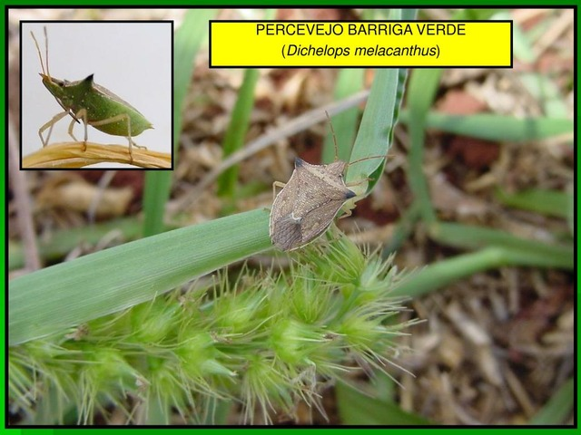
  <p><em>Fonte: acervo de Dados do projeto; cópia redimensionada.</em></p>
</div>

<div align="center">
  <p><strong>Figura 10 — IMG_02637: lagarta-do-cartucho → lagarta-falsa-medideira</strong></p>
  
  <p><em>Fonte: acervo de Dados do projeto; cópia redimensionada.</em></p>
</div>

As observações e hipóteses por imagem estão em [`revisao_visual.csv`](../assets/data/avaliacao_T8_1/candidato_T5_6_20261026/aprofundamento/revisao_visual.csv). A montagem com texto de IMG_02168 e o estágio alado aparente de IMG_02637 ficam registrados para revisão da frente de Dados. Os rótulos do teste foram preservados.

### Limitações

O teste já foi consultado em etapas anteriores; os resultados são exploratórios. Os rótulos são os históricos do conjunto, e a validação taxonômica está pendente. A inspeção visual não determina a causa das mudanças de classe. Classes com poucas imagens exigem cautela na leitura dos deltas.

Esta avaliação não comprova o RNF-06 em dados independentes nem revalida os limiares da T6.5. Latência no celular e seleção da versão correspondem às tarefas T8.2 e T8.3. O INT8 da T7.3 permanece o artefato oficial.

### Reprodução e artefatos

Os [resultados completos](../assets/data/avaliacao_T8_1/candidato_T5_6_20261026/) incluem métricas das seis versões, matrizes em CSV, previsões, mudanças por imagem e registros de proveniência. O método da inspeção está nas [anotações visuais](../assets/data/avaliacao_T8_1/candidato_T5_6_20261026/anotacoes_visuais_int8.json).

```bash
python -m src.avaliacao_pos_conversao_t8_1 --saida runs/reproducao_T8_1
python tests/validar_avaliacao_pos_conversao_t8_1.py
python -m src.aprofundamento_t8_1 --raiz-imagens /caminho/das/fontes --saida runs/aprofundamento_T8_1
python tests/validar_aprofundamento_t8_1.py
```

A consolidação requer NumPy; os gráficos e a revisão requerem Matplotlib, Pillow e as sete fotos originais. Os comandos recusam sobrescrever saídas existentes. Foram aprovados 16 testes da consolidação e 9 do aprofundamento, sem testes pulados.

## 8.2 Benchmark de inferência (T8.2)

**Autora da task:** Karol. **Revisão e medição:** 06/11/2026.

**O critério de aceite da T8.2 está atendido no escopo de benchmark comparativo local:** versões oficiais medidas com protocolo comum, tamanhos, condições e amostras documentados. As medianas das sessões repetiram-se com variação máxima de 7,7%. Há picos dentro de uma sessão, descritos abaixo e mantidos no p95. Isso não aprova o desempenho no celular.

### O que foi corrigido

A coleta anterior usava somente arquivos T5.6. O benchmark agora mede os **cinco artefatos oficiais do candidato EfficientNet-Lite0**: FP32 da T7.1, faixa dinâmica e float16 da T7.2, INT8 oficial da T7.3 e INT8 regenerado na T7.2. Os INT8 têm o mesmo tamanho, mas hashes diferentes, e foram medidos separadamente. Antes de executar, o script confere bytes e SHA-256 contra os registros da T7.2. Nenhum modelo foi treinado ou convertido nesta revisão.

A coleta anterior de seis arquivos T5.6 permanece no [histórico](Benchmark_T8_2_historico_T5_6.md), no [JSON original](../assets/data/benchmark_T8_2/resultados.json) e no [CSV original](../assets/data/benchmark_T8_2/resumo.csv). Seus tempos não foram agrupados com os novos. Arquivos `.keras` são checkpoints de treinamento e não entram no pacote de inferência comparado.

### Condições e método

- **3 sessões em processos independentes**, com PIDs registrados. Mesmo computador, runtime, entrada, configuração de CPU e fonte de energia em todas elas.
- **Uma thread, XNNPACK e CPU lógica 0 fixa.** Prioridade acima do normal somente no processo do benchmark; afinidade e prioridade são restauradas ao terminar. O plano de energia e os demais processos não são alterados. A existência de partições delegadas é verificada em cada arquivo.
- Batch 1, RGB 224 × 224, pixels sintéticos uniformes em [0,1], semente 42. A mesma imagem float é convertida ao dtype e à escala/zero-point de cada modelo fora da cronometragem. Hashes dos tensores ficam nos registros.
- **100 aquecimentos globais por modelo**, depois **5 rodadas intercaladas** de **40 medições por modelo**. Antes de cada bloco: pausa de 100 ms e 20 aquecimentos descartados. A ordem gira entre rodadas e sessões, permitindo que cada modelo ocupe todas as posições.
- Cada sessão contém 200 amostras por versão; o consolidado contém **600 amostras por versão**, **3.000 inferências medidas** no total. Nenhum valor extremo foi excluído.
- `perf_counter_ns` mede **set_tensor + invoke + get_tensor**. Leitura do modelo, criação/alocação do interpretador, geração e quantização da entrada e pré-processamento ficam fora do intervalo. A saída INT8 é lida sem desquantização. A inicialização é registrada separadamente; não representa a partida a frio do aplicativo.
- Fonte de energia consultada antes e depois de cada bloco. A coleta é interrompida se ela mudar. CPU total do sistema e tempo de CPU do processo são registrados por bloco. Temperatura e frequência efetiva não foram medidas; os núcleos permitidos são fixos, mas não são exclusivos do benchmark.

**Ambiente:** Intel(R) Core(TM) Ultra 5 235U, 14 processadores lógicos; `Windows-11-10.0.26200-SP0`; Python 3.13.14, TensorFlow 2.21.0, NumPy 2.4.4. **Alimentação: tomada em todos os blocos.** CPU total observada: 10,8% a 38,5%, incluindo o benchmark e processos concorrentes. Horários UTC e hashes do código estão nos arquivos de cada sessão.

### Tempos e tamanhos medidos

| Versão | Bytes | MB | Redução vs FP32 | Média (ms) | Mediana (ms) | p95 (ms) |
| --- | ---: | ---: | ---: | ---: | ---: | ---: |
| FP32 — T7.1 | 13.531.184 | 13,531 | 0,0% | 12,48 | 12,25 | 16,03 |
| Faixa dinâmica — T7.2 | 3.753.152 | 3,753 | 72,3% | 60,58 | 60,36 | 71,97 |
| Float16 — T7.2 | 6.833.548 | 6,834 | 49,5% | 12,33 | 12,25 | 13,93 |
| INT8 oficial — T7.3 | 4.003.624 | 4,004 | 70,4% | 8,54 | 8,55 | 10,03 |
| INT8 regenerado — T7.2 | 4.003.624 | 4,004 | 70,4% | 8,99 | 8,57 | 12,67 |

**MB = 1.000.000 bytes.** Os percentis do consolidado foram recalculados sobre todas as amostras, não sobre a média dos percentis de cada sessão. Os arquivos de evidência preservam os valores sem arredondamento.

### Verificação da oscilação

| Versão | Sessão 1: mediana (ms) | Sessão 2: mediana (ms) | Sessão 3: mediana (ms) | Variação entre sessões |
| --- | ---: | ---: | ---: | ---: |
| FP32 — T7.1 | 12,41 | 12,43 | 12,03 | 3,4% |
| Faixa dinâmica — T7.2 | 60,33 | 60,06 | 60,80 | 1,2% |
| Float16 — T7.2 | 12,38 | 12,34 | 12,11 | 2,2% |
| INT8 oficial — T7.3 | 8,55 | 8,55 | 8,54 | 0,05% |
| INT8 regenerado — T7.2 | 8,52 | 9,13 | 8,48 | 7,7% |

A variação é `100 × (maior mediana / menor mediana − 1)`. A maior variação entre sessões foi **7,7%**. Dentro de uma mesma sessão, a maior variação entre medianas dos blocos foi **50,9%**; as cinco medianas de cada versão e sessão estão nos JSON individuais. Esses indicadores tornam a oscilação visível e permitem comparar a nova coleta com o problema anterior, em que a mediana do Lite0 FP32 passou de 393,65 para 115,75 ms.

| Versão | Variação entre blocos: sessão 1 | Sessão 2 | Sessão 3 |
| --- | ---: | ---: | ---: |
| FP32 — T7.1 | 5,8% | 39,9% | 5,0% |
| Faixa dinâmica — T7.2 | 8,5% | 42,6% | 10,6% |
| Float16 — T7.2 | 4,7% | 9,5% | 3,8% |
| INT8 oficial — T7.3 | 6,5% | 4,8% | 9,0% |
| INT8 regenerado — T7.2 | 5,5% | 50,9% | 5,8% |

O maior pico entre medianas de blocos ocorreu na segunda sessão, no INT8 regenerado (50,9%). Também houve oscilação no FP32 e na faixa dinâmica nessa sessão. O protocolo comum, a ordem balanceada e a repetição em três processos permitem comparar as distribuições e verificar a repetição das medianas; não demonstram ausência de interferência em cada chamada. A tarefa não define um limite numérico de variação. Por isso, os indicadores são publicados junto dos tempos, sem excluir blocos nem tratar a variação como zero.

Mesmo com o protocolo comum, não se atribui toda a diferença de tempo apenas à quantização: frequência da CPU, temperatura, sistema e processos concorrentes podem afetar as amostras. A ausência de sensores térmicos não deve ser interpretada como temperatura constante. Para analisar diferenças pequenas, como FP32 versus float16 nesta CPU, seriam necessárias mais sessões; estes dados não sustentam vantagem clara de velocidade entre os dois.

### Custo para dispositivos móveis e aceite

Todas as versões quantizadas ficam abaixo do limite proposto de **8 MB (RNF-01)**. O FP32 ocupa 13,531 MB e excede esse limite. A faixa dinâmica reduz mais o armazenamento (72,3%); float16 reduz 49,5%; os INT8 reduzem 70,4%. O tamanho do arquivo não representa RAM de execução nem tamanho total do APK.

Os tempos informam o custo de inferência observado nesta CPU. Não são uma estimativa de energia ou bateria e não comprovam a latência em ARM, GPU ou NNAPI. A escolha para embarque também depende da qualidade de classificação avaliada na T8.1. Os números da T7.2 não são agrupados aqui: aquela medição usa imagem real e inclui (des)quantização no intervalo.

| Critério da T8.2 | Evidência |
| --- | --- |
| Diferentes versões do modelo | Cinco arquivos oficiais T7.1–T7.3, conferidos por SHA-256 |
| Tamanho de cada modelo | Bytes exatos, MB e redução na tabela, JSON e CSV |
| Tempos sob condições comparáveis | Protocolo comum, fonte de energia fixa, mesma CPU lógica, uma thread, XNNPACK, aquecimento, ordem balanceada e três sessões; oscilação explicitada acima |
| Resultados documentados | Ambiente, amostras individuais, código utilizado, comandos e testes de integridade publicados |

**Validação no celular (RNF-04, p95 ≤ 300 ms): pendente e separada do aceite comparativo local.** Executar os mesmos arquivos no aparelho de referência, fixando runtime, threads e delegate e registrando energia e condições térmicas. RAM e consumo energético exigem medição no aparelho. Captura, decodificação e pré-processamento devem ser medidos separadamente para avaliar a espera total do usuário (RNF-03). Nenhum desses RNFs foi aprovado por extrapolação dos tempos locais.

### Reprodução e evidências

Na raiz do repositório, usar **Python 3.13 no Windows**. Ambiente utilizado: `.work/benchmark-python` (pasta ignorada pelo Git). Para preparar e executar uma nova coleta:

```powershell
& "$env:LOCALAPPDATA\Programs\Python\Python313\python.exe" -m venv .work/benchmark-python
.\.work\benchmark-python\Scripts\python.exe -m pip install -r requirements-benchmark.txt
.\.work\benchmark-python\Scripts\python.exe -m src.benchmark_t8_2 --saida runs/reproducao_T8_2 --sessoes 3 --rodadas 5 --repeticoes 40 --aquecimento 100 --cpu 0 --energia tomada
.\.work\benchmark-python\Scripts\python.exe tests/validar_benchmark_t8_2.py
```

A saída deve ser uma pasta nova: o programa recusa sobrescrita. `--raiz` indica a raiz do repositório. `--cpu` escolhe um índice lógico disponível; `-1` permite escalonamento normal e registra essa diferença. `--energia bateria` existe para uma coleta explicitamente feita nessa condição; não se deve misturá-la à coleta na tomada. Para validar uma reprodução em vez da coleta publicada:

```powershell
.\.work\benchmark-python\Scripts\python.exe tests/validar_benchmark_t8_2.py --dados runs/reproducao_T8_2
```

Evidências: [JSON consolidado](../assets/data/benchmark_T8_2/oficiais_20261106/resultados.json), [CSV consolidado](../assets/data/benchmark_T8_2/oficiais_20261106/resumo.csv) e pastas de cada sessão no [diretório da coleta](../assets/data/benchmark_T8_2/oficiais_20261106). Cada sessão conserva seu JSON, CSV e uma cópia exata do script `protocolo.py`, identificada por hash. Código principal: [benchmark_t8_2.py](../src/benchmark_t8_2.py); dependências: [requirements-benchmark.txt](../requirements-benchmark.txt); validação: [validar_benchmark_t8_2.py](../tests/validar_benchmark_t8_2.py).

Os testes conferem integridade dos arquivos históricos e atuais, cobertura das cinco versões, condições declaradas entre sessões, amostras e estatísticas por bloco/sessão/consolidado, CSV contra JSON, rotação balanceada, código preservado e recusas de artefato alterado, sobrescrita, energia divergente e parâmetros inválidos. Eles não certificam temperatura, energia consumida ou desempenho no celular.

**Validação realizada: 8 testes passaram** na coleta publicada. O teste de integridade verifica as evidências, sem repetir as inferências.

## 8.3 Seleção do modelo para mobile (T8.3)

**Atualização em 16/11/2026:** seleção concluída na [T10.4](#104-consolidação-da-seleção-e-versionamento-do-modelo-final-t104). O Float16 abaixo é o modelo oficial da versão `1.0.0` do MVP, e o `status` de [`decisao.json`](../assets/data/selecao_T8_3/decisao.json) passou a `concluida_versao_oficial_mvp`. A escolha e as métricas não mudaram.

**Atualização em 08/11/2026:** a [T8.1](#81-avaliação-pós-conversão-t81) entrou na `develop` e foi conferida contra esta seção, sem divergências (`t8_1: conferida` em [`decisao.json`](../assets/data/selecao_T8_3/decisao.json)), e o frontend da [T9.1](#91-pipeline-de-captura-e-processamento-de-imagens-t91) já integra esta decisão. A escolha não mudou.

**Decisão:** embarcar o **Float16** da T7.2 (`modelo_float16.tflite`, 6.833.548 bytes, SHA-256 `c9a26ce1…8a5a8fa2`), mantendo o **INT8 oficial da T7.3** como contingência. A decisão usa apenas evidências já versionadas (T7.2, T8.1, T8.2 e política T6.5): nenhum modelo foi treinado, convertido ou executado de novo. O Float16 mantém entrada e saída em float32, com o mesmo contrato `[1, 224, 224, 3]` → `[1, 13]` do FP32. A seleção é reproduzível pelo [script](../src/selecao_mobile_t8_3.py), e o resultado está em [`decisao.json`](../assets/data/selecao_T8_3/decisao.json), [`tabela_decisao.csv`](../assets/data/selecao_T8_3/tabela_decisao.csv) e [`relatorio.md`](../assets/data/selecao_T8_3/relatorio.md).

### Critério

A partição de decisão é a **validação**. O teste já foi consultado em etapas anteriores e serve só como verificação exploratória; um teste automatizado confirma que alterá-lo não muda a ordem das versões.

1. **Eliminatórios:** RNF-01 (arquivo ≤ 8 MB), RNF-09 (execução sem delegate), RNF-04 indicativo local (p95 < 300 ms) e RNF-06 pontual (perda de acurácia macro ≤ 2 p.p.).
2. **Entre as elegíveis, na ordem em que a task lista os critérios:**
   - **acurácia:** o RNF-06 é **demonstrado** quando o limite inferior do IC 95% da variação de acurácia macro, na validação, não fica abaixo de −2 p.p.;
   - **desempenho por classe:** menor queda de F1 em uma classe em relação ao FP32;
   - **latência:** menor p95 da T8.2;
   - **tamanho:** menor arquivo.

### Resultado

| Versão | MB | Elegível | F1 macro (val.) | Δ acurácia macro (p.p.) e IC 95% | Pior queda de F1 por classe | p95 local (ms) |
| --- | ---: | :---: | ---: | --- | --- | ---: |
| FP32 (T7.1) | 13,53 | não — RNF-01 | 0,7811 | referência | — | 16,03 |
| Faixa dinâmica (T7.2) | 3,75 | sim | 0,7755 | −0,33 [−2,48; 1,98] | −12,1 p.p. (Percevejo-verde, n=14) | 71,97 |
| **Float16 (T7.2)** | 6,83 | **sim** | 0,7830 | +0,13 [0,00; 0,40] | 0,0 p.p. | 13,93 |
| INT8 oficial (T7.3) | 4,00 | sim | 0,7767 | −0,22 [−3,26; 2,93] | −16,7 p.p. (Percevejo-verde, n=14) | 10,03 |
| INT8 regenerado (T7.2) | 4,00 | sim | 0,7832 | +0,28 [−2,48; 3,20] | −10,7 p.p. (Percevejo-verde, n=14) | 12,67 |

Fontes: [tabela da T7.2](../assets/modelos/comparacao_T7_2_candidato_T5_6_20261026/tabela_comparativa.csv), [métricas por classe da T7.2](../assets/modelos/comparacao_T7_2_candidato_T5_6_20261026/metricas_por_classe.csv) e [resumo do benchmark da T8.2](../assets/data/benchmark_T8_2/oficiais_20261106/resumo.csv). O INT8 regenerado só verificou a reprodutibilidade da T7.3 e não é byte a byte igual a ela. Ele aparece como evidência, não como candidato próprio.

### Por que Float16 e não INT8

- **É a única versão reduzida com o RNF-06 demonstrado.** Nas versões inteiras e na faixa dinâmica, o IC 95% desce abaixo de −2 p.p. com 474 imagens. Isso não indica perda; indica que a amostra não garante o limite. No Float16, o IC fica entre 0,00 e +0,40 p.p.
- **Não piora nenhuma classe.** O Float16 teve 1 divergência de top-1 em relação ao FP32 na validação e nenhuma no teste. O INT8 oficial teve 15 nas duas partições. A fragilidade já conhecida do **Percevejo-verde** (14 imagens na validação) cai de 8/14 para 6/14 acertos no INT8 oficial e na faixa dinâmica. A [T8.1](#81-avaliação-pós-conversão-t81), no teste (473 imagens), confirma o quadro: o Float16 preserva as classificações do Keras (0 acertos perdidos), e o INT8 oficial perde 7 acertos e ganha 5, com F1 pior em seis classes. O F1 macro do INT8 oficial no teste é maior (+0,71 p.p.), mas a acurácia global cai 0,42 p.p.; como o teste já foi consultado, ele não participou da escolha.
- **A política T6.5 continua válida sem recalibrar.** Com o limiar de 0,65 no top-1, o Float16 aceita as mesmas 430 de 474 imagens do FP32, com 90,7% de acerto nas aceitas, e seus scores diferem do FP32 em até 0,015. No INT8 oficial, a diferença chega a 0,42, e a T6.5 exige reconferir o limiar nessa versão (aceita 433 imagens, com 90,3% de acerto, quase na meta de 90%).
- **Latência e tamanho não decidem.** O INT8 é o mais rápido (p95 de 10,0 contra 13,9 ms) e ocupa 2,8 MB menos, mas as duas versões ficam muito abaixo de 300 ms e de 8 MB. A medida é de um CPU x86, e o ganho do INT8 pode ser diferente em ARM.

Esta decisão **revisa a recomendação da T7.2**, que indicava o INT8 oficial. A T7.2 já registrava que o Float16 era a alternativa quando a fidelidade importasse e que o RNF-06 não estava garantido para o INT8. A T8.3 aplica a ordem de critérios da task, que coloca a acurácia antes da latência e do tamanho, e agora dispõe do benchmark comparável da T8.2.

### Contingência e custo

- **Contingência:** se, no aparelho de referência, o Float16 violar o RNF-04 (p95 > 300 ms) ou o RNF-07 (memória), passar para o INT8 oficial da T7.3 (`quantizacao_T7_3_candidato_T5_6_20261026/modelo_int8.tflite`, 4.003.624 bytes). O Float16 em CPU carrega os pesos como float32, então o uso de RAM tende a se aproximar do FP32; isso precisa ser medido.
- **RNF-02 (acréscimo ao pacote ≤ 9 MB):** o Float16 deixa cerca de 2,2 MB para rótulos, índice e eventual base técnica. Confirmar com o parceiro se o conteúdo técnico da T9.3 entra nessa conta.
- **Arquivos já versionados:** o artefato escolhido continua em `comparacao_T7_2_candidato_T5_6_20261026/`. O pacote da T5.6 não foi alterado. O `modelo_int8.tflite` do pacote T5.6 (`07e78745…`) **não é** o INT8 oficial da T7.3 (`456caec5…`). O frontend da T9.1 já aponta para os dois arquivos desta decisão, Float16 principal e INT8 oficial da T7.3 de contingência ([`model-sources.json`](../frontend/model-sources.json)), e não empacota o INT8 antigo da T5.6 nem o FP32.

### Pendências e limites

- **Aparelho de referência:** RNF-03, RNF-04 e RNF-07 não foram medidos no celular; a latência vem do CPU x86 da T8.2. A medição segue o protocolo de `adb` da [seção 7.2](#72-comparação-das-estratégias-de-quantização-t72) e vale para o Float16 e para a contingência.
- **RNF-06 em conjunto independente:** o teste atual já foi consultado, e os intervalos reamostram imagens, não grupos de fotos da mesma planta; podem ser otimistas.
- **Política de confiança:** foi recontada só no top-1 a partir dos scores da T7.2. O top-3 e o limiar no arquivo embarcado exigem nova inferência.
- **Aprovação do parceiro:** pendente, como em todas as versões candidatas da T5.6.

### Reprodução e verificação

```bash
python -m src.selecao_mobile_t8_3 --saida runs/reproducao_T8_3
python tests/validar_selecao_mobile_t8_3.py
```

O script usa somente a biblioteca padrão do Python, confere bytes e SHA-256 de cada versão entre a T7.2 e a T8.2 e recusa divergências. Os **10 testes** passaram. Eles cobrem a reprodução da decisão publicada, os hashes do escolhido e da contingência, a ordem dos critérios, a independência em relação ao teste, o limite da política T6.5, o INT8 do pacote T5.6 e a conferência com a T8.1, inclusive a detecção de divergência.

# 9. Integração Mobile

## 9.1 Pipeline de captura e processamento de imagens (T9.1)

**Atualização em 08/11/2026. Estado:** pipeline web implementado e verificado localmente com Float16 T7.2 principal e INT8 oficial T7.3 de contingência, conforme a decisão T8.3 fornecida para a integração. A validação da câmera e dos limites de desempenho no aparelho físico e a aprovação do parceiro permanecem pendentes.

### Captura e processamento

O frontend React/TypeScript executa o modelo no próprio navegador, com LiteRT.js e um Web Worker. A ação **Tirar foto** abre o seletor nativo com preferência pela câmera traseira; **Escolher da galeria** abre um seletor separado. A câmera depende do navegador/aparelho. No computador ou em ambiente sem suporte à captura, o sistema pode oferecer seleção de arquivo. Arrastar e soltar também é aceito.

As duas entradas encaminham um `File` para a mesma função de análise em [`App.tsx`](../frontend/src/App.tsx). Cancelar o seletor preserva a foto e o resultado. Depois da classificação, **Tirar outra foto** e **Trocar foto** permitem uma nova análise, inclusive da mesma imagem. As ações ficam indisponíveis enquanto a análise está em andamento. A aplicação não presume que o seletor nativo informe a razão de uma captura cancelada ou indisponível.

O fluxo usa o contrato T4.1, reproduzido em [`preprocess.ts`](../frontend/src/lib/preprocess.ts): orientação EXIF aplicada uma vez, RGB, redimensionamento bicúbico com proporção preservada, entrada de 224 × 224 pixels e preenchimento cinza `(128,128,128)`, sem recorte. A entrada float32 é normalizada para [0,1]; no INT8, escala e zero point são lidos do arquivo. A normalização interna do backbone não é repetida.

São aceitos JPEG, PNG e WebP até 10 MiB e 40 megapixels, sem transparência. O [`worker`](../frontend/src/lib/inference.worker.ts) reutiliza o modelo carregado, executa a inferência, desquantiza a saída quando usa INT8 e associa cada score ao índice original das 13 classes. A foto original e a entrada preparada podem ser conferidas na interface. A fotografia não é enviada a um servidor.

### Artefatos e vínculo com as entregas anteriores

[`model-sources.json`](../frontend/model-sources.json) centraliza as origens das classes e de cada modelo, os contratos e as chaves de hash. A situação registrada é `T8.3_concluida_versao_oficial_mvp` (atualizada na [T10.4](#104-consolidação-da-seleção-e-versionamento-do-modelo-final-t104)). O empacotamento verifica os hashes e o vínculo entre classes e modelo, confere as dimensões/tipos dos tensores e gera cópias web com assinaturas de dimensões concretas, preservando os originais.

| Item em execução nesta atualização | Origem | SHA-256 original |
| --- | --- | --- |
| Classes | `assets/modelos/candidato_T5_6_20261026/classes.json` | `1058619e188ffd7fa42bfc6821e2e122356b35d8503af71b987f37ae1e4572f4` |
| Float16 principal T7.2 | `assets/modelos/comparacao_T7_2_candidato_T5_6_20261026/modelo_float16.tflite` | `c9a26ce13806a2fa26bffbd8cfbdac83ff4c05ffff1009ca9483bb587a5a8fa2` |
| INT8 de contingência T7.3 | `assets/modelos/quantizacao_T7_3_candidato_T5_6_20261026/modelo_int8.tflite` | `456caec54fae3c57684f9afd6842cae611a1f6cb6587b40b0c5bd8256aea1340` |

O manifesto servido em `models/manifest.json` registra os hashes original/web, versão da conversão, caminhos de origem/contrato e origem/hash das classes. O [`gerador de referências Python`](../frontend/scripts/generate-reference.py) lê esses mesmos caminhos e confere os hashes antes de inferir. Os testes de navegador conferem a identidade do modelo e das classes contra a referência antes de comparar os scores. Assim, referências do modelo antigo não validam silenciosamente um novo arquivo.

O Float16 ocupa 6.833.548 bytes e mantém entrada e saída float32. O INT8 oficial ocupa 4.003.624 bytes e é distinto do INT8 T5.6 anteriormente usado pela interface. O carregador tenta Float16 com WebGPU, quando disponível, e CPU/WASM; se não conseguir compilar, validar os tensores ou aquecer o principal, usa o INT8 oficial em CPU/WASM e informa a troca. Falhas de download ou hash são informadas para permitir recuperação. A contingência por latência ou memória depende da medição no aparelho e de uma decisão de configuração; não é acionada automaticamente por uma medição isolada. O FP32 antigo não é empacotado nesta integração.

### Evidências locais e limites do aceite

Em Windows, foram executados:

- **9 testes unitários:** referências do processamento Python, quantização e arredondamento.
- **6 testes E2E em Chromium:** Float16 principal e INT8 oficial real após incompatibilidade simulada do principal, identidade dos artefatos, 13 scores e classe principal comparados com Python, EXIF, reutilização, ausência de uploads, entradas de galeria/captura, cancelamento, repetição da mesma foto, arquivos inválidos, recuperação de download e recusa de modelo alterado.
- **Build de produção:** preparação de artefatos, TypeScript e Vite concluídos.
- **Revisão visual:** desktop de 1440 px e viewport móvel de 390 px, sem rolagem horizontal nas telas verificadas. O teste de captura móvel também verifica a largura após o resultado.

Ambiente das referências: TensorFlow 2.21.0, Pillow 12.2.0 e NumPy 2.4.4. Para os dois modelos, a execução Python exige saídas idênticas entre o original e a cópia web nas referências; entre Python e navegador, os testes usam tolerância de 2/256 por score. Essas amostras são sintéticas e verificam integração, não qualidade agronômica ou generalização.

**Pendente no aparelho de referência:** registrar aparelho/SO/navegador e URL HTTPS; capturar pela câmera e selecionar da galeria; conferir EXIF, imagem preparada e classificação; cancelar e repetir; registrar indisponibilidade/permissões conforme o que o sistema expuser. Medir pré-processamento e inferência no aparelho, sem extrapolar a latência do notebook. A automação do input de captura não substitui essa evidência física.

A T9.2 trata o limiar e o estado inconclusivo; a T9.3 trata associação e conteúdo técnico revisado; a T9.4 valida o fluxo offline. Esta atualização não acrescenta service worker, conteúdo técnico nem regra de confiança. Comandos de reprodução e limitações estão no [README do frontend](../frontend/README.md).

## 9.2 Tratamento do limiar de confiança (T9.2)

### Regra implementada

O aplicativo aplica a política definida na [T6.5](#65-política-de-confiança-t65), usando diretamente o arquivo versionado [`parametros.json`](../assets/data/politica_T6_5/parametros.json). O limiar, a quantidade de hipóteses e os textos são incorporados ao JavaScript no build, sem uma segunda configuração de confiança ou consulta adicional à rede.

| Maior score da imagem | Resultado apresentado |
| --- | --- |
| Menor que **0,65** | Resultado inconclusivo, sem classe, score ou orientação técnica associados à identificação da foto. |
| Maior ou igual a **0,65** | As **três hipóteses** com maiores scores, em ordem decrescente; empate pelo menor índice da classe. |

A decisão considera o score original, antes do arredondamento do percentual exibido. Assim, 0,649999 é inconclusivo e 0,65 é aceito. O limiar é aplicado somente ao maior score: quando ele é aceito, a segunda e a terceira hipóteses podem ter scores inferiores a 0,65, conforme a política. Nenhuma soma ou alteração de scores é realizada. Saída vazia, scores não finitos/fora de [0, 1] ou índices repetidos também não produzem identificação.

### Estado inconclusivo e nova captura

Quando nenhuma classe atinge o limiar, a interface apresenta os textos da política:

> Resultado inconclusivo: não foi possível identificar o problema com segurança nesta foto.

> Fotografe de novo, mais perto, com o inseto ou a parte da planta afetada em foco e bem iluminada.

A imagem original e a entrada preparada continuam disponíveis para consulta. O botão **“Tentar outra foto”** abre o seletor de captura; a galeria também permanece disponível. Cancelar a seleção mantém o resultado atual. Ao analisar outra foto, a tela limpa o resultado e a classe selecionada anteriormente. Se o novo resultado for inconclusivo, as hipóteses e o conteúdo técnico anterior não aparecem; remover a foto retorna ao estado inicial.

A lista geral de classes continua como consulta independente. Ela não é usada para preencher uma identificação inconclusiva. O resultado comunica que a identificação não foi obtida com segurança; não afirma ausência de praga nem identifica automaticamente imagens fora do escopo.

### Integração e limites

A regra está em [`confidence.ts`](../frontend/src/lib/confidence.ts), consumida pela interface [`App.tsx`](../frontend/src/App.tsx). O worker mantém sua inferência e os scores originais. O filtro é aplicado tanto ao **Float16 principal** quanto ao **INT8 oficial de contingência**, após a desquantização já realizada no worker, sem mudar a captura ou o preprocessamento.

O limiar de 0,65 permanece o definido no projeto; sua calibração de origem foi feita em Keras FP32. Esta entrega implementa o tratamento do limiar e não recalibra os scores ou comprova desempenho diagnóstico no formato embarcado. Um score alto continua sendo apresentado como hipótese, não como probabilidade calibrada de acerto ou diagnóstico confirmado. A validação física no aparelho, a disponibilidade de conteúdo técnico e o fluxo offline completo permanecem nas respectivas entregas.

### Verificação

Em **08/11/2026**, passaram **19 testes unitários** (9 de preprocessamento e 10 de confiança), **8 testes de navegador Chromium** e o build TypeScript/Vite. A regra de confiança cobre fronteiras abaixo/igual/acima do limiar, top-k, desempate, preservação do vetor original, soma aproximada dos scores INT8 e recusa de saída inconsistente.

Os testes de navegador mantêm a inferência real Float16/INT8 e a comparação dos 13 scores com as referências Python. Como as fotos sintéticas de referência têm score máximo abaixo de 0,65, verificam o estado inconclusivo real sem identificação. Dois testes adicionais usam dublê somente do transporte do worker para produzir os scores exatos de fronteira e verificar transições aceito → inconclusivo → aceito, limpeza da classe anterior, ausência de orientações técnicas, nova captura, cancelamento, remoção e viewport de 390 px sem rolagem horizontal. Esse dublê complementa a execução dos modelos reais; não substitui avaliação agronômica ou uso físico da câmera.

Para reproduzir, na pasta `frontend`:

```bash
npm ci
npm test
npx playwright install chromium
npm run test:e2e
npm run build
```

O comando de inicialização e o build preparam os artefatos web a partir dos modelos versionados. A implementação do estado inconclusivo não altera pesos, classes, arquivos TFLite ou os parâmetros da T6.5.

## 9.3 Associação da predição ao conteúdo técnico (T9.3)

**Autor:** Lucas. **Revisor:** Glauco. **Data:** 08/11/2026.

**Situação: entrega parcial.** A associação entre cada classe do modelo, o dicionário de classes e a base local de conteúdo está implementada e testada, e funciona sem rede. O **conteúdo técnico em si ainda não existe**: o catálogo do Agro App não foi recebido, então nenhuma das 13 classes tem texto de sintomas ou manejo, e todas resolvem como *indisponível*. O critério de aceite ("cada classe reconhecida é associada ao conteúdo técnico correspondente, consultável sem internet") só será atendido por completo quando o catálogo for preenchido. Até lá, o aplicativo deve dizer que o conteúdo está indisponível, sem afirmar nenhuma orientação. Existe material de referência para 11 das 13 classes (ver o [mapa de fontes](#mapa-de-fontes-de-conteúdo)), mas ele tem direitos reservados e não foi copiado.

### Fluxo

1. O modelo devolve o índice da classe (0 a 12), na ordem de [`classes.json`](../assets/modelos/candidato_T5_6_20261026/classes.json).
2. A [associação](../assets/data/conteudo_T9_3/associacao_classes.json) liga o índice ao nome do modelo, à identificação da praga, aos IDs do inventário e do acervo anterior e à `chave_conteudo` oficial.
3. A [base local](../assets/data/conteudo_T9_3/base_conteudo.json) guarda o texto de cada `chave_conteudo`, com fonte, data de revisão e o indicador `validated`.
4. A função `associar_predicoes` ([`associacao_conteudo_t9_3.py`](../src/associacao_conteudo_t9_3.py)) enriquece cada previsão com a identificação e o estado do conteúdo. Mantém a ordem e o score do modelo e recusa índices fora das 13 classes.

A T9.3 **não depende do limiar de confiança**. A [T9.2](#92-tratamento-do-limiar-de-confiança-t92) decide quais previsões aparecem (a proposta da [T6.5](#65-política-de-confiança-t65) é 3 hipóteses e limiar 0,65 no top-1) e o painel de orientações mostra o conteúdo da classe escolhida entre as hipóteses aceitas. O app não chama `associar_predicoes` (função Python, usada nos testes): ele lê o `frontend/src/data/content.ts`, gerado destes arquivos (ver abaixo). Mudar o limiar não altera esta entrega.

### As 13 classes

| Índice | Classe (nome do modelo) | Cultura | IDs no inventário | ID no acervo anterior | Chave proposta | Classes relacionadas (T6.4) | Conteúdo |
| ---: | --- | --- | --- | --- | --- | --- | --- |
| 0 | Vaquinha (Diabrotica speciosa) | Milho/Soja | 0 | — | `praga.diabrotica_speciosa` | 1, 2, 5, 6, 10, 11, 12 | indisponível |
| 1 | Cigarrinha-do-milho (Dalbulus maidis) | Milho | 1 | AGRO-001 | `praga.dalbulus_maidis` | 0 | indisponível |
| 2 | Percevejo-barriga-verde (Dichelops/Diceraeus) | Milho/Soja | 2 | — | `praga.dichelops_sp` | 0, 3, 4, 5, 7, 9, 10, 11 | indisponível |
| 3 | Lagarta-do-cartucho (Spodoptera frugiperda) | Milho/Soja | 3 | — | `praga.spodoptera_frugiperda` | 2, 7, 8, 9, 10 | indisponível |
| 4 | Percevejo-marrom (Euschistus heros) | Soja | 4 | — | `praga.euschistus_heros` | 2, 7, 11 | indisponível |
| 5 | Percevejo-verde (Nezara viridula) | Soja | 5 | — | `praga.nezara_viridula` | 0, 2, 6, 10 | indisponível |
| 6 | Percevejo-asa-preta (Edessa meditabunda) | Soja | 6 | — | `praga.edessa_meditabunda` | 0, 5 | indisponível |
| 7 | Percevejo-do-milho (Leptoglossus zonatus) | Milho | 7 | AGRO-003 | `praga.leptoglossus_zonatus` | 2, 3, 4, 11, 12 | indisponível |
| 8 | Lagarta-falsa-medideira (Chrysodeixis includens) | Soja | 8 | — | `praga.chrysodeixis_includens` | 3, 10 | indisponível |
| 9 | Lagarta-da-soja (Anticarsia gemmatalis) | Soja | 9 | AGRO-053 | `praga.anticarsia_gemmatalis` | 2, 3 | indisponível |
| 10 | Lagarta-das-vagens (Spodoptera eridania e S. cosmioides) | Soja | 10, 11 | — | `praga.spodoptera_eridania_cosmioides` | 0, 2, 3, 5, 8, 11, 12 | indisponível |
| 11 | Astylus variegatus | Milho | 12 | — | `praga.astylus_variegatus` | 0, 2, 4, 7, 10 | indisponível |
| 12 | Cigarrinha-das-pastagens (Deois flavopicta) | Milho | 13 | — | `praga.deois_flavopicta` | 0, 7, 10 | indisponível |

O nome exibido é o do modelo. Na classe 11, o dataset do parceiro usa também "larva-angorá"; esse nome comum não foi adotado, para não divergir do modelo e do restante da documentação. A coluna "Classes relacionadas" vem dos 27 pares da [T6.4](#64-proposta-de-tratamento-de-classes-t64). Na classe 10, os IDs 10 e 11 do inventário (*Spodoptera eridania* e *S. cosmioides*) formam uma única classe, conforme a [seção 3.5](#35-classes-do-mvp).

### Regras de associação

- **Só a chave oficial abre conteúdo.** Enquanto `chave_conteudo` for `null`, ou o status não for `validado`, a classe resolve como indisponível. A `chave_conteudo_proposta` (`praga.<espécie>`) serve apenas à organização local e nunca é usada para abrir conteúdo; segue a regra da [seção do dicionário](#vinculação-ao-conteúdo-técnico).
- **Classes relacionadas na T6.4 ficam separadas.** O contrato recusa duas classes de um mesmo par com o mesmo conteúdo. A relação não soma scores, não altera o ranking e não força uma classe a aparecer.
- **Nada é inventado.** Um item só é *disponível* com texto, fonte e data de revisão, `validated` verdadeiro, e a classe com `validacao_conteudo` (responsável, data e evidência).
- **Sem rede.** A associação e a base são arquivos locais; o código não importa nenhum módulo de rede, e um teste confere isso.

### Origem da identificação

Nome comum e científico vêm da tabela das classes no `instruções.md` do dataset do parceiro (pasta `Agro_App/dataset/dataset` do Drive da equipe). Os nomes científicos são **referência a validar por agrônomo**, como o próprio arquivo indica. As pastas `Milho`, `Soja` e `dataset` do Drive contêm só imagens e metadados de imagem; não há texto técnico nelas. A associação com o dicionário da [T3.4](#dicionário-de-classes-t34) existe só para as três classes que também constam do acervo anterior (índices 1, 7 e 9); as demais não têm ID `AGRO-xxx`.

### Mapa de fontes de conteúdo

O [mapa de fontes](../assets/data/conteudo_T9_3/fontes_conteudo.json) indica, por classe, onde há material técnico de referência, com a citação da fonte e da página. Foram consultadas duas publicações da Embrapa citadas no [dicionário de classes](#dicionário-de-classes-t34), em 08/11/2026:

- **Manual da soja** (SOSA-GÓMEZ et al., 2014): 3ª edição, Embrapa Soja, 102 páginas no PDF. Cada ficha traz as fases do inseto e um parágrafo de danos. Não há seção de manejo.
- **Artigo da cigarrinha-do-milho** (OLIVEIRA, 2025): artigo da Revista Cultivar Grandes Culturas, de Ivênio Rubens de Oliveira (Embrapa Milho e Sorgo). Trata de sintomas, período de controle e manejo químico e biológico.

A tabela usa a numeração **impressa** das páginas (a do PDF é uma a mais no manual); o mapa registra as duas. As referências completas estão ao final da seção.

| Índice | Classe | Citação | O que a fonte traz | Observação |
| ---: | --- | --- | --- | --- |
| 0 | Vaquinha (Diabrotica speciosa) | (SOSA-GÓMEZ et al., 2014, p. 42) | descrição das fases, danos | Ficha no contexto da soja; a classe do modelo também cobre milho. |
| 1 | Cigarrinha-do-milho (Dalbulus maidis) | (OLIVEIRA, 2025, p. 12-14) | sintomas, período de controle, manejo químico e biológico | Artigo de 3 páginas (12 a 14 impressas, PDF 1 a 3). Inclui manejo químico e biológico, que exige validação agronômica. |
| 2 | Percevejo-barriga-verde (Dichelops/Diceraeus) | (SOSA-GÓMEZ et al., 2014, p. 84) | descrição das fases, danos | A fonte usa o gênero Dichelops; o modelo e o dataset usam Diceraeus spp. (ex-Dichelops). |
| 3 | Lagarta-do-cartucho (Spodoptera frugiperda) | (SOSA-GÓMEZ et al., 2014, p. 74) | descrição das fases, danos | No manual a ficha usa o título lagarta-das-vagens e o contexto da soja; o modelo chama a classe de lagarta-do-cartucho. |
| 4 | Percevejo-marrom (Euschistus heros) | (SOSA-GÓMEZ et al., 2014, p. 78) | descrição das fases, danos | A ficha faz menção pontual à resistência a inseticidas, sem seção de manejo. |
| 5 | Percevejo-verde (Nezara viridula) | (SOSA-GÓMEZ et al., 2014, p. 82) | descrição das fases, danos | — |
| 6 | Percevejo-asa-preta (Edessa meditabunda) | (SOSA-GÓMEZ et al., 2014, p. 86) | descrição das fases, danos | O manual chama a espécie de percevejo-edessa; o modelo, de percevejo-asa-preta. |
| 7 | Percevejo-do-milho (Leptoglossus zonatus) | **sem fonte** | — | Obter a fonte com o parceiro. |
| 8 | Lagarta-falsa-medideira (Chrysodeixis includens) | (SOSA-GÓMEZ et al., 2014, p. 36) | descrição das fases, danos | — |
| 9 | Lagarta-da-soja (Anticarsia gemmatalis) | (SOSA-GÓMEZ et al., 2014, p. 34) | descrição das fases, danos | — |
| 10 | Lagarta-das-vagens (Spodoptera eridania e S. cosmioides) | (SOSA-GÓMEZ et al., 2014, p. 70) | descrição das fases, danos | A classe reúne duas espécies; há uma ficha para cada. |
| 10 | Lagarta-das-vagens (Spodoptera eridania e S. cosmioides) | (SOSA-GÓMEZ et al., 2014, p. 72) | descrição das fases, danos | A classe reúne duas espécies; há uma ficha para cada. |
| 11 | Astylus variegatus | (SOSA-GÓMEZ et al., 2014, p. 98) | descrição das fases, danos | A ficha descreve danos apenas eventuais. O manual usa o nome larva-angorá; o modelo usa o nome científico. |
| 12 | Cigarrinha-das-pastagens (Deois flavopicta) | **sem fonte** | — | Obter a fonte com o parceiro. |

**Onze das 13 classes têm material de referência; as classes 7 e 12 não têm.** Dez classes têm descrição e danos (manual) e a classe 1 tem sintomas e manejo (artigo). O manual é do contexto da soja, então para vaquinha, barriga-verde e lagarta-do-cartucho, que também ocorrem em milho, a ficha vale só para soja. O iNaturalist e o AgroInsect, consultados antes, trazem apenas identificação (taxonomia, nomes e fotos), sem sintomas nem manejo.

O mapa **não contém texto das fontes** e o resolvedor não o usa. As duas publicações têm direitos reservados (Lei nº 9.610), e o repositório não as versiona; o hash de cada PDF consultado fica no mapa. O uso permitido é a referência bibliográfica e a redação própria a partir delas, **sempre com citação da fonte e da página**. Copiar o texto para o aplicativo depende de autorização da Embrapa ou do parceiro, e o manejo químico não entra sem validação. Um teste recusa o mapa se faltar a referência completa (com ano, link e data de acesso) ou a citação por página, se algum campo de texto for longo o bastante para conter trecho copiado, e se o uso do texto for marcado como autorizado sem registro de responsável, data e evidência.

### Como completar quando o catálogo chegar

1. Receber do parceiro o catálogo com chaves oficiais, título, texto, fonte e data de cada praga.
2. Em `associacao_classes.json`, preencher `chave_conteudo` e `validacao_conteudo` (responsável, data, evidência) e mudar `status_conteudo` para `validado`. O comando `python -m src.associacao_conteudo_t9_3 gerar` preserva esses campos ao atualizar o restante e nunca sobrescreve a base.
3. Em `base_conteudo.json`, incluir um item por `chave` com `titulo`, `texto`, `fonte`, `revisado_em` e `validated: true`. No campo `fonte`, usar a citação do mapa de fontes (por exemplo, `SOSA-GÓMEZ et al., 2014, p. 78`) e listar a referência completa em Referências. Os campos coincidem com o `TechnicalContent` do frontend (`title`, `text`, `source`, `reviewedAt`, `validated`); gere o `frontend/src/data/content.ts` com `python -m src.associacao_conteudo_t9_3 frontend`, que inclui só as classes que o resolvedor dá como disponíveis.
4. Executar `python -m src.associacao_conteudo_t9_3 verificar --exigir-conteudo`. O comando só termina com sucesso quando as 13 classes têm conteúdo validado, o que corresponde ao RNF-08 (100% das classes resolvem para conteúdo válido). Hoje ele falha de propósito.
5. Verificar a abertura do conteúdo no aparelho em modo avião (T9.4).

### Pendências e limites

- **Catálogo de conteúdo técnico do Agro App:** não recebido; sem ele, 0 das 13 classes tem conteúdo disponível e o critério de aceite não está completo.
- **Fontes de referência:** as classes 7 (*Leptoglossus zonatus*) e 12 (*Deois flavopicta*) não têm fonte; as demais têm material com direitos reservados, cujo uso no aplicativo depende de autorização ou de redação própria validada.
- **Validação do parceiro:** nomes científicos, cultura e associação de cada classe ao conteúdo precisam ser confirmados, e os pares da T6.4 dependem da decisão agronômica.
- **Integração no aplicativo:** o `frontend/src/data/content.ts` é gerado da associação e da base (comando `frontend`), e um teste falha se ele ficar desatualizado. Hoje sai vazio, porque nenhuma classe tem conteúdo validado.
- **RNF-08 completo** (100% de conteúdo válido) e a demonstração **sem rede no aparelho** (T9.4) continuam pendentes.

### Reprodução e verificação

```bash
python -m src.associacao_conteudo_t9_3 gerar
python -m src.associacao_conteudo_t9_3 verificar
python -m src.associacao_conteudo_t9_3 frontend
python tests/validar_associacao_conteudo_t9_3.py
python tests/validar_fontes_conteudo_t9_3.py
```

Os comandos usam somente a biblioteca padrão do Python. Os **15 testes** da associação passam. Eles cobrem o `content.ts` do frontend gerado a partir da associação, a reprodução da associação a partir das fontes e seus hashes, as 13 classes na ordem do modelo, os IDs do inventário e do acervo, as chaves únicas e a recusa de URLs, as relações da T6.4, o estado indisponível sem catálogo, um catálogo sintético completo, os estados intermediários, o contrato de validação, a preservação do preenchimento manual ao regenerar, a recusa de índices inválidos e a ausência de acesso à rede.

Os **14 testes** do mapa de fontes também passam. Eles cobrem a coerência com as 13 classes, as lacunas, o intervalo e a numeração das páginas, o vocabulário das seções, a referência completa e a citação por página, os direitos e a autorização de uso, e a recusa de texto copiado.

### Referências

ALMEIDA, G.; NAZARIO, L.; TEIXEIRA, M.; STIRLE, J.; FRANCA, H.; OLIVEIRA, M.; OLIVEIRA, R.; NOVAK, S.; BAILÃO, A.; GONTIJO, P. **AGROINSECT: a dataset for identifying agricultural insects and pests of interest**. Versão 2. [S. l.]: Mendeley Data, 2026. DOI: 10.17632/4jyp4m9gxj.2. Disponível em: https://data.mendeley.com/datasets/4jyp4m9gxj/2. Acesso em: 8 nov. 2026. Licença CC BY 4.0.

AGROTECH INTELI. **Dataset de pragas de soja e milho: AgroTech Inteli × Agro App**. Documento interno (instruções.md), pasta Agro_App/dataset/dataset do Drive da equipe, 2026.

INATURALIST. **Observações de pragas de soja e milho no Brasil**. Disponível em: https://www.inaturalist.org. Acesso em: 4 out. 2026. Licenças CC0 e CC BY, foto a foto; os créditos individuais estão em `field_labels.csv`.

OLIVEIRA, I. R. de. **Estratégias contra a cigarrinha-do-milho**. Cultivar Grandes Culturas, [S. l.], n. 312, p. 12-14, 2025. Disponível em: https://www.embrapa.br/en/busca-de-publicacoes/-/publicacao/1179329/estrategias-contra-a-cigarrinha-do-milho. Acesso em: 8 nov. 2026.

SOSA-GÓMEZ, D. R. et al. **Manual de identificação de insetos e outros invertebrados da cultura da soja**. 3. ed. Londrina: Embrapa Soja, 2014. (Embrapa Soja. Documentos, 269). ISSN 1516-781X. Disponível em: https://www.embrapa.br/en/busca-de-publicacoes/-/publicacao/991685/manual-de-identificacao-de-insetos-e-outros-invertebrados-da-cultura-da-soja. Acesso em: 8 nov. 2026.

## 9.4 Validação do funcionamento offline (T9.4)

**Autor:** Glauco. **Revisor:** Lucas. **Data:** 08/11/2026.

**Situação: entrega parcial.** O app abre e classifica sem rede depois da primeira visita, e isso está coberto por teste automatizado. Falta a demonstração no celular físico, exigida pelo critério de aceite, e o conteúdo técnico continua vazio por depender do catálogo da [T9.3](#93-associação-da-predição-ao-conteúdo-técnico-t93).

### O que foi implementado

- **Service worker sem dependência.** O modelo fica em [`scripts/sw.js`](../frontend/scripts/sw.js). O build ([`vite.config.ts`](../frontend/vite.config.ts)) grava `dist/sw.js` com a lista de arquivos do próprio build: app, fontes, `models/manifest.json`, os dois `.tflite` do manifesto (Float16 principal e INT8 de contingência) e as variantes do runtime WASM, cerca de 60 MB.
- **Pré-cache atômico.** Na primeira visita com rede, `cache.addAll` baixa tudo de uma vez. Se um arquivo falhar, nada é considerado pronto.
- **Versão do cache.** O nome do cache é `agroapp-<hash>`, com os 16 primeiros caracteres do SHA-256 da lista e do conteúdo dos arquivos. Cada build novo troca o nome e apaga o cache anterior. Esse nome identifica o build na demonstração.
- **Estado visível.** Quando o pré-cache termina, o status mostra **Modelo pronto · disponível offline**. Se ele falhar (cota do navegador ou queda de rede no meio do download), o status mostra **modo offline indisponível**, em vez de só registrar o erro no console.
- **Conteúdo técnico.** O `content.ts` vai embutido no bundle JS, então entra no cache junto com o app. Hoje está vazio e o painel mostra "Conteúdo técnico ainda indisponível".
- No `npm run dev` o service worker não é registrado.

### Como foi validado

O projeto Playwright `offline` ([`tests/offline.spec.ts`](../frontend/tests/offline.spec.ts)) roda no Chromium de desktop sobre o build de produção (`npm run build` + `npm run preview`):

1. Abre o app com rede e espera **disponível offline**.
2. Desliga a rede, recarrega e espera **Modelo pronto**.
3. Escolhe uma foto e confere que a inferência real termina. A foto sintética fica abaixo do limiar da T9.2, então o teste aceita o estado inconclusivo ou as hipóteses.
4. Ainda sem rede, recarrega com um dublê só do worker (como no `confidence.spec.ts`) para forçar um resultado aceito e confere o painel de orientações técnicas: hoje "indisponível"; quando o `content.ts` for preenchido, o painel com a fonte.
5. Confere que nenhuma requisição falhou com a rede desligada.

Um segundo teste aborta o download de um `.tflite` pelo service worker e confere o aviso **modo offline indisponível**.

Em 08/11/2026 passaram os 2 testes `offline`, os 8 testes `chromium` e os 19 testes unitários.

```bash
cd frontend
npx playwright test --project=offline
```

O build e o preview só sobem quando o projeto `offline` roda; `--project=chromium` usa apenas o servidor de desenvolvimento.

### Demonstração no celular (pendente)

O critério pede capturar, classificar e ver o conteúdo em modo avião num aparelho. O roteiro está no [README do frontend](../frontend/README.md#funcionamento-offline-t94). Registro a preencher:

| Campo | Valor |
| --- | --- |
| Aparelho | — |
| Versão do Android | — |
| Navegador e versão | — |
| URL HTTPS | — |
| Nome do cache (hash do build) | — |
| Resultado (abriu, classificou, painel de conteúdo) | — |
| Print ou vídeo | — |

### Limites

- O teste automatizado roda no Chromium de desktop com a rede desligada pelo Playwright. Ele não prova o comportamento no Android, a câmera real nem o modo avião.
- O service worker exige HTTPS (ou `localhost`). Pelo IP da rede local em HTTP, o app não fica disponível offline.
- O pré-cache ocupa cerca de 60 MB. Em aparelhos com pouco espaço o navegador pode recusar, e o app avisa que o modo offline ficou indisponível. O navegador também pode apagar o cache sob pressão de armazenamento.
- O conteúdo técnico está vazio (T9.3). O painel aparece offline, mas só com o aviso de indisponível.
- A demonstração congelada da Sprint 04 (`frontend/dist`, #49) foi gerada antes desta tarefa e não tem `sw.js`. O pacote da demo precisa ser gerado de novo depois do merge.
- Modo offline e PWA instalável continuam fora do escopo do produto (`PRODUCT.md`). Esta tarefa só garante que o app, já aberto uma vez, volte a funcionar sem rede.

# 10. Consolidação da avaliação

## 10.1 Independência dos conjuntos de dados

A revisão de 13/11/2026 conferiu as **3.156 imagens** do candidato EfficientNet-Lite0 de 26/10/2026, distribuídas em **2.209 de treino, 474 de validação e 473 de teste**. O índice utilizado possui SHA-256 `28ee662885202f0bda3dec9660e44b28f99b8bd183210bcbdd795b103269b2eb`, correspondente ao manifesto do candidato.

Foram conferidos os arquivos originais, pixels após orientação EXIF, grupos registrados e IDs de observação iNaturalist. Essas chaves apresentaram zero sobreposições entre partições. A busca perceptual reproduziu os **45 pares candidatos** da auditoria, com as mesmas distâncias. A inspeção visual assistida por IA classificou um par como duplicata confirmada, um como relação suspeita e 43 como sem vínculo confirmado. A revisão humana permanece pendente.

| Relação | Imagens | Tratamento definido |
| --- | --- | --- |
| Mesma fotografia em versões diferentes | `IMG_01019`, treino, e `IMG_01874`, teste | Registrar o vazamento entre fontes e vincular as duas versões à mesma unidade em uma futura partição. Incluir `IMG_01020`, outra foto da observação `142398716`, nesse grupo. |
| Possível mesma cena ou sequência | `IMG_01752`, validação, e `IMG_01835`, teste | Manter o vínculo como suspeito e agrupar preventivamente em uma próxima versão até esclarecer a origem. |

O índice histórico foi preservado para rastrear o treinamento e as avaliações. **Os resultados obtidos nesse recorte são exploratórios**, considerando o vazamento, os vínculos ainda desconhecidos e a consulta prévia ao teste durante o desenvolvimento. As comparações entre versões e análises de erros continuam possíveis com identificação do recorte, modelo, runtime e preprocessing. A magnitude do efeito dessas limitações sobre as métricas permanece desconhecida.

Uma exclusão retrospectiva pode ser publicada como análise de sensibilidade, com regra, IDs removidos e novos suportes explicitados. A comprovação de generalização depende de um novo conjunto representativo, com grupos e manifesto reservados antes da avaliação e sem uso para ajuste de modelo ou limiar. **Nenhum novo teste com essa evidência de reserva foi identificado nesta revisão.**

A busca perceptual possui alcance limitado. Recortes, rotações e fotos diferentes de uma mesma sessão podem escapar da triagem. Os 43 pares sem vínculo confirmado e os zeros nas chaves exatas devem ser lidos com essa restrição.

O [registro completo da revisão](../assets/data/independencia_T10_1/README.md) reúne as figuras dos casos, a classificação dos 45 pares, as cinco imagens dos grupos relacionados, assinaturas das 3.156 imagens, hashes, método de reprodução e protocolo para um eventual novo teste. A [decisão sobre o uso dos resultados](../assets/data/independencia_T10_1/decisao_avaliacao.json) está vinculada ao índice e ao resumo da verificação.

## 10.2 Correspondência do preprocessing Python e web

**Autora:** Ana Célia. **Revisora prevista:** Karol. **Meta de entrega:** a definir. **Entrega formal:** pendente de revisão; implementação e evidências técnicas registradas em 14/11/2026.

O contrato T10.2 é implementado em [`preprocessamento.py`](../src/preprocessamento.py) e [`preprocess.ts`](../frontend/src/lib/preprocess.ts). Ele explicita a decodificação RGB8, a política de ignorar ICC nos dois ambientes para preservar a entrada histórica do treinamento, EXIF aplicado uma vez, resize bicúbico Pillow, padding cinza e normalização float32/INT8. O navegador passou a usar `colorSpaceConversion: 'none'` e canvas sRGB explícito; o Python passou a recusar transparência como a web e expor os pixels anteriores à normalização para auditoria.

Os testes com 18 entradas fotográficas (originais sem perfil, sRGB e Display P3; variantes com oito orientações EXIF e casos de fronteira de confiança) apresentaram **igualdade exata dos pixels e dos tensores** em Python e Chromium desktop. O controle negativo do comportamento anterior revelou diferenças máximas de 9 níveis RGB no JPEG Display P3 e 13 no PNG com ICC.

A [comparação dos modelos finais Float16 T7.2 e INT8 T7.3](#103-comparação-dos-modelos-float16-e-int8-entre-python-e-web) registra os hashes, 13 scores, classes, decisões e decomposição por etapa. Contra Python sem delegates, o erro máximo de score foi aproximadamente `4,62e-6` no Float16 e `0,11328125` no INT8, com duas mudanças de decisão nesse último. **Com XNNPACK habilitado no Python, o INT8 coincidiu exatamente com a web; o Float16 diferiu em até `1,20e-7`, sem mudanças de classe/decisão nos dois modelos.** A configuração de runtime deve acompanhar a versão do modelo nas validações. Esses resultados não representam uma nova avaliação independente de acurácia nem recalibração do limiar.

**Conferência do aceite técnico:** contrato definido e implementado nos dois ambientes; testes fotográficos com ICC, sem perfil e com EXIF; correspondência demonstrada no corpus; comparação dos modelos finais documentada na seção 10.3. A revisão humana de Karol não é presumida por essa verificação automatizada.

### Contrato de preprocessing

Identificador: `T10.2-rgb8-sem-conversao-icc-v1`. Treino, calibração e avaliação Python usam `preparar_imagem`; a inferência web usa `prepareImage`, `normalize` e `quantize` no worker.

| Etapa | Regra comum aos pipelines |
| --- | --- |
| Decodificação | JPEG, PNG e WebP estáticos de fotografias RGB8 opacas. Pillow no Python; `createImageBitmap` no navegador, sem redimensionamento na decodificação. Cinza de 8 bits é expandido para RGB; paleta e alpha totalmente opaco podem ser convertidos. |
| ICC e cor | Preservar os códigos RGB8 e ignorar ICC e correção de gama dos metadados. Python usa `convert('RGB')` sem `ImageCms`; a web usa `colorSpaceConversion: 'none'`, `premultiplyAlpha: 'none'` e canvas/leitura sRGB explícitos. Os códigos são tratados como sRGB na leitura e no preview. |
| EXIF | Aplicar a orientação 1–8, incluindo espelhamentos, exatamente uma vez antes de calcular as dimensões. Python usa `ImageOps.exif_transpose`; a web, `imageOrientation: 'from-image'`. As dimensões devolvidas são as orientadas. |
| Transparência | Recusar qualquer pixel com alpha menor que 255, inclusive transparência de paleta. Não compor a foto sobre outra cor nem descartar alpha silenciosamente. |
| Dimensões | Limite de 40 milhões de pixels. A interface também limita o arquivo a 10 MiB. A verificação de pixels ocorre após abrir o cabeçalho no Python e criar o bitmap na web; não garante um limite de memória durante a decodificação. |
| Geometria | Escala = `224 / max(largura, altura)`; cada dimensão = `max(1, round_even(dimensão * escala))`. Preservar proporção e ampliar imagens pequenas. Empates são arredondados para o inteiro par. |
| Reamostragem | Bicúbica separável do Pillow 12.2, com antialiasing na redução e arredondamento/clipping RGB8 entre os passes. A web reproduz os coeficientes de precisão de 22 bits, sem usar o resize nativo do canvas. |
| Preenchimento | Quadro 224×224 com RGB8 `(128,128,128)`. Deslocamento = `floor((224 - dimensão) / 2)`; sobra ímpar à direita/embaixo. Sem recorte. |
| Float | HWC RGB contíguo, `float32(pixel / 255)` em `[0,1]`, com batch `[1,224,224,3]`. O modelo Float16 final recebe float32. Não repetir a normalização do backbone embutida no modelo. |
| INT8 | A partir do float32: `clip(round_even(x / scale + zero_point), -128,127)`. Escala e zero point vêm do modelo final. Os testes cobrem os 256 níveis RGB com a escala oficial T7.3. |
| Preview | Gerado dos próprios RGB8 224×224 usados no tensor, sem segunda decodificação ou conversão ICC. |

Ignorar ICC preserva os valores utilizados no treinamento T4.1 e elimina a conversão automática que ocorria somente na web. A regra estabelece correspondência numérica; não converte Display P3 ou Adobe RGB para sRGB colorimétrico. Uma mudança dessa política exige outro contrato, novas referências e reavaliação dos modelos. CMYK/YCCK, HDR, canais de 16 bits, imagens animadas, perfis inválidos e outros formatos não têm equivalência certificada nesta entrega.

### Evidências, tolerâncias e verificação

As [referências fotográficas](../frontend/tests/fixtures/preprocessing/README.md) incluem três originais intactos (sem perfil, sRGB e Display P3), variantes lossless com/sem ICC, WebP, oito orientações EXIF controladas e quatro casos de fronteira de confiança. EXIF e brilho das variantes são transformações de teste sobre fotos reais; não são registros originais de câmera. `reference.json` registra hashes, dimensões, perfil, orientação e versões Python; `boundary-provenance.json` registra a origem, o brilho e o modelo utilizados na seleção dos casos críticos.

Os arquivos `.decoded.gz` e `.pixels.gz` preservam os RGB8 do Python antes e depois da geometria. PNG e WebP lossless exigem igualdade exata. Para os JPEGs deste corpus, o teto de regressão é diferença máxima de 3 níveis RGB e MAE de 0,35 por canal na escala 0–255, nas duas etapas. Esses limites acomodam diferenças entre decodificadores e não garantem o mesmo teto para qualquer JPEG. **Na execução registrada, todos os 18 casos tiveram diferença zero.**

A normalização e a quantização exigem igualdade exata quando os RGB8 são iguais. Os hashes float32 e dos tensores são conferidos contra as referências Python; código, dependências, política ou imagens desatualizados impedem a comparação. Os seis padrões sintéticos anteriores continuam exigindo os hashes exatos do Pillow e cobrem ampliação, redução, dimensões estreitas e empate no arredondamento. O controle negativo usa a conversão ICC automática antiga nas mesmas fotos e detecta o defeito corrigido.

Para verificar o preprocessing sem TensorFlow, com Pillow 12.2.0 e NumPy 2.4.4:

```powershell
python frontend/scripts/generate-preprocessing-reference.py
python tests/validar_preprocessamento.py
python tests/validar_preprocessamento_t10_2.py
cd frontend
npm.cmd test
npx.cmd playwright test tests/preprocessing.spec.ts --project=chromium
npm.cmd run build
```

O teste de inferência é ativado com `MODEL_COMPARISON=1` após gerar as referências dos modelos, conforme a seção 10.3. Ele exige correspondência com Python usando XNNPACK: scores INT8 exatos neste corpus e tolerância de `1e-5` no Float16. As diferenças contra Python sem delegates são registradas, incluindo mudanças de decisão.

Fotos RGB8 opacas mantêm os pixels de entrada Python anteriores, inclusive com ICC. A recusa de transparência é uma restrição nova no Python, alinhada à web. Os resultados e hashes históricos de código continuam identificando suas execuções originais; não são substituídos para simular nova calibração. Uma nova execução de etapas que conferem proveniência deve gerar sua própria evidência.

Referências das APIs: [WHATWG, ImageBitmap](https://html.spec.whatwg.org/multipage/imagebitmap-and-animations.html), para decodificação sem conversão com `none`, e [Pillow, ImageCms](https://pillow.readthedocs.io/en/stable/reference/ImageCms.html), para a transformação colorimétrica explícita que este contrato não aplica.

## 10.3 Comparação dos modelos Float16 e INT8 entre Python e web

Em **14/11/2026**, após a correção do preprocessing da T10.2, foram executados testes comparativos com os modelos finais **Float16 T7.2**, principal, e **INT8 T7.3**, de contingência. O objetivo foi verificar se a mesma foto produz tensores, scores, classes e decisões de confiança correspondentes no Python e no navegador, separando o efeito da preparação da imagem do efeito do runtime de inferência.

**Resultado:** os pixels e os tensores de entrada foram idênticos nos dois ambientes nos 18 casos. Com XNNPACK habilitado no Python, os scores INT8 coincidiram exatamente com os da web; no Float16, a diferença máxima foi `1,1920929e-7`. Nessa configuração não houve mudança de classe ou de decisão. Ao desativar os delegates no Python, o INT8 apresentou diferenças maiores e duas mudanças de decisão, detalhadas abaixo.

### Modelos e rastreabilidade

Os testes utilizaram o candidato EfficientNet-Lite0 `candidato_T5_6_20261026`, com a mesma ordem das [13 classes](../assets/modelos/candidato_T5_6_20261026/classes.json) e os artefatos selecionados para o frontend:

| Papel | Modelo e versão | Artefato original | SHA-256 original |
| --- | --- | --- | --- |
| Principal | Float16 T7.2 | [`modelo_float16.tflite`](../assets/modelos/comparacao_T7_2_candidato_T5_6_20261026/modelo_float16.tflite) | `c9a26ce13806a2fa26bffbd8cfbdac83ff4c05ffff1009ca9483bb587a5a8fa2` |
| Contingência | INT8 T7.3 | [`modelo_int8.tflite`](../assets/modelos/quantizacao_T7_3_candidato_T5_6_20261026/modelo_int8.tflite) | `456caec54fae3c57684f9afd6842cae611a1f6cb6587b40b0c5bd8256aea1340` |

As cópias especializadas para a web tiveram seus hashes conferidos contra o manifesto do frontend. No Python sem delegates, cada original e sua cópia web produziram os mesmos 13 scores em todos os casos. Os hashes das cópias, dos tensores, das imagens, do código, das classes e da política de confiança estão nos [dados completos da comparação](../assets/data/comparacao_preprocessamento_T10_2/comparacao.json). Nenhum modelo foi retreinado ou alterado por estes testes.

A comparação recusa referências antigas quando mudam código, dependências, política ou imagens. Os hashes float32 e dos tensores do navegador também são conferidos contra as referências Python, evitando que resultados de versões diferentes sejam apresentados como uma única execução.

### Protocolo de comparação

O corpus contém **18 entradas fotográficas**, entre originais sem perfil de cor, com sRGB e com Display P3, variantes lossless com e sem ICC, WebP, oito orientações EXIF e quatro casos de fronteira de confiança. As orientações e os ajustes de brilho foram aplicados deliberadamente a fotografias reais para testar o processamento. São casos de regressão; não constituem 18 observações independentes nem um novo conjunto de avaliação de acurácia. A origem e as transformações estão nas [referências fotográficas](../frontend/tests/fixtures/preprocessing/README.md).

O ambiente Python utilizou **Python 3.13.14, Pillow 12.2.0, NumPy 2.4.4 e TensorFlow 2.21.0**, em CPU com uma thread, nas configurações sem delegates e com delegate padrão XNNPACK. O navegador foi **Chromium 156.0.8078.4**, no Windows, com **LiteRT.js 2.6.0 em CPU/WASM e uma thread**. A configuração com delegates padrão corresponde ao caminho documentado na T8.1, embora aquela avaliação tenha utilizado quatro threads.

Para cada combinação de foto e modelo, foram comparados:

1. **Decodificação e geometria:** dimensões após EXIF, RGB8 decodificado e pixels após redimensionamento e preenchimento cinza.
2. **Tensor de entrada:** forma `[1,224,224,3]`, valores e hash. O modelo Float16 recebe float32 em `[0,1]`; o INT8 recebe valores quantizados com escala e zero point do próprio modelo. A normalização interna do backbone não é repetida.
3. **Saída:** os 13 scores, erro absoluto máximo e médio, classe de maior score e decisão da política de confiança. A regra permanece **top-1 maior ou igual a 0,65**, sem arredondar o score antes da comparação.
4. **Origem da divergência:** o Python também executou a inferência com o tensor produzido na web. Isso permite separar diferenças de preprocessing das diferenças de runtime, mantendo o mesmo modelo e a mesma entrada.

### Resultados entre os ambientes

Nos 18 casos, a diferença máxima dos pixels RGB8 foi **zero**, tanto na decodificação quanto após a geometria. A diferença dos tensores também foi **zero**. As diferenças de score observadas abaixo pertencem à inferência, não à preparação das imagens.

| Modelo | Configuração Python comparada à web | Diferença máxima no tensor | Diferença máxima de score | Classes diferentes | Decisões diferentes |
| --- | --- | ---: | ---: | ---: | ---: |
| Float16 T7.2 | Sem delegates | 0 | `4,61935997e-6` | 0/18 | 0/18 |
| INT8 T7.3 | Sem delegates | 0 | `0,11328125` | 0/18 | 2/18 |
| Float16 T7.2 | Com XNNPACK | 0 | `1,1920929e-7` | 0/18 | 0/18 |
| INT8 T7.3 | Com XNNPACK | 0 | 0 | 0/18 | 0/18 |

Na comparação sem delegates, o erro absoluto médio dos 13 scores foi aproximadamente `1,86e-7` no Float16 e `0,00300481` no INT8. Seis dos 18 casos INT8 ultrapassaram a referência de `2/256` usada nos testes sintéticos anteriores. Essa referência serve como sinal de investigação; os testes anteriores não garantiam esse limite para qualquer fotografia.

**A igualdade dos scores INT8 com XNNPACK associa a divergência observada à configuração da inferência.** O ensaio não localiza o primeiro operador responsável pela diferença entre os caminhos de execução e não demonstra equivalência de todos os builds ou dispositivos.

### Casos críticos no limiar de confiança

A tabela apresenta três casos relevantes usando **Python sem delegates** como referência. A classe de maior score foi preservada, mas as duas entradas INT8 mudaram de decisão na web:

| Modelo e entrada | Classe prevista nos dois ambientes | Top-1 Python | Top-1 web | Decisão Python → web |
| --- | --- | ---: | ---: | --- |
| Float16 — `boundary-float16-above.png` | 0 — Vaquinha | `0,650361896` | `0,650360882` | Aceito → aceito |
| INT8 — `exif-6.png` | 2 — Percevejo-barriga-verde | `0,585937500` | `0,667968750` | Inconclusivo → aceito |
| INT8 — `boundary-int8-above.png` | 0 — Vaquinha | `0,761718750` | `0,648437500` | Aceito → inconclusivo |

O caso Float16 ficou próximo do limiar e manteve a decisão apesar da pequena diferença numérica. No INT8, os casos evidenciam mudanças nos dois sentidos, mesmo com tensores idênticos. **Com XNNPACK no Python, as classes e decisões coincidiram com a web também nesses casos.**

Os arquivos `boundary-*` foram procurados por ajuste de brilho nos modelos finais sem delegates. Os valores RGB8 e a quantização tornam a resposta descontínua; o nome `above` identifica o lado encontrado nessa configuração, sem garantir que o score continue acima de 0,65 em outro runtime. Esses casos não estimam a frequência de mudança de decisão em fotos naturais.

### Pontos para análise e limites

- **Configuração de referência:** registrar delegate, número de threads e versão/build do runtime junto ao hash do modelo. A correspondência observada com XNNPACK não deve ser estendida ao Python sem delegates. Se a equivalência sem delegates for necessária, reduzir os casos críticos e localizar o primeiro operador divergente.
- **Troca entre os modelos:** Float16 e INT8 tiveram quatro diferenças de classe e quatro diferenças de decisão nos 18 casos, tanto no Python sem delegates quanto na web, embora os casos de decisão não sejam necessariamente os mesmos. Por exemplo, em `display-p3.jpg`, o Float16 indicou Vaquinha, com top-1 `0,824377`, e o INT8 indicou Cigarrinha-das-pastagens, com `0,664062`; ambos foram aceitos. A contingência exige avaliação própria, mesmo quando o preprocessing corresponde.
- **Limiar de confiança:** o valor de 0,65 foi definido anteriormente em Keras FP32. A comparação não recalibra Float16 ou INT8 e não justifica alterar o limiar ou arredondar scores para ocultar divergências. Qualquer nova margem de abstenção depende de decisão de produto e validação específica.
- **Alcance da evidência:** os resultados são de regressão em CPU/WASM no Chromium desktop. WebGPU, Safari, Firefox e Android físico permanecem fora desta comprovação. As variantes controladas e a consulta aos modelos na seleção dos casos de fronteira impedem interpretar o corpus como avaliação independente de generalização.

### Reprodução e verificação

A implementação da comparação está em [`comparacao_preprocessamento_t10_2.py`](../src/comparacao_preprocessamento_t10_2.py), e o teste no navegador está em [`preprocessing.spec.ts`](../frontend/tests/preprocessing.spec.ts). Em ambiente Python com as versões indicadas acima:

```powershell
cd frontend
npm.cmd run assets
cd ..
python -m src.comparacao_preprocessamento_t10_2 referencia
cd frontend
$env:MODEL_COMPARISON='1'
npx.cmd playwright test tests/preprocessing.spec.ts --project=chromium
Remove-Item Env:MODEL_COMPARISON
cd ..
python -m src.comparacao_preprocessamento_t10_2 relatorio
```

Na execução de 14/11/2026 passaram os **19 testes unitários**, os **12 testes de navegador**, incluindo inferência real e offline, as validações Python do preprocessing e o build TypeScript/Vite. Após acrescentar a checagem explícita das referências XNNPACK, os dois testes comparativos de navegador e as validações Python foram executados novamente e passaram.

Os [dados completos](../assets/data/comparacao_preprocessamento_T10_2/comparacao.json) preservam os scores por classe, as decisões, as margens em relação ao limiar, os erros por etapa e a identidade dos modelos. O comando `relatorio` atualiza esse JSON; a análise descritiva é mantida nesta seção. A reprodução gera os tensores intermediários em `frontend/.work/model-comparison-*.json`.

## 10.4 Consolidação da seleção e versionamento do modelo final (T10.4)

Em 16/11/2026, a seleção da [T8.3](#83-seleção-do-modelo-para-mobile-t83) foi concluída e a versão oficial do MVP foi fixada como **`1.0.0`**. O modelo já consumido pelo frontend é o definitivo: nenhum modelo foi treinado, convertido, quantizado ou trocado nesta etapa.

| Papel | Formato | Origem | SHA-256 original | Arquivo entregue | SHA-256 entregue |
| --- | --- | --- | --- | --- | --- |
| **Principal** | Float16 (T7.2) | `assets/modelos/comparacao_T7_2_candidato_T5_6_20261026/modelo_float16.tflite` | `c9a26ce13806a2fa26bffbd8cfbdac83ff4c05ffff1009ca9483bb587a5a8fa2` | `models/modelo_float16_web.tflite` (6.833.548 bytes) | `9c18f0a2ca4a4e2eb0d84dd415046f0bd35385ede8c47e14463d3a0f134647ec` |
| **Contingência** | INT8 oficial (T7.3) | `assets/modelos/quantizacao_T7_3_candidato_T5_6_20261026/modelo_int8.tflite` | `456caec54fae3c57684f9afd6842cae611a1f6cb6587b40b0c5bd8256aea1340` | `models/modelo_int8_web.tflite` (4.003.624 bytes) | `df2f5d4fe22b4d3f76c4b8f6dab6e0100231c83d606122999ed15ceb72c05978` |

O hash entregue difere do original porque a cópia web só torna concretas as dimensões dinâmicas da assinatura; pesos, operadores e quantização são preservados ([seção 9.1](#91-pipeline-de-captura-e-processamento-de-imagens-t91)).

### O que mudou

- [`decisao.json`](../assets/data/selecao_T8_3/decisao.json) e o [script da T8.3](../src/selecao_mobile_t8_3.py): `status` de `decisao_aprovada_para_integracao_pendente_celular_e_parceiro` para `concluida_versao_oficial_mvp`. A tabela, os critérios e a escolha continuam reproduzidos pelo script.
- [`model-sources.json`](../frontend/model-sources.json): versão `1.0.0`, estado `T8.3_concluida_versao_oficial_mvp`, caminho da decisão T8.3 e papel explícito de cada modelo (`principal` e `contingencia`), que antes só era dado pela ordem da lista.
- [`prepare-assets.mjs`](../frontend/scripts/prepare-assets.mjs): o build lê a decisão T8.3 e **recusa** gerar os artefatos se o caminho ou o SHA-256 do principal ou da contingência divergir de `escolhido` ou `contingencia`. O manifesto servido (`models/manifest.json`) passa a registrar `version`, `selection` (origem e estado da decisão) e `role` de cada modelo, além dos hashes original e web já existentes.
- A verificação do pacote de demonstração e o teste de navegador conferem o papel de cada modelo e o estado da seleção.
- `frontend/public/models` e `frontend/dist` foram regenerados pelo build.

### Verificação

Após `npm.cmd run build`, os dois manifestos (`public/models` e `dist/models`) conferem com os arquivos entregues: tamanho e SHA-256 de cada cópia web, SHA-256 de cada origem e a lista de modelos do pré-cache offline (`dist/sw.js`), que contém só os dois arquivos do manifesto. Passaram os 10 testes da T8.3, os 19 testes unitários e os 10 testes de navegador. Uma alteração proposital do hash da contingência em `decisao.json` interrompeu o build, como esperado.

### Limites

A conclusão da seleção não fecha as pendências já registradas na T8.3: RNF-03, RNF-04 e RNF-07 no aparelho de referência, RNF-06 em conjunto independente ([seção 10.1](#101-independência-dos-conjuntos-de-dados)), a política T6.5 no top-3 do arquivo embarcado e a aprovação do parceiro. A contingência continua sendo acionada pelo carregador apenas quando o principal não compila, não valida os tensores ou falha no aquecimento; a troca por latência ou memória depende da medição no aparelho.
