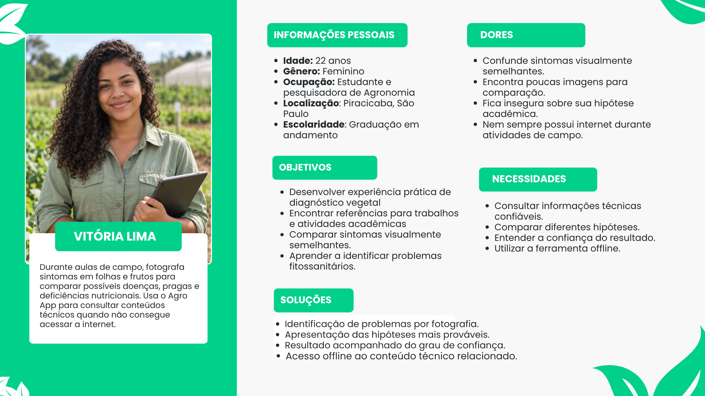

# Documentação do Projeto — AgroApp

## Sumário

<strong>1. Entendimento de Negócio</strong>

- [1.1 Matriz de riscos](#11-matriz-de-riscos)
- [1.2 Canvas de proposta de valor](#12-canvas-de-proposta-de-valor)
- [1.3 Persona e jornada do usuário](#13-persona-e-jornada-do-usuário)
- [1.4 Governança do acervo de imagens](#14-governança-do-acervo-de-imagens)

<strong>2. Especificação Técnica e Arquitetura</strong>

- [2.1 Requisitos e restrições técnicas](#21-requisitos-e-restrições-técnicas)
- [2.2 Glossário técnico do projeto](#22-glossário-técnico-do-projeto)
- [2.3 Levantamento de arquiteturas viáveis](#23-levantamento-de-arquiteturas-viáveis)
- [2.4 Diagrama da arquitetura da solução](#24-diagrama-da-arquitetura-da-solução)
- [2.5 Consolidação técnica](#25-consolidação-técnica)

---

# 1. Entendimento de Negócio

## 1.1 Matriz de riscos

A matriz de riscos identifica os eventos que podem comprometer o desenvolvimento e os resultados do Módulo de Identificação de Pragas por Reconhecimento Visual integrado ao Agro App, avaliando cada um por probabilidade e impacto para priorizar as ações de mitigação. Foram levantados 12 riscos, dos quais 6 vêm do Termo de Abertura do Projeto (TAP) e 6 derivam dos requisitos do módulo, como nível mínimo de confiança, qualidade da imagem e rastreabilidade.

### Matriz de probabilidade e impacto

A Figura 1 mostra onde cada risco se posiciona ao cruzar probabilidade (eixo vertical) e impacto (eixo horizontal). Quanto mais próximo do canto superior direito, maior a prioridade de tratamento.

  
<strong>Figura 1 — Matriz de probabilidade e impacto</strong>

  
  
<em>Fonte: feito pela própria equipe, 2026.</em>

### Critérios de classificação

Cada risco recebeu uma nota de 1 a 3 em probabilidade e em impacto. A probabilidade indica a chance de o risco ocorrer ao longo do projeto, e o impacto indica o quanto ele compromete a qualidade do modelo, o cronograma ou a entrega do MVP.

| Nota | Probabilidade | Impacto |
| --- | --- | --- |
| 1 | **Baixa:** ocorrência improvável ao longo do projeto | **Baixo:** efeito pequeno, absorvido na própria sprint |
| 2 | **Média:** pode ocorrer, dependendo de decisões ou condições em aberto | **Médio:** atrasa etapas ou reduz a qualidade de parte da solução, mas o MVP continua viável |
| 3 | **Alta:** ocorrência provável ou já esperada, dadas as características dos dados e do contexto de uso | **Alto:** compromete o desempenho do modelo, o cronograma ou os critérios de sucesso do MVP |

O nível de risco é o produto entre as duas notas:

| Produto | Nível de risco | Tratamento |
| --- | --- | --- |
| 1 a 2 | Baixo | Acompanhamento simples, sem ação imediata |
| 3 a 4 | Médio | Monitoramento e manutenção da mitigação planejada |
| 6 | Alto | Mitigação ativa, revisada a cada sprint |
| 9 | Crítico | Prioridade máxima, tratado desde as primeiras fases |

### Riscos identificados

A tabela apresenta os riscos ordenados por nível.

| Risco | Probabilidade | Impacto | Nível | Mitigação | Responsável |
| --- | --- | --- | --- | --- | --- |
| **R01.** Número insuficiente de imagens por classe, principalmente para pragas e doenças menos frequentes | Alta (3) | Alto (3) | 9 (Crítico) | Priorizar no MVP as classes com mais imagens, usar aumento de dados e complementar com bases públicas validadas pelo parceiro | Equipe de dados e Agro App |
| **R04.** Sintomas visualmente semelhantes entre agentes causais distintos geram confusão sistemática entre classes | Alta (3) | Alto (3) | 9 (Crítico) | Retornar as hipóteses mais prováveis com grau de confiança, em vez de diagnóstico único, e agrupar classes indistinguíveis quando validado pelo parceiro | Equipe de modelagem |
| **R02.** Desbalanceamento entre classes faz o modelo favorecer as mais representadas | Alta (3) | Médio (2) | 6 (Alto) | Balanceamento e ponderação de classes, avaliando por métricas por classe e não pela acurácia global | Equipe de modelagem |
| **R06.** Fotos de baixa qualidade tiradas em campo (sol forte, sombra, tremor) prejudicam a análise | Alta (3) | Médio (2) | 6 (Alto) | Definir padrão mínimo de nitidez, validar a foto antes da análise e pedir nova foto explicando o problema | Equipe de desenvolvimento |
| **R03.** Modelo excede o tamanho ou o tempo de resposta aceitáveis no aparelho | Média (2) | Alto (3) | 6 (Alto) | Arquiteturas leves desde o início, quantização e limites de tamanho e latência definidos com o parceiro | Equipe de modelagem |
| **R07.** Limiar mínimo de confiança mal calibrado: muito baixo gera diagnósticos errados, muito alto faz o modelo recusar quase tudo | Média (2) | Alto (3) | 6 (Alto) | Definir o limiar com base no conjunto de validação e em referências de mercado, e pedir nova foto ou mais informações quando não for atingido | Equipe de modelagem |
| **R09.** Diferença entre as imagens do acervo e as fotos reais de campo faz o modelo ir bem no teste e mal em uso | Média (2) | Alto (3) | 6 (Alto) | Aumento de dados com variações de luz, ângulo e fundo, e testes com fotos tiradas por celular em condições reais | Equipe de modelagem |
| **R11.** O produtor trata a hipótese como conclusão definitiva e decide o manejo com base nela | Média (2) | Alto (3) | 6 (Alto) | Apresentar hipóteses com confiança, permitir esclarecer dúvidas antes da conclusão e deixar claro que a dosagem não faz parte do módulo | Equipe de UX e produto |
| **R05.** Curva de aprendizado da equipe em visão computacional maior que a prevista | Média (2) | Médio (2) | 4 (Médio) | Bibliotecas e modelos pré-treinados de alto nível, acompanhamento da diretoria de tecnologia e divisão de tarefas por frente de trabalho | Diretoria de tecnologia |
| **R08.** Acervo do parceiro chega atrasado, sem rótulos ou em formato inadequado | Média (2) | Médio (2) | 4 (Médio) | Confirmar volume, rotulagem e formato na Fase 1 e reservar a rotulagem manual no cronograma da Fase 2 | Gestão do projeto |
| **R12.** Aumento de escopo por funcionalidades ainda não detalhadas no TAP, como diálogo com o usuário e logs de rastreabilidade | Média (2) | Médio (2) | 4 (Médio) | Definir com o parceiro o que entra no MVP e o que fica para ciclos posteriores, com registro formal da decisão | Gestão do projeto |
| **R10.** Diagnóstico direciona a um conteúdo técnico errado ou inexistente na base do Agro App | Baixa (1) | Alto (3) | 3 (Médio) | Mapeamento classe-conteúdo validado pelo parceiro, testes em todas as classes do MVP e sugestão de conteúdos relacionados quando não houver validação | Equipe de desenvolvimento e Agro App |

### Análise da distribuição dos riscos

Dos 12 riscos, 2 são críticos, 6 são altos e 4 são médios, e nenhum ficou no nível baixo. Os críticos (R01 e R04) decorrem das características dos dados, que são o volume de imagens por classe e a semelhança visual entre sintomas, e por isso suas mitigações devem orientar já as Fases 1 e 2 do cronograma. Os altos se concentram no desempenho e no uso do módulo, como qualidade das fotos, limites de tamanho e latência, limiar de confiança, diferença entre o acervo e o campo e interpretação do resultado, e vários dependem de decisões ainda em aberto com o parceiro. Os médios estão ligados à equipe, ao parceiro e ao escopo. O R10 tem baixa probabilidade porque o Agro App já organiza o conteúdo por cultura e praga, mas alto impacto, pois um direcionamento errado comprometeria a recomendação de manejo.

---

## 1.2 Canvas de proposta de valor

Mapear as dores e ganhos do produtor, diferenciando o que o Agro App já resolve do que será acrescentado pelo diagnóstico visual.

**Documentação — a preencher**

| Dores do produtor | Ganhos esperados | Solução atual do Agro App | Contribuição do diagnóstico visual |
| --- | --- | --- | --- |
| A preencher | A preencher | A preencher | A preencher |

**Canvas:** inserir a imagem ou o link do artefato aqui.

**Referências:** a preencher.

---

## 1.3 Persona e jornada do usuário

Uma persona é uma representação fictícia de um usuário, criada com base nas características, nos objetivos, nas necessidades e nas dificuldades do público que se pretende atender. Em nosso projeto, as personas funcionam como uma forma de validar se a solução proposta está realmente alinhada aos problemas e às expectativas de seus futuros usuários. Elas orientam as decisões da equipe ao longo do desenvolvimento, ajudando a avaliar funcionalidades, formas de interação e situações de uso do Módulo de Identificação de Pragas por Reconhecimento Visual integrado ao Agro App. Foram definidas duas personas para o projeto, e Vitória Lima, apresentada a seguir, é uma delas.

### Persona 2 — Vitória Lima

  
<strong>Figura 1 — Persona Vitória Lima</strong>

  
  
<em>Fonte: feito pela própria equipe, 2026.</em>

Vitória Lima tem 22 anos, cursa Agronomia e atua como pesquisadora em Piracicaba, São Paulo. Durante atividades de campo, fotografa sintomas em folhas e frutos para comparar possíveis doenças, pragas e deficiências nutricionais. Ela busca desenvolver experiência prática em diagnóstico vegetal e consultar referências técnicas confiáveis, mas encontra dificuldades para diferenciar sintomas visualmente semelhantes, avaliar hipóteses com segurança e acessar a internet em campo. Por isso, precisa de um módulo que apresente as hipóteses mais prováveis, informe o grau de confiança do resultado e permita acesso offline a conteúdos técnicos relacionados.

### Jornada do usuário — Vitória Lima

A jornada do usuário representa as etapas percorridas por uma pessoa ao interagir com uma solução, considerando suas ações, seus pensamentos, suas emoções e as dificuldades encontradas durante a experiência. No projeto, esse mapeamento permite compreender como Vitória utilizaria o módulo em uma situação real e identificar pontos de fricção e oportunidades de melhoria.

  
<strong>Figura 2 — Mapa da jornada do usuário de Vitória Lima</strong>

  
  
<em>Fonte: feito pela própria equipe, 2026.</em>

Na jornada mapeada, Vitória encontra uma alteração em uma planta durante uma aula de campo e registra uma fotografia pelo módulo integrado ao Agro App. Caso esteja sem conexão, a imagem permanece salva no dispositivo até que possa ser enviada e processada. Em seguida, ela consulta as hipóteses apresentadas e seus respectivos níveis de confiança, compara os sinais com o conteúdo técnico disponível e registra as informações necessárias para discutir o resultado e o próximo passo com o professor.

O mapa evidencia necessidades importantes para o módulo, como orientar a captura de imagens com qualidade, informar claramente o estado do envio e do processamento, explicar o grau de confiança dos resultados e manter um histórico com fotos, análises e anotações. Esses elementos reduzem dúvidas ao longo da experiência e tornam seu uso mais seguro e útil em atividades de campo.

---

## 1.4 Governança do acervo de imagens

### 1. Objetivo

Estabelecer como as imagens usadas no desenvolvimento do diagnóstico visual serão recebidas, catalogadas, protegidas e descartadas. A governança permite verificar a procedência e a permissão de uso de cada imagem, manter a rastreabilidade do dataset e reduzir riscos de exposição indevida.

### 2. Origem das imagens

- **Acervo principal:** fornecido pelo Agro App para treinamento e avaliação do modelo. Pode conter imagens de pragas, doenças, deficiências nutricionais, plantas daninhas e culturas agrícolas.
- **Bases públicas complementares:** podem reforçar classes com poucas amostras, desde que sua utilização seja validada pelo parceiro e as condições de uso sejam verificadas.
- **Outras origens:** caso sejam incorporadas, deverão passar pelo mesmo registro de procedência e pela verificação das permissões antes do uso.

A origem de cada conjunto e, quando possível, de cada imagem deve ser registrada antes de sua inclusão no dataset.

### 3. Propriedade e permissão de uso

Para cada origem, deve-se identificar o titular dos direitos ou responsável pelo fornecimento, a autorização ou licença aplicável e suas limitações. O registro deve distinguir a permissão para **treinamento, validação, teste, documentação e apresentação**, além de eventuais restrições de compartilhamento, redistribuição ou publicação. O fornecimento de uma imagem, por si só, não comprova autorização para todos esses usos.

Até que a titularidade, as autorizações e as restrições do acervo principal sejam documentadas, as imagens não devem ser usadas fora das finalidades expressamente comprovadas. Isso inclui a publicação em documentos e apresentações. Imagens sem permissão identificada devem ficar fora dos conjuntos de uso até que a situação seja esclarecida.

### 4. Catalogação e rastreabilidade

**Proposta da equipe:** manter um registro por imagem ou por conjunto homogêneo, conforme a granularidade disponível, com os seguintes campos mínimos:

| Campo | Informação a registrar |
| --- | --- |
| Identificador | Código único da imagem ou do conjunto. |
| Origem e fornecimento | Fonte, referência de obtenção e responsável pelo fornecimento. |
| Conteúdo | Classe ou rótulo, cultura associada e observações relevantes, quando aplicáveis. |
| Direito de uso | Titular ou responsável, autorização ou licença, evidência e restrições conhecidas. |
| Histórico | Data de inclusão, alterações de rótulo e motivo de exclusão, quando ocorrer. |
| Uso no dataset | Partição de treino, validação ou teste e identificação de eventuais derivados. |

O identificador deve permitir localizar a imagem, sua origem e a evidência da permissão sem depender apenas do nome do arquivo.

### 5. Armazenamento e controle de acesso

**Proposta da equipe:** manter o acervo em local de acesso restrito, organizado por origem e etapa de tratamento. Preservar os arquivos brutos separadamente das versões processadas e registrar a ligação entre eles. Conceder acesso somente às pessoas que precisam das imagens para suas atividades, revisar esses acessos quando a participação mudar e evitar links públicos ou a inclusão acidental do acervo em repositórios públicos. Quando houver cópias de segurança, elas devem seguir as mesmas regras de acesso e o ciclo de retenção definido para os originais.

O local de armazenamento, a lista de pessoas autorizadas e as regras de cópia de segurança precisam ser definidos antes do recebimento do acervo. A escolha da ferramenta deve respeitar essas regras; esta seção não pressupõe uma solução específica.

### 6. Dados pessoais e LGPD

Embora o objetivo seja fotografar plantas, uma imagem pode incluir pessoas ao fundo, rostos, placas de veículos, localização em metadados EXIF ou elementos de uma propriedade rural que, em determinado contexto, permitam identificar uma pessoa natural. A presença desses elementos deve ser avaliada também nas bases públicas. A [ANPD define dado pessoal pela possibilidade de identificar uma pessoa natural direta ou indiretamente](https://www.gov.br/anpd/pt-br/assuntos/titular-de-dados); a avaliação de cada imagem depende do contexto.

**Proposta da equipe:** inspecionar as imagens e seus metadados antes de incluí-las no dataset; coletar e conservar somente o necessário para a finalidade definida; restringir o acesso; e remover metadados ou ocultar elementos identificadores quando não forem necessários à análise agronômica. Se a identificação for necessária ou a remoção não for suficiente, o uso deve passar por avaliação específica da finalidade, da base legal e das responsabilidades das partes, com apoio jurídico quando necessário. Essas medidas seguem os princípios de finalidade, necessidade e segurança da [LGPD](https://www.planalto.gov.br/ccivil_03/_ato2015-2018/2018/lei/l13709compilado.htm); sua aplicação concreta depende dos dados e do papel de cada parte.

Também é necessário verificar se o acervo inclui fotografias enviadas por usuários do aplicativo, quais informações lhes foram fornecidas e se existe política interna de privacidade aplicável. A definição dos responsáveis pelo tratamento de eventuais dados pessoais depende dessa análise.

### 7. Uso de bases públicas complementares

Uma base pública somente deve ser incorporada após registrar sua origem, versão ou endereço de referência, licença e condições de uso; verificar a compatibilidade dessas condições com as finalidades do projeto; avaliar adequação às culturas e classes do MVP, qualidade das imagens e presença de dados pessoais; e identificar duplicatas relevantes em relação ao acervo existente. A procedência e o resultado dessa avaliação devem acompanhar as imagens importadas.

Além da licença, a inclusão de cada base complementar depende de aprovação para o projeto. Essa aprovação deve registrar os limites de uso, redistribuição e publicação das imagens importadas.

### 8. Retenção e descarte

**Proposta da equipe:** conservar imagens de desenvolvimento enquanto forem necessárias às atividades autorizadas; identificar quais imagens integram o dataset final e sob qual responsabilidade permanecerão; e revisar periodicamente cópias temporárias, duplicatas e imagens rejeitadas para descarte quando não houver finalidade ou obrigação de conservação. O descarte deve abranger originais, derivados e cópias acessíveis, conforme o ambiente de armazenamento, com registro do que foi excluído, quando e por quem. Cópias de segurança devem seguir o procedimento de expiração aplicável. A [ANPD observa que não há prazo único de tratamento aplicável a todos os casos](https://www.gov.br/anpd/pt-br/acesso-a-informacao/perguntas-frequentes); o prazo depende da finalidade e das circunstâncias.

Os prazos de retenção por categoria, o destino do dataset final e o procedimento de exclusão após o projeto ainda precisam ser definidos. Até lá, a equipe deve evitar cópias desnecessárias e manter identificáveis as imagens que deverão ser revisadas para descarte.

### 9. Responsabilidades

| Parte | Responsabilidade |
| --- | --- |
| Agro App | Fornecer o acervo principal e esclarecer sua origem, permissões, restrições de uso e políticas aplicáveis. |
| Equipe do projeto | Organizar e preparar o dataset, aplicar os controles definidos e registrar o uso e o descarte das imagens. |
| Responsáveis técnicos/agronômicos | Apoiar a revisão da adequação agronômica das imagens, culturas, classes e rótulos. |
| Responsáveis pela governança do dataset | Manter o catálogo, as evidências de permissão, o histórico de alterações e a revisão de acessos e retenção. As pessoas que exercerão essa função ainda precisam ser designadas. |

As responsabilidades operacionais da tabela não definem, por si só, os papéis legais de controlador e operador previstos na LGPD. Caso haja tratamento de dados pessoais, esses papéis devem ser avaliados conforme as decisões efetivamente tomadas por cada parte sobre finalidade e meios do tratamento, considerando as [definições da ANPD para agentes de tratamento](https://www.gov.br/anpd/pt-br/assuntos/titular-de-dados).

### 10. Riscos e medidas de mitigação

| Risco | Impacto | Mitigação |
| --- | --- | --- |
| Imagem sem origem comprovada | Perda de rastreabilidade e dificuldade de justificar seu uso. | Registrar procedência e impedir a inclusão até esclarecimento. |
| Ausência de autorização de uso | Uso fora das condições permitidas. | Guardar evidência da permissão e verificar cada finalidade antes do uso. |
| Dados pessoais na imagem ou nos metadados | Exposição indevida de pessoas identificáveis. | Inspecionar imagens e metadados, minimizar dados e restringir acesso. |
| Vazamento do dataset | Divulgação não autorizada do acervo. | Restringir acessos, evitar exposição pública e aplicar controles ao armazenamento e às cópias. |
| Uso indevido de base pública | Violação de licença ou incorporação de dados inadequados. | Verificar licença, procedência, qualidade e aprovação antes da importação. |
| Imagens duplicadas | Distorção na composição e na avaliação do dataset. | Identificar duplicatas e revisar sua distribuição entre treino, validação e teste. |
| Rótulos incorretos | Treinamento e avaliação comprometidos. | Submeter rótulos duvidosos à revisão técnica e registrar correções. |
| Perda de rastreabilidade | Impossibilidade de reconstruir a origem e o uso das imagens. | Manter identificadores, catálogo, evidências e histórico de alterações. |

### 11. Definições necessárias para uso do acervo

| Definição | Por que é necessária |
| --- | --- |
| Direitos e autorizações do acervo principal para treinamento, validação e teste. | Delimitar as finalidades permitidas e documentar sua evidência. |
| Origem de fotografias enviadas por usuários e informações fornecidas a eles. | Avaliar permissões de uso e eventual tratamento de dados pessoais. |
| Ambiente de armazenamento, pessoas autorizadas e regras de segurança. | Proteger o acervo desde seu recebimento. |
| Uso em documentação, apresentações, compartilhamento e publicação. | Evitar divulgação além das permissões existentes. |
| Bases públicas complementares aprovadas e respectivas condições. | Verificar licença, adequação e limites de uso antes da importação. |
| Prazos de retenção por categoria, destino do dataset final e responsáveis pelo descarte. | Planejar a conservação e a exclusão de originais, derivados e cópias. |
| Políticas internas aplicáveis e papéis relativos a dados pessoais. | Alinhar os controles do projeto às regras existentes e às responsabilidades de cada parte. |

Essas definições devem ser registradas com a decisão tomada, o responsável e a evidência correspondente antes da etapa do projeto que dependa delas.

---

# 2. Especificação Técnica e Arquitetura

## 2.1 Requisitos e restrições técnicas

Esta seção reúne os requisitos do módulo de diagnóstico visual previstos na Seção 17 do TAP. Os requisitos funcionais descrevem o fluxo desde a escolha da fotografia até o acesso ao conteúdo técnico do Agro App. As restrições técnicas tratam da execução do modelo no dispositivo, incluindo limites de tamanho, tempo de resposta e recursos necessários para a inferência. A definição conjunta desses pontos orienta o desenvolvimento e a validação do MVP.

### Requisitos funcionais do diagnóstico visual (MVP)

| ID | Requisito Funcional | Descrição | Entrada | Comportamento esperado | Critério de aceitação |
| --- | --- | --- | --- | --- | --- |
| RF-01 | O sistema deve permitir que o usuário capture ou selecione uma fotografia para diagnóstico. | Disponibiliza as duas formas de fornecer uma imagem ao módulo. | Fotografia capturada pela câmera ou selecionada no dispositivo. | Recebe a fotografia escolhida e inicia o fluxo de análise. | Uma fotografia capturada e uma fotografia selecionada podem, cada uma, iniciar a análise. |
| RF-02 | O sistema deve preparar a fotografia para a entrada do modelo de classificação. | Aplica à imagem os ajustes exigidos pelo modelo embarcado. | Fotografia recebida no RF-01. | Produz uma imagem no formato de entrada definido para o modelo. | Para cada fotografia aceita, a saída da preparação atende às especificações de entrada do modelo utilizado no MVP. |
| RF-03 | O sistema deve classificar a imagem nas classes definidas para o MVP. | Identifica possíveis pragas, doenças, deficiências nutricionais ou plantas daninhas nas culturas contempladas. | Imagem preparada no RF-02. | Retorna uma classe e um grau de confiança para cada hipótese produzida. | Todas as classes retornadas pertencem ao catálogo de classes do MVP; cada hipótese possui um grau de confiança associado. O escopo inicial de culturas é soja e milho, conforme o glossário. |
| RF-04 | O sistema deve apresentar as hipóteses mais prováveis em ordem decrescente de confiança. | Exibe as identificações candidatas resultantes da análise. | Hipóteses retornadas no RF-03. | Apresenta o nome de cada hipótese selecionada para exibição, começando pela de maior confiança. | As hipóteses exibidas pertencem ao resultado da análise e aparecem em ordem decrescente de confiança. |
| RF-05 | O sistema deve apresentar o grau de confiança de cada hipótese exibida. | Permite consultar a confiança atribuída a cada identificação candidata. | Hipóteses e graus de confiança retornados no RF-03. | Mostra o grau de confiança junto à hipótese correspondente. | Cada hipótese exibida possui um valor visível que corresponde ao grau de confiança retornado para ela. |
| RF-06 | O sistema deve informar quando nenhuma hipótese atingir o limiar mínimo de confiança. | Trata o resultado inconclusivo da análise. | Hipóteses retornadas no RF-03 e limiar mínimo adotado no MVP. | Apresenta uma mensagem de identificação inconclusiva, sem indicar uma classe como diagnóstico obtido. | Se todos os graus de confiança forem inferiores ao limiar, a mensagem é exibida e nenhuma classe é indicada como identificação obtida. |
| RF-07 | O sistema deve associar as classes do MVP ao conteúdo técnico correspondente do Agro App. | Relaciona cada classe reconhecível às informações técnicas existentes no aplicativo. | Classe pertencente ao catálogo do MVP. | Identifica o conteúdo técnico vinculado à classe. | Para cada classe do catálogo do MVP, a associação aponta para um conteúdo técnico correspondente e acessível no Agro App. |
| RF-08 | O sistema deve permitir que o usuário acesse as informações e recomendações de manejo relacionadas à hipótese apresentada. | Oferece a navegação do resultado para o conteúdo técnico associado. | Hipótese exibida com conteúdo associado no RF-07. | Ao selecionar a hipótese, abre o conteúdo correspondente no Agro App. | A seleção de cada hipótese exibida abre o conteúdo técnico associado à sua classe. |

### Requisitos não funcionais e restrições técnicas

Consolidação dos requisitos não funcionais levantados para o módulo de diagnóstico visual, em formato verificável. Valores marcados com ⧗ dependem de resposta do parceiro e estão preenchidos com proposta da equipe.

| ID | Requisito | Métrica | Valor | Verificação |
| --- | --- | --- | --- | --- |
| RNF-01 | Tamanho do modelo embarcado | MB do .tflite | ≤ 8 MB ⧗ | Medição do arquivo gerado |
| RNF-02 | Acréscimo total ao pacote | MB | ≤ 9 MB ⧗ | Modelo + rótulos + índice |
| RNF-03 | Latência fim a fim | p95, device de referência | ≤ 3 s ⧗ | 50 execuções, modo avião |
| RNF-04 | Latência de inferência isolada | p95 | ≤ 300 ms ⧗ | TFLite Benchmark Tool |
| RNF-05 | Operação offline | Chamadas de rede no fluxo | 0 | Modo avião + inspeção de tráfego |
| RNF-06 | Perda por quantização | Δ acurácia macro float → int8 | ≤ 2 p.p. ⧗ | Avaliação no conjunto de teste |
| RNF-07 | Pico de memória na inferência | MB de RAM | ⧗ (RQ-C07) | Profiler no device de referência |
| RNF-08 | Resolução de rota do diagnóstico | % de classes que resolvem para conteúdo válido | 100% | Teste automatizado sobre o índice |
| RNF-09 | Degradação sem aceleração | Funcionamento com XNNPACK/CPU apenas | Obrigatório | Execução com delegates desativados |

**Ambiente de execução:** a definir.

---

## 2.2 Glossário técnico do projeto

### Glossário Técnico

Este glossário tem como objetivo estabelecer um vocabulário comum entre a equipe de desenvolvimento e o parceiro ao longo das dez semanas de projeto. A padronização dos termos busca reduzir ambiguidades durante discussões técnicas, definição de requisitos, preparação dos dados, treinamento e avaliação do modelo, análise dos resultados e validação do MVP.

Os conceitos apresentados estão relacionados às principais etapas da solução, desde a organização do dataset e treinamento do modelo até sua execução local no dispositivo, avaliação da qualidade da imagem, tratamento de situações de baixa confiança e associação dos resultados ao conteúdo técnico disponível no AgroApp.

Para o MVP, o escopo agronômico inicial contempla as culturas de **soja e milho**. As classes específicas de problemas que serão reconhecidas dentro dessas culturas serão definidas conforme a estrutura e a disponibilidade das imagens do dataset.

| Termo | Definição no contexto do projeto |
|---|---|
| **Dataset** | Conjunto organizado de imagens utilizado para desenvolver e avaliar o modelo. Será composto principalmente pelo acervo disponibilizado pelo AgroApp, podendo ser complementado por bases públicas quando necessário. |
| **Amostra** | Uma unidade individual do dataset. No projeto, corresponde normalmente a uma imagem utilizada em alguma etapa de treinamento, validação ou teste do modelo. |
| **Cultura** | Espécie agrícola à qual a imagem ou o problema analisado está relacionado. No MVP, as culturas contempladas serão **soja e milho**. |
| **Classe** | Categoria que o modelo deverá distinguir durante a classificação. No MVP, o conjunto de classes será composto por problemas associados às culturas de soja e milho, conforme a estrutura e a rotulagem definidas para o dataset. |
| **Rótulo (Label)** | Informação associada a uma amostra que indica sua classe considerada correta. É utilizada como referência durante o treinamento e a avaliação do modelo. |
| **Anotação / Rotulagem** | Processo de associar às imagens as informações necessárias para sua utilização no dataset, principalmente a classe correspondente a cada amostra. |
| **Partição do Dataset** | Divisão do dataset em conjuntos com funções distintas, normalmente treino, validação e teste, evitando que a avaliação final seja realizada sobre as mesmas imagens utilizadas para o aprendizado do modelo. |
| **Conjunto de Treino** | Parte do dataset utilizada para que o modelo ajuste seus parâmetros e aprenda os padrões relacionados às diferentes classes. |
| **Conjunto de Validação** | Parte do dataset utilizada durante o desenvolvimento para acompanhar o desempenho do modelo e auxiliar na comparação entre configurações e experimentos. |
| **Conjunto de Teste** | Parte separada do dataset utilizada para avaliar o desempenho final do modelo sobre imagens que não participaram de seu treinamento. |
| **Transfer Learning** | Estratégia em que um modelo previamente treinado é adaptado ao problema específico do projeto, evitando a necessidade de desenvolver e treinar uma arquitetura completamente do zero. |
| **Aumento de Dados (Data Augmentation)** | Aplicação de transformações sobre as imagens de treinamento para aumentar sua diversidade e reduzir problemas relacionados à quantidade limitada ou à pouca variedade de amostras. |
| **Inferência** | Processo em que o modelo já treinado recebe uma nova imagem e gera uma previsão sobre a classe à qual ela provavelmente pertence. |
| **Inferência Local** | Execução da inferência diretamente no dispositivo do usuário, sem depender de uma conexão com servidores externos, preservando o funcionamento offline do AgroApp. |
| **Quantização** | Técnica de otimização utilizada para reduzir o tamanho do modelo e seu consumo de memória e recursos computacionais, buscando viabilizar sua execução em dispositivos móveis. |
| **Validação da Imagem** | Etapa anterior à classificação responsável por verificar se a fotografia apresenta condições mínimas para análise, considerando fatores como nitidez e qualidade visual suficiente. Caso esses critérios não sejam atendidos, o sistema deverá solicitar uma nova imagem antes de realizar a análise. |
| **Classe Predita** | Classe indicada pelo modelo como resultado da análise de uma nova imagem. Ela representa a categoria considerada mais compatível com os padrões identificados pelo modelo. |
| **Hipótese Diagnóstica** | Possível identificação do problema apresentada ao usuário a partir da análise da imagem. O termo é utilizado para indicar que o resultado do modelo deve ser tratado considerando seu grau de confiança e possíveis ambiguidades, e não necessariamente como uma conclusão definitiva. |
| **Grau de Confiança** | Valor associado à previsão do modelo que representa o nível de confiança atribuído a determinada hipótese. Esse valor auxilia o sistema a decidir como apresentar o resultado ao usuário, mas não deve ser interpretado isoladamente como garantia de que a classificação está correta. |
| **Limiar de Confiança** | Valor mínimo estabelecido para que uma hipótese possa ser apresentada como suficientemente confiável. Esse limite deverá ser definido com base nos experimentos do projeto e em referências adequadas. Caso nenhuma hipótese alcance o limiar estabelecido, o sistema deverá adotar um comportamento alternativo. |
| **Fallback** | Comportamento adotado quando o sistema não possui informações ou confiança suficientes para apresentar uma hipótese adequada. Pode incluir solicitar uma nova fotografia, pedir informações adicionais ou direcionar o usuário para conteúdos relacionados disponíveis no AgroApp. |
| **Base de Conteúdo** | Conjunto de informações técnicas já existentes no AgroApp que será associado às classes reconhecidas pelo modelo, permitindo direcionar o usuário para informações e recomendações relacionadas ao problema analisado. |
| **Latência** | Tempo decorrido entre o início do processamento da imagem e a disponibilização do resultado ao usuário. Como a inferência será executada localmente, esse indicador será utilizado para avaliar a velocidade da solução em dispositivos móveis. |
| **Métricas de Avaliação** | Indicadores utilizados para analisar o desempenho do modelo. Entre as métricas previstas estão acurácia, precisão e recall, que devem ser avaliadas também individualmente por classe e não apenas de forma global. |
| **Matriz de Confusão** | Estrutura que compara as classes reais das imagens com as classes preditas pelo modelo, permitindo identificar quais categorias estão sendo classificadas corretamente e quais estão sendo confundidas entre si. |
| **Log** | Registro de eventos relevantes ocorridos durante a execução da solução. Pode armazenar informações como resultado obtido, nível de confiança, ocorrência de falhas, conteúdo recomendado e ações realizadas pelo usuário. |
| **Rastreabilidade** | Capacidade de reconstruir e analisar o comportamento da solução a partir dos registros gerados. No projeto, poderá permitir verificar se o sistema encontrou uma resposta, qual foi seu grau de confiança, quais conteúdos foram sugeridos e se o usuário acessou as informações recomendadas. |

### Evolução do Glossário

Este glossário representa uma versão inicial do vocabulário técnico compartilhado do projeto e não deve ser considerado uma lista definitiva. A tabela poderá ser expandida, revisada ou refinada ao longo das dez semanas conforme novos conceitos passem a fazer parte das decisões técnicas, das reuniões com o parceiro, dos experimentos realizados ou da documentação da solução.

Algumas definições também poderão se tornar mais específicas conforme decisões ainda em aberto forem tomadas. Isso se aplica principalmente à composição das **classes do modelo**, aos critérios mínimos utilizados na **validação da imagem**, ao valor adotado como **limiar de confiança** e às informações efetivamente armazenadas para fins de **rastreabilidade**.

Embora o MVP tenha sido delimitado inicialmente às culturas de **soja e milho**, ainda será necessário definir quais problemas e classes associados a essas culturas serão contemplados, considerando principalmente a disponibilidade, qualidade e distribuição das imagens fornecidas para treinamento.

Recomenda-se que o glossário seja atualizado sempre que um termo técnico passar a ser utilizado de maneira recorrente ou quando houver possibilidade de interpretações diferentes entre a equipe e o parceiro. Dessa forma, o documento permanece conciso e atua como uma referência compartilhada para comunicação, tomada de decisão e documentação técnica ao longo do projeto.

---

## 2.3 Levantamento de arquiteturas viáveis

Pesquisar arquiteturas compatíveis com execução embarcada e comparar número de parâmetros, tamanho e acurácia de referência com os limites levantados no T2.1.

**Documentação — a preencher**

| Arquitetura | Parâmetros | Tamanho | Acurácia de referência | Dataset e condições de avaliação | Compatibilidade com T2.1 | Fonte |
| --- | --- | --- | --- | --- | --- | --- |
| A pesquisar | A verificar | A verificar | A verificar | A verificar | A avaliar | A preencher |

**Análise comparativa e limitações:** a preencher.

**Arquitetura recomendada e justificativa:** a definir após a análise.

---

## 2.4 Diagrama da arquitetura da solução

Construir e finalizar o diagrama com captura da imagem, preprocessing, inferência local, política de confiança e associação ao conteúdo técnico.

**Documentação — a preencher**

**Diagrama:** inserir a imagem, o link ou um bloco Mermaid aqui.

| Componente | Responsabilidade | Entrada | Saída |
| --- | --- | --- | --- |
| Captura da imagem | A preencher | A preencher | A preencher |
| Pré-processamento | A preencher | A preencher | A preencher |
| Inferência local | A preencher | A preencher | A preencher |
| Política de confiança | A preencher | A preencher | A preencher |
| Associação ao conteúdo técnico | A preencher | A preencher | A preencher |

**Decisões de arquitetura e justificativas:** a preencher.

---

## 2.5 Consolidação técnica

Finalizar os requisitos e restrições técnicas com os valores acordados com o parceiro e revisar o glossário técnico do projeto.

**Documentação — a preencher**

| Item validado | Valor ou decisão acordada | Data | Participantes da validação | Evidência |
| --- | --- | --- | --- | --- |
| A preencher | A validar | A preencher | A preencher | A preencher |

