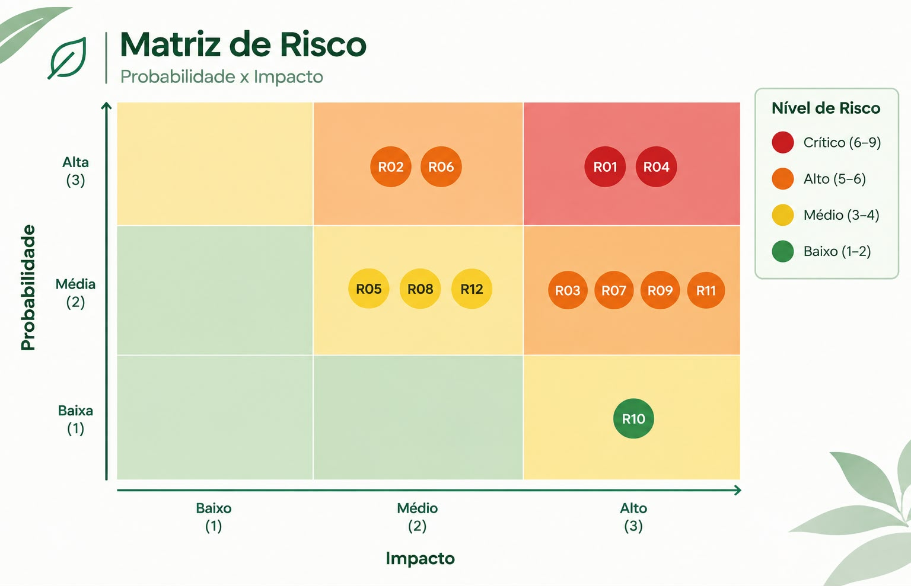
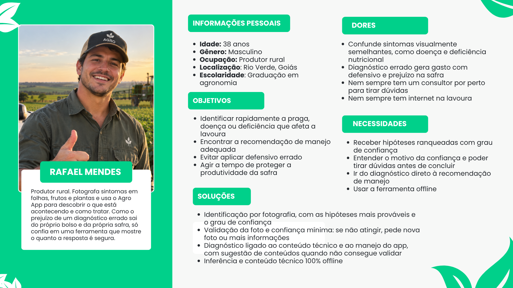
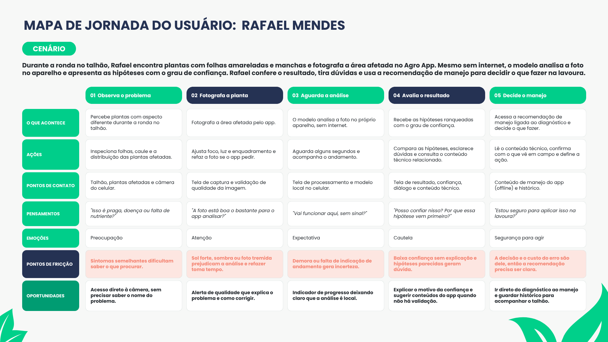
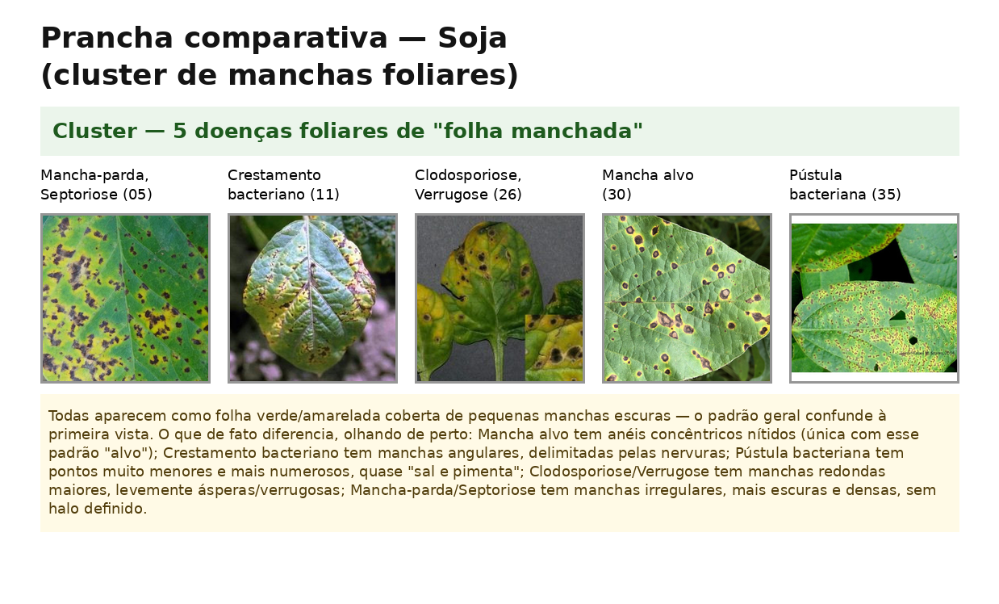

# Documentação do Projeto — AgroApp

## Sumário

<details>
<summary><strong>1. Entendimento de Negócio</strong></summary>

- [1.1 Matriz de riscos](#11-matriz-de-riscos)
- [1.2 Canvas de proposta de valor](#12-canvas-de-proposta-de-valor)
- [1.3 Persona e jornada do usuário](#13-persona-e-jornada-do-usuário)
- [1.4 Governança do acervo de imagens](#14-governança-do-acervo-de-imagens)

</details>

<details>
<summary><strong>2. Especificação Técnica e Arquitetura</strong></summary>

- [2.1 Requisitos e restrições técnicas](#21-requisitos-e-restrições-técnicas)
- [2.2 Glossário técnico do projeto](#22-glossário-técnico-do-projeto)
- [2.3 Levantamento de arquiteturas viáveis](#23-levantamento-de-arquiteturas-viáveis)
- [2.4 Diagrama da arquitetura da solução](#24-diagrama-da-arquitetura-da-solução)
- [2.5 Consolidação técnica](#25-consolidação-técnica)

- [Entendimento dos dados](#entendimento-dos-dados)
- [T3.4 — Dicionário de classes](#dicionário-de-classes-t34)

</details>

---

# 1. Entendimento de Negócio

## 1.1 Matriz de riscos

A matriz de riscos identifica os eventos que podem comprometer o desenvolvimento e os resultados do Módulo de Identificação de Pragas por Reconhecimento Visual integrado ao Agro App, avaliando cada um por probabilidade e impacto para priorizar as ações de mitigação. Foram levantados 12 riscos, dos quais 6 vêm do Termo de Abertura do Projeto (TAP) e 6 derivam dos requisitos do módulo, como nível mínimo de confiança, qualidade da imagem e rastreabilidade.

### Matriz de probabilidade e impacto

A Figura 1 mostra onde cada risco se posiciona ao cruzar probabilidade (eixo vertical) e impacto (eixo horizontal). Quanto mais próximo do canto superior direito, maior a prioridade de tratamento.

<div align="center">
  <p><strong>Figura 1 — Matriz de probabilidade e impacto</strong></p>
  
  <p><em>Fonte: feito pela própria equipe, 2026.</em></p>
</div>

### Critérios de classificação

Cada risco recebeu uma nota de 1 a 3 em probabilidade e em impacto. A probabilidade indica a chance de o risco ocorrer ao longo do projeto, e o impacto indica o quanto ele compromete a qualidade do modelo, o cronograma ou a entrega do MVP.

| Nota | Probabilidade | Impacto |
| --- | --- | --- |
| 1 | **Baixa:** ocorrência improvável ao longo do projeto | **Baixo:** efeito pequeno, absorvido na própria sprint |
| 2 | **Média:** pode ocorrer, dependendo de decisões ou condições em aberto | **Médio:** atrasa etapas ou reduz a qualidade de parte da solução, mas o MVP continua viável |
| 3 | **Alta:** ocorrência provável ou já esperada, dadas as características dos dados e do contexto de uso | **Alto:** compromete o desempenho do modelo, o cronograma ou os critérios de sucesso do MVP |

O nível de risco é o produto entre as duas notas:

| Produto | Nível de risco | Tratamento |
| --- | --- | --- |
| 1 a 2 | Baixo | Acompanhamento simples, sem ação imediata |
| 3 a 4 | Médio | Monitoramento e manutenção da mitigação planejada |
| 6 | Alto | Mitigação ativa, revisada a cada sprint |
| 9 | Crítico | Prioridade máxima, tratado desde as primeiras fases |

### Riscos identificados

A tabela apresenta os riscos ordenados por nível.

| Risco | Probabilidade | Impacto | Nível | Mitigação | Responsável |
| --- | --- | --- | --- | --- | --- |
| **R01.** Número insuficiente de imagens por classe, principalmente para pragas e doenças menos frequentes | Alta (3) | Alto (3) | 9 (Crítico) | Priorizar no MVP as classes com mais imagens, usar aumento de dados e complementar com bases públicas validadas pelo parceiro | Equipe de dados e Agro App |
| **R04.** Sintomas visualmente semelhantes entre agentes causais distintos geram confusão sistemática entre classes | Alta (3) | Alto (3) | 9 (Crítico) | Retornar as hipóteses mais prováveis com grau de confiança, em vez de diagnóstico único, e agrupar classes indistinguíveis quando validado pelo parceiro | Equipe de modelagem |
| **R02.** Desbalanceamento entre classes faz o modelo favorecer as mais representadas | Alta (3) | Médio (2) | 6 (Alto) | Balanceamento e ponderação de classes, avaliando por métricas por classe e não pela acurácia global | Equipe de modelagem |
| **R06.** Fotos de baixa qualidade tiradas em campo (sol forte, sombra, tremor) prejudicam a análise | Alta (3) | Médio (2) | 6 (Alto) | Definir padrão mínimo de nitidez, validar a foto antes da análise e pedir nova foto explicando o problema | Equipe de desenvolvimento |
| **R03.** Modelo excede o tamanho ou o tempo de resposta aceitáveis no aparelho | Média (2) | Alto (3) | 6 (Alto) | Arquiteturas leves desde o início, quantização e limites de tamanho e latência definidos com o parceiro | Equipe de modelagem |
| **R07.** Limiar mínimo de confiança mal calibrado: muito baixo gera diagnósticos errados, muito alto faz o modelo recusar quase tudo | Média (2) | Alto (3) | 6 (Alto) | Definir o limiar com base no conjunto de validação e em referências de mercado, e pedir nova foto ou mais informações quando não for atingido | Equipe de modelagem |
| **R09.** Diferença entre as imagens do acervo e as fotos reais de campo faz o modelo ir bem no teste e mal em uso | Média (2) | Alto (3) | 6 (Alto) | Aumento de dados com variações de luz, ângulo e fundo, e testes com fotos tiradas por celular em condições reais | Equipe de modelagem |
| **R11.** O produtor trata a hipótese como conclusão definitiva e decide o manejo com base nela | Média (2) | Alto (3) | 6 (Alto) | Apresentar hipóteses com confiança, permitir esclarecer dúvidas antes da conclusão e deixar claro que a dosagem não faz parte do módulo | Equipe de UX e produto |
| **R05.** Curva de aprendizado da equipe em visão computacional maior que a prevista | Média (2) | Médio (2) | 4 (Médio) | Bibliotecas e modelos pré-treinados de alto nível, acompanhamento da diretoria de tecnologia e divisão de tarefas por frente de trabalho | Diretoria de tecnologia |
| **R08.** Acervo do parceiro chega atrasado, sem rótulos ou em formato inadequado | Média (2) | Médio (2) | 4 (Médio) | Confirmar volume, rotulagem e formato na Fase 1 e reservar a rotulagem manual no cronograma da Fase 2 | Gestão do projeto |
| **R12.** Aumento de escopo por funcionalidades ainda não detalhadas no TAP, como diálogo com o usuário e logs de rastreabilidade | Média (2) | Médio (2) | 4 (Médio) | Definir com o parceiro o que entra no MVP e o que fica para ciclos posteriores, com registro formal da decisão | Gestão do projeto |
| **R10.** Diagnóstico direciona a um conteúdo técnico errado ou inexistente na base do Agro App | Baixa (1) | Alto (3) | 3 (Médio) | Mapeamento classe-conteúdo validado pelo parceiro, testes em todas as classes do MVP e sugestão de conteúdos relacionados quando não houver validação | Equipe de desenvolvimento e Agro App |

### Análise da distribuição dos riscos

Dos 12 riscos, 2 são críticos, 6 são altos e 4 são médios, e nenhum ficou no nível baixo. Os críticos (R01 e R04) decorrem das características dos dados, que são o volume de imagens por classe e a semelhança visual entre sintomas, e por isso suas mitigações devem orientar já as Fases 1 e 2 do cronograma. Os altos se concentram no desempenho e no uso do módulo, como qualidade das fotos, limites de tamanho e latência, limiar de confiança, diferença entre o acervo e o campo e interpretação do resultado, e vários dependem de decisões ainda em aberto com o parceiro. Os médios estão ligados à equipe, ao parceiro e ao escopo. O R10 tem baixa probabilidade porque o Agro App já organiza o conteúdo por cultura e praga, mas alto impacto, pois um direcionamento errado comprometeria a recomendação de manejo.

---

## 1.2 Canvas de proposta de valor


<p align="center">
  
</p>

### 1. Contextualização

O Canvas de Proposta de Valor foi desenvolvido com o objetivo de compreender as principais necessidades do usuário do AgroApp durante a identificação de problemas em uma cultura e relacioná-las à solução proposta.

O problema analisado ocorre principalmente no contexto de campo, no qual o usuário pode observar alterações na cultura sem possuir conhecimento técnico suficiente para identificar sua causa. Além disso, a disponibilidade de conexão com a internet pode ser limitada, dificultando o acesso imediato a especialistas ou a informações que auxiliem na tomada de decisão.

A partir desse cenário, o Canvas foi dividido entre o **Segmento de Clientes**, que representa as tarefas, dores e ganhos esperados pelo usuário, e a **Proposta de Valor**, que apresenta como a solução busca responder a essas necessidades.

### 2. Segmento de Clientes

### 2.1 Tarefas do Cliente

As tarefas representam aquilo que o usuário procura realizar ao perceber um possível problema em sua cultura, independentemente da solução proposta.

A primeira tarefa é **identificar o que está causando o problema observado na cultura**. O usuário percebe algum sintoma ou alteração visual, mas precisa compreender sua possível origem.

Após a identificação, existe a necessidade de **encontrar informações técnicas sobre o problema**, de forma a compreender melhor suas características e consequências.

Por fim, o usuário precisa **entender como manejar ou tratar o problema identificado**, utilizando as informações obtidas para decidir como agir de maneira adequada.

Dessa forma, as tarefas estão relacionadas a três momentos principais: identificar o problema, compreender suas características e encontrar uma forma apropriada de manejo.

### 2.2 Dores

As dores representam os obstáculos, dificuldades e riscos encontrados pelo usuário durante a realização dessas tarefas.

Uma das principais dificuldades é **não conseguir identificar rapidamente o problema enquanto está em campo**. Essa dificuldade é ampliada quando o usuário não possui conhecimento técnico suficiente para reconhecer visualmente pragas ou doenças.

Mesmo utilizando o AgroApp, pode existir uma barreira para encontrar o conteúdo correto, já que o usuário pode não saber previamente qual termo, praga ou doença deve procurar.

Outro fator relevante é a **falta de conexão com a internet no campo**. No processo atual, o usuário pode precisar fotografar o problema, esperar até conseguir conexão, enviar a imagem e posteriormente aguardar a análise de um agrônomo. Esse fluxo aumenta o tempo entre a percepção do problema e o acesso a uma orientação.

Também existe uma incerteza relacionada à **qualidade da fotografia capturada**, já que o usuário pode não saber se a imagem possui condições adequadas para análise.

Por fim, uma identificação incorreta pode gerar uma decisão de manejo inadequada, criando um risco adicional para o usuário.

### 3. Ganhos esperados pelo cliente

Os ganhos representam os resultados desejados pelo usuário ao realizar essas tarefas.

O principal ganho esperado é **conseguir identificar rapidamente o possível problema e possuir confiança na informação recebida**. A rapidez é especialmente importante porque o usuário pode precisar tomar uma decisão enquanto ainda está no campo.

Também é desejável obter a informação **no momento em que ela é necessária**, sem precisar esperar por conexão ou pelo retorno imediato de um especialista.

Além da identificação, o usuário espera compreender **como agir de forma mais segura**, diminuindo a incerteza durante a tomada de decisão.

Consequentemente, espera-se também uma **economia de tempo e uma redução da dependência de assistência imediata de um especialista**, sem necessariamente substituir a atuação profissional em situações que exijam análise especializada.

### 4. Proposta de Valor

### 4.1 Produto e serviço

A solução proposta consiste em um **módulo de visão computacional capaz de analisar uma fotografia diretamente no dispositivo do usuário**, buscando identificar possíveis pragas, doenças, deficiências nutricionais ou plantas daninhas.

A partir da análise, o módulo apresenta ao usuário as informações técnicas e as recomendações de manejo correspondentes.

O objetivo, portanto, não é apenas apresentar uma classificação visual, mas reduzir o caminho entre a observação de um problema na cultura e o acesso à informação necessária para compreendê-lo e decidir como agir.

### 4.2 Aliviadores de dores

A proposta busca reduzir as principais dificuldades identificadas no segmento de clientes.

O funcionamento **offline** permite que a análise seja realizada mesmo em regiões sem conexão com a internet, eliminando uma das principais barreiras do contexto de uso.

A utilização da imagem como ponto de partida também reduz a necessidade de o usuário **conhecer previamente o nome da praga, doença ou outro problema** para encontrar a informação desejada.

A solução busca ainda **reduzir o tempo de espera por uma primeira identificação**, oferecendo uma análise diretamente no dispositivo.

Para lidar com as limitações e incertezas inerentes ao modelo, são apresentadas **hipóteses acompanhadas de grau de confiança**, evitando tratar toda previsão como uma identificação absoluta.

Por fim, a solução direciona o usuário ao **conteúdo técnico correspondente**, reduzindo o esforço necessário para localizar manualmente a informação relevante dentro da plataforma.

### 4.3 Criadores de ganhos

Além de reduzir dificuldades existentes, a proposta busca gerar novos benefícios para o usuário.

Um dos principais é a **entrega do resultado em poucos segundos**, diminuindo o intervalo entre a captura da imagem e a obtenção da informação.

O módulo também facilita o **acesso à informação relevante**, tornando o processo mais direto para usuários que não possuem conhecimento técnico aprofundado.

Outro ganho é a criação de um fluxo integrado entre **identificação do possível problema e recomendação de manejo**, evitando que o usuário tenha que realizar diferentes buscas após receber o resultado.

Por funcionar diretamente no dispositivo, a solução permite ainda que o usuário **acesse a informação no próprio campo e no momento em que surge a necessidade**.

### 5. Relação entre o Segmento de Clientes e a Proposta de Valor

O encaixe entre as duas partes do Canvas ocorre porque as características da solução respondem diretamente às necessidades levantadas no segmento de clientes.

A dificuldade de identificar um problema é atendida pela análise da fotografia por visão computacional. A ausência de internet é tratada pelo funcionamento offline. A necessidade de conhecer previamente a nomenclatura do problema é reduzida porque a interação começa por uma imagem. A demora por uma primeira análise é reduzida pela inferência realizada diretamente no dispositivo. Já a necessidade de compreender como agir é atendida pela apresentação das informações técnicas e recomendações de manejo relacionadas ao resultado.

Da mesma forma, os criadores de ganhos estão relacionados aos resultados esperados pelo usuário: a resposta em poucos segundos atende à necessidade de rapidez; o acesso facilitado à informação contribui para uma decisão mais segura; e o funcionamento em campo possibilita que essa informação esteja disponível justamente no momento em que é necessária.

### 6. Síntese da proposta de valor

A proposta de valor pode ser sintetizada como a possibilidade de **reduzir o caminho entre a identificação visual de uma anormalidade na cultura e o acesso à informação necessária para compreender e manejar o possível problema**.

Em vez de depender inicialmente do conhecimento técnico do usuário, de conexão com a internet ou da espera por uma primeira análise externa, o módulo utiliza uma fotografia como ponto de partida e busca disponibilizar rapidamente informações relevantes diretamente no dispositivo.

A proposta, portanto, concentra-se principalmente em três atributos: **rapidez, disponibilidade em campo e facilidade de acesso à informação técnica**.

---

## 1.3 Persona e jornada do usuário

Uma persona é uma representação fictícia de um usuário, criada com base nas características, nos objetivos, nas necessidades e nas dificuldades do público que se pretende atender. Em nosso projeto, as personas funcionam como uma forma de validar se a solução proposta está realmente alinhada aos problemas e às expectativas de seus futuros usuários. Elas orientam as decisões da equipe ao longo do desenvolvimento, ajudando a avaliar funcionalidades, formas de interação e situações de uso do Módulo de Identificação de Pragas por Reconhecimento Visual integrado ao Agro App. Foram definidas duas personas para o projeto, e Vitória Lima, apresentada a seguir, é uma delas.

### Persona 1 — Rafael Mendes

<div align="center">
  <p><strong>Figura 2 — Persona Rafael Mendes</strong></p>
  
  <p><em>Fonte: feito pela própria equipe, 2026.</em></p>
</div>

Rafael Mendes tem 38 anos, é engenheiro agrônomo e produtor rural em Rio Verde, Goiás. Ele cuida da própria lavoura e, durante as rondas nos talhões, fotografa plantas com sintomas para descobrir o que está acontecendo e como tratar. Ele busca identificar rapidamente pragas, doenças e deficiências nutricionais, encontrar a recomendação de manejo adequada e evitar a aplicação de defensivo errado, mas encontra dificuldades para diferenciar sintomas visualmente semelhantes, nem sempre tem um consultor por perto e nem sempre conta com internet na lavoura. Por isso, precisa de um módulo que apresente as hipóteses mais prováveis, informe o grau de confiança do resultado, permita esclarecer dúvidas antes de uma conclusão e leve do diagnóstico ao manejo, inclusive offline.

### Jornada do usuário — Rafael Mendes

A jornada do usuário representa as etapas percorridas por uma pessoa ao interagir com uma solução, considerando suas ações, seus pensamentos, suas emoções e as dificuldades encontradas durante a experiência. No projeto, esse mapeamento permite compreender como Rafael utilizaria o módulo em uma situação real e identificar pontos de fricção e oportunidades de melhoria.

<div align="center">
  <p><strong>Figura 3 — Mapa da jornada do usuário de Rafael Mendes</strong></p>
  
  <p><em>Fonte: feito pela própria equipe, 2026.</em></p>
</div>

Na jornada mapeada, Rafael percebe plantas com aspecto diferente durante a ronda no talhão e fotografa a área afetada pelo módulo integrado ao Agro App. A análise é feita no próprio aparelho, mesmo sem conexão, e ele recebe as hipóteses com seus respectivos níveis de confiança. Caso a confiança fique abaixo do mínimo, o módulo não afirma o diagnóstico e pede uma nova foto ou mais informações. Em seguida, Rafael compara as hipóteses, esclarece suas dúvidas, consulta o conteúdo técnico relacionado e usa a recomendação de manejo para decidir o que fazer na lavoura.

O mapa evidencia necessidades importantes para o módulo, como validar a qualidade da imagem antes da análise, indicar o andamento do processamento, explicar o grau de confiança dos resultados, sugerir conteúdos do aplicativo quando não houver validação e conduzir do diagnóstico direto ao manejo. Como o custo de uma decisão equivocada recai sobre a própria safra, esses elementos aumentam a segurança de Rafael ao decidir e tornam o uso do módulo mais útil no dia a dia da lavoura.

### Persona 2 — Vitória Lima

<div align="center">
  <p><strong>Figura 4 — Persona Vitória Lima</strong></p>
  
  <p><em>Fonte: feito pela própria equipe, 2026.</em></p>
</div>

Vitória Lima tem 22 anos, cursa Agronomia e atua como pesquisadora em Piracicaba, São Paulo. Durante atividades de campo, fotografa sintomas em folhas e frutos para comparar possíveis doenças, pragas e deficiências nutricionais. Ela busca desenvolver experiência prática em diagnóstico vegetal e consultar referências técnicas confiáveis, mas encontra dificuldades para diferenciar sintomas visualmente semelhantes, avaliar hipóteses com segurança e acessar a internet em campo. Por isso, precisa de um módulo que apresente as hipóteses mais prováveis, informe o grau de confiança do resultado e permita acesso offline a conteúdos técnicos relacionados.

### Jornada do usuário — Vitória Lima

A jornada do usuário representa as etapas percorridas por uma pessoa ao interagir com uma solução, considerando suas ações, seus pensamentos, suas emoções e as dificuldades encontradas durante a experiência. No projeto, esse mapeamento permite compreender como Vitória utilizaria o módulo em uma situação real e identificar pontos de fricção e oportunidades de melhoria.

<div align="center">
  <p><strong>Figura 5 — Mapa da jornada do usuário de Vitória Lima</strong></p>
  
  <p><em>Fonte: feito pela própria equipe, 2026.</em></p>
</div>

Na jornada mapeada, Vitória encontra uma alteração em uma planta durante uma aula de campo e registra uma fotografia pelo módulo integrado ao Agro App. Caso esteja sem conexão, a imagem permanece salva no dispositivo até que possa ser enviada e processada. Em seguida, ela consulta as hipóteses apresentadas e seus respectivos níveis de confiança, compara os sinais com o conteúdo técnico disponível e registra as informações necessárias para discutir o resultado e o próximo passo com o professor.

O mapa evidencia necessidades importantes para o módulo, como orientar a captura de imagens com qualidade, informar claramente o estado do envio e do processamento, explicar o grau de confiança dos resultados e manter um histórico com fotos, análises e anotações. Esses elementos reduzem dúvidas ao longo da experiência e tornam seu uso mais seguro e útil em atividades de campo.

---

## 1.4 Governança do acervo de imagens

### 1. Objetivo

Estabelecer como as imagens usadas no desenvolvimento do diagnóstico visual serão recebidas, catalogadas, protegidas e descartadas. A governança permite verificar a procedência e a permissão de uso de cada imagem, manter a rastreabilidade do dataset e reduzir riscos de exposição indevida.

### 2. Origem das imagens

- **Acervo principal:** fornecido pelo Agro App para treinamento e avaliação do modelo. Pode conter imagens de pragas, doenças, deficiências nutricionais, plantas daninhas e culturas agrícolas.
- **Bases públicas complementares:** podem reforçar classes com poucas amostras, desde que sua utilização seja validada pelo parceiro e as condições de uso sejam verificadas.
- **Outras origens:** caso sejam incorporadas, deverão passar pelo mesmo registro de procedência e pela verificação das permissões antes do uso.

A origem de cada conjunto e, quando possível, de cada imagem deve ser registrada antes de sua inclusão no dataset.

### 3. Propriedade e permissão de uso

Para cada origem, deve-se identificar o titular dos direitos ou responsável pelo fornecimento, a autorização ou licença aplicável e suas limitações. O registro deve distinguir a permissão para **treinamento, validação, teste, documentação e apresentação**, além de eventuais restrições de compartilhamento, redistribuição ou publicação. O fornecimento de uma imagem, por si só, não comprova autorização para todos esses usos.

Até que a titularidade, as autorizações e as restrições do acervo principal sejam documentadas, as imagens não devem ser usadas fora das finalidades expressamente comprovadas. Isso inclui a publicação em documentos e apresentações. Imagens sem permissão identificada devem ficar fora dos conjuntos de uso até que a situação seja esclarecida.

### 4. Catalogação e rastreabilidade

**Proposta da equipe:** manter um registro por imagem ou por conjunto homogêneo, conforme a granularidade disponível, com os seguintes campos mínimos:

| Campo | Informação a registrar |
| --- | --- |
| Identificador | Código único da imagem ou do conjunto. |
| Origem e fornecimento | Fonte, referência de obtenção e responsável pelo fornecimento. |
| Conteúdo | Classe ou rótulo, cultura associada e observações relevantes, quando aplicáveis. |
| Direito de uso | Titular ou responsável, autorização ou licença, evidência e restrições conhecidas. |
| Histórico | Data de inclusão, alterações de rótulo e motivo de exclusão, quando ocorrer. |
| Uso no dataset | Partição de treino, validação ou teste e identificação de eventuais derivados. |

O identificador deve permitir localizar a imagem, sua origem e a evidência da permissão sem depender apenas do nome do arquivo.

### 5. Armazenamento e controle de acesso

**Proposta da equipe:** manter o acervo em local de acesso restrito, organizado por origem e etapa de tratamento. Preservar os arquivos brutos separadamente das versões processadas e registrar a ligação entre eles. Conceder acesso somente às pessoas que precisam das imagens para suas atividades, revisar esses acessos quando a participação mudar e evitar links públicos ou a inclusão acidental do acervo em repositórios públicos. Quando houver cópias de segurança, elas devem seguir as mesmas regras de acesso e o ciclo de retenção definido para os originais.

O local de armazenamento, a lista de pessoas autorizadas e as regras de cópia de segurança precisam ser definidos antes do recebimento do acervo. A escolha da ferramenta deve respeitar essas regras; esta seção não pressupõe uma solução específica.

### 6. Dados pessoais e LGPD

Embora o objetivo seja fotografar plantas, uma imagem pode incluir pessoas ao fundo, rostos, placas de veículos, localização em metadados EXIF ou elementos de uma propriedade rural que, em determinado contexto, permitam identificar uma pessoa natural. A presença desses elementos deve ser avaliada também nas bases públicas. A [ANPD define dado pessoal pela possibilidade de identificar uma pessoa natural direta ou indiretamente](https://www.gov.br/anpd/pt-br/assuntos/titular-de-dados); a avaliação de cada imagem depende do contexto.

**Proposta da equipe:** inspecionar as imagens e seus metadados antes de incluí-las no dataset; coletar e conservar somente o necessário para a finalidade definida; restringir o acesso; e remover metadados ou ocultar elementos identificadores quando não forem necessários à análise agronômica. Se a identificação for necessária ou a remoção não for suficiente, o uso deve passar por avaliação específica da finalidade, da base legal e das responsabilidades das partes, com apoio jurídico quando necessário. Essas medidas seguem os princípios de finalidade, necessidade e segurança da [LGPD](https://www.planalto.gov.br/ccivil_03/_ato2015-2018/2018/lei/l13709compilado.htm); sua aplicação concreta depende dos dados e do papel de cada parte.

Também é necessário verificar se o acervo inclui fotografias enviadas por usuários do aplicativo, quais informações lhes foram fornecidas e se existe política interna de privacidade aplicável. A definição dos responsáveis pelo tratamento de eventuais dados pessoais depende dessa análise.

### 7. Uso de bases públicas complementares

Uma base pública somente deve ser incorporada após registrar sua origem, versão ou endereço de referência, licença e condições de uso; verificar a compatibilidade dessas condições com as finalidades do projeto; avaliar adequação às culturas e classes do MVP, qualidade das imagens e presença de dados pessoais; e identificar duplicatas relevantes em relação ao acervo existente. A procedência e o resultado dessa avaliação devem acompanhar as imagens importadas.

Além da licença, a inclusão de cada base complementar depende de aprovação para o projeto. Essa aprovação deve registrar os limites de uso, redistribuição e publicação das imagens importadas.

### 8. Retenção e descarte

**Proposta da equipe:** conservar imagens de desenvolvimento enquanto forem necessárias às atividades autorizadas; identificar quais imagens integram o dataset final e sob qual responsabilidade permanecerão; e revisar periodicamente cópias temporárias, duplicatas e imagens rejeitadas para descarte quando não houver finalidade ou obrigação de conservação. O descarte deve abranger originais, derivados e cópias acessíveis, conforme o ambiente de armazenamento, com registro do que foi excluído, quando e por quem. Cópias de segurança devem seguir o procedimento de expiração aplicável. A [ANPD observa que não há prazo único de tratamento aplicável a todos os casos](https://www.gov.br/anpd/pt-br/acesso-a-informacao/perguntas-frequentes); o prazo depende da finalidade e das circunstâncias.

Os prazos de retenção por categoria, o destino do dataset final e o procedimento de exclusão após o projeto ainda precisam ser definidos. Até lá, a equipe deve evitar cópias desnecessárias e manter identificáveis as imagens que deverão ser revisadas para descarte.

### 9. Responsabilidades

| Parte | Responsabilidade |
| --- | --- |
| Agro App | Fornecer o acervo principal e esclarecer sua origem, permissões, restrições de uso e políticas aplicáveis. |
| Equipe do projeto | Organizar e preparar o dataset, aplicar os controles definidos e registrar o uso e o descarte das imagens. |
| Responsáveis técnicos/agronômicos | Apoiar a revisão da adequação agronômica das imagens, culturas, classes e rótulos. |
| Responsáveis pela governança do dataset | Manter o catálogo, as evidências de permissão, o histórico de alterações e a revisão de acessos e retenção. As pessoas que exercerão essa função ainda precisam ser designadas. |

As responsabilidades operacionais da tabela não definem, por si só, os papéis legais de controlador e operador previstos na LGPD. Caso haja tratamento de dados pessoais, esses papéis devem ser avaliados conforme as decisões efetivamente tomadas por cada parte sobre finalidade e meios do tratamento, considerando as [definições da ANPD para agentes de tratamento](https://www.gov.br/anpd/pt-br/assuntos/titular-de-dados).

### 10. Riscos e medidas de mitigação

| Risco | Impacto | Mitigação |
| --- | --- | --- |
| Imagem sem origem comprovada | Perda de rastreabilidade e dificuldade de justificar seu uso. | Registrar procedência e impedir a inclusão até esclarecimento. |
| Ausência de autorização de uso | Uso fora das condições permitidas. | Guardar evidência da permissão e verificar cada finalidade antes do uso. |
| Dados pessoais na imagem ou nos metadados | Exposição indevida de pessoas identificáveis. | Inspecionar imagens e metadados, minimizar dados e restringir acesso. |
| Vazamento do dataset | Divulgação não autorizada do acervo. | Restringir acessos, evitar exposição pública e aplicar controles ao armazenamento e às cópias. |
| Uso indevido de base pública | Violação de licença ou incorporação de dados inadequados. | Verificar licença, procedência, qualidade e aprovação antes da importação. |
| Imagens duplicadas | Distorção na composição e na avaliação do dataset. | Identificar duplicatas e revisar sua distribuição entre treino, validação e teste. |
| Rótulos incorretos | Treinamento e avaliação comprometidos. | Submeter rótulos duvidosos à revisão técnica e registrar correções. |
| Perda de rastreabilidade | Impossibilidade de reconstruir a origem e o uso das imagens. | Manter identificadores, catálogo, evidências e histórico de alterações. |

### 11. Definições necessárias para uso do acervo

| Definição | Por que é necessária |
| --- | --- |
| Direitos e autorizações do acervo principal para treinamento, validação e teste. | Delimitar as finalidades permitidas e documentar sua evidência. |
| Origem de fotografias enviadas por usuários e informações fornecidas a eles. | Avaliar permissões de uso e eventual tratamento de dados pessoais. |
| Ambiente de armazenamento, pessoas autorizadas e regras de segurança. | Proteger o acervo desde seu recebimento. |
| Uso em documentação, apresentações, compartilhamento e publicação. | Evitar divulgação além das permissões existentes. |
| Bases públicas complementares aprovadas e respectivas condições. | Verificar licença, adequação e limites de uso antes da importação. |
| Prazos de retenção por categoria, destino do dataset final e responsáveis pelo descarte. | Planejar a conservação e a exclusão de originais, derivados e cópias. |
| Políticas internas aplicáveis e papéis relativos a dados pessoais. | Alinhar os controles do projeto às regras existentes e às responsabilidades de cada parte. |

Essas definições devem ser registradas com a decisão tomada, o responsável e a evidência correspondente antes da etapa do projeto que dependa delas.

---

# 2. Especificação Técnica e Arquitetura

## 2.1 Requisitos e restrições técnicas

Esta seção reúne os requisitos do módulo de diagnóstico visual previstos na Seção 17 do TAP. Os requisitos funcionais descrevem o fluxo desde a escolha da fotografia até o acesso ao conteúdo técnico do Agro App. As restrições técnicas tratam da execução do modelo no dispositivo, incluindo limites de tamanho, tempo de resposta e recursos necessários para a inferência. A definição conjunta desses pontos orienta o desenvolvimento e a validação do MVP.

### Requisitos funcionais do diagnóstico visual (MVP)

| ID | Requisito Funcional | Descrição | Entrada | Comportamento esperado | Critério de aceitação |
| --- | --- | --- | --- | --- | --- |
| RF-01 | O sistema deve permitir que o usuário capture ou selecione uma fotografia para diagnóstico. | Disponibiliza as duas formas de fornecer uma imagem ao módulo. | Fotografia capturada pela câmera ou selecionada no dispositivo. | Recebe a fotografia escolhida e inicia o fluxo de análise. | Uma fotografia capturada e uma fotografia selecionada podem, cada uma, iniciar a análise. |
| RF-02 | O sistema deve preparar a fotografia para a entrada do modelo de classificação. | Aplica à imagem os ajustes exigidos pelo modelo embarcado. | Fotografia recebida no RF-01. | Produz uma imagem no formato de entrada definido para o modelo. | Para cada fotografia aceita, a saída da preparação atende às especificações de entrada do modelo utilizado no MVP. |
| RF-03 | O sistema deve classificar a imagem nas classes definidas para o MVP. | Identifica possíveis pragas, doenças, deficiências nutricionais ou plantas daninhas nas culturas contempladas. | Imagem preparada no RF-02. | Retorna uma classe e um grau de confiança para cada hipótese produzida. | Todas as classes retornadas pertencem ao catálogo de classes do MVP; cada hipótese possui um grau de confiança associado. O escopo inicial de culturas é soja e milho, conforme o glossário. |
| RF-04 | O sistema deve apresentar as hipóteses mais prováveis em ordem decrescente de confiança. | Exibe as identificações candidatas resultantes da análise. | Hipóteses retornadas no RF-03. | Apresenta o nome de cada hipótese selecionada para exibição, começando pela de maior confiança. | As hipóteses exibidas pertencem ao resultado da análise e aparecem em ordem decrescente de confiança. |
| RF-05 | O sistema deve apresentar o grau de confiança de cada hipótese exibida. | Permite consultar a confiança atribuída a cada identificação candidata. | Hipóteses e graus de confiança retornados no RF-03. | Mostra o grau de confiança junto à hipótese correspondente. | Cada hipótese exibida possui um valor visível que corresponde ao grau de confiança retornado para ela. |
| RF-06 | O sistema deve informar quando nenhuma hipótese atingir o limiar mínimo de confiança. | Trata o resultado inconclusivo da análise. | Hipóteses retornadas no RF-03 e limiar mínimo adotado no MVP. | Apresenta uma mensagem de identificação inconclusiva, sem indicar uma classe como diagnóstico obtido. | Se todos os graus de confiança forem inferiores ao limiar, a mensagem é exibida e nenhuma classe é indicada como identificação obtida. |
| RF-07 | O sistema deve associar as classes do MVP ao conteúdo técnico correspondente do Agro App. | Relaciona cada classe reconhecível às informações técnicas existentes no aplicativo. | Classe pertencente ao catálogo do MVP. | Identifica o conteúdo técnico vinculado à classe. | Para cada classe do catálogo do MVP, a associação aponta para um conteúdo técnico correspondente e acessível no Agro App. |
| RF-08 | O sistema deve permitir que o usuário acesse as informações e recomendações de manejo relacionadas à hipótese apresentada. | Oferece a navegação do resultado para o conteúdo técnico associado. | Hipótese exibida com conteúdo associado no RF-07. | Ao selecionar a hipótese, abre o conteúdo correspondente no Agro App. | A seleção de cada hipótese exibida abre o conteúdo técnico associado à sua classe. |


### Requisitos não funcionais e restrições técnicas

Consolidação dos requisitos não funcionais levantados para o módulo de diagnóstico visual, em formato verificável. Valores marcados com ⧗ dependem de resposta do parceiro e estão preenchidos com proposta da equipe.

| ID | Requisito | Métrica | Valor | Verificação |
| --- | --- | --- | --- | --- |
| RNF-01 | Tamanho do modelo embarcado | MB do .tflite | ≤ 8 MB ⧗ | Medição do arquivo gerado |
| RNF-02 | Acréscimo total ao pacote | MB | ≤ 9 MB ⧗ | Modelo + rótulos + índice |
| RNF-03 | Latência fim a fim | p95, device de referência | ≤ 3 s ⧗ | 50 execuções, modo avião |
| RNF-04 | Latência de inferência isolada | p95 | ≤ 300 ms ⧗ | TFLite Benchmark Tool |
| RNF-05 | Operação offline | Chamadas de rede no fluxo | 0 | Modo avião + inspeção de tráfego |
| RNF-06 | Perda por quantização | Δ acurácia macro float → int8 | ≤ 2 p.p. ⧗ | Avaliação no conjunto de teste |
| RNF-07 | Pico de memória na inferência | MB de RAM | ⧗ (RQ-C07) | Profiler no device de referência |
| RNF-08 | Resolução de rota do diagnóstico | % de classes que resolvem para conteúdo válido | 100% | Teste automatizado sobre o índice |
| RNF-09 | Degradação sem aceleração | Funcionamento com XNNPACK/CPU apenas | Obrigatório | Execução com delegates desativados |

**Ambiente de execução:** a definir.

---

## 2.2 Glossário técnico do projeto

### Glossário Técnico

Este glossário tem como objetivo estabelecer um vocabulário comum entre a equipe de desenvolvimento e o parceiro ao longo das dez semanas de projeto. A padronização dos termos busca reduzir ambiguidades durante discussões técnicas, definição de requisitos, preparação dos dados, treinamento e avaliação do modelo, análise dos resultados e validação do MVP.

Os conceitos apresentados estão relacionados às principais etapas da solução, desde a organização do dataset e treinamento do modelo até sua execução local no dispositivo, avaliação da qualidade da imagem, tratamento de situações de baixa confiança e associação dos resultados ao conteúdo técnico disponível no AgroApp.

Para o MVP, o escopo agronômico inicial contempla as culturas de **soja e milho**. As classes específicas de problemas que serão reconhecidas dentro dessas culturas serão definidas conforme a estrutura e a disponibilidade das imagens do dataset.

| Termo | Definição no contexto do projeto |
|---|---|
| **Dataset** | Conjunto organizado de imagens utilizado para desenvolver e avaliar o modelo. Será composto principalmente pelo acervo disponibilizado pelo AgroApp, podendo ser complementado por bases públicas quando necessário. |
| **Amostra** | Uma unidade individual do dataset. No projeto, corresponde normalmente a uma imagem utilizada em alguma etapa de treinamento, validação ou teste do modelo. |
| **Cultura** | Espécie agrícola à qual a imagem ou o problema analisado está relacionado. No MVP, as culturas contempladas serão **soja e milho**. |
| **Classe** | Categoria que o modelo deverá distinguir durante a classificação. No MVP, o conjunto de classes será composto por problemas associados às culturas de soja e milho, conforme a estrutura e a rotulagem definidas para o dataset. |
| **Rótulo (Label)** | Informação associada a uma amostra que indica sua classe considerada correta. É utilizada como referência durante o treinamento e a avaliação do modelo. |
| **Anotação / Rotulagem** | Processo de associar às imagens as informações necessárias para sua utilização no dataset, principalmente a classe correspondente a cada amostra. |
| **Partição do Dataset** | Divisão do dataset em conjuntos com funções distintas, normalmente treino, validação e teste, evitando que a avaliação final seja realizada sobre as mesmas imagens utilizadas para o aprendizado do modelo. |
| **Conjunto de Treino** | Parte do dataset utilizada para que o modelo ajuste seus parâmetros e aprenda os padrões relacionados às diferentes classes. |
| **Conjunto de Validação** | Parte do dataset utilizada durante o desenvolvimento para acompanhar o desempenho do modelo e auxiliar na comparação entre configurações e experimentos. |
| **Conjunto de Teste** | Parte separada do dataset utilizada para avaliar o desempenho final do modelo sobre imagens que não participaram de seu treinamento. |
| **Transfer Learning** | Estratégia em que um modelo previamente treinado é adaptado ao problema específico do projeto, evitando a necessidade de desenvolver e treinar uma arquitetura completamente do zero. |
| **Aumento de Dados (Data Augmentation)** | Aplicação de transformações sobre as imagens de treinamento para aumentar sua diversidade e reduzir problemas relacionados à quantidade limitada ou à pouca variedade de amostras. |
| **Inferência** | Processo em que o modelo já treinado recebe uma nova imagem e gera uma previsão sobre a classe à qual ela provavelmente pertence. |
| **Inferência Local** | Execução da inferência diretamente no dispositivo do usuário, sem depender de uma conexão com servidores externos, preservando o funcionamento offline do AgroApp. |
| **Quantização** | Técnica de otimização utilizada para reduzir o tamanho do modelo e seu consumo de memória e recursos computacionais, buscando viabilizar sua execução em dispositivos móveis. |
| **Validação da Imagem** | Etapa anterior à classificação responsável por verificar se a fotografia apresenta condições mínimas para análise, considerando fatores como nitidez e qualidade visual suficiente. Caso esses critérios não sejam atendidos, o sistema deverá solicitar uma nova imagem antes de realizar a análise. |
| **Classe Predita** | Classe indicada pelo modelo como resultado da análise de uma nova imagem. Ela representa a categoria considerada mais compatível com os padrões identificados pelo modelo. |
| **Hipótese Diagnóstica** | Possível identificação do problema apresentada ao usuário a partir da análise da imagem. O termo é utilizado para indicar que o resultado do modelo deve ser tratado considerando seu grau de confiança e possíveis ambiguidades, e não necessariamente como uma conclusão definitiva. |
| **Grau de Confiança** | Valor associado à previsão do modelo que representa o nível de confiança atribuído a determinada hipótese. Esse valor auxilia o sistema a decidir como apresentar o resultado ao usuário, mas não deve ser interpretado isoladamente como garantia de que a classificação está correta. |
| **Limiar de Confiança** | Valor mínimo estabelecido para que uma hipótese possa ser apresentada como suficientemente confiável. Esse limite deverá ser definido com base nos experimentos do projeto e em referências adequadas. Caso nenhuma hipótese alcance o limiar estabelecido, o sistema deverá adotar um comportamento alternativo. |
| **Fallback** | Comportamento adotado quando o sistema não possui informações ou confiança suficientes para apresentar uma hipótese adequada. Pode incluir solicitar uma nova fotografia, pedir informações adicionais ou direcionar o usuário para conteúdos relacionados disponíveis no AgroApp. |
| **Base de Conteúdo** | Conjunto de informações técnicas já existentes no AgroApp que será associado às classes reconhecidas pelo modelo, permitindo direcionar o usuário para informações e recomendações relacionadas ao problema analisado. |
| **Latência** | Tempo decorrido entre o início do processamento da imagem e a disponibilização do resultado ao usuário. Como a inferência será executada localmente, esse indicador será utilizado para avaliar a velocidade da solução em dispositivos móveis. |
| **Métricas de Avaliação** | Indicadores utilizados para analisar o desempenho do modelo. Entre as métricas previstas estão acurácia, precisão e recall, que devem ser avaliadas também individualmente por classe e não apenas de forma global. |
| **Matriz de Confusão** | Estrutura que compara as classes reais das imagens com as classes preditas pelo modelo, permitindo identificar quais categorias estão sendo classificadas corretamente e quais estão sendo confundidas entre si. |
| **Log** | Registro de eventos relevantes ocorridos durante a execução da solução. Pode armazenar informações como resultado obtido, nível de confiança, ocorrência de falhas, conteúdo recomendado e ações realizadas pelo usuário. |
| **Rastreabilidade** | Capacidade de reconstruir e analisar o comportamento da solução a partir dos registros gerados. No projeto, poderá permitir verificar se o sistema encontrou uma resposta, qual foi seu grau de confiança, quais conteúdos foram sugeridos e se o usuário acessou as informações recomendadas. |

### Evolução do Glossário

Este glossário representa uma versão inicial do vocabulário técnico compartilhado do projeto e não deve ser considerado uma lista definitiva. A tabela poderá ser expandida, revisada ou refinada ao longo das dez semanas conforme novos conceitos passem a fazer parte das decisões técnicas, das reuniões com o parceiro, dos experimentos realizados ou da documentação da solução.

Algumas definições também poderão se tornar mais específicas conforme decisões ainda em aberto forem tomadas. Isso se aplica principalmente à composição das **classes do modelo**, aos critérios mínimos utilizados na **validação da imagem**, ao valor adotado como **limiar de confiança** e às informações efetivamente armazenadas para fins de **rastreabilidade**.

Embora o MVP tenha sido delimitado inicialmente às culturas de **soja e milho**, ainda será necessário definir quais problemas e classes associados a essas culturas serão contemplados, considerando principalmente a disponibilidade, qualidade e distribuição das imagens fornecidas para treinamento.

Recomenda-se que o glossário seja atualizado sempre que um termo técnico passar a ser utilizado de maneira recorrente ou quando houver possibilidade de interpretações diferentes entre a equipe e o parceiro. Dessa forma, o documento permanece conciso e atua como uma referência compartilhada para comunicação, tomada de decisão e documentação técnica ao longo do projeto.

---

## 2.3 Levantamento de arquiteturas viáveis

Pesquisar arquiteturas compatíveis com execução embarcada e comparar número de parâmetros, tamanho e acurácia de referência com os limites levantados no T2.1.

| Arquitetura | Parâmetros | Tamanho | Acurácia de referência | Dataset e condições de avaliação | Compatibilidade com T2.1 | Fonte |
| --- | --- | --- | --- | --- | --- | --- |
| EfficientNet-Lite0 | 4,7M | ≈ 4,7 MB (INT8, estimado) | 75,1% FP32 / 74,4% INT8 (top-1) | ImageNet-1k, 224×224. Latência INT8 de 6,5 ms em CPU do Pixel 4, com 4 threads e batch 1. | Provável: suporte nativo a INT8, menor tamanho da família. | [1] |
| EfficientNet-Lite1 | 5,4M | ≈ 5,4 MB (INT8, estimado) | 76,7% FP32 / 75,9% INT8 (top-1) | ImageNet-1k, 240×240. Latência INT8 de 9,1 ms em CPU do Pixel 4, com 4 threads e batch 1. | Provável. | [1] |
| EfficientNet-Lite2 | 6,1M | ≈ 6,1 MB (INT8, estimado) | 77,6% FP32 / 77,0% INT8 (top-1) | ImageNet-1k, 260×260. Latência INT8 de 12 ms em CPU do Pixel 4, com 4 threads e batch 1. | Provável, dependendo do limite final de tamanho. | [1] |
| EfficientNet-Lite3 | 8,2M | ≈ 8,2 MB (INT8, estimado) | 79,8% FP32 / 79,0% INT8 (top-1) | ImageNet-1k, 280×280. Latência INT8 de 18 ms em CPU do Pixel 4, com 4 threads e batch 1. | Depende do limite final de tamanho. | [1] |
| EfficientNet-Lite4 | 13,0M | ≈ 13 MB (INT8, estimado) | 81,5% FP32 / 80,2% INT8 (top-1) | ImageNet-1k, 300×300. Latência INT8 de 30 ms em CPU do Pixel 4, com 4 threads e batch 1. | Improvável: maior opção da lista, adequada apenas se o limite permitir. | [1] |
| MobileNetV3-Small (1.0) | 2,9M | ≈ 2,9 MB (INT8, estimado) | 68,1% top-1 (float) | ImageNet-1k, 224×224. 66M MACs e 15,8 ms em CPU do Pixel 1 (float). | Provável em tamanho e latência, mas com acurácia de base mais baixa. | [2] |
| MobileNetV3-Large (1.0) | 5,4M | ≈ 5,4 MB (INT8, estimado) | 75,6% top-1 (float) | ImageNet-1k, 224×224. 217M MACs e 51,2 ms em CPU do Pixel 1 (float). | Provável, mas falta validar a queda de acurácia após quantização. | [2] |
| MobileNetV3-Large (0.75) | 4,0M | ≈ 4,0 MB (INT8, estimado) | 73,3% top-1 (float) | ImageNet-1k, 224×224. 155M MACs e 39,8 ms em CPU do Pixel 1 (float). | Provável; representa um meio-termo entre tamanho, custo computacional e acurácia. | [2] |
| MobileNetV2 (referência) | 3,5M | 14 MB (Keras, FP32) | 71,3% top-1 | ImageNet-1k, 224×224, pesos Keras. | Fora do escopo do TAP; usado apenas como comparação. | [3] |
| EfficientNet-B0 (referência) | 5,3M | 29 MB (Keras, FP32) | 77,1% top-1 | ImageNet-1k, 224×224, pesos Keras. | Descartada: não foi desenhada para INT8 e apresenta risco maior de perda na quantização. | [3], [4] |

Como as fontes consultadas não publicam o tamanho dos arquivos `.tflite` das variantes candidatas, os valores em MB para modelos INT8 foram estimados usando a regra aproximada de 1 byte por parâmetro. Os valores em MB de MobileNetV2 e EfficientNet-B0 são referentes aos arquivos Keras em FP32 e, portanto, não são diretamente comparáveis com as estimativas INT8.

### Análise comparativa e limitações

Dentro das duas famílias previstas no TAP, o EfficientNet-Lite oferece a escala de acurácia mais previsível: de 74,4% (Lite0) a 80,2% (Lite4) em INT8, com custo crescente de parâmetros e latência. O MobileNetV3-Large tem acurácia float próxima à do Lite0 (75,6% contra 75,1%) com número de parâmetros semelhante, enquanto o MobileNetV3-Small é a opção de menor custo, mas apresenta acurácia de base sensivelmente inferior (68,1%).

O diferencial técnico está na quantização. O EfficientNet-Lite foi adaptado para execução embarcada, removendo squeeze-and-excite e trocando swish por ReLU6 para facilitar a quantização pós-treino. Segundo o blog do TensorFlow, a quantização pós-treino do EfficientNet original derrubou o top-1 de 75% para 46% em um teste inicial. Por isso, o EfficientNet-B0 padrão foi descartado como arquitetura principal. O MobileNetV3 usa hard-swish e squeeze-and-excite; a documentação também indica que a variante minimalistic, sem esses blocos, é menos eficiente em CPU, embora possa ser mais performática em GPU/DSP.

O tamanho tende a ser o critério mais restritivo, já que o TAP limita o modelo ao espaço que o Agro App aceita no pacote. A latência dificilmente deve ser o gargalo inicial, pois todos os candidatos avaliados ficam na casa de dezenas de milissegundos nos benchmarks publicados. Ainda assim, essa leitura deve ser validada com o dispositivo-alvo definido no T2.1.

As principais limitações do levantamento são:

- A acurácia de referência vem do ImageNet-1k, com objetos genéricos, e não representa diretamente o desempenho em folhas, pragas e deficiências fotografadas em campo.
- As latências vêm de aparelhos diferentes (Pixel 4 para EfficientNet-Lite e Pixel 1 para MobileNetV3) e de precisões diferentes (INT8 e float), servindo apenas como ordem de grandeza.
- Não foi encontrada nas fontes consultadas a acurácia INT8 do MobileNetV3, então ela precisa ser medida no projeto.
- Os benchmarks foram feitos em celulares Google, enquanto o aparelho-alvo dos produtores rurais pode ser mais modesto.
- O tamanho em MB foi estimado considerando a cabeça de 1000 classes; o modelo final, com menos classes, pode ser menor.
- Os candidatos foram limitados às famílias previstas no TAP; outras arquiteturas recentes não foram levantadas nesta etapa.

### Arquitetura recomendada e justificativa

Recomenda-se preliminarmente adotar o **EfficientNet-Lite0** como arquitetura principal do MVP, com **EfficientNet-Lite2** e **MobileNetV3-Large (1.0)** como candidatas para comparação no fine-tuning.

O EfficientNet-Lite0 apresenta o menor tamanho entre as variantes com acurácia INT8 publicada (74,4%), o que reduz o risco em relação à restrição de espaço do TAP. Além disso, foi desenhado para quantização, diminuindo a chance de perda significativa de acurácia na conversão para TensorFlow Lite/LiteRT prevista no escopo do projeto.

O EfficientNet-Lite2 deve ser considerado como alternativa se o limite de tamanho permitir e o Lite0 ficar aquém no dataset real, pois ganha cerca de 2,6 pontos de top-1 INT8 em relação ao Lite0 (77,0% contra 74,4%). O MobileNetV3-Large entra como comparação por ser citado no TAP e estar disponível diretamente no Keras, mas precisa ser testado quanto à perda pós-quantização.

A escolha final deve sair de um experimento de fine-tuning no dataset do Agro App, medindo F1 por classe, tamanho do arquivo `.tflite` e latência no aparelho-alvo.

**Referências:**

[1] [Repositório oficial EfficientNet-Lite (tensorflow/tpu)](https://github.com/tensorflow/tpu/blob/master/models/official/efficientnet/lite/README.md)  
[2] [Documentação Keras: MobileNet e MobileNetV3](https://keras.io/api/applications/mobilenet/)  
[3] [Documentação Keras Applications](https://keras.io/api/applications/)  
[4] [TensorFlow Blog: Higher accuracy on vision models with EfficientNet-Lite](https://blog.tensorflow.org/2020/03/higher-accuracy-on-vision-models-with-efficientnet-lite.html)

---

## 2.4 Diagrama da arquitetura da solução

Construir e finalizar o diagrama com captura da imagem, preprocessing, inferência local, política de confiança e associação ao conteúdo técnico.

**Documentação — a preencher**

**Diagrama:** inserir a imagem, o link ou um bloco Mermaid aqui.

| Componente | Responsabilidade | Entrada | Saída |
| --- | --- | --- | --- |
| Captura da imagem | A preencher | A preencher | A preencher |
| Pré-processamento | A preencher | A preencher | A preencher |
| Inferência local | A preencher | A preencher | A preencher |
| Política de confiança | A preencher | A preencher | A preencher |
| Associação ao conteúdo técnico | A preencher | A preencher | A preencher |

**Decisões de arquitetura e justificativas:** a preencher.

---

## 2.5 Consolidação técnica

Finalizar os requisitos e restrições técnicas com os valores acordados com o parceiro e revisar o glossário técnico do projeto.

**Documentação — a preencher**

| Item validado | Valor ou decisão acordada | Data | Participantes da validação | Evidência |
| --- | --- | --- | --- | --- |
| A preencher | A validar | A preencher | A preencher | A preencher |


# Entendimento dos dados

## Inventário do acervo

### Objetivo

Realizar a contagem das imagens do Agro App por cultura,
classe e ocorrência, consolidando os dados para análise
do conjunto recebido.

### Metodologia

O inventário foi realizado automaticamente com Python
no Google Colab, percorrendo a estrutura de diretórios
do conjunto de dados armazenado no Google Drive.

[Link do Colab](https://colab.research.google.com/drive/18igL8eeSBvpOwm9mstFra3c0GXk4uCVB)

Estrutura considerada:

```text
Agro App/
├── Soja/
│   ├── Doencas/
│   └── Pragas/
└── Milho/
    └── Pragas/
```

Cada subpasta de ocorrência foi identificada e a quantidade
de imagens presente nela foi contabilizada.

### Resultados

| Cultura | Classe | Quantidade de imagens |
|---------|---------|----------------------:|
| Soja | Doenças | 97 |
| Soja | Pragas | 13 |
| Milho | Pragas | 16 |
| **Total** | | **126** |

Foram identificadas 126 imagens distribuídas em 55
ocorrências.

A relação completa das imagens por cultura, classe e ocorrência está disponível em:

[Inventário do Agro App](https://docs.google.com/spreadsheets/d/1VAnspzW3pkyijLxPsg4IY85lJJX28dmgtZ5hci610FI/edit?usp=sharing)

Além disso, a planilha do inventário também está versionada no repositório em:

`assets/data/inventario-acervo.xlsx`

### Observação

A associação formal entre os nomes das ocorrências e seus
respectivos agentes causais está registrada no [dicionário de classes da T3.4](#dicionário-de-classes-t34), com referências a validar e pendências explícitas para os rótulos ambíguos.

## Análise exploratória visual

### Objetivo

Analisar amostras representativas de cada classe do acervo (Milho e Soja) e registrar
as principais características visuais que ajudam a diferenciar classes semelhantes,
identificando os pares e clusters de classes com maior risco de confusão para o modelo
e o que, na prática, permite distingui-los (cor, formato da lesão, textura, parte da
planta afetada).

### Metodologia


Etapas:

1. Observação em bloco. As imagens de cada classe foram reunidas em folhas de
   contato por bloco — Milho/Pragas, Soja/Pragas e Soja/Doenças —
   para permitir uma primeira varredura comparativa entre classes vizinhas.
2. Levantamento de pares candidatos. A partir da varredura e da semelhança de
   nomenclatura entre classes (ex.: várias classes com "podridão", "mancha" ou
   "nematóide" no nome), foram levantados pares e clusters candidatos a confusão.
3. Validação Cada par candidato só foi considerado
   efetivamente confuso após a checagem individual das imagens, pares com nomes parecidos mas distintas nessa
   checagem foram descartados (ver [Pares avaliados e descartados](#pares-avaliados-e-descartados)).

4. Registro. Para cada par/cluster confirmado, foi registrado o que efetivamente
   causa a confusão e o que permite diferenciar as classes, consolidado nas pranchas comparativas desta seção.

Como o acervo ainda é pequeno, todas as imagens disponíveis foram observadas, não
apenas uma amostra de 5 a 10 por classe.

### Resultados

#### Classes e imagens observadas

| Cultura | Bloco | Classes | Imagens observadas |
| --- | --- | --- | --- |
| Milho | Pragas | 4 | 16  |
| Soja | Pragas | 10 | 13  |
| Soja | Doenças | 41 | 97  |
| **Total** | | **55** | **126** |

#### Características visuais por classe

**Milho — Pragas**

| Classe | Característica visual predominante |
| --- | --- |
| Percevejo-do-milho | corpo em escudo, marrom-escuro/preto com faixa clara e pernas com pontas laranja; ninfas em cluster avermelhado; ovos em fileira |
| Pulgão-do-milho | sempre em colônia densa (nunca inseto isolado), concentrada no cartucho/base do pendão; textura granulada verde-escura/cinza com pontos brancos |
| Coró-do-milho | larva em "C", branco-acinzentada/azulada, cabeça marrom-alaranjada, sempre em ambiente de solo |
| Cigarrinha do milho | inseto adulto minúsculo, alongado, amarelo-pálido (raro nas fotos); maioria das imagens mostra o sintoma indireto — estrias cloróticas ou avermelhamento da folha |

**Soja — Pragas**

| Classe | Característica visual predominante |
| --- | --- |
| Percevejo da Soja | inseto escudo verde-acinzentado, adulto, sobre vagem |
| Broca-das-axilas-da-soja | lagarta verde-clara, corpo mole segmentado, dentro de broto/folha enrolada |
| Broca das vagens | mesma lagarta verde-clara, dentro da vagem |
| Lagarta-da-soja | lagarta listrada verde/preta, borda da folha consumida |
| Cascudinho-da-soja | besouro pequeno marrom-acinzentado, corpo oval compacto |
| Gorgulho-da-soja, Tamanduá-da-soja | besouro preto pequeno com marca clara em cruz/X sobre os élitros |
| Tamanduá-da-soja | mesmo padrão de besouro preto com marca clara em cruz/X |
| Coró da soja / Coró-da-soja, bicho-bolo / Coró-da-soja-do-cerrado | larva branca em "C", cabeça marrom, corpo translúcido, sobre terra |

**Soja — Doenças (agrupadas por padrão visual)**

| Grupo | Classes | Característica visual predominante |
| --- | --- | --- |
| Podridões de raiz/colo/haste | Podridão-de-raízes; Podridão-preta-das-raízes/Podridão-cinzenta-do-caule; Podridão-radicular; Estiolamento/Tombamento-de-mudas; Cancro-da-haste; Macrophomina; Podridão radicular de Phytophthora; Murcha-de-fusarium; Podridão-vermelha-da-raiz; Fusariose | raiz ou caule escurecido/apodrecido; variações vão de fibras enegrecidas a lesão roxo-avermelhada no colo |
| Manchas foliares | Mancha-aureolada; Mancha-parda/Septoriose; Crestamento bacteriano; Mancha alvo; Mancha-olho-de-rã; Pústula bacteriana; Clodosporiose/Verrugose; Oídio; Mela ou requeima; Ferrugem asiática; Míldio | folha verde/amarelada com manchas ou pontuações escuras; diferenciadores no detalhe, halo, formato circular, tamanho e densidade dos pontos |
| Nematoides | Nematóide-reniforme; nematóide de cisto da soja (NCS); Nematóide-espiralado; Nematóide de galhas; Nematóide das lesões; Nematóide de cisto | sintoma indireto (reboleira, planta atrofiada) ou sinal direto na raiz |
| Sementes/grãos e vagens armazenados | Fungo-de-armazenamento; Fungo de pós colheita; Tombamento; Fungo-de-pós-colheita/Podridão-dos-grãos-armazenados; Phomopsis-da-semente; Antracnose; Podridão da semente/Podridão de Fusarium; Seca da haste e da vagem |  semente/vagem coberta por esporos, cor e textura do mofo variam  |
| Sistêmicas / murcha / vírus | Mofo-branco/Podridão-de-sclerotinia; Murcha-de-Sclerotium; Damping-off/Podridão-aquosa; Nematoide-da-haste verde/Ponta Branca; Mosaico comum da soja | planta murcha ou com micélio branco visível no colo; mosaico é a única com padrão de mosqueado na folha e no grão |

#### Pares e clusters de classes visualmente confundíveis

| # | Classes | O que causa a confusão | O que diferencia | Prancha |
| --- | --- | --- | --- | --- |
| 1 | Coró da soja × Coró-da-soja, bicho-bolo × Coró-da-soja-do-cerrado | mesma larva branca em "C", cabeça marrom, sobre terra | sem escala de referência ou o besouro adulto ao lado, a foto isolada não identifica a espécie | Figura 1 |
| 2 | Tombamento × Fungo-de-pós-colheita, Podridão-dos-grãos-armazenados | textura granular idêntica (esporulação dourada/marrom cobrindo a semente) | praticamente nenhuma, pelo visual isolado, diferenciação depende do estágio/local relatado, não da imagem | Figura 1 |
| 3 | Ferrugem asiática × Míldio | folha verde/amarelada com pequenos pontos marrom-avermelhados espalhados entre nervuras | diferença real (pústula com esporulação × halo anguloso) só aparece de perto, na face inferior da folha | Figura 1 |
| 4 | Podridão-vermelha-da-raiz × Fusariose, Podridão vermelha da raiz | mesma lesão — estria roxo-avermelhada sobre caule bege, na altura da raiz | nenhuma diferença visual identificada; ver [duplicidades de rótulo](#possíveis-duplicidades-de-rótulo) | Figura 1 |
| 5 | Tamanduá-da-soja × Gorgulho-da-soja, Tamanduá-da-soja | mesmo besouro preto pequeno com marca clara em cruz/X sobre os élitros | não identificado no material disponível | Figura 2 |
| 6 | Broca das vagens × Broca-das-axilas-da-soja | mesma lagarta verde-clara, corpo mole segmentado, cabeça marrom | local da foto (dentro da vagem × dentro do broto/axila), sem esse contexto, a lagarta isolada é praticamente idêntica | Figura 2 |
| 7 | Podridão-preta-das-raízes/Podridão-cinzenta-do-caule × Podridão-cinzenta-do-caule/Podridão-preta-das-raízes | mesmo nome invertido; mesma imagem de caule acinzentado com casca descascando | nenhuma diferença visual identificada; ver [duplicidades de rótulo](#possíveis-duplicidades-de-rótulo) | Figura 3 |
| 8 | Mancha-parda/Septoriose × Crestamento bacteriano × Clodosporiose/Verrugose × Mancha alvo × Pústula bacteriana | folha verde/amarelada coberta de pequenas manchas escuras — padrão geral confunde à primeira vista | Mancha alvo: anéis concêntricos nítidos (único padrão "alvo"). Crestamento bacteriano: manchas angulares, delimitadas pelas nervuras. Pústula bacteriana: pontos muito menores e mais numerosos. Clodosporiose/Verrugose: manchas redondas maiores, levemente ásperas. Mancha-parda/Septoriose: manchas irregulares, mais escuras e densas, sem halo definido | Figura 4 |


#### Possíveis duplicidades de rótulo

Alguns pares acima não parecem ser apenas visualmente parecidos, mas sim a mesma
doença cadastrada duas vezes no acervo:

- **Podridão-vermelha-da-raiz** × **Fusariose, Podridão vermelha da raiz**, nomes já
  se sobrepõem; imagens mostram a mesma lesão.
- **Podridão-preta-das-raízes, Podridão-cinzenta-do-caule** × **Podridão-cinzenta-do-caule,
  Podridão-preta-das-raízes** , mesmo nome, apenas invertido.
- **nematóide de cisto da soja (NCS)** × **Nematóide de cisto**, mesmo padrão visual,
  raízes com pequenos cistos esféricos aderidos.


#### Pranchas comparativas

<div align="center">
  <p><strong>Figura 1 — Prancha comparativa, Soja (clusters de doenças e pragas)</strong></p>
  
  <p><em>Fonte: Próprios autores (2026).</em></p>
</div>

<div align="center">
  <p><strong>Figura 2 — Prancha comparativa, Soja (pragas, continuação)</strong></p>
  
  <p><em>Fonte: Próprios autores (2026).</em></p>
</div>

<div align="center">
  <p><strong>Figura 3 — Prancha comparativa, Soja (duplicidade de rótulo — caule/raiz)</strong></p>
  
  <p><em>Fonte: Próprios autores (2026).</em></p>
</div>

<div align="center">
  <p><strong>Figura 4 — Prancha comparativa, Soja (cluster de manchas foliares)</strong></p>
  
  <p><em>Fonte: Próprios autores (2026).</em></p>
</div>

### Observação

Boa parte das classes de Soja/Doenças tem hoje apenas 1 a 3 imagens, abaixo do volume
desejável de 5 a 10 indicado como objetivo mínimo para avaliação visual, a análise foi feita com
todo o material disponível, mas os pares e clusters aqui identificados devem ser
revisados quando o acervo for complementado pelo parceiro ou por bases públicas
validadas (Seção 1.4, item 7). O [dicionário de classes da T3.4](#dicionário-de-classes-t34)
registra as relações entre os rótulos candidatos a duplicidade. A decisão de unificar
ou manter classes separadas depende de validação agronômica e do conteúdo técnico do parceiro.

## Dicionário de classes (T3.4)

O dicionário relaciona as **55 ocorrências e 126 imagens** do inventário às culturas, aos agentes causais de referência e ao vínculo de conteúdo técnico. Cobre 4 ocorrências de milho/pragas (16 imagens), 10 de soja/pragas (13 imagens) e 41 de soja/doenças (97 imagens). Não inclui classes de plantas daninhas, deficiências ou plantas sadias, pois não há registros dessas categorias no inventário recebido.

O arquivo [dicionario-classes.json](../assets/data/dicionario-classes.json) é a fonte estruturada desta entrega. A origem dos rótulos e das contagens é o [inventário versionado](../assets/data/inventario-acervo.xlsx). Os agentes são referências bibliográficas para revisão agronômica, não diagnósticos confirmados das imagens. A confirmação da identidade de cada ocorrência depende do parceiro.

### Campos e convenções

| Campo JSON | Significado e regra |
| --- | --- |
| `id` | Identificador único e estável, de `AGRO-001` a `AGRO-055`. A ordem inicial acompanha as linhas preenchidas do inventário. Não reutilizar IDs nem renumerar após revisão. Não representa o índice de saída do modelo. |
| `cultura` | Soja ou Milho; faz parte da identidade da ocorrência. |
| `categoria` | Pragas ou Doenças; o campo `classe` da planilha representa esta categoria, não uma classe individual de treinamento. |
| `rotulo_origem` | Texto exato da planilha, inclusive acentos decompostos, grafias e separadores. Permite rastrear a ocorrência. |
| `nome_comum` | Rótulo convertido para Unicode NFC para exibição, preservando a nomenclatura recebida. Correções de nomes exigem revisão, mantendo o rótulo de origem. |
| `quantidade_imagens` | Contagem registrada no inventário. |
| `agente_causal` | Táxon ou conjunto de táxons de referência; `null` quando o rótulo não permite associação suficientemente segura. Gênero seguido de `spp.` não identifica uma espécie. |
| `status_agente` | `referencia_a_validar` ou `indeterminado`; nenhuma imagem foi confirmada agronomicamente nesta entrega. |
| `fontes` | Códigos de referências bibliográficas definidos no objeto `fontes` do JSON. Lista vazia para agentes indeterminados. |
| `chave_conteudo` | Chave **oficial** do conteúdo técnico do Agro App. Atualmente `null` em todos os registros: o catálogo oficial não está no repositório. |
| `chave_conteudo_proposta` | Chave local única em ASCII (`cultura.ocorrencia.agro-NNN`) para organizar a futura integração. Não é uma URL, rota ou identificador existente do aplicativo. |
| `status_conteudo` | `aguardando_catalogo_agroapp`; mudar para `validado` somente após confirmar a chave oficial e a abertura do conteúdo correto. |
| `relacoes` | IDs de ocorrências candidatas a duplicidade ou revisão de identidade. Não autoriza união de classes. |

### Catálogo

Todas as chaves abaixo são **propostas locais**, ainda sem correspondência oficial validada. “Indeterminado” é uma pendência explícita, não uma nova classe do modelo.

<!-- tabela:inicio -->
| ID | Cultura | Categoria | Rótulo no inventário / nome comum | Agente causal de referência | Chave proposta |
| --- | --- | --- | --- | --- | --- |
| AGRO-001 | Milho | Pragas | Cigarrinha do milho | Dalbulus maidis | `milho.ocorrencia.agro-001` |
| AGRO-002 | Milho | Pragas | Coró-do-milho | Indeterminado — revisão necessária | `milho.ocorrencia.agro-002` |
| AGRO-003 | Milho | Pragas | Percevejo-do-milho | Indeterminado — revisão necessária | `milho.ocorrencia.agro-003` |
| AGRO-004 | Milho | Pragas | Pulgão-do-milho | Rhopalosiphum maidis | `milho.ocorrencia.agro-004` |
| AGRO-005 | Soja | Doenças | Antracnose | Colletotrichum truncatum | `soja.ocorrencia.agro-005` |
| AGRO-006 | Soja | Doenças | Cancro-da-haste | Diaporthe aspalathi; Diaporthe caulivora | `soja.ocorrencia.agro-006` |
| AGRO-007 | Soja | Doenças | Clodosporiose, Verrugose | Indeterminado — revisão necessária | `soja.ocorrencia.agro-007` |
| AGRO-008 | Soja | Doenças | Crestamento bacteriano | Pseudomonas savastanoi pv. glycinea | `soja.ocorrencia.agro-008` |
| AGRO-009 | Soja | Doenças | Damping-off, Podridão-aquosa, Tombamento | Indeterminado — revisão necessária | `soja.ocorrencia.agro-009` |
| AGRO-010 | Soja | Doenças | Estiolamento, Podridão-de-raízes, Tombamento-de-mudas | Indeterminado — revisão necessária | `soja.ocorrencia.agro-010` |
| AGRO-011 | Soja | Doenças | Ferrugem asiática | Phakopsora pachyrhizi | `soja.ocorrencia.agro-011` |
| AGRO-012 | Soja | Doenças | Fungo de pós colheita | Indeterminado — revisão necessária | `soja.ocorrencia.agro-012` |
| AGRO-013 | Soja | Doenças | Fungo-de-armazenamento | Indeterminado — revisão necessária | `soja.ocorrencia.agro-013` |
| AGRO-014 | Soja | Doenças | Fungo-de-pós-colheita, Podridão-dos-grãos-armazenados | Indeterminado — revisão necessária | `soja.ocorrencia.agro-014` |
| AGRO-015 | Soja | Doenças | Fusariose, Podridão vermelha da raiz | Fusarium spp. (complexo de podridão vermelha da raiz) | `soja.ocorrencia.agro-015` |
| AGRO-016 | Soja | Doenças | Macrophomina | Macrophomina phaseolina | `soja.ocorrencia.agro-016` |
| AGRO-017 | Soja | Doenças | Mancha alvo | Corynespora cassiicola | `soja.ocorrencia.agro-017` |
| AGRO-018 | Soja | Doenças | Mancha-aureolada | Indeterminado — revisão necessária | `soja.ocorrencia.agro-018` |
| AGRO-019 | Soja | Doenças | Mancha-olho-de-rã | Cercospora sojina | `soja.ocorrencia.agro-019` |
| AGRO-020 | Soja | Doenças | Mancha-parda, Septoriose | Septoria glycines | `soja.ocorrencia.agro-020` |
| AGRO-021 | Soja | Doenças | Mela ou requeima | Rhizoctonia solani AG1 | `soja.ocorrencia.agro-021` |
| AGRO-022 | Soja | Doenças | Míldio | Peronospora manshurica | `soja.ocorrencia.agro-022` |
| AGRO-023 | Soja | Doenças | Mofo-branco, Podridão-de-sclerotinia | Sclerotinia sclerotiorum | `soja.ocorrencia.agro-023` |
| AGRO-024 | Soja | Doenças | Mosaico comum da soja | Soybean mosaic virus (SMV) | `soja.ocorrencia.agro-024` |
| AGRO-025 | Soja | Doenças | Murcha-de-Sclerotium | Sclerotium rolfsii | `soja.ocorrencia.agro-025` |
| AGRO-026 | Soja | Doenças | Murcha-de-fusarium, Murcha | Fusarium spp. | `soja.ocorrencia.agro-026` |
| AGRO-027 | Soja | Doenças | Nematoide-da-haste verde, Ponta Branca | Aphelenchoides besseyi | `soja.ocorrencia.agro-027` |
| AGRO-028 | Soja | Doenças | Nematóide das lesões | Pratylenchus spp. | `soja.ocorrencia.agro-028` |
| AGRO-029 | Soja | Doenças | Nematóide de cisto | Heterodera glycines | `soja.ocorrencia.agro-029` |
| AGRO-030 | Soja | Doenças | Nematóide de galhas | Meloidogyne spp. | `soja.ocorrencia.agro-030` |
| AGRO-031 | Soja | Doenças | Nematóide-espiralado, Nematóide | Helicotylenchus spp. | `soja.ocorrencia.agro-031` |
| AGRO-032 | Soja | Doenças | Nematóide-reniforme | Rotylenchulus reniformis | `soja.ocorrencia.agro-032` |
| AGRO-033 | Soja | Doenças | Oídio | Microsphaera diffusa (sinônimo: Erysiphe diffusa) | `soja.ocorrencia.agro-033` |
| AGRO-034 | Soja | Doenças | Phomopsis-da-semente | Diaporthe spp. (Phomopsis spp.) | `soja.ocorrencia.agro-034` |
| AGRO-035 | Soja | Doenças | Podridão da semente, Podridão de Fusarium | Fusarium spp. | `soja.ocorrencia.agro-035` |
| AGRO-036 | Soja | Doenças | Podridão radicular de Phytophthora | Phytophthora sojae | `soja.ocorrencia.agro-036` |
| AGRO-037 | Soja | Doenças | Podridão-cinzenta-do-caule, Podridão-preta-das-raízes | Macrophomina phaseolina | `soja.ocorrencia.agro-037` |
| AGRO-038 | Soja | Doenças | Podridão-de-raízes | Indeterminado — revisão necessária | `soja.ocorrencia.agro-038` |
| AGRO-039 | Soja | Doenças | Podridão-preta-das-raízes, Podridão-cinzenta-do-caule | Macrophomina phaseolina | `soja.ocorrencia.agro-039` |
| AGRO-040 | Soja | Doenças | Podridão-radicular | Indeterminado — revisão necessária | `soja.ocorrencia.agro-040` |
| AGRO-041 | Soja | Doenças | Podridão-vermelha-da-raiz | Fusarium spp. (complexo de podridão vermelha da raiz) | `soja.ocorrencia.agro-041` |
| AGRO-042 | Soja | Doenças | Pústula bacteriana | Xanthomonas axonopodis pv. glycines | `soja.ocorrencia.agro-042` |
| AGRO-043 | Soja | Doenças | Seca da haste e da vagem, Phomopsis-da-semente | Diaporthe spp. (Phomopsis spp.) | `soja.ocorrencia.agro-043` |
| AGRO-044 | Soja | Doenças | Tombamento | Indeterminado — revisão necessária | `soja.ocorrencia.agro-044` |
| AGRO-045 | Soja | Doenças | nematóide de cisto da soja (NCS) | Heterodera glycines | `soja.ocorrencia.agro-045` |
| AGRO-046 | Soja | Pragas | Broca das vagens - Soja | Indeterminado — revisão necessária | `soja.ocorrencia.agro-046` |
| AGRO-047 | Soja | Pragas | Broca-das-axilas-da-soja | Crocidosema aporema | `soja.ocorrencia.agro-047` |
| AGRO-048 | Soja | Pragas | Cascudinho-da-soja | Myochrous armatus | `soja.ocorrencia.agro-048` |
| AGRO-049 | Soja | Pragas | Coró da soja | Indeterminado — revisão necessária | `soja.ocorrencia.agro-049` |
| AGRO-050 | Soja | Pragas | Coró-da-soja-do-cerrado | Phyllophaga capillata | `soja.ocorrencia.agro-050` |
| AGRO-051 | Soja | Pragas | Coró-da-soja_ bicho-bolo | Indeterminado — revisão necessária | `soja.ocorrencia.agro-051` |
| AGRO-052 | Soja | Pragas | Gorgulho-da-soja_ Tamanduá-da-soja | Sternechus subsignatus | `soja.ocorrencia.agro-052` |
| AGRO-053 | Soja | Pragas | Lagarta-da-soja | Anticarsia gemmatalis | `soja.ocorrencia.agro-053` |
| AGRO-054 | Soja | Pragas | Percevejo da Soja | Indeterminado — revisão necessária | `soja.ocorrencia.agro-054` |
| AGRO-055 | Soja | Pragas | Tamanduá-da-soja | Sternechus subsignatus | `soja.ocorrencia.agro-055` |
<!-- tabela:fim -->

### Ambiguidades e duplicidades

- **AGRO-015 / AGRO-041:** fusariose e podridão vermelha da raiz; revisar a identidade e o complexo de espécies antes de unificar.
- **AGRO-016 / AGRO-037 / AGRO-039:** Macrophomina e os nomes invertidos de podridão cinzenta/preta; verificar se representam o mesmo conteúdo e a mesma classe.
- **AGRO-029 / AGRO-045:** nematoide de cisto, com agente de referência comum; preservar os registros até confirmação.
- **AGRO-052 / AGRO-055:** gorgulho/tamanduá; possível duplicidade de nomenclatura.
- **AGRO-049 / AGRO-050 / AGRO-051:** os nomes de corós não justificam atribuir a mesma espécie a todos. A referência de AGRO-050 é específica ao coró-do-cerrado; os demais permanecem indeterminados.
- **AGRO-046 / AGRO-047:** broca das vagens e broca das axilas requerem revisão de espécie e do local de ataque. Semelhança visual não confirma igualdade de agente.
- **AGRO-012 / AGRO-013 / AGRO-014 / AGRO-044:** fungos pós-colheita, armazenamento e tombamento são rótulos abrangentes. Não atribuir Aspergillus, Penicillium ou outro agente apenas pela aparência das sementes.
- **AGRO-002 / AGRO-003 / AGRO-054:** coró e percevejos podem representar diferentes espécies; o rótulo disponível não resolve essa escolha.
- **AGRO-007 / AGRO-018:** manter “Clodosporiose” e “Mancha-aureolada” como recebidos, aguardando correção ou confirmação agronômica.
- **AGRO-009 / AGRO-010 / AGRO-038 / AGRO-040:** tombamentos e podridões genéricos admitem causas distintas; não completar o agente por inferência do nome.

As relações registradas não modificam as 55 ocorrências do inventário. A seleção das classes do MVP e qualquer fusão devem registrar os IDs de origem, a justificativa e a evidência da decisão. O modelo deverá ter um manifesto próprio que associe cada índice de saída ao ID aprovado, sem depender da posição no JSON.

### Vinculação ao conteúdo técnico

1. Receber do Agro App o catálogo com chaves oficiais, cultura, título e mecanismo de acesso ao conteúdo.
2. Conferir, para cada ocorrência, cultura, agente e nome comum; obter confirmação agronômica nos casos ambíguos.
3. Preencher `chave_conteudo` com a chave real, mantendo a chave proposta apenas como referência local. Mais de uma ocorrência pode apontar ao mesmo conteúdo após aprovação.
4. Registrar a evidência e o responsável pela validação em novo campo `validacao_conteudo` (responsável, data e evidência) e mudar `status_conteudo` para `validado`.
5. Verificar a abertura do conteúdo correto, inclusive offline, para todas as classes selecionadas para o MVP, conforme RF-07, RF-08 e RNF-08.

Enquanto `chave_conteudo` for `null` ou o status não for `validado`, a integração não deve tentar navegar usando a chave proposta. Tratar a associação como indisponível. A entrega organiza o mapeamento, mas a resolução de 100% das rotas permanece dependente do catálogo oficial.

### Referências e manutenção

As associações usam como referência os [manuais de doenças de soja da Embrapa](https://www.embrapa.br/en/web/soja/busca-de-publicacoes/-/publicacao/991687/manual-de-identificacao-de-doencas-de-soja) e de [insetos e outros invertebrados da soja](https://www.embrapa.br/en/busca-de-publicacoes/-/publicacao/991685/manual-de-identificacao-de-insetos-e-outros-invertebrados-da-cultura-da-soja). As referências complementares estão identificadas no JSON por registro. Essa bibliografia não comprova a identidade dos exemplares do acervo nem substitui o catálogo técnico do parceiro.

Para atualizar a tabela após editar o JSON: `python assets/data/gerar_dicionario.py`. Para verificar cobertura do inventário, contagens, unicidade e integridade das relações: `python tests/validar_dicionario.py`. Os comandos usam somente a biblioteca padrão do Python.
