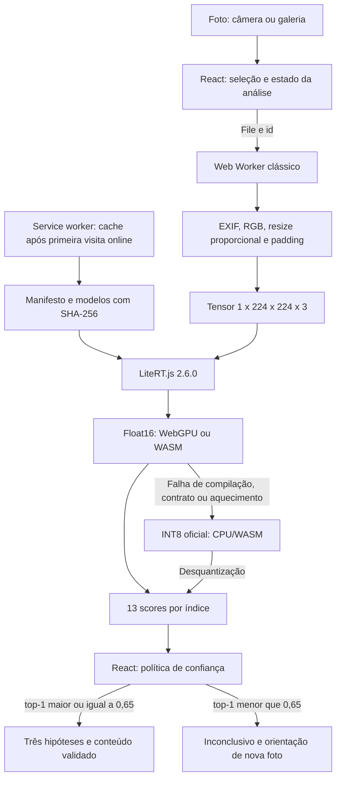

# T14.4 — Arquitetura final e integração web

Autora: Karol · Revisor: Rui · Meta de entrega: a definir.
Documentação implementada em 17/11/2026; revisão técnica de Rui em 18/11/2026. O alcance das verificações está registrado ao final do guia.

## Fluxo do MVP 1.0.0



A foto é processada no navegador, sem backend de inferência ou upload. O download inicial inclui interface, modelos e runtime. O service worker é diferente do worker de inferência: mantém arquivos para acesso offline.

## Componentes e responsabilidades

| Componente | Responsabilidade |
| --- | --- |
| [App.tsx](../frontend/src/App.tsx) | Captura/galeria, estados, IDs de requisição, cancelamento e apresentação |
| [preprocess.ts](../frontend/src/lib/preprocess.ts) | Validação, orientação EXIF, RGB8, resize, padding, normalização/quantização |
| [inference.worker.ts](../frontend/src/lib/inference.worker.ts) | Download com hash, inicialização única, aquecimento, tensores, inferência e liberação de memória |
| [confidence.ts](../frontend/src/lib/confidence.ts) | Aplicação da política versionada e validação dos scores |
| [types.ts](../frontend/src/types.ts) | Contratos das mensagens, manifesto, tensores e previsões |
| [model-sources.json](../frontend/model-sources.json) | Origens e contratos dos modelos/classes, papéis e versão |
| [prepare-assets.mjs](../frontend/scripts/prepare-assets.mjs) | Confere decisão, hashes, classes e tensores; prepara modelos, WASM e worker |
| [content.ts](../frontend/src/data/content.ts) | Catálogo por índice, fontes e estado de validação do conteúdo técnico |
| [sw.js](../frontend/scripts/sw.js) e [vite.config.ts](../frontend/vite.config.ts) | Pré-cache e atualização do pacote offline por build |

## Contrato de entrada, saída e mensagens

A interface envia `init` com `base`, ou `analyze` com `id` e `file`. O worker responde `status`, `ready`, `result` ou `error`, conforme [types.ts](../frontend/src/types.ts). Uma análise por vez; o modelo compilado é reutilizado. O resultado contém previsões associadas às classes por índice, dimensões originais, preview e tempos `preparationMs`/`inferenceMs`. A UI usa o ID para evitar apresentar respostas de análises antigas.

Aceitam-se JPEG, PNG e WebP opacos, até 10 MiB e 40 megapixels. Aplica-se EXIF uma vez; ICC é explicitamente ignorado para preservar os RGB8 codificados, conforme o contrato Python. O resize proporcional bicúbico com antialiasing mantém a imagem inteira, completa com RGB `(128,128,128)` e produz 224 × 224. Transparência é recusada. Referência: [preprocessamento Python](../src/preprocessamento.py) e seções 10.2/10.3 de [Projeto.md](Projeto.md).

Float16 recebe float32 `[1,224,224,3]` em `[0,1]` e retorna float32 `[1,13]`. INT8 recebe a mesma imagem normalizada, quantizada por escala/zero point do manifesto, em int8 `[1,224,224,3]`, e retorna int8 `[1,13]`, desquantizado antes de ordenar ou aplicar a política. A normalização interna ImageNet pertence ao grafo e não deve ser repetida no JavaScript. São exigidos 13 scores finitos em `[0,1]`; a associação usa a ordem exata de [classes.json](../assets/modelos/candidato_T5_6_20261026/classes.json).

## Modelos, runtime e contingência

A [decisão T8.3](../assets/data/selecao_T8_3/decisao.json) define Float16 T7.2 (6.833.548 bytes) como principal e INT8 T7.3 (4.003.624 bytes) como contingência. Links e métricas estão em [T14.3](T14_3_Avaliacao_Conversao.md). FP32 e INT8 antigo T5.6 não entram no pacote web.

O empacotador gera `manifest.json` e cópias `*_web.tflite`: fixa somente as dimensões dinâmicas das assinaturas nas formas já alocadas de batch 1. Preserva pesos, operadores e quantização. Registra hashes originais e web, contratos e classes. O navegador verifica SHA-256 antes de compilar; o build recusa divergência da decisão oficial.

O worker clássico permite `importScripts` do carregador Emscripten. Float16 tenta WebGPU quando disponível e depois WASM; INT8 usa CPU/WASM com uma thread. O runtime é `@litertjs/core` 2.6.0, servido na mesma origem. A interface só fica pronta após conferir tipos/formas e executar aquecimento.

A troca automática para INT8 acontece se o principal não compilar, apresentar contrato incompatível ou falhar no aquecimento, após esgotar seus aceleradores. Download ou hash inválido gera erro e opção de recarregar; não provoca troca silenciosa. A interface identifica a contingência. Falhas numa análise já iniciada retornam erro, sem política automática de troca por foto.

A decisão T8.3 também prevê contingência por p95/memória no aparelho de referência. Isso exige medição e decisão explícita de configuração; o código atual não troca modelo automaticamente pelo tempo de uma única inferência. Não confundir essa condição operacional com o fallback de compatibilidade implementado.

## Confiança e hipóteses

A [política T6.5](../assets/data/politica_T6_5/parametros.json) está incorporada no bundle. Se top-1 for maior ou igual a 0,65, exibe três hipóteses em ordem decrescente, com desempate pelo menor índice. Só top-1 precisa atingir o limiar; não se arredonda antes da comparação. Se ficar abaixo, mantém a imagem e pede nova foto, sem exibir classes, scores ou conteúdo da análise; limpa seleção anterior. A consulta independente ao catálogo permanece disponível.

A regra vale também para INT8 após desquantização. O limiar foi calibrado em Keras FP32: não implica recalibração dos artefatos convertidos, diagnóstico confirmado ou detecção de imagens fora das classes. Conteúdo técnico só é exibido quando validado e associado ao índice correto; na ausência, mostra indisponibilidade.

## Execução e verificação

Requer Node.js compatível com Vite 7 e npm (use Node 22.12+). Na raiz:

```powershell
cd frontend
npm.cmd ci
npm.cmd run dev
```

`predev` e `prebuild` executam `assets`. Abra a URL impressa no terminal. Para gerar e servir o pacote:

```powershell
npm.cmd test
npm.cmd run build
npx.cmd playwright install chromium
npm.cmd run test:e2e
```

Depois dos testes, `npm.cmd run preview` inicia o servidor para navegação manual e ocupa o terminal até ser encerrado. A comparação completa de inferência é ativada com `MODEL_COMPARISON=1`, após preparar suas referências.

Para conferir novamente os dois modelos contra Python, use o ambiente de T14.2 e inicie na raiz do repositório. Execute em checkout dedicado, pois os geradores atualizam as referências fotográficas/sintéticas versionadas e o comando `relatorio` atualiza o JSON comparativo histórico.

```powershell
Push-Location frontend
npm.cmd run assets
Pop-Location
& $python frontend/scripts/generate-reference.py
& $python -m src.comparacao_preprocessamento_t10_2 referencia

Push-Location frontend
Remove-Item Env:DEMO_PREVIEW -ErrorAction SilentlyContinue
$env:MODEL_COMPARISON = "1"
npm.cmd run test:e2e -- --project chromium
Remove-Item Env:MODEL_COMPARISON
Pop-Location

& $python -m src.comparacao_preprocessamento_t10_2 relatorio
```

`generate-reference.py` gera as referências sintéticas e confere a equivalência Python entre os modelos originais e as cópias web. `comparacao_preprocessamento_t10_2 referencia` prepara `frontend/.work/model-comparison-python.json` e o corpus fotográfico com os casos de fronteira. Os testes gravam os resultados web e as diferenças de pixels. O comando `relatorio` combina essas saídas e registra os efeitos de preprocessing e delegates. O corpus de regressão possui entradas controladas e serve para conferir correspondência entre ambientes.

A comparação fotográfica acima usa o servidor de desenvolvimento do projeto `chromium`, onde o worker temporário do teste é interceptado pelo Playwright. No preview com cache ativo, o service worker pode interceptar essa requisição e impedir o carregamento do worker de teste. Para uma comparação adicional no preview, isole o teste com `serviceWorkers: 'block'` na configuração do Playwright. Os testes offline usam sua própria sessão com service worker habilitado.

Para gerar uma versão preservada e conferir sua integridade, inicie na raiz do repositório.

```powershell
cd frontend
npm.cmd run demo:package
npm.cmd run demo:verify -- .work/demo/IDENTIFICADOR_GERADO/site
```

Substitua `IDENTIFICADOR_GERADO` pela pasta informada pelo empacotador. Publique a pasta `site` integralmente em HTTPS e preserve seu `release.json`, arquivo compactado e checksum. Detalhes de publicação e testes estão em [frontend/README.md](../frontend/README.md).

## Offline e limitações

O build registra service worker e pré-carrega app, fontes, ambos os modelos e variantes WASM (aproximadamente 60 MB no conjunto). Aguarde a indicação de disponibilidade offline antes de desconectar. Falha de cota/rede indica indisponibilidade; primeiro acesso sem rede não funciona. Novo build troca o cache. Desenvolvimento com `npm run dev` não registra esse worker. Use HTTPS para publicação e câmera; localhost serve para desenvolvimento.

Validação automatizada histórica: Chromium no Windows e viewport móvel; ainda requer comprovação em Android físico e outros navegadores. Latência de sessão não é benchmark do aparelho-alvo. Tamanho do `.tflite` não representa download total ou RAM, e WebGPU depende do navegador/dispositivo. O teste histórico já foi consultado e a independência de avaliação permanece uma limitação. Ao atualizar modelo, política ou preprocessing, regenere assets/referências, compare ambos os formatos e registre nova decisão de versão antes de publicar.

## Alcance da revisão

Foram conferidos os componentes e contratos contra o código atual, os caminhos dos scripts e a sequência de geração das referências. A revisão incluiu o build e os 12 testes automatizados de navegador, com a comparação completa Float16/INT8 ativada e os dois casos offline. A checagem adicional dos dois testes comparativos no preview passou com o service worker bloqueado em uma configuração temporária de revisão. O ensaio em dispositivo físico e a validação por participante externo exigem registros próprios.
